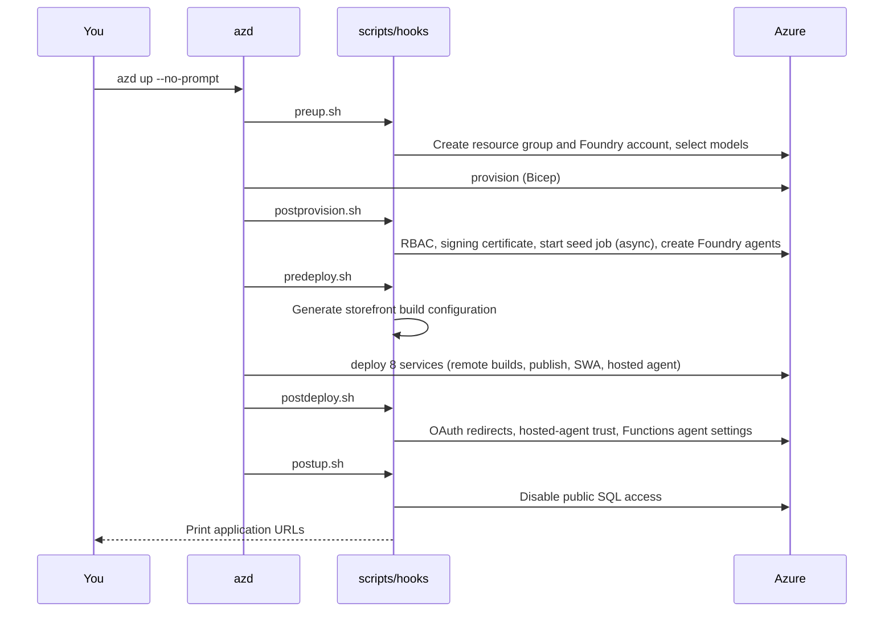

# Deploy and explore AdventureWorks

This quickstart deploys the whole AdventureWorks demo — three web apps, the APIs, the OAuth/MCP
server, Microsoft Foundry agents and all supporting Azure resources — into your own subscription with
one Azure Developer CLI (azd) command, then shows you how to sign in and explore it. You do not need to
run anything locally.

> **Demo / proof-of-concept only.** Each environment is disposable. Change the source or Bicep and
> redeploy rather than repairing resources by hand, and delete the environment when you are done.

For the full hook-by-hook explanation, see [Deployment](docs/operations/deployment.md). If your
subscription only allows deployment from GitHub, the optional
[GitHub Actions service-principal workflow](.github/workflows/README.md#azd-up-service-principalyml)
runs the same `azd up` hooks after administrator setup.

## 1. Prerequisites

| Requirement | Notes |
| --- | --- |
| Azure subscription | With quota for Azure SQL, Container Apps, Flex Consumption Functions and Foundry models in your chosen regions |
| Deployer permissions | Contributor plus a conditioned role-assignment role — see [Deployer permissions](docs/AZD_DEPLOYER_PERMISSIONS.md) and [infra/README.md](infra/README.md) |
| Azure Developer CLI (azd) 1.39.1 or later | Plus the `azure.ai.agents` extension (`azd extension install azure.ai.agents`), used to deploy the hosted Manufacturing agent |
| Azure CLI (`az`) | Used by the deployment hooks |
| Node.js and npm | Builds the storefront |
| .NET 10 SDK | Publishes the Functions app and hosted agent |
| Git LFS | Pulls the seed data and product images used by the seed job |
| Docker | Optional; container images are built remotely in Azure Container Registry |

The repository's GitHub Codespace / dev container already includes these tools — see
[Dev container](docs/operations/dev-container.md). On Windows, see
[WSL deployment](docs/operations/wsl-deployment.md).

## 2. Create an azd environment

Fork or clone the repository, open a terminal at the repository root and sign in:

```bash
az login --tenant <your-tenant-id>
azd auth login
azd env new <your-environment-name>
azd env set AZURE_SUBSCRIPTION_ID <your-subscription-id>
azd env set AZURE_LOCATION eastus2
azd env set FOUNDRY_LOCATION swedencentral
```

The resource group is named `rg-<your-environment-name>`. `AZURE_LOCATION` hosts the application
resources and `FOUNDRY_LOCATION` hosts Microsoft Foundry and its model deployments.

### Optional: choose the AI models

By default the `preup` hook discovers which chat, embedding and image models have quota in
`FOUNDRY_LOCATION` and picks one of each. You can steer chat-model selection with:

| Setting | Effect |
| --- | --- |
| `CHAT_MODEL_COST_TIER` | `economy`, `balanced` (default) or `premium` |
| `CHAT_MODEL_NAME_REGEX` | Restrict candidates to matching model names |
| `CHAT_MODEL_MIN_CAPACITY` | Minimum deployable capacity (default `1`) |

For example, `azd env set CHAT_MODEL_COST_TIER economy` before `azd up`. Let the hook discover
the model versions, SKUs and capacities rather than setting them by hand: the hook also prepares
other environment values on a fresh environment.

The image model is optional: when no image quota is available the demo deploys without AI image
generation.

## 3. Deploy with `azd up`

```bash
azd up --no-prompt
```

Always pass `--no-prompt` so the run is unattended. Deployment time varies with region and quota;
infrastructure provisioning alone takes around 20 minutes.

`azd up` provisions the Bicep templates in `infra/` and deploys eight services defined in `azure.yaml`:
`app` (Static Web App), `app-admin`, `app-manufacturing`, `mcp-inspector`, `api` (Data API Builder) and
`api-mcp` (Container Apps), `api-functions` (Flex Consumption) and `manufacturing-agent` (Foundry hosted
agent). Bash lifecycle hooks in `scripts/hooks/` run around those steps:



| Hook | What it does |
| --- | --- |
| `preup.sh` | Persists your subscription and identity, creates the resource group and Foundry account, and selects AI models with available quota. |
| `postprovision.sh` | Reports legacy runtime role assignments, creates the OAuth signing certificate in Key Vault, builds the seed-job image and starts the seed job asynchronously, grants Foundry permissions and creates the Foundry agents. |
| `predeploy.sh` | Writes `app/.env.production` (API, Functions, MCP and Application Insights URLs) and renders the Static Web App configuration. |
| Service hooks | Configure DAB, Functions and the storefront after each deploys. |
| `postdeploy.sh` | Publishes the hosted Manufacturing agent endpoint, trusts its identity in api-mcp, configures OAuth redirect URIs and refreshes Functions agent settings. |
| `postup.sh` | Ensures the hosted agent exists, disables public network access to Azure SQL and removes the temporary client firewall rule, then prints the URLs. |

Database users and permissions for the runtime identity are created by the seed job, which connects
over the private network. Details: [Deployment](docs/operations/deployment.md).

## 4. Wait for the seed job

The seed job is a Container Apps job that loads the AdventureWorks schema and data, around 1,800
AI-generated product images and the demo extensions (vector embeddings, translations, manufacturing
content and real-time triggers). It starts during `postprovision` and keeps running after `azd up`
finishes — usually 8–15 minutes.

Check progress in either of these ways:

- Open the storefront **`/health`** page (printed by `postup`). Its data section shows the seed status
  reported by the Functions endpoint `GET /api/seed/status`.
- List job executions with the Azure CLI:

  ```bash
  az containerapp job execution list \
    --name "$(azd env get-value SERVICE_SEED_JOB_NAME --no-prompt)" \
    --resource-group "$(azd env get-value AZURE_RESOURCE_GROUP --no-prompt)" \
    --output table
  ```

Wait for the job to succeed before exploring data-backed features. See
[seed-job/README.md](seed-job/README.md) for what it loads.

## 5. Sign in and explore

Print the application URLs at any time:

```bash
bash scripts/utilities/list-app-urls.sh
```

| App | Who signs in | Demo identity |
| --- | --- | --- |
| Storefront | Shoppers — browse anonymously or create an account with **Sign up** | Your own new consumer account |
| Admin portal | Employees | Ken Sánchez, `ken0@adventure-works.com` (role `executive-admin`) |
| Manufacturing portal | Manufacturing staff | Peter Krebs, `peter0@adventure-works.com` (role `manufacturing-engineer`) |
| MCP Inspector | Developers exploring MCP tools | Signs in through api-mcp OAuth with a demo identity |

Ken and Peter are the seeded demo sign-ins; the admin and manufacturing login pages offer them as
click-to-fill demo identities. Container Apps scale to zero, so the first request after an idle period
can take a few seconds.

Next steps:

- Follow the [demo walkthrough](docs/overview/demo-walkthrough.md) for a guided 15–30 minute tour.
- Call protected APIs from scripts with
  [authenticated deployment scripts](docs/testing/AZURE_AUTHENTICATED_SCRIPTS.md)
  (`scripts/utilities/azure-auth.py`).
- Browse the [feature catalog](docs/overview/feature-catalog.md) or the
  [documentation hub](docs/README.md).

## 6. Update, recreate and remove

- **Deploy code changes** to the existing environment with `azd deploy --no-prompt` (optionally naming
  a service, for example `azd deploy api-functions --no-prompt`).
- **Recreate the environment** when a change needs new infrastructure or a fresh database. This is a
  user-run operation that permanently deletes the current environment and its data; the exact command
  is in [.github/copilot-instructions.md](.github/copilot-instructions.md#azure-environment-policy-demopoc-only).
  AI coding agents must not run it.
- **Idle cost:** resources are not shut down automatically. Two always-ready Functions instances run
  the SQL change listeners, which also keep the serverless database (60-minute auto-pause) from
  pausing. Remove everything when finished:

  ```bash
  azd down --no-prompt
  ```

  Add `--purge` to also purge soft-deleted Key Vault and Foundry resources.

If something fails, see [Troubleshooting](docs/operations/troubleshooting.md).
