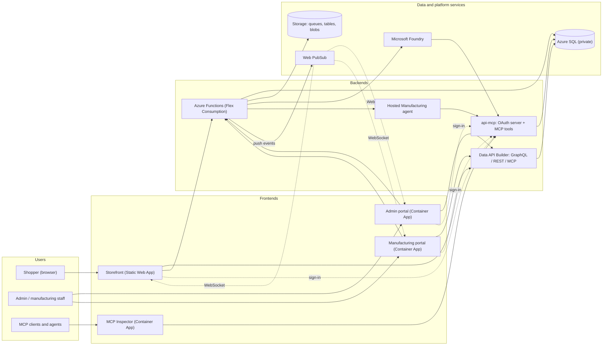
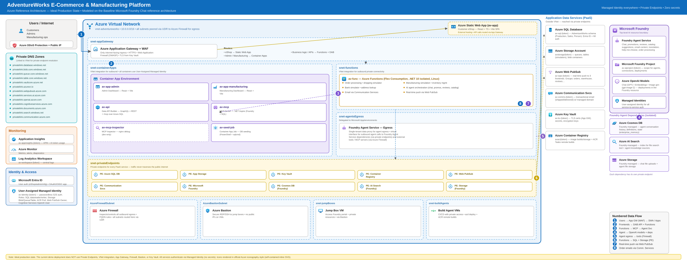

# AdventureWorks: Azure AI e-commerce & manufacturing demo

AdventureWorks is a complete, deployable Azure demo that turns the classic
[AdventureWorks sample database](https://learn.microsoft.com/sql/samples/adventureworks-install-configure)
into a modern, AI-powered business: a public online bike shop, a back-office admin portal and a
manufacturing / supply-chain portal, all sharing one Azure SQL database. It shows how Data API Builder,
Azure Functions, a self-contained OAuth 2.1 + Model Context Protocol (MCP) server, Microsoft Foundry
agents and Azure Web PubSub fit together with managed identities and private networking — and it all
deploys with a single `azd up`.

> **Demo / proof-of-concept only.** This repository is a learning and demonstration asset, not a
> production system. Every Azure environment it creates is disposable. See
> [What the demo demonstrates](docs/overview/what-it-demonstrates.md) for the patterns shown and the
> simplifications accepted for a demo.


_[Watch the full video](docs/adventureworks-demo.webm) (25 seconds)._

## What you can explore

A one-line tour of the main capabilities. The [feature catalog](docs/overview/feature-catalog.md)
lists every user-visible feature with its route, backend and documentation page.

- **Storefront** ([docs](docs/apps/storefront.md)) — catalog browsing in 23 locales and multiple
  currencies, AI semantic search, a "Help me choose" product wizard, product comparison, guest cart
  that merges on sign-in, checkout, order tracking, PDF receipts, returns and a signed-in AI shopping
  assistant.
- **Admin portal** ([docs](docs/apps/admin-portal.md)) — dashboard with an AI business assistant,
  product and category management with AI-generated copy, images and translations, customers, orders
  and the simulated order pipeline, review moderation, AI promotions, profitability reports, and an
  AI-driven shopping simulator that generates realistic orders.
- **Manufacturing portal** ([docs](docs/apps/manufacturing-portal.md)) — seven stages (Define,
  Engineer, Plan, Execute, Supply, Receive, Warehouse) covering bills of materials, routings, work
  orders, a live shop-floor simulation, purchase orders, inventory, costing, warehouse operations and a
  bank/finance view.
- **AI and agents** ([docs](docs/architecture/ai-architecture.md)) — 21 Microsoft Foundry agents
  (prompt, workflow and intent agents) plus a hosted Manufacturing agent that can observe, propose or
  autonomously act on production and procurement, with human approval of proposals.
- **MCP server** ([docs](docs/services/api-mcp.md)) — 63 MCP tools with per-tool OAuth scopes,
  ownership checks and confirmation prompts for destructive actions; explore them with the bundled
  [MCP Inspector](docs/apps/mcp-inspector.md).
- **Real-time updates** ([docs](docs/architecture/realtime-eventing.md)) — server mutations push events
  through Azure Web PubSub so all three apps refresh instantly, with no polling.
- **Identity** ([docs](docs/architecture/identity-and-auth.md)) — passwordless managed identities for
  every Azure resource, and audience-bound OAuth tokens for application users.

## Architecture at a glance



The demo deploys these Azure services (details in
[System overview](docs/architecture/system-overview.md) and
[Azure resources](docs/reference/azure-resources.md)):

- **Frontends:** the storefront on Azure Static Web Apps; the admin portal, manufacturing portal and
  MCP Inspector on Azure Container Apps.
- **Data API Builder (DAB)** on Container Apps — GraphQL, REST and an MCP endpoint over the
  AdventureWorks schema, with JWT role-based permissions.
- **Azure Functions on Flex Consumption** — 245 .NET 10 isolated-worker functions (HTTP, queue, timer,
  SQL-trigger and Durable) for business logic, AI calls and simulations. Two always-ready instances
  host the SQL change listeners.
- **api-mcp** on Container Apps — a self-contained OpenIddict OAuth authorization server that signs
  in AdventureWorks database users and issues resource-bound tokens, plus the MCP server with 63 tools.
- **Microsoft Foundry** — chat and embedding model deployments, 21 agents and the hosted Manufacturing
  agent.
- **Platform services** — Azure SQL Database (serverless, private endpoint only), Storage (queues,
  tables, blobs, file share), Web PubSub, Azure Communication Services email, Key Vault (OAuth signing
  certificate), Container Registry, Application Insights and Log Analytics.
- **Networking** — a virtual network with private endpoints for SQL, Storage and Key Vault;
  Container Apps and Functions are VNet-integrated.
- **Seed job** — a Container Apps job that loads the AdventureWorks data, AI-generated product images
  and demo extensions after provisioning.

### Ideal production reference architecture

The diagram below is the **target production architecture** for a solution like this, modeled on the
[Baseline Microsoft Foundry chat reference architecture](https://learn.microsoft.com/azure/architecture/ai-ml/architecture/baseline-openai-e2e-chat).
The demo already implements its virtual network, private endpoints and managed identities; the
reference adds production edge and egress controls (such as Application Gateway with WAF and Azure
Firewall) that a demo does not need.



## azd services

`azure.yaml` defines eight services, all deployed by `azd up` / `azd deploy`:

| Service | Folder | Azure host | Purpose |
| --- | --- | --- | --- |
| `app` | [`app/`](app/README.md) | Static Web App | Public storefront (React + Vite) |
| `app-admin` | [`app-admin/`](app-admin/README.md) | Container App | Back-office admin portal |
| `app-manufacturing` | [`app-manufacturing/`](app-manufacturing/README.md) | Container App | Manufacturing and supply-chain portal |
| `mcp-inspector` | [`mcp-inspector/`](mcp-inspector/README.md) | Container App | Browser MCP Inspector for api-mcp and DAB MCP |
| `api` | [`api/`](api/README.md) | Container App | Data API Builder (GraphQL / REST / MCP) |
| `api-functions` | [`api-functions/`](api-functions/README.md) | Function App (Flex Consumption) | Business logic, AI, simulations, real-time push |
| `api-mcp` | [`api-mcp/`](api-mcp/README.md) | Container App | OAuth authorization server and MCP tools |
| `manufacturing-agent` | [`manufacturing-agent/mcp-tools/`](manufacturing-agent/mcp-tools/README.md) | Foundry hosted agent | Autonomous manufacturing agent |

The [seed job](seed-job/README.md) is provisioned by Bicep and started by a deployment hook; it is not
an azd service.

## Repository layout

| Path | Contents |
| --- | --- |
| `app/`, `app-admin/`, `app-manufacturing/` | The three React + TypeScript + Vite frontends |
| `mcp-inspector/` | MCP Inspector container with an authenticating gateway |
| `api/` | Data API Builder configuration and container |
| `api-functions/`, `api-functions.Tests/` | Azure Functions app and its tests |
| `api-mcp/` | OAuth server, MCP tools and tests |
| `manufacturing-agent/` | Hosted Manufacturing agent (Foundry `azure.ai.agent`) |
| `workflows/` | Foundry workflow agent definitions |
| `seed-job/` | Database seed container, SQL scripts and CSV data |
| `infra/` | Bicep modules and the least-privilege deployer role |
| `scripts/` | azd hooks, Foundry agent creation, utilities, data-management exports and data generators |
| `tests/` | Auth, script and end-to-end test suites |
| `docs/` | Documentation, demo video and architecture diagram |

`scripts/generators/` holds one-off data generators used to build the seed data: category,
subcategory, product-name and special-offer translations, review embeddings, reviews with embeddings
and component costs. See [scripts/README.md](scripts/README.md).

## Deploy it

You need an Azure subscription, the Azure Developer CLI (azd) with the `azure.ai.agents` extension,
the Azure CLI, Node.js and the .NET 10 SDK. Then:

```bash
azd env new adventureworks123
azd env set AZURE_LOCATION eastus2
azd env set FOUNDRY_LOCATION swedencentral
azd up --no-prompt
```

The [Quickstart](QUICKSTART.md) covers prerequisites, deployer permissions, what each deployment hook
does, monitoring the asynchronous seed job, demo sign-ins and clean-up.

**Idle cost:** the environment is not free when idle. Two always-ready Flex Consumption instances run
the SQL change listeners, which also keep the serverless database from auto-pausing. Run
`azd down --no-prompt` when you are finished.

## Documentation

| Start here | |
| --- | --- |
| [Quickstart](QUICKSTART.md) | Deploy, sign in and explore |
| [Demo walkthrough](docs/overview/demo-walkthrough.md) | A scripted 15–30 minute demo |
| [What it demonstrates](docs/overview/what-it-demonstrates.md) | Azure patterns shown and demo simplifications |
| [Feature catalog](docs/overview/feature-catalog.md) | Every feature, route and backend |
| [System overview](docs/architecture/system-overview.md) | Components and how they connect |
| [Storefront](docs/apps/storefront.md) · [Admin portal](docs/apps/admin-portal.md) · [Manufacturing portal](docs/apps/manufacturing-portal.md) · [MCP Inspector](docs/apps/mcp-inspector.md) | The four user interfaces |
| [Documentation hub](docs/README.md) | All documentation by topic |
| [Glossary](docs/glossary.md) | Terms used across the docs |
| [llms.txt](llms.txt) | Machine-readable index for AI agents |

## How it was built

Everything in this repository — code, infrastructure, scripts, tests and documentation — was created
with AI assistance using GitHub Copilot in agent mode.

## License

See [LICENSE](LICENSE).
