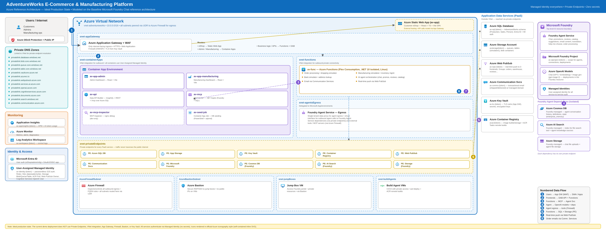

# AdventureWorks documentation hub

This hub lists every page of the AdventureWorks Azure AI e-commerce and manufacturing demo
documentation. New to the project? Read the [project README](../README.md), deploy with the
[Quickstart](../QUICKSTART.md), then follow the [demo walkthrough](overview/demo-walkthrough.md).
Unfamiliar terms are defined in the [glossary](glossary.md).

## 1. Start here

- [Project README](../README.md) — what the demo is, feature tour, architecture and quick deploy.
- [Quickstart](../QUICKSTART.md) — deploy with `azd up`, wait for seeding, sign in and explore.
- [Demo walkthrough](overview/demo-walkthrough.md) — scripted 15–30 minute tour across all three apps.

## 2. Overview

- [What the demo demonstrates](overview/what-it-demonstrates.md) — Azure patterns shown and simplifications accepted for a demo.
- [Feature catalog](overview/feature-catalog.md) — every user-visible feature with app route, backend and doc link.
- [Glossary](glossary.md) — definitions of DAB, OAuth, MCP, agent, manufacturing and deployment terms.

## 3. Architecture

- [System overview](architecture/system-overview.md) — components, hosting and how they connect end to end.
- [Request flows](architecture/request-flows.md) — sequence diagrams for sign-in, checkout, order processing and agent runs.
- [Real-time eventing](architecture/realtime-eventing.md) — Web PubSub push, outbox listener and polling-free frontends.
- [Data stores](architecture/data-stores.md) — Azure SQL schema, Storage queues/tables/blobs and Durable Functions state.
- [Identity and authentication](architecture/identity-and-auth.md) — managed identities, OAuth tokens, scopes, roles and categories.
- [AI architecture](architecture/ai-architecture.md) — Foundry models, prompt agents, hosted agent and MCP tools.
- [Networking](architecture/networking.md) — virtual network, subnets, private endpoints and public ingress.
- [DAB naming conventions](architecture/dab-naming-conventions.md) — how database tables map to GraphQL and REST names.

The diagram above shows the ideal production reference architecture; the media assets
(`AdventureWorks-Reference-Architecture.svg`, `adventureworks-demo.gif`, `adventureworks-demo.webm`)
live in this folder.

## 4. Apps

- [Storefront](apps/storefront.md) — public React shop on Static Web Apps: catalog, cart, checkout, AI.
- [Admin portal](apps/admin-portal.md) — back-office React app on Container Apps for employees.
- [Manufacturing portal](apps/manufacturing-portal.md) — seven-stage production and supply-chain app for manufacturing staff.
- [MCP Inspector](apps/mcp-inspector.md) — hosted MCP Inspector for exploring api-mcp and DAB MCP tools.

## 5. Features by domain

### Commerce

- [Catalog and browsing](features/commerce/catalog-and-browsing.md) — categories, product pages, sale, compare and recently viewed.
- [Cart and checkout](features/commerce/cart-and-checkout.md) — guest and signed-in carts, merge, checkout and order creation.
- [Order lifecycle](features/commerce/order-lifecycle.md) — simulated order statuses 1–7, pipeline timing and delivery.
- [Receipts](features/commerce/receipts.md) — PDF receipt generation, private storage and download.
- [Promotions](features/promotions/promotions.md) — special offers, AI-generated promotions and auto-promotions.
- [SEO](features/seo/seo.md) — meta tags, structured data, robots.txt and sitemap.

### Customers

- [Accounts and sign-in](features/customers/accounts-and-sign-in.md) — consumer sign-up, sign-in, profile, addresses and payment methods.
- [Passwords and reset](features/customers/passwords-and-reset.md) — password hashing, change and reset flow.
- [Email notifications](features/email/email-notifications.md) — order confirmation, shipped/delivered and admin emails via ACS.
- [Localization](features/i18n/localization.md) — 23 storefront languages, AI translation and currencies.

### Content and AI

- [Foundry agents](features/ai/foundry-agents.md) — catalog of Foundry agents, their tools and callers.
- [AI chat](features/ai/ai-chat.md) — storefront shopping assistant and admin business assistant.
- [AI content generation](features/ai/ai-content-generation.md) — AI product copy, images, customers, categories and translations.
- [Product reviews](features/reviews/product-reviews.md) — reviews, AI generation, verified reviews and moderation.
- [Semantic search](features/search/semantic-search.md) — vector search and suggestions over SQL embeddings.
- [Help me choose](features/search/help-me-choose.md) — AI questionnaire that recommends products.

### Manufacturing and supply

- [Manufacturing overview](features/manufacturing/manufacturing-overview.md) — seven-stage model, products, BOMs and routings.
- [Production simulation](features/manufacturing/production-simulation.md) — work-order operations, scrap, workforce and timing.
- [Planning and feasibility](features/manufacturing/planning-and-feasibility.md) — demand, shortages, feasibility, costing and reorder advice.
- [Manufacturing content](features/manufacturing/manufacturing-content.md) — instructions, diagrams and part sheets with illustrations.
- [Manufacturing agent](features/manufacturing/manufacturing-agent.md) — agent modes, runs, proposals and approvals.
- [Supply chain](features/supply-chain/supply-chain.md) — vendors, quotes, purchase orders and receiving.
- [Warehouse operations](features/warehouse/warehouse-operations.md) — simulated store, retrieve and receive operations with damage.

### Simulators and finance

- [Shopping simulator](features/simulators/shopping-simulator.md) — AI-generated consumer and B2B orders with auto-stop.
- [Simulator controls](features/simulators/simulator-controls.md) — start, stop, reset and tune the simulations.
- [Bank simulator](features/finance/bank-simulator.md) — simulated accounts and transactions driven by orders and purchases.
- [Reporting](features/finance/reporting.md) — sales, profitability, inventory and customer reports.

## 6. Security and identity

- [Identity and authentication](architecture/identity-and-auth.md) — overview of user OAuth and Azure workload identities.
- [MCP OAuth](features/mcp-oauth/README.md) — api-mcp authorization server, clients, grants and resource tokens.
- [MCP tool scope matrix](features/mcp-oauth/TOOL_SCOPE_MATRIX.md) — required scope and access rules for each MCP tool.
- [Functions OAuth](features/functions-oauth/README.md) — how Functions validates tokens, scopes, categories and ownership.
- [Functions route scope matrix](features/functions-oauth/ROUTE_SCOPE_MATRIX.md) — authorization tier and scope for every HTTP route.
- [End-to-end authentication](features/authentication/END_TO_END_AUTHENTICATION.md) — trust model and executable validation across all services.

## 7. Services

- [Data API builder](services/dab-api.md) — DAB GraphQL, REST and MCP over Azure SQL with role permissions.
- [Azure Functions](services/functions.md) — Flex Consumption app: triggers, scaling, configuration and structure.
- [api-mcp](services/api-mcp.md) — OAuth authorization server and MCP server with 63 tools.
- [Hosted Manufacturing agent](services/manufacturing-agent.md) — Foundry hosted agent, identity and MCP tool access.
- [Seed job](services/seed-job.md) — Container Apps job that loads data, images and demo extensions.

## 8. Operations

- [Deployment](operations/deployment.md) — azd lifecycle, hooks and redeploying service changes.
- [Deployer permissions](AZD_DEPLOYER_PERMISSIONS.md) — why Contributor is not enough and the conditioned role grant.
- [CI/CD](operations/ci-cd.md) — GitHub Actions workflows for build checks and service-principal deployment.
- [Dev container](operations/dev-container.md) — Codespaces / dev container tooling for deployment and development.
- [WSL deployment](operations/wsl-deployment.md) — deploying from Windows Subsystem for Linux.
- [Monitoring](operations/monitoring.md) — Application Insights telemetry across frontends, Functions and agents.
- [Health diagnostics](features/monitoring/HEALTH_DIAGNOSTICS.md) — readiness endpoints and the storefront `/health` page.
- [Seed data generation](operations/seed-data-generation.md) — exporting embeddings and translations into seed CSVs.
- [Troubleshooting](operations/troubleshooting.md) — common deployment and runtime problems and their fixes.

## 9. Testing

- [Testing strategy](testing/testing-strategy.md) — test suites, what they cover and how to run them.
- [Authenticated deployment scripts](testing/AZURE_AUTHENTICATED_SCRIPTS.md) — call protected APIs with `azure-auth.py` tokens.
- [AI and MCP testing guide](testing/AI_AND_MCP_TESTING_GUIDE.md) — testing Foundry agents and MCP tools.
- [AI chat MCP testing](testing/AI_CHAT_MCP_TESTING.md) — testing chat agents' delegated MCP calls.
- [Test scripts](../tests/scripts/README.md) — prerequisites and commands for the shell and Node test scripts.

## 10. Reference

- [Functions routes](reference/functions-routes.md) — every Azure Function with trigger, route and authorization.
- [DAB entities](reference/dab-entities.md) — all DAB entities, GraphQL names, roles and policies.
- [Web PubSub events](reference/webpubsub-events.md) — groups, events, producers and consuming apps.
- [Storage resources](reference/storage-resources.md) — queues, tables, blob containers and file shares.
- [Environment variables](reference/environment-variables.md) — azd outputs and per-service runtime settings.
- [Azure resources](reference/azure-resources.md) — every provisioned resource with SKU and identity.
- [Scripts](reference/scripts.md) — every script, its purpose and safe use.

Component READMEs: [app](../app/README.md) · [app-admin](../app-admin/README.md) ·
[app-manufacturing](../app-manufacturing/README.md) · [mcp-inspector](../mcp-inspector/README.md) ·
[api](../api/README.md) · [api-functions](../api-functions/README.md) · [api-mcp](../api-mcp/README.md) ·
[manufacturing-agent](../manufacturing-agent/mcp-tools/README.md) · [seed-job](../seed-job/README.md) ·
[infra](../infra/README.md) · [scripts](../scripts/README.md) · [tests](../tests/README.md) ·
[workflows](../.github/workflows/README.md).

## 11. For AI agents

- [llms.txt](../llms.txt) — machine-readable index of every documentation page with summaries.
- [Copilot instructions](../.github/copilot-instructions.md) — repository conventions and demo environment policy for coding agents.
