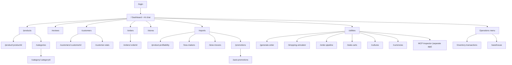
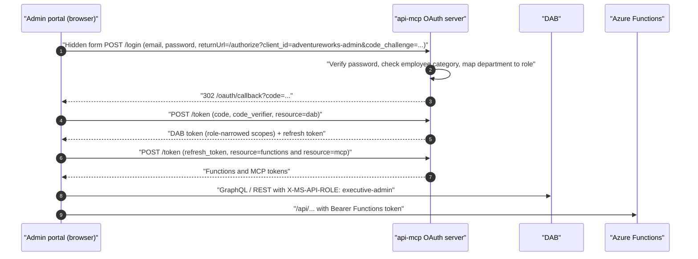

# Admin portal: AdventureWorks back-office for employees (React SPA on Azure Container Apps)

The admin portal (`app-admin/`) is the back office for AdventureWorks employees. Staff manage products, categories, customers, orders, B2B stores, reviews and promotions. They also run sales and profitability reports, watch the simulated warehouse, start the AI shopping simulator and open the MCP Inspector. It is a React + TypeScript + Vite single-page application served from an **Azure Container App**.

## Purpose and audience

| Question | Answer |
|---|---|
| Who uses it | Employees with an internal admin role: `executive-admin`, `sales-admin`, `marketing-admin`, `inventory-admin` or `operations-admin`. Customers cannot sign in. |
| What it demonstrates | Role-scoped OAuth tokens from a self-contained authorization server, DAB GraphQL and REST CRUD with role headers, AI content generation through Foundry agents (products, categories, customers, orders, promotions, reviews, emails), Durable Functions jobs, and push-driven page refreshes with Azure Web PubSub. |
| Hosting | Azure Container App `app-admin` (0.25 vCPU / 0.5 GiB, 0–3 replicas, external ingress on port 80). The image is built remotely in Azure Container Registry and serves `dist/` with `serve -s`. |
| Stack | React 18, TypeScript, Vite 5, React Router v6, React Query, shadcn/ui, `graphql-request`, `@azure/web-pubsub-client` and the Application Insights web SDK. |
| Demo identity | `ken0@adventure-works.com` (Ken Sánchez, `executive-admin`); the login page can fill it in with one click. See [authenticated scripts](../testing/AZURE_AUTHENTICATED_SCRIPTS.md) for canned identities. |

## Page map



The header navigation has **Products, Reviews, Customers, Orders, Stores, Reports and Utilities**, a **Sales** menu (Product Profitability, Loss Makers, Slow Movers, Promotions), a **Data** group (Categories) and an **Operations** group (Inv. Transactions, Warehouse). It also has a product search box (`/search`) and a user menu with sign-out. Some pages, such as Cultures, Currencies, Stale Carts, Shopping Simulator, Order Pipeline, Auto-Promotions and Generate Order, are reached through links on other pages, mainly Utilities.

## Sign-in and roles

The admin portal uses the OAuth 2.0 authorization code flow with PKCE against api-mcp. The login page posts the credentials in a hidden form to `{api-mcp}/login`. The server then continues to `/authorize` and redirects back to `/oauth/callback` with a code.

| Item | Value |
|---|---|
| OAuth client | `adventureworks-admin` (trusted first-party, so no consent screen) |
| Allowed user category | `employee` |
| Scopes requested | `offline_access mcp.access realtime.connect products.read sales.read customers.read customers.write inventory.read orders.read orders.write manufacturing.read manufacturing.write admin.read admin.write mcp.admin`. The server narrows them to the user's role. |
| Tokens held | DAB, Functions and MCP audience tokens; the first is from the code exchange and the others come from a refresh-token resource switch. Stored in `localStorage` (`dab_oauth_token`, `fn_oauth_token`, `mcp_oauth_token`) and refreshed 60 seconds before expiry. |
| Request headers | The GraphQL client adds `Authorization` and `X-MS-API-ROLE` (the first `roles` claim). A fetch interceptor adds the Functions token to calls to the Functions base URL. |
| Wrong category | Sign-in is refused with "This portal is restricted to AdventureWorks administrators." |
| Redirect URIs | Registered on api-mcp by `scripts/hooks/postdeploy.sh` from `APP_ADMIN_URL` |



**Role derivation and effective permissions.** The role comes from the employee's department. Every page loads for any admin role, but each API call is authorized by scope, so a page can show a permission error for one role and work for another.

| Department | Role | Notable scopes |
|---|---|---|
| 16 Executive | `executive-admin` | Everything the portal requests except `manufacturing.write`; it is the only role with `orders.write` (ship, begin processing, order pipeline changes) and `mcp.admin` |
| 4 Marketing | `marketing-admin` | `admin.write` (AI generation, promotions, simulator) and customer access; no `orders.read` |
| 3 Sales | `sales-admin` | Sales, customer and order reads plus `customers.write`; no `inventory.read`, `admin.write` or `orders.write` |
| 5 Purchasing, 15 Shipping and Receiving | `inventory-admin` | Read-mostly: `products.read`, `inventory.read`, `manufacturing.read` (warehouse page) and `admin.read` |
| Any other department except 7 and 8 | `operations-admin` | Sales, customer, order and inventory reads plus `customers.write`; no `admin.write` |

Departments 7 (Production) and 8 (Production Control) map to `manufacturing-engineer`. That role is in the manufacturing category, so it cannot sign in here; it uses the [manufacturing portal](manufacturing-portal.md).

Authoritative tables: [Functions route scope matrix](../features/functions-oauth/ROUTE_SCOPE_MATRIX.md), [MCP tool scope matrix](../features/mcp-oauth/TOOL_SCOPE_MATRIX.md), [DAB entities](../reference/dab-entities.md), [identity and auth](../architecture/identity-and-auth.md).

## Page-by-page tour

The `App.tsx` route table has **30 routes plus a catch-all**: `/login` and `/oauth/callback` are public and the other 28 are wrapped in `RequireAuth`. "Live" lists the Web PubSub groups that refresh the page.

### Dashboard and catalog

| Route | What the admin sees and does | Backend calls | Live |
|---|---|---|---|
| `/` | Dashboard: KPI cards (orders, customers, products, reviews to moderate), the 5 most recent orders, quick links and the **AI agent chat**. The chat answers operational questions with MCP tools and keeps conversations in the browser. This is the only page with the chat. | Functions `GET /api/reporting/dashboard-counts`; DAB GraphQL `salesOrderHeaders`; `POST /api/agent/chat` (MCP-audience token, `isAdmin: true`), `GET /api/agent/status` | `orders`, `warehouse`, `shopping-simulator` |
| `/products` | Catalog browser by category and subcategory with product counts. Create products, product models and variations, or use the AI **Generate products** wizard. | DAB GraphQL and mutations (`createProduct`, `createProductModel`, descriptions, photos); Functions `POST /api/products/generate-content`, `POST /api/TranslateProductDescriptions_HttpStart` | — |
| `/product/:productId` | Product editor: details, price, inventory, photos, localized descriptions, special offers, reviews and transaction history. AI actions: regenerate content, translate descriptions, generate images and generate verified reviews. | DAB GraphQL/REST (product entities, `ProductReview`, `transactionHistories`); Functions `POST /api/products/{id}/generate-images`, `GET /api/products/{id}/eligible-reviewer-count`, `POST /api/generate-verified-reviews/start` | `warehouse`, `reviews` |
| `/categories` | Category and subcategory management, including AI-generated categories and translated names. | Functions `POST /api/CreateCategory`, `CreateSubcategory`, `DeleteCategory`, `DeleteSubcategory`, `GenerateCategoryWithAI`, `TranslateCategoryName`, `GetSubcategoryProductCount`; DAB GraphQL lists | — |
| `/category/:categoryId` | Products in one category with photos and a reviews summary, plus a guided delete. | DAB GraphQL and mutations | — |
| `/search` | Product search over the catalog, filtered in the browser (the header search box opens it). | DAB GraphQL products, categories, subcategories | — |
| `/cultures` | Languages and localization coverage: add cultures and edit product names and descriptions per culture. | DAB GraphQL (`cultures`, `productDescriptions`, `productNames`, `productModelProductDescriptionCultures`) | `utilities` |
| `/currencies` | Currencies and exchange rates, with a refresh action. | DAB GraphQL `currencies`, `currencyRates`; Functions `POST /api/exchange-rates/refresh` | — |

### Customers, orders and stores

| Route | What the admin sees and does | Backend calls | Live |
|---|---|---|---|
| `/customers` | Customer list with total spend, filters and sorting. Generate a customer with AI, or write and send AI-generated emails to one or many customers. | DAB GraphQL `customers`, `people`, `emailAddresses`, `salesOrderHeaders`; Functions `GET /api/person-addresses`, `POST /api/customers/generate-with-ai`, `POST /api/email/generate-ai-content`, `POST /api/persons/{id}/send-email` | `orders`, `shopping-simulator` |
| `/customers/:customerId` | Customer profile: names, email addresses, phones, addresses, payment methods, orders, and a password reset or set. | DAB GraphQL/REST (`Person`, `PersonPhone`, `BusinessEntityAddress`, `PersonCreditCard`); Functions `/api/addresses`, `POST /api/password/reset/request`, `POST /api/password` | `orders` |
| `/customer-stats` | Aggregate customer statistics: totals, country and region breakdowns, monthly revenue. | Functions `GET /api/customer-stats`, `/customer-country-breakdown`, `/customer-region-breakdown`, `/customer-monthly-revenue` | `orders`, `shopping-simulator` |
| `/orders` | Order list with date filters and status tabs (Processing, Pending, Shipped, Cancelled, Delivered). Generate missing PDF receipts in bulk. | DAB GraphQL `salesOrderHeaders`; Functions `POST /api/GenerateOrderReceipts_HttpStart`, `POST /api/orders/generate-missing-receipts` | `orders`, `shopping-simulator` |
| `/orders/:orderId` | Order detail with lines and addresses. Actions: begin processing, ship, cancel, download or email the receipt. | DAB GraphQL; Functions `POST /api/orders/begin-processing-order`, `POST /api/orders/{id}/ship`, `GET /api/orders/{id}/receipt-status`, `GET /api/orders/{id}/receipt`, `POST /api/orders/generate-and-send-receipt` | `orders` |
| `/order-pipeline` | Order pipeline settings: minutes from processing to approved and hours from approved to shipped, live counts per status, and buttons to promote pending or approved orders now. | Functions `GET/PUT /api/orders/pipeline/config`, `GET /api/orders/pipeline/status`, `POST /api/orders/pipeline/promote-pending`, `POST /api/orders/pipeline/promote-approved` | `orders` |
| `/generate-order` | AI order generator: create one realistic order (with refinement) or queue a bulk batch. | Functions `POST /api/GenerateOrderWithAI`, `POST /api/GenerateOrdersBulk` | — |
| `/stores` | B2B stores: store list, territories, store order history, and **Place store order** for a reseller. | Functions `GET /api/stores`, `/api/stores/{id}`, `/api/stores/{id}/orders`, `/api/store-territories`, `/api/orders/{id}/lines`, `/api/store-products`, `/api/product-catalog`, `POST /api/store-orders` | `orders` |
| `/stale-carts` | Abandoned shopping carts grouped by customer, with an AI cart-recovery analysis and a recovery campaign simulator. | DAB GraphQL; Functions `POST /api/carts/analyze-recovery` | `orders` |

### Reviews and promotions

| Route | What the admin sees and does | Backend calls | Live |
|---|---|---|---|
| `/reviews` | Review moderation queue: approve, reply, delete, run AI analysis on a batch, or start **analyze and approve all** as a background job with progress. | DAB GraphQL `productReviews`, `productReviewReplies`; DAB REST `ProductReview`, `ProductReviewReply`; Functions `POST /api/reviews/analyze-batch`, `POST /api/reviews/moderation/start-analyze-approve-all`, `GET /api/reviews/moderation/status` | `reviews` |
| `/promotions` | Special offers and the products assigned to them. The AI **Generate promotion** wizard supports multi-turn refinement, and promotions can be translated. | DAB GraphQL `specialOffers`, `specialOfferProducts`; Functions `POST /api/GeneratePromotion`, `POST /api/TranslatePromotion` | `promotions` |
| `/auto-promotions` | Settings for automatic promotions created after a number of consumer or store orders, with counters that can be reset. | Functions `GET/PUT /api/auto-promotion/config`, `POST /api/auto-promotion/reset-counters` | `promotions`, `orders` |

### Reports and operations

| Route | What the admin sees and does | Backend calls | Live |
|---|---|---|---|
| `/reports` | Sales reports: revenue by category and territory, monthly trend, top products, orders by status, inventory by category. A channel selector switches between all orders, e-shop and B2B. | Functions `GET /api/reporting/*` (`revenue-by-category`, `monthly-trend`, `top-products`, `orders-by-status`, `revenue-by-territory`, `inventory-by-category`) | `orders`, `promotions`, `warehouse` |
| `/product-profitability` | Margins by product and category, discount impact, and a per-product drill-down with sales trends. | Functions `GET /api/reporting/product-profitability`, `profitability-by-category`, `discount-impact`, `product-profitability-detail`, `sales-trends` | `orders`, `promotions` |
| `/loss-makers` | Products with the lowest margins, with actions to change the price, discontinue, or create a clearance promotion. | Functions `GET /api/reporting/product-profitability?sortAsc=true`; DAB `updateProduct` | `orders`, `promotions` |
| `/slow-movers` | Products that sell below a threshold, with the same actions. | Functions `GET /api/reporting/slow-movers` | `orders`, `promotions` |
| `/inventory-transactions` | Inventory transaction history, with a switch to the archive table. | DAB GraphQL `transactionHistories`, `transactionHistoryArchives` | `warehouse` |
| `/warehouse` | Warehouse monitor: queue depth chart, active pick/pack/put-away operations and damage events from the warehouse simulation. | Functions `GET /api/warehouse/status`, `/api/warehouse/active`, `/api/warehouse/damage-events` | `warehouse` |
| `/shopping-simulator` | Start or stop the AI shopping simulator. Sliders set the rate (1–60 orders per minute), duration (1–72 hours, default 24), store share and consumer mix, and a results feed shows each generated order. | Functions `GET /api/shopping-simulator/status`, `POST /start`, `POST /stop`, `POST /clear-queue`, `GET /results` | `shopping-simulator` |
| `/utilities` | Hub page that links to the generators, simulator, pipeline, stale carts, cultures and currencies. It has two **MCP Inspector** deep links (custom MCP and DAB MCP) and launches the **Generate verified reviews** wizard. | Wizard: Functions `GET /api/generate-verified-reviews/summary`, `POST /start`, `GET /status` | `reviews` (wizard) |
| `/login`, `/oauth/callback` | Sign-in form with the demo identity, and the PKCE code exchange. | api-mcp `/login`, `/authorize`, `/token` | — |
| `*` | Not Found page. | — | — |

## Data access summary

| Backend | Used for |
|---|---|
| **DAB GraphQL** (`API_URL`) | Most reads (catalog, customers, orders, reviews, offers, cultures, currencies, transactions) and CRUD mutations, sent with the admin role header. |
| **DAB REST** (`API_URL` with `/graphql` replaced by `/api`) | Review approval and replies, phones, business-entity addresses, payment-method deletes. |
| **Azure Functions** (`API_FUNCTIONS_URL`) | Reporting, AI generation, orders and receipts, stores, review moderation jobs, warehouse, simulator, pipeline, exchange rates, addresses (`Person.Address` is not in DAB) and Web PubSub negotiation. |
| **api-mcp** (`API_MCP_URL`) | OAuth only. MCP tools are used by the dashboard AI chat through Functions, and interactively through the [MCP Inspector](mcp-inspector.md). |

## Live updates (Web PubSub)

`useRealTimeUpdates` is mounted at the app root. It negotiates with `GET /api/webpubsub/negotiate` using the Functions token and handles **six groups**. For each event it invalidates React Query keys and dispatches a `webpubsub` DOM event so that pages showing job status can re-read it.

| Group | Server grant (scope) | Refreshes |
|---|---|---|
| `orders` | `orders.read` or `manufacturing.read` | Orders, order lines, receipt status, stores, carts, reporting, customer stats, dashboard |
| `warehouse` | `inventory.read` | Inventory, transaction history, inventory report, dashboard, warehouse page |
| `shopping-simulator` | `admin.read` or `manufacturing.read` | Orders, customers, customer stats, dashboard, simulator page |
| `reviews` | `admin.read` | Reviews, moderation job status, verified-reviews wizard |
| `promotions` | `admin.read` | Special offers, reporting, auto-promotion counters |
| `utilities` | `admin.read` | Localization data |

The server chooses the groups for the token, so each role only receives the groups its scopes allow. For example, a `sales-admin` does not receive `warehouse` events. Status pages use `useLiveUpdates`, which:

- registers its listener before the first read;
- batches events in a fixed 250 ms window;
- runs one read at a time and keeps a follow-up when an event arrives mid-read;
- re-reads after a reconnect or when the window regains focus.

There is no polling. If the connection fails, a **Live updates unavailable** notice appears. See [real-time eventing](../architecture/realtime-eventing.md) and the [Web PubSub event reference](../reference/webpubsub-events.md).

## Runtime configuration

At container start, `app-admin/docker-entrypoint.sh` writes `/app/dist/config.js` (`window.APP_CONFIG`) from the Container App's environment variables, so the same image works in any environment. Values resolve in the order `APP_CONFIG`, then `VITE_*`, then localhost defaults.

| Key | Purpose |
|---|---|
| `API_URL` | DAB GraphQL endpoint; the REST base and DAB MCP URL are derived from it |
| `API_FUNCTIONS_URL` | Azure Functions base URL |
| `API_MCP_URL` | api-mcp base URL (OAuth) |
| `APPINSIGHTS_CONNECTIONSTRING` | Browser telemetry |
| `APP_URL` | Storefront link |
| `APP_MANUFACTURING_URL` | Manufacturing portal link |
| `MCP_INSPECTOR_URL` | Base URL for the MCP Inspector deep links on Utilities |
| `WEB_PUBSUB_HOST_NAME` | Informational; the connection URL comes from negotiation |

See the [environment variables reference](../reference/environment-variables.md).

## Telemetry

The app uses the Application Insights web SDK with the cloud role name **`app-admin`**. It tracks routes automatically and correlates requests to the GraphQL, Functions and MCP hosts. See [monitoring](../operations/monitoring.md).

## Local development

```bash
cd app-admin
npm install
npm run dev        # Vite dev server on http://localhost:8080
```

- Set `VITE_API_URL`, `VITE_API_FUNCTIONS_URL` and `VITE_API_MCP_URL` in `app-admin/.env` to the deployed values (`azd env get-value <KEY> --no-prompt`).
- api-mcp's built-in development redirect URI for this client is `http://localhost:5174/oauth/callback`. Either run Vite on port 5174 (`npm run dev -- --port 5174`) or register your local callback on api-mcp.
- Deploy changes with `azd deploy app-admin --no-prompt`. See [deployment](../operations/deployment.md).

## Tests

The admin portal has no unit test suite. Run `npm run lint` in `app-admin/`. The cross-frontend regression `node --experimental-vm-modules --test tests/scripts/test-live-updates.mjs` covers its live-update batching and its no-polling rule. To check the APIs behind the pages, use the scripted calls in [authenticated scripts](../testing/AZURE_AUTHENTICATED_SCRIPTS.md), for example:

```bash
python3 scripts/utilities/azure-auth.py request \
  --identity admin --resource functions --path /api/reporting/dashboard-counts
```

See [testing strategy](../testing/testing-strategy.md).

## Limits and scope

- The admin portal has no `/health` page. Use the storefront's `/health` page or the Functions readiness endpoint ([HEALTH_DIAGNOSTICS](../features/monitoring/HEALTH_DIAGNOSTICS.md)).
- Some background utilities have no admin UI and are started through their Functions routes instead: embedding generation, language-file translation, transaction archiving and delivery-window settings. See [Functions routes](../reference/functions-routes.md).
- The order-pipeline page edits the processing and shipping delays. Delivery windows (shipped → delivered) are configured through the API.
- AI actions call Foundry models, so each one has a cost. The shopping simulator always stops after its configured duration.

## Related feature docs

| Topic | Doc |
|---|---|
| Catalog and categories | [catalog-and-browsing](../features/commerce/catalog-and-browsing.md) |
| Orders and pipeline | [order-lifecycle](../features/commerce/order-lifecycle.md) |
| Receipts | [receipts](../features/commerce/receipts.md) |
| Reviews and moderation | [product-reviews](../features/reviews/product-reviews.md) |
| Promotions and auto-promotions | [promotions](../features/promotions/promotions.md) |
| AI content generation | [ai-content-generation](../features/ai/ai-content-generation.md) |
| AI chat | [ai-chat](../features/ai/ai-chat.md), [foundry-agents](../features/ai/foundry-agents.md) |
| Reporting | [reporting](../features/finance/reporting.md) |
| Warehouse simulation | [warehouse-operations](../features/warehouse/warehouse-operations.md) |
| Shopping simulator | [shopping-simulator](../features/simulators/shopping-simulator.md) |
| Localization | [localization](../features/i18n/localization.md) |
| MCP Inspector | [mcp-inspector](mcp-inspector.md) |
| Functions authorization | [Functions OAuth](../features/functions-oauth/README.md) |

Key code:

- `app-admin/src/App.tsx`: routes
- `app-admin/src/services/dabAuth.ts`: sign-in
- `app-admin/src/hooks/useRealTimeUpdates.ts` and `app-admin/src/hooks/useLiveUpdates.ts`: live updates
- `app-admin/src/lib/utils.ts`: runtime config
