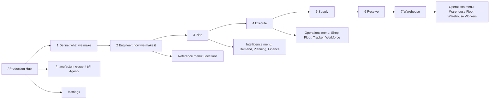
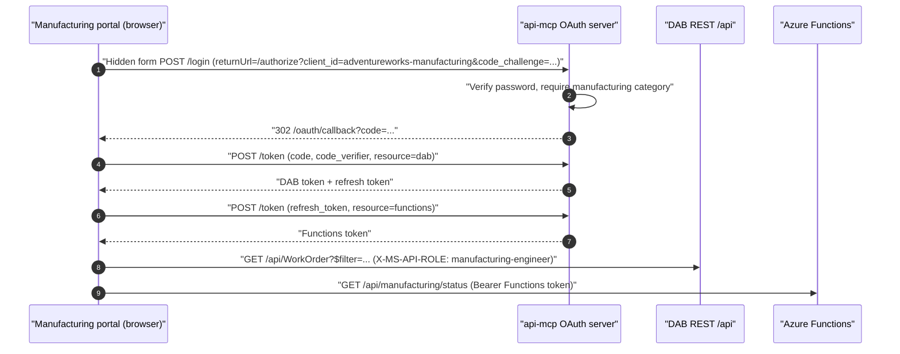
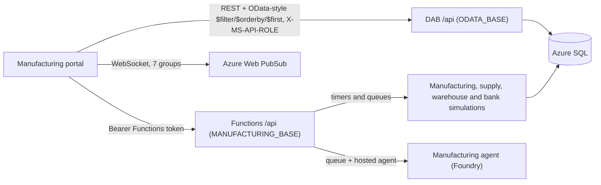

# Manufacturing portal: AdventureWorks Manufacturing Hub (React SPA on Azure Container Apps)

The manufacturing portal (`app-manufacturing/`, page title "Adventure Works | Manufacturing Hub") is the factory-floor and supply-chain app for production staff. It follows a bike from product definition, bill of materials (BOM) and routing, through work-order planning, shop-floor execution, vendor purchasing and goods receipt, to finished-goods warehousing. It also controls the autonomous **manufacturing agent**. Most of what it shows comes from simulations that run in Azure Functions. It is a React + TypeScript + Vite single-page app served from an **Azure Container App**.

## Purpose and audience

| Question | Answer |
|---|---|
| Who uses it | Production staff with the `manufacturing-engineer` role (employees in departments 7 Production and 8 Production Control). Admin employees and customers cannot sign in. |
| What it demonstrates | DAB REST with OData-style queries against `Production` and `Purchasing` tables, Functions-hosted manufacturing, supply-chain, warehouse and bank simulations, a hosted Foundry agent with human-in-the-loop approvals, manufacturing instructions with SVG illustrations, and fully push-driven screens with Azure Web PubSub. |
| Hosting | Azure Container App `app-manufacturing` (0.25 vCPU / 0.5 GiB, 0–3 replicas, external ingress on port 80). The image is built remotely in Azure Container Registry and serves `dist/` with `serve -s`. |
| Stack | React 18, TypeScript, Vite 5, React Router v6, React Query, shadcn/ui, Recharts, `@azure/web-pubsub-client` and the Application Insights web SDK. |
| Demo identity | `peter0@adventure-works.com` (Peter Krebs, Production Control Manager, `manufacturing-engineer`). The login page fills it in with one click. Scripts use `--identity manufacturing`; see [authenticated scripts](../testing/AZURE_AUTHENTICATED_SCRIPTS.md). |

## Page map

The header shows seven numbered **stage tabs**, each with a one-line description, plus secondary menus.



| Menu | Items |
|---|---|
| **Operations** | Shop Floor, Product Tracker, Workforce, Warehouse Floor, Warehouse Workers |
| **Intelligence** | Demand, Planning, Finance |
| **Reference** | Locations |
| **Admin** | AI Agent, Settings |

## Sign-in

The manufacturing portal uses the OAuth 2.0 authorization code flow with PKCE against api-mcp, like the admin portal.

| Item | Value |
|---|---|
| OAuth client | `adventureworks-manufacturing` (trusted first-party, so no consent screen) |
| Allowed user category | `manufacturing` |
| Scopes | `mcp.access realtime.connect products.read inventory.read manufacturing.read manufacturing.write offline_access` |
| Tokens | DAB token from the code exchange and a Functions token from a refresh-token resource switch. Both are kept in `localStorage`, scoped to a session generation and refreshed about 60 seconds before expiry. Web Locks serialize use of the single-use refresh token across tabs. |
| Request headers | `dabFetch` adds `Authorization` and `X-MS-API-ROLE: manufacturing-engineer`. A fetch interceptor adds the Functions token to calls to the Functions base URL. |
| Wrong category | Sign-in is refused with "This portal is restricted to AdventureWorks manufacturing staff." |
| Redirect URIs | Registered on api-mcp from `APP_MANUFACTURING_URL` by the postdeploy hook |



Any authenticated user can open every route; authorization is enforced by DAB and Functions. See [identity and auth](../architecture/identity-and-auth.md) and [mcp-oauth](../features/mcp-oauth/README.md).

## Page-by-page tour

The `App.tsx` route table has **41 routes**: `/login`, `/oauth/callback`, 38 authenticated routes and the `*` Not Found catch-all. "Live" lists the Web PubSub groups whose events refresh the page's data. Every data page shows a loading skeleton while it fetches.

### Production Hub

| Route | What the user sees and does | Backend calls | Live |
|---|---|---|---|
| `/` | Production Hub dashboard. KPIs: work-order queue depth, in progress, planned, completed today, active workers, AI agent queue, active purchase orders, material shortages, low or out-of-stock products, catalog size. Panels: active work orders, live operations, procurement and station utilization. | Functions `manufacturing/status`, `manufacturing/workforce`, `manufacturing/agent-queue-status`, `plan/catalog`; DAB REST `WorkOrder`, `WorkOrderRouting`, `PurchaseOrderHeader`/`Detail`, `ProductInventory` | `manufacturing-ops`, `supply-chain`, `warehouse`, `manufacturing-agent` |

### 1 Define: what we make

| Route | What the user sees and does | Backend calls | Live |
|---|---|---|---|
| `/define` | Manufactured finished goods (products with an active BOM and routing history), grouped by product model. Create or delete products. | DAB REST `Product`, `ProductModel`, `ProductCategory`, `ProductSubcategory`, `BillOfMaterials`, `WorkOrderRouting` | `manufacturing-ops` |
| `/define/products/:id` | Product detail with a cost roll-up for finished goods. | DAB REST `Product`, `UnitMeasure`; Functions `plan/cost/{id}`, `plan/cost/{id}/current` | `manufacturing-ops` |
| `/define/models` and `/define/models/:id` | Product models: create, edit and delete, with descriptions and member products. | DAB REST `ProductModel`, `ProductDescription` and culture links | `manufacturing-ops` |
| `/define/models/:id/instructions` | Manufacturing instructions for a model: parsed from the model's `Instructions` XML and shown as numbered steps with SVG illustrations, revision history and an enlarge dialog. | DAB REST `ProductModel`; bundled instruction content | `manufacturing-ops` |
| `/define/parts/:id/instructions` | Instruction sheet for a manufactured part or sub-assembly. | DAB REST `Product`; Functions `manufacturing/parts/{productId}/documents` | `manufacturing-ops` |

### 2 Engineer: how we make it

| Route | What the user sees and does | Backend calls | Live |
|---|---|---|---|
| `/engineer` | BOM browser: pick a product to see its component tree. | DAB REST `BillOfMaterials` (active rows have no `EndDate`), `Product` | `manufacturing-ops` |
| `/engineer/bom/:productId` | BOM editor: add or remove components. | DAB REST `BillOfMaterials` (POST, DELETE) | `manufacturing-ops` |
| `/engineer/routing/:productId` | Routing: the sequence of operations by work center, with planned hours and cost; editable. | DAB REST `WorkOrderRouting`, `Location` | `manufacturing-ops` |
| `/engineer/locations` and `/engineer/locations/:id` | Work-center locations (Reference menu) with capacity and the operations that run there. | DAB REST `Location`, `WorkOrderRouting` | `manufacturing-ops` |

### 3 Plan

| Route | What the user sees and does | Backend calls | Live |
|---|---|---|---|
| `/plan` | Work-order list (latest 500): create, edit and delete. Manual creation is disabled while the AI agent is active (`AgentControlBanner`). | DAB REST `WorkOrder`, `Product`, `ScrapReason`; Functions `POST manufacturing/begin` | `manufacturing-ops`, `manufacturing-agent` |
| `/plan/work-orders/:id` | Work-order detail with routing progress and scrap. | DAB REST `WorkOrder`, `WorkOrderRouting` | `manufacturing-ops` |
| `/plan/schedule` | Production schedule for planned and in-progress work. | DAB REST `WorkOrder`, `WorkOrderRouting` | `manufacturing-ops` |
| `/plan/demand` | **Demand** (Intelligence menu): open customer demand from unfulfilled sales orders and historical 30/90/365-day demand from shipped orders, with Schedule and Reorder actions. | DAB REST `SalesOrderHeader`, `SalesOrderDetail`; Functions `plan/feasibility`, `supply/*`, `manufacturing/begin` | `orders`, `shopping-simulator`, `manufacturing-ops` |
| `/plan/intelligence` | **Planning** (Intelligence menu): 90-day shortage forecast, material-blocked products, reorder recommendations, overstock and thin-margin lists, with a button to start a manufacturing run. | Functions `plan/catalog`, `plan/shortage-forecast`, `plan/reorder-recommendations`, `plan/overstock`, `plan/thin-margin`, `plan/feasibility`, `manufacturing/begin` | `manufacturing-ops`, `supply-chain` |
| `/plan/finance` | **Finance** (Intelligence menu): bank balance and transactions from the bank simulator, with procurement and manufacturing spend. | Functions `bank/status`, `bank/transactions`, `financials/summary`, `financials/procurement`, `financials/manufacturing` | `finance` |

### 4 Execute

| Route | What the user sees and does | Backend calls | Live |
|---|---|---|---|
| `/execute` | Manufacturing control room with tabs for locations, material shortages (with bulk reorder), active operations, scrap events and supplier quality. | Functions `manufacturing/status`, `manufacturing/scrap-events`, `manufacturing/vendor-quality`, `supply/reorder-all`; DAB REST `WorkOrderRouting` | `manufacturing-ops`, `supply-chain` |
| `/execute/shop-floor` | **Shop Floor**: operation cards per station showing what each work center is building now. | DAB REST `WorkOrder`, `WorkOrderRouting`, `Location`, `Product` | `manufacturing-ops` |
| `/execute/work-order/:id` | Work-order execution view: operations, timings and scrap. | DAB REST `WorkOrder`, `WorkOrderRouting` | `manufacturing-ops` |
| `/execute/work-order/:id/instructions` | Read-only workstation instructions, filtered to the selected operation's work center (defaults to the first unfinished operation). | DAB REST `WorkOrderRouting`, `ProductModel` | `manufacturing-ops` |
| `/execute/tracker` | **Product Tracker**: finished-good runs from the last 30 days with their sub-assembly work orders; a toast appears when a run completes. | DAB REST `WorkOrder`, `WorkOrderRouting`, `Product` | `manufacturing-ops` |
| `/execute/workforce` | **Workforce**: shop-floor workers by shift and status. | Functions `manufacturing/workforce`, `manufacturing/workforce/detail`; DAB REST active operations | `manufacturing-ops` |

### 5 Supply

| Route | What the user sees and does | Backend calls | Live |
|---|---|---|---|
| `/supply` | Supply chain: vendor KPIs, active and historical purchase orders (with cancel), a component catalog, and risk analyses (finished-good risk, supply-chain risk, vendor blockers). | DAB REST `PurchaseOrderHeader`, `PurchaseOrderDetail`, `Vendor`, `Product`, `BillOfMaterials`; Functions `supply/vendors`, `supply/catalog`, `DELETE supply/order/{id}` | `supply-chain` |
| `/supply/vendors/:vendorId` | Vendor detail: get a quote, place an order, see scrap quality and historical purchase orders. `?order=1&product=` opens the order panel directly. | Functions `supply/vendors/{id}`, `supply/quote`, `POST supply/order`, `manufacturing/vendor-quality/{id}`, `manufacturing/scrap-events?vendorId=` | `supply-chain` |
| `/supply/orders/:orderId` | Purchase-order timeline and the finished goods that use the ordered component. | DAB REST `PurchaseOrderHeader`, `PurchaseOrderDetail`, `BillOfMaterials` | `supply-chain` |
| `/supply/product/:productId` | Purchase history for a component (latest, average, min/max price, total spend) and current vendor quotes. | DAB REST purchase orders; Functions `supply/catalog/{productId}` | `supply-chain` |

### 6 Receive

| Route | What the user sees and does | Backend calls | Live |
|---|---|---|---|
| `/receive` | Inventory browser. **Reorder** splits a purchase across vendors (cheapest in-stock vendor first, within vendor minimum and maximum quantities). **Build** starts a manufacturing run, including nested sub-assembly work orders, up to the quantity the current inventory allows. | DAB REST `ProductInventory`, `Product`, `Location`; Functions `plan/catalog`, `supply/*`, `manufacturing/begin` | `warehouse`, `supply-chain`, `manufacturing-ops` |
| `/receive/inventory/:productId` | Inventory by location for one product, transaction history and a preferred-vendor quick order. | DAB REST `ProductInventory`, `TransactionHistory`; Functions `supply/*` | `warehouse`, `supply-chain` |
| `/receive/costing` | Cost analysis: a product navigator, current manufacturing cost, gross margin and a component cost breakdown with drill-down. | Functions `plan/catalog`, `plan/cost/{id}/current`; DAB REST `ProductCostHistory` | `manufacturing-ops`, `supply-chain` |
| `/receive/costing/:productId` | Cost compared with list price over time for one product. | DAB REST `ProductCostHistory`, `ProductListPriceHistory`; Functions `plan/cost/{id}/current` | `manufacturing-ops` |

### 7 Warehouse

| Route | What the user sees and does | Backend calls | Live |
|---|---|---|---|
| `/warehouse` | Finished-goods storage dashboard: throughput, queue depth, items stored and retrieved today, damage events and active operations. | Functions `warehouse/status`, `warehouse/active`, `warehouse/metrics`, `warehouse/damage-events` | `warehouse` |
| `/warehouse/floor` | **Warehouse Floor**: live store, retrieve and receive-from-supplier operations. | Functions `warehouse/active` | `warehouse` |
| `/warehouse/workforce` | **Warehouse Workers**: the three-shift warehouse team. | Functions `warehouse/workforce`, `warehouse/workforce/detail` | `warehouse` |
| `/warehouse/config` | Warehouse settings tabs: handling times per subcategory, supplier receive times, damage rates for store, retrieve and receive, and the latest 20 damage events. | Functions GET/PUT `warehouse/subcategory-config/{id}`, `warehouse/supplier-receive-config/{id}`, `warehouse/damage-config/{type}` | `warehouse` |

### Admin menu and sign-in pages

| Route | What the user sees and does | Backend calls | Live |
|---|---|---|---|
| `/manufacturing-agent` | **AI Agent** control: the agent mode (0 Off, 1 Read-Only, 2 Propose + Approve, 3 Fully Autonomous; mode 3 asks for confirmation), an auto-shutoff timer (1 h, 2 h, 4 h, 8 h, 1 d, 3 d or no limit) with a countdown, a queue card with an estimated drain time and a bottleneck warning above 20 pending items, **pending approvals** in mode 2 (approve, reject, approve all, reject all; proposals expire after 5 minutes), and an activity feed of the last 30 agent runs with their steps, tools and findings. | Functions GET/PUT `manufacturing/agent-config`, `manufacturing/agent-runs?limit=30`, `manufacturing/agent-queue-status`, `manufacturing/proposals?status=pending`, `manufacturing/proposals/{id}/approve`, `/reject`, `manufacturing/proposals/approve-all`, `/reject-all` | `manufacturing-agent` |
| `/settings` | Simulation control: stop manufacturing, reset the supply chain, initialize the supply chain. Vendor operations: supply-chain speed multiplier (1–50) and restocking a vendor. Shop-floor tuning per location: scrap rate and reasons, capacity, hours, speed, overtime and shift start. Agent queue: clear the queue and the poison queue. Also links to warehouse settings. | Functions `manufacturing/stop`, `DELETE supply/reset`, `supply/initialize`, GET/PUT `supply/config`, `supply/restock/{vendorId}`, GET/PUT `manufacturing/scrap-config/{loc}`, `manufacturing/location-config/{loc}`, `DELETE manufacturing/agent-queue`, `DELETE manufacturing/agent-queue/poison` | `manufacturing-ops`, `supply-chain`, `manufacturing-agent` |
| `/login` | Sign-in form with the Peter Krebs demo identity. | api-mcp `/login` | — |
| `/oauth/callback` | PKCE code exchange. | api-mcp `/token` | — |
| `*` | Not Found page. | — | — |

## Data access summary



| Backend | Used for |
|---|---|
| **DAB REST** (`ODATA_BASE`, which is `API_URL` without `/graphql`) | Production and purchasing tables: `Product`, `ProductModel`, `BillOfMaterials`, `WorkOrder`, `WorkOrderRouting`, `Location`, `ProductInventory`, `PurchaseOrderHeader`/`Detail`, `Vendor`, `SalesOrderHeader`/`Detail`, cost and price history. The app does not use GraphQL. |
| **Azure Functions** (`MANUFACTURING_BASE`) | Route families `manufacturing/*`, `plan/*`, `supply/*`, `warehouse/*`, `bank/*` and `financials/*`, plus Web PubSub negotiation. |
| **api-mcp** (`API_MCP_URL`) | OAuth only. The app makes no MCP tool calls and has no chat; the manufacturing agent runs on the server and is controlled through Functions. |

## Live updates (Web PubSub)

`AuthenticatedLayout` mounts `useRealTimeUpdates()`. It negotiates with `GET /api/webpubsub/negotiate` (Functions token, `realtime.connect`) and subscribes to **seven groups**. Any event in a group invalidates that group's registered React Query keys. Invalidations are batched in a fixed **2000 ms window**, and keys whose query is in flight get one follow-up refresh. Connecting or reconnecting refreshes every live key.

| Group | Query-key families it refreshes |
|---|---|
| `manufacturing-ops` | Work orders, routings, active operations, workforce, scrap and vendor quality; products, models, BOMs, instructions and locations; inventory and planning lists; cost history; scrap and location settings |
| `manufacturing-agent` | Agent runs, proposals, queue status and agent mode |
| `supply-chain` | Purchase orders, vendors and supply catalog; inventory and planning lists; cost; work-order status; finance; supply-chain speed setting |
| `warehouse` | Warehouse status, operations, workforce and settings; inventory, cost, work-order status, purchase orders and vendor quality |
| `orders` | Demand, inventory and planning lists, work-order status, finance |
| `shopping-simulator` | Demand, inventory and planning lists, work-order status |
| `finance` | Bank and financial summaries, cost, open sales orders |

The groups overlap on purpose: an event that changes stock, for example, refreshes every inventory view whichever simulation produced it. The **Live** column in the page tables lists each page's main groups.

When the connection is not live, the layout shows "Connecting to live updates." or "Live updates unavailable — displayed data may be stale. No automatic polling." See [real-time eventing](../architecture/realtime-eventing.md) and the [Web PubSub event reference](../reference/webpubsub-events.md).

## Runtime configuration

At container start, `app-manufacturing/docker-entrypoint.sh` writes `/app/dist/config.js` (`window.APP_CONFIG`). `index.html` loads it before the app bundle, and `src/config/api.ts` resolves each value in the order `APP_CONFIG`, then `VITE_*`, then localhost defaults.

| Key | Source | Purpose |
|---|---|---|
| `ODATA_BASE` | `API_URL` with `/graphql` removed | DAB REST base |
| `MANUFACTURING_BASE` | `API_FUNCTIONS_URL` + `/api` | Functions base for app routes |
| `API_URL`, `API_FUNCTIONS_URL` | Container App env | Raw endpoints; the Web PubSub negotiate URL is derived from the Functions URL |
| `API_MCP_URL` | Container App env | OAuth server |
| `APPINSIGHTS_CONNECTIONSTRING` | Container App env | Browser telemetry |

See the [environment variables reference](../reference/environment-variables.md).

## Telemetry

The app uses the Application Insights web SDK with the cloud role name **`app-manufacturing`**. It tracks routes automatically and adds correlation headers only to the DAB, Functions and MCP hosts. With no connection string, telemetry is disabled. See [monitoring](../operations/monitoring.md).

## Manufacturing content

Model and part instructions come from the `Production.ProductModel.Instructions` XML. The app also bundles generated content: 56 model and 27 part instruction JSON files under `src/data/manufacturing/` and 95 SVG illustrations under `public/illustrations/`. The bundled content is used only when it matches the live XML. `npm run illustrations:export` regenerates the illustration export through the Functions `manufacturing/illustrations/export` route. See [manufacturing content](../features/manufacturing/manufacturing-content.md).

## Building and deploying

```bash
cd app-manufacturing
npm ci
npm test                # Vitest
npm run build           # production bundle in dist/
```

The portal runs only in Azure. Deploy changes with `azd deploy app-manufacturing --no-prompt` and test at `APP_MANUFACTURING_URL`. See [deployment](../operations/deployment.md). api-mcp's `http://localhost:5175/oauth/callback` registration is a loopback callback for [`azure-auth.py`](../testing/AZURE_AUTHENTICATED_SCRIPTS.md), not a dev server.

## Tests

| Suite | Command | Covers |
|---|---|---|
| Vitest (16 files) | `cd app-manufacturing && npm test` | Breadcrumbs, instruction parser and pages, shortages panel, `dabFetch`, DAB and supply-chain service reads, real-time batching and push lifecycle |
| Live-updates regression (all frontends) | `node --experimental-vm-modules --test tests/scripts/test-live-updates.mjs` | Batching and the no-polling rule across all three frontends |
| Lint | `cd app-manufacturing && npm run lint` | ESLint |

To check the APIs behind the pages with the manufacturing identity:

```bash
python3 scripts/utilities/azure-auth.py request \
  --identity manufacturing --resource functions --path /api/manufacturing/status
```

See [testing strategy](../testing/testing-strategy.md) and [authenticated scripts](../testing/AZURE_AUTHENTICATED_SCRIPTS.md).

## Limits and scope

- Data is simulated: work orders, operations, purchase-order deliveries, warehouse moves and bank transactions are produced by Functions timers and queues. See [production simulation](../features/manufacturing/production-simulation.md) and [simulator controls](../features/simulators/simulator-controls.md).
- While the AI agent is active, manual create actions on planning, receive and vendor pages are disabled so that the agent and people do not issue conflicting work orders.
- Fully autonomous agent mode and agent runs call Foundry models, so they have a cost. The auto-shutoff timer limits how long the agent runs.
- The app has no `/health` page. Use the storefront `/health` page or Functions readiness ([HEALTH_DIAGNOSTICS](../features/monitoring/HEALTH_DIAGNOSTICS.md)).
- There are no role-specific screens; every signed-in manufacturing user sees the same pages.

## Related feature docs

| Topic | Doc |
|---|---|
| End-to-end manufacturing model | [manufacturing-overview](../features/manufacturing/manufacturing-overview.md) |
| Simulation engine | [production-simulation](../features/manufacturing/production-simulation.md) |
| Feasibility, shortages and costing | [planning-and-feasibility](../features/manufacturing/planning-and-feasibility.md) |
| Instructions and illustrations | [manufacturing-content](../features/manufacturing/manufacturing-content.md) |
| Manufacturing agent | [manufacturing-agent](../features/manufacturing/manufacturing-agent.md), [service](../services/manufacturing-agent.md) |
| Vendors and purchase orders | [supply-chain](../features/supply-chain/supply-chain.md) |
| Warehouse | [warehouse-operations](../features/warehouse/warehouse-operations.md) |
| Bank simulator and finance | [bank-simulator](../features/finance/bank-simulator.md) |
| Simulation settings | [simulator-controls](../features/simulators/simulator-controls.md) |
| Functions routes | [functions-routes](../reference/functions-routes.md) |

Key code:

- `app-manufacturing/src/App.tsx`: routes
- `app-manufacturing/src/components/ProductionHeader.tsx`: navigation
- `app-manufacturing/src/hooks/useRealTimeUpdates.ts`: live updates
- `app-manufacturing/src/config/api.ts`: runtime config
- `app-manufacturing/src/components/LoadingSkeletons.tsx`: skeletons
