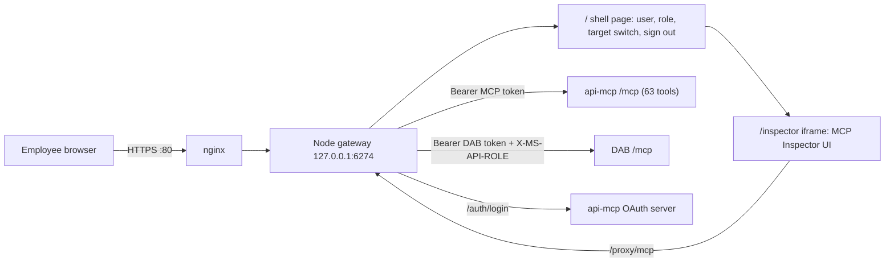
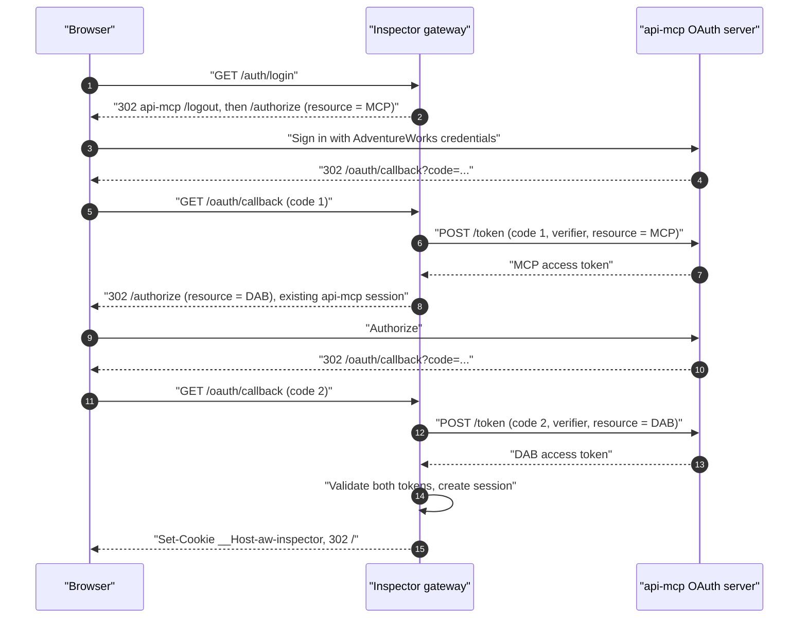

# MCP Inspector: authenticated console for the AdventureWorks MCP servers

The MCP Inspector app (`mcp-inspector/`) is an internal test console for the two Model Context Protocol (MCP) servers in AdventureWorks:

- **Custom MCP**: the api-mcp server with 63 AdventureWorks tools.
- **DAB MCP**: the MCP endpoint built into Data API builder (DAB).

It wraps the open-source [`@modelcontextprotocol/inspector`](https://github.com/modelcontextprotocol/inspector) UI (version 0.15.0) behind a small Node.js **OAuth gateway**. Employees sign in once, choose a target, and list and call tools. The gateway keeps the access tokens on the server and adds them to each proxied MCP request.

## Purpose and audience

| Question | Answer |
|---|---|
| Who uses it | Internal employees: any admin role (`executive-admin`, `sales-admin`, `marketing-admin`, `inventory-admin`, `operations-admin`) or `manufacturing-engineer`. Customers cannot sign in. |
| What it demonstrates | MCP Streamable HTTP, OAuth resource-bound tokens (one for api-mcp and one for DAB), and per-role tool authorization in the [tool scope matrix](../features/mcp-oauth/TOOL_SCOPE_MATRIX.md) and DAB entity permissions. |
| How users get there | Two deep links on the admin portal's [Utilities page](admin-portal.md) (custom MCP and DAB MCP), or `MCP_INSPECTOR_URL` from `azd env get-value MCP_INSPECTOR_URL --no-prompt`. |
| Hosting | Azure Container App (0.25 vCPU / 0.5 GiB, 0–1 replicas, external ingress on port 80), built remotely in Azure Container Registry from `mcp-inspector/Dockerfile` (`node:22-bookworm-slim`). |

## Page and endpoint map



| Route | What the user sees or what it does |
|---|---|
| `/` | Shell page. Signed in, it shows the user's name and role, a **Custom MCP \| DAB MCP** switch (`?target=dab` selects DAB), a sign-out button and an iframe with the Inspector UI. The iframe is preset to `transport=streamable-http`, the chosen target's MCP URL as `serverUrl` and a 240-second request timeout; the Inspector UI sends its requests through the gateway's `/proxy/mcp`. Signed out, it shows "Internal employee or manufacturing sign-in is required." and a sign-in link. |
| `/inspector` | The upstream MCP Inspector UI, served inside the shell's iframe. In the UI you connect, list tools, resources and prompts, and call tools with JSON arguments. |
| `/auth/login` | Starts sign-in (see below). |
| `/oauth/callback` | OAuth redirect target for both authorization flows. |
| `POST /auth/logout` | Ends the gateway session and closes its backend MCP sessions. |
| `/proxy/mcp` | MCP Streamable HTTP proxy (`GET`, `POST`, `DELETE`) for the two configured targets only. |
| `/proxy/health`, `/proxy/config` | Endpoints the Inspector UI calls to check its proxy. Other `/proxy/*` paths return 404. |
| `/health` | Gateway liveness, used by the container entrypoint at startup. |

## Sign-in

The gateway is a confidential-style server-side client. It runs **two PKCE authorization code flows in a row** with client `adventureworks-inspector`: one for the api-mcp MCP audience and one for the DAB audience (`{api-mcp origin}/dab`). Both tokens come from the same sign-in.



| Item | Value |
|---|---|
| OAuth client | `adventureworks-inspector` |
| Scopes | All AdventureWorks scopes except `realtime.connect`; api-mcp narrows them to the user's role |
| Fresh sign-in | `/auth/login` goes through api-mcp `/logout` first, so each Inspector session starts with a new sign-in |
| Endpoint discovery | Read from api-mcp `/.well-known/openid-configuration`. The authorize, token and JWKS endpoints must share the api-mcp origin. |
| Token checks | RS256 signature, issuer and audience; `app` claim `adventureworks-inspector`; category `employee` or `manufacturing`; exactly one internal role; `mcp.access` present; lifetime of 1 hour or less; the same subject and role in both tokens |
| Session | `__Host-aw-inspector` cookie (Secure, HttpOnly). Pending sign-in flows expire after 5 minutes. The gateway keeps at most 100 flows and 100 sessions in memory. |
| Session length | There is no refresh: the session ends when the first of its two tokens expires, about 10 minutes with the default token lifetime. Sign in again to continue. |

The browser never receives the access tokens. See [mcp-oauth](../features/mcp-oauth/README.md) and [identity and auth](../architecture/identity-and-auth.md).

## How a tool call flows

```mermaid
sequenceDiagram
    autonumber
    participant UI as "Inspector UI (iframe)"
    participant G as "Gateway /proxy/mcp"
    participant T as "api-mcp /mcp or DAB /mcp"
    UI->>G: "POST /proxy/mcp?url=<target> (JSON-RPC tools/call, session cookie)"
    G->>G: "Check Host, Origin, Sec-Fetch-Site, session and allowed target"
    G->>T: "POST (Authorization: Bearer token for that audience; DAB also gets X-MS-API-ROLE)"
    T-->>G: "JSON or event stream response + Mcp-Session-Id"
    G-->>UI: "Response streamed back (no buffering)"
```

| Rule | Value |
|---|---|
| Targets | Only `API_MCP_URL` and `API_DAB_MCP_URL`; any other URL is rejected |
| Transport | `streamable-http` only |
| Request body | At most 1 MB |
| Backend sessions | At most 16 MCP sessions per target per gateway session. An `Mcp-Session-Id` is accepted only from the gateway session that created it. |
| Timeout | 300 seconds per backend request (nginx `proxy_read_timeout` 310 s, buffering off) |
| Clean-up | Sign-out or session expiry deletes the backend MCP sessions |

What the tools return depends on the signed-in role. The [tool scope matrix](../features/mcp-oauth/TOOL_SCOPE_MATRIX.md) lists the scope each custom tool needs, and DAB applies the role's entity permissions ([DAB entities](../reference/dab-entities.md)).

## Security headers and request checks

Every gateway response sets a strict Content Security Policy, `Cache-Control: no-store` and `X-Content-Type-Options: nosniff`. The gateway checks the `Host`, `Origin` and `Sec-Fetch-Site` headers on state-changing and proxy requests, so other sites cannot drive the proxy with the session cookie.

## Runtime configuration

| Variable | Required | Purpose |
|---|---|---|
| `API_MCP_URL` | Yes | Custom MCP endpoint; canonical HTTPS URL ending in `/mcp`. Its origin is the OAuth issuer. |
| `API_DAB_MCP_URL` | Yes | DAB MCP endpoint; canonical HTTPS URL ending in `/mcp` |
| `MCP_PROXY_FULL_ADDRESS` | Yes | Public gateway proxy URL ending in `/proxy` |
| `MCP_RESOURCE_IDENTIFIER`, `DAB_RESOURCE_IDENTIFIER` | No | Override the OAuth resource (audience) for each target |
| `APPLICATIONINSIGHTS_CONNECTION_STRING` | No | Server-side telemetry |

The three required URLs must be on different origins. Bicep sets them on the Container App, and `scripts/hooks/postdeploy.sh` registers the gateway's callback on api-mcp (`OAUTH_INSPECTOR_REDIRECT_URIS`, from `MCP_INSPECTOR_URL`). See the [environment variables reference](../reference/environment-variables.md).

## Telemetry

`mcp-inspector/telemetry.mjs` sends one Application Insights request item per gateway request, with the cloud role **`mcp-inspector`**. It is turned off when `APPLICATIONINSIGHTS_CONNECTION_STRING` is missing or invalid.

- **Names.** Each item is named with the method and a fixed route label. Known routes (`/`, `/health`, `/auth/login`, `/auth/logout`, `/oauth/callback`, `/inspector`, `/proxy/health`, `/proxy/config`, `/proxy/mcp`) keep their path. Other `/proxy/` paths become `/proxy/*` and everything else becomes `/assets/*`.
- **Never sent.** Query strings (OAuth codes and state), headers, cookies, tokens, bodies and tool arguments.
- **Result.** The status code and duration are recorded, and any status below 500 counts as success.
- **Correlation.** The operation ID is the trace ID from an incoming W3C `traceparent` header, or a new random ID.
- **Delivery.** Items are buffered (at most 500, oldest dropped first) and sent every 5 seconds, plus a final send when the container receives `SIGTERM` or `SIGINT`.

See [monitoring](../operations/monitoring.md#mcp-inspector-requests).

## Deploying and testing

The gateway needs HTTPS URLs on separate origins and a registered redirect URI, so it is meant to be tested in the deployed environment. Deploy changes with `azd deploy mcp-inspector --no-prompt`, then open `MCP_INSPECTOR_URL`. To call MCP tools from a script instead, use the authenticated helper:

```bash
python3 scripts/utilities/azure-auth.py token --identity manufacturing --resource mcp
```

See [authenticated scripts](../testing/AZURE_AUTHENTICATED_SCRIPTS.md) for how to use the token safely.

## Tests

| Suite | Command | Covers |
|---|---|---|
| Gateway tests | `npm --prefix mcp-inspector test` ([`gateway.test.mjs`](../../mcp-inspector/gateway.test.mjs)) | Configuration checks, sign-in flows, token checks, session and proxy limits, header checks |
| api-mcp client tests | `dotnet test api-mcp/AdventureWorks.Tests --filter InspectorOAuthTests` | The `adventureworks-inspector` client registration and allowed categories |

See [testing strategy](../testing/testing-strategy.md).

## Limits and scope

- Sessions are held in memory and the app runs at most one replica, so a restart or scale-to-zero ends every session.
- Sessions last only as long as the shorter-lived token (no refresh); sign in again when a session ends.
- Only the two AdventureWorks MCP targets can be reached, over Streamable HTTP. The gateway does not proxy the Inspector's other transports or arbitrary server URLs.
- Tool calls run with the signed-in employee's own role. The Inspector does not grant extra permissions.

## Related docs

| Topic | Doc |
|---|---|
| api-mcp server and its 63 tools | [api-mcp service](../services/api-mcp.md) |
| DAB and its MCP endpoint | [DAB API service](../services/dab-api.md) |
| OAuth server, clients and scopes | [mcp-oauth](../features/mcp-oauth/README.md) |
| Tool scopes by role | [TOOL_SCOPE_MATRIX](../features/mcp-oauth/TOOL_SCOPE_MATRIX.md) |
| Admin Utilities deep links | [admin portal](admin-portal.md) |
| End-to-end authentication | [END_TO_END_AUTHENTICATION](../features/authentication/END_TO_END_AUTHENTICATION.md) |

Key code:

- `mcp-inspector/gateway.mjs`: gateway, OAuth and proxy
- `mcp-inspector/nginx.conf`: reverse proxy
- `mcp-inspector/entrypoint.sh`: startup
- `mcp-inspector/telemetry.mjs`: telemetry
