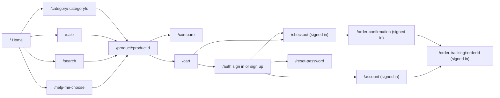
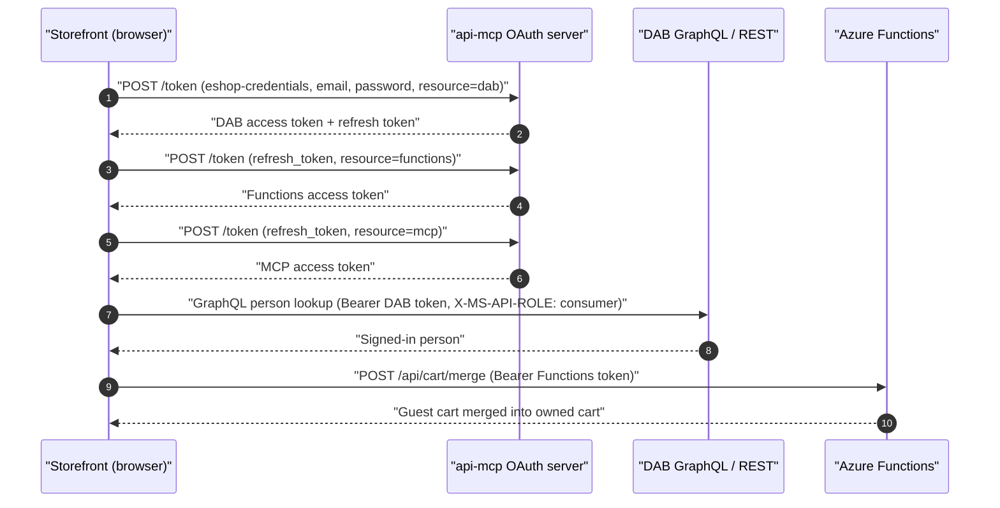
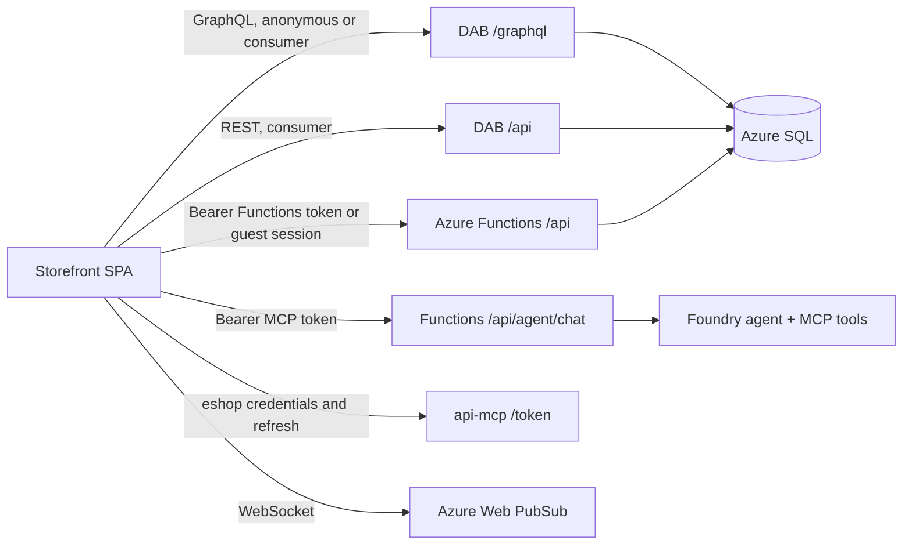
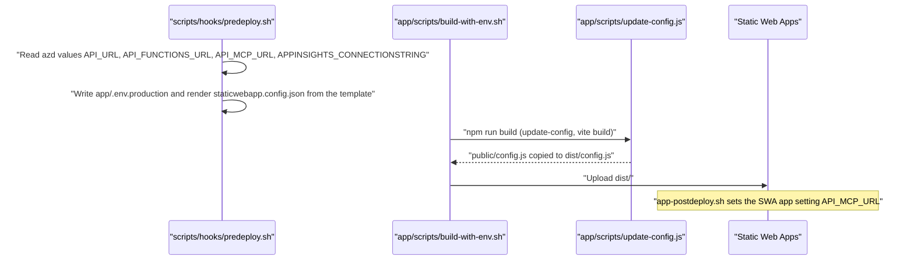

# Storefront: AdventureWorks e-shop (React SPA on Azure Static Web Apps)

The storefront (`app/`) is the public AdventureWorks bike shop. Shoppers can browse a localized catalog, search it with AI semantic search, get help from the Help Me Choose wizard, keep a guest cart, sign up or sign in, check out, track orders and chat with an AI shopping assistant. It is a React + TypeScript + Vite single-page application (SPA) hosted on **Azure Static Web Apps (SWA)**.

## Purpose and audience

| Question | Answer |
|---|---|
| Who uses it | Anonymous shoppers and signed-in **consumers** (customers). Employees use the [admin portal](admin-portal.md) or the [manufacturing portal](manufacturing-portal.md) instead. |
| What it demonstrates | Anonymous GraphQL catalog reads through Data API builder (DAB), a self-contained OAuth server that issues audience-bound tokens, server-side guest carts, AI semantic search, Foundry agents (chat and Help Me Choose), 23 UI languages, and push-based cache invalidation with Azure Web PubSub. |
| Hosting | Azure Static Web Apps (`host: staticwebapp` in `azure.yaml`). The app is built on the deployment machine and the `dist/` folder is uploaded. |
| Stack | React 19, TypeScript, Vite 5, React Router v6, React Query, shadcn/ui, `graphql-request`, `i18next`, `@azure/web-pubsub-client` and the Application Insights web SDK. |

## Page map



Every page includes the header search box, category menu, language, currency and unit selectors, the compare bar and the AI chat button.

## Sign-in and session

The storefront does **not** redirect to a login page. It sends the shopper's email and password directly to the api-mcp token endpoint using a custom **e-shop credentials grant**, then uses the refresh token to get the other tokens it needs.

| Item | Value |
|---|---|
| OAuth client | `adventureworks-eshop` (trusted first-party public client) |
| Allowed user category | `consumer` (any person who is not an employee) |
| Grant | `urn:adventureworks:params:oauth:grant-type:eshop-credentials` at `POST {api-mcp}/token` |
| Scopes requested | `mcp.access realtime.connect products.read customers.read customers.write orders.read orders.write offline_access` |
| Tokens held | Three audience-bound access tokens (DAB `{api-mcp}/dab`, Functions `{api-mcp}/functions`, MCP `{api-mcp}/mcp`) plus a refresh token |
| Storage | `sessionStorage` (`dab_oauth_token`, `functions_oauth_token`, `mcp_oauth_token`, `eshop_oauth_refresh_token`, `adventureworks_current_user`), so each browser tab has its own session |
| Refresh | Tokens are refreshed 60 seconds before they expire |
| DAB role header | Requests to DAB add `Authorization: Bearer …` and an `X-MS-API-ROLE` header taken from the token's `roles` claim (`consumer`) |
| Ownership claims | Consumer tokens carry `business_entity_id` and, once a `Sales.Customer` row exists, `customer_id`. DAB policies and Functions handlers compare these claims with the requested records. |



New customers sign up on `/auth`. The page calls the anonymous `POST /api/signup` Function and then signs in. `RequireAuth` guards the checkout, confirmation, account and tracking pages in the browser and sends anonymous visitors to `/auth`. The APIs enforce authorization independently of the browser check.

Details: [identity and auth overview](../architecture/identity-and-auth.md), [mcp-oauth server](../features/mcp-oauth/README.md), [accounts and sign-in](../features/customers/accounts-and-sign-in.md).

## Page-by-page tour

The `App.tsx` route table has **19 routes plus a catch-all** (`*` → Not Found). Pages marked 🔒 are wrapped in `RequireAuth`. All pages are imported eagerly, with no route-level lazy loading.

### Shopping and discovery

| Route | What the shopper sees and does | Backend calls | Live updates |
|---|---|---|---|
| `/` | Home page: hero, category grid, featured products, promotion banner and a **Recently viewed** strip (the last 8 products, kept in `localStorage`). | DAB GraphQL (anonymous): `products` (finished goods), product models, descriptions, special offers, photos, inventory | — |
| `/category/:categoryId` | Category listing with subcategory, price, colour and size filters and sorting. Product cards support quick view and add-to-cart. | DAB GraphQL (anonymous): categories, subcategories, products | — |
| `/product/:productId` | Product detail: image gallery, size and colour variants from the product model, localized name and description, price with any active discount, stock status, reviews, "notify me when available" (stored in the browser only) and **Add to compare**. Signed-in shoppers can write a review and mark reviews helpful. | DAB GraphQL (anonymous) for product, reviews and inventory; DAB REST `POST ProductReview` (consumer) for new reviews | — |
| `/sale` | Products with an active special offer, grouped by product model. | DAB GraphQL: `specialOffers`, `specialOfferProducts`, products | — |
| `/search` | AI semantic search results (top 20) with category and price filters, sorted by relevance, price, discount or rating. Out-of-stock items are hidden. The header search box shows AI suggestions after 2 characters. | Functions (public): `POST /api/search/semantic` (`query`, `topN`, `cultureId`), `GET /api/search/suggestions?q=` | — |
| `/help-me-choose` | Help Me Choose: an AI questionnaire about riding style and budget that ends in product recommendations. | Functions (public): `POST /api/helpme/questions`, `POST /api/helpme/recommend`, `GET /api/helpme/catalog-meta` | — |
| `/compare` | Side-by-side comparison of up to **3** products chosen with the compare bar. The selection is held in memory and is cleared when the page reloads. | Data already loaded by the catalog pages | — |

### Cart, checkout and orders

| Route | What the shopper sees and does | Backend calls | Live updates |
|---|---|---|---|
| `/cart` | Server-side shopping cart. A guest gets a cart session from `POST /api/cart/session`; its token is kept in `localStorage` and sent in the `X-Guest-Cart-Session` header. Signed-in shoppers use their own cart, and the guest cart is merged into it at sign-in. | Functions: `GET/POST/DELETE /api/cart/items`, `PATCH/DELETE /api/cart/items/{id}`, `POST /api/cart/merge` | `orders` → refresh cart |
| `/checkout` 🔒 | Choose billing and shipping addresses, see tax (by state or province), shipping and currency-converted totals, then place the order. If the shopper has no customer record yet, one is created and the tokens are refreshed to pick up the `customer_id` claim. | DAB GraphQL: `customers`/`createCustomer`, `salesTaxRates`, `countryRegionCurrencies`, `currencyRates`; Functions: `/api/addresses`, `GET /api/payment-methods`, `POST /api/orders`, `POST /api/orders/{id}/details` | `orders` → refresh cart |
| `/order-confirmation` 🔒 | Confirmation summary for `?orderId=SO-{id}` with the shipping address. A PDF receipt is generated and emailed in the background. | DAB GraphQL order header; Functions `GET /api/addresses/{id}` | — |
| `/order-tracking` 🔒 and `/order-tracking/:orderId` 🔒 | Order list and a step timeline (confirmed → processing → shipped → out for delivery → delivered) derived from the order status code. | DAB GraphQL `salesOrderHeaders` by customer; Functions `GET /api/orders/details?orderIds=` | — |
| `/account` 🔒 | Account tabs: profile (name, email addresses, phone numbers), addresses, saved payment methods, order history with receipt resend, and change password. | DAB GraphQL `updatePerson`/`updateEmailAddress`; DAB REST `PersonPhone`, `PersonCreditCard`, `StateProvince`, `CountryRegion`; Functions `/api/addresses`, `GET /api/payment-methods`, `POST /api/orders/generate-and-send-receipt`, `POST /api/password/verify`, `POST /api/password` | — |

The order status codes are 1 Pending, 2 Approved, 3 Backordered, 4 Rejected, 5 Shipped, 6 Cancelled and 7 Delivered. See [order lifecycle](../features/commerce/order-lifecycle.md).

### Account access and information pages

| Route | What the visitor sees and does | Backend calls | Live updates |
|---|---|---|---|
| `/auth` | Sign-in and sign-up tabs, with a "forgot password" link. | api-mcp `POST /token`; Functions `POST /api/signup` (anonymous) | — |
| `/reset-password` | Request a reset email, then validate the emailed token and set a new password. | Functions (public): `POST /api/password/reset/request`, `/reset/validate`, `/reset/complete` | — |
| `/oauth/callback` | Retained redirect-callback page. The storefront signs in with the credentials grant, so normal use never lands here. | — | — |
| `/returns`, `/faq` | Static returns policy and FAQ, translated through i18n. | None | — |
| `/health` | Health diagnostics dashboard (see below). | Public health and capability endpoints | Shows WebSocket status |
| `*` | Not Found page (tracked as `Page_NotFound`). | — | — |

### Always-on overlays

| Feature | What it does | Backend |
|---|---|---|
| **AI shopping assistant** | Floating chat for signed-in customers. It uses MCP tools to answer questions about products and the shopper's own orders, and suggests follow-up questions. It also includes a safety demo with six canned prompts that show Foundry guardrail and ownership blocks. | `POST /api/agent/chat` with the **MCP-audience** token; see [AI chat](../features/ai/ai-chat.md) |
| **Compare bar** | Appears when products are added to compare (maximum 3). | — |
| **Language, currency and units** | 23 UI languages, a currency derived from the language (converted with `currencyRates`) and imperial or metric units. Choices persist in `localStorage`. | DAB GraphQL `productNames`, `currencyRates` |
| **Live-updates notice** | Banner shown when the Web PubSub connection is unavailable. | — |

## Data access summary



| Backend | Used for |
|---|---|
| **DAB GraphQL** (`API_URL`) | Catalog data (products, categories, models, descriptions, photos, inventory, special offers, reviews, product names, currency and tax rates) and profile and customer records. Catalog queries request large single pages (`first:` 1000–10000) and enrich products in the browser. |
| **DAB REST** (`API_URL` with `/graphql` replaced by `/api`) | `Person`, `PersonPhone`, `PersonCreditCard` (delete), `ProductReview` (create), `StateProvince`, `CountryRegion`. |
| **Azure Functions** (`API_FUNCTIONS_URL`) | Cart, addresses (DAB does not expose the `Person.Address` table), orders, payment methods, passwords, signup, semantic search, Help Me Choose, AI chat, Web PubSub negotiation and health. |
| **api-mcp** (`API_MCP_URL`) | OAuth token endpoint only. The storefront does not call MCP tools directly; the chat agent calls them on the server. |

## Live updates (Web PubSub)

The storefront negotiates a connection with `GET /api/webpubsub/negotiate`, using the Functions token (it needs `realtime.connect`). It listens to one group:

| Group | Payload | Effect in the storefront |
|---|---|---|
| `orders` | Sanitized `{ "event": "orders-changed" }` with no record IDs or values | Invalidates the `["shoppingCart"]` query, batched in a fixed 250 ms window. Connecting and reconnecting also refresh the cart. |

There is no polling. If negotiation fails, the **Live updates unavailable** notice appears. See [real-time eventing](../architecture/realtime-eventing.md) and the [Web PubSub event reference](../reference/webpubsub-events.md).

## Runtime configuration

The storefront reads `window.APP_CONFIG` from `/config.js`, which `index.html` loads before the app bundle. Each value falls back to a `VITE_*` variable and then to a localhost default.

| Key | Purpose | Fallback |
|---|---|---|
| `API_URL` | DAB GraphQL endpoint (includes `/graphql`) | `VITE_API_URL`, then `http://localhost:5000/graphql` |
| `API_FUNCTIONS_URL` | Azure Functions base URL | `VITE_API_FUNCTIONS_URL`, then `http://localhost:7071` |
| `API_MCP_URL` | api-mcp base URL (OAuth token endpoint) | `VITE_API_MCP_URL`; with no value, sign-in is unavailable |
| `APPINSIGHTS_CONNECTIONSTRING` | Browser telemetry | With no value, telemetry is off |

This is how the file is produced during `azd deploy`:



`app/staticwebapp.config.template.json` provides:

- the SPA fallback to `index.html`;
- a 301 redirect from `/sitemap.xml` to the Functions sitemap;
- security headers: a CSP that allows `wss://*.webpubsub.azure.com`, `X-Frame-Options: DENY` and `nosniff`.

The generated `config.js`, `.env.production` and `staticwebapp.config.json` are git-ignored. `app/Dockerfile`, `app/docker-entrypoint.sh` and `app/hooks/predeploy.ps1` are legacy files; the Static Web Apps deployment does not use them.

Full variable list: [environment variables reference](../reference/environment-variables.md).

## Telemetry

The app uses the Application Insights web SDK with the cloud role name **`app-eshop`**. It provides automatic route tracking and CORS correlation with the APIs. Custom events:

- `User_Login`, `User_Signup`, `User_Logout`
- `Product_View`, `Product_AddToCart`, `Purchase_Complete`, `Order_ReceiptResent`
- `Page_NotFound`
- `HelpMeChoose.ProfileCompleted`, `HelpMeChoose.ResultsViewed`

When no connection string is configured, tracking does nothing. See [monitoring](../operations/monitoring.md).

## Health diagnostics page (`/health`)

The `/health` page checks dependencies through public, sanitized endpoints:

| Mode | Runs | Checks |
|---|---|---|
| **Quick** | On page load | DAB GraphQL `productCategories(first:1)`, Functions `GET /api/health` and `GET /api/health/readiness`. Results map to 15 dependency IDs: `sql`, `blobs`, `queues`, `tables`, `mcp`, `mcp-ready`, `oauth`, `webpubsub-service`, `files`, `openai`, `foundry`, `manufacturing-agent`, `email`, `order-emails`, `telemetry` |
| **Capabilities** | On demand | Semantic search, search suggestions, agent status, Help Me Choose catalog metadata, sitemap, OpenAPI |
| **Data** | On demand | Seed status and presence of seeded product photos |

The page also shows the current Web PubSub connection status. For the contract and troubleshooting, see [HEALTH_DIAGNOSTICS](../features/monitoring/HEALTH_DIAGNOSTICS.md). The admin and manufacturing portals have no `/health` route.

## Localization

- **23 locales** are bundled as JSON under `app/src/locales/<lang>/`, with the namespaces `common`, `product`, `cart`, `account`, `footer` and `chat`. The `helpme` namespace exists in English only, so other languages fall back to English.
- The language comes from `localStorage.selectedLanguage` or browser detection. Product names are localized through the DAB `productNames` entity and fall back to English.
- Each language has a default currency, converted using `AverageRate`. JPY and KRW are shown without decimals.
- Every language uses a left-to-right layout, including Arabic and Hebrew.

See [localization](../features/i18n/localization.md).

## Local development

```bash
cd app
npm install
npm run dev        # Vite dev server on http://localhost:8080
```

- To use the deployed services, set `VITE_API_URL`, `VITE_API_FUNCTIONS_URL` and `VITE_API_MCP_URL` in `app/.env`. Read the values with `azd env get-value API_URL --no-prompt` and similar commands. Sign-in, cart and search need all three.
- The Vite dev server proxies `/sitemap.xml` to a local Functions host on port 7071.
- The storefront signs in with the credentials grant, so there is no OAuth redirect URI to register for local development.
- Deploy changes with `azd deploy app --no-prompt`. See [deployment](../operations/deployment.md).

## Tests

| Suite | Command | Covers |
|---|---|---|
| Storefront `node --test` | `cd app && node --test scripts/health-checks.test.mjs scripts/sale-product-model-card.test.mjs` | `/health` page logic and sale-card add-to-cart variants |
| Live-updates regression (all frontends) | `node --experimental-vm-modules --test tests/scripts/test-live-updates.mjs` | Batching, reconnect recovery and the no-polling rule across all three frontends |
| Lint | `cd app && npm run lint` | ESLint |

See [testing strategy](../testing/testing-strategy.md).

## Limits and scope

- **Compare** holds at most 3 products and is not saved. **Recently viewed** keeps the last 8 products.
- Catalog pages load large single pages from DAB rather than following pagination cursors.
- The **notify when available** form stores requests in the browser only; there is no back-end subscription.
- Only the shopping cart is live-updated. Other pages refresh through React Query's normal refetch when the window regains focus.
- There is no right-to-left layout, and the Help Me Choose questionnaire text is in English only.
- AI features (chat, Help Me Choose, semantic search) call Foundry models, so each request has a cost.

## Related feature docs

| Topic | Doc |
|---|---|
| Catalog, categories, compare, recently viewed | [catalog-and-browsing](../features/commerce/catalog-and-browsing.md) |
| Guest and owned carts, checkout | [cart-and-checkout](../features/commerce/cart-and-checkout.md) |
| Order statuses and pipeline | [order-lifecycle](../features/commerce/order-lifecycle.md) |
| PDF receipts | [receipts](../features/commerce/receipts.md) |
| Sign-up, sign-in, profile, addresses | [accounts-and-sign-in](../features/customers/accounts-and-sign-in.md) |
| Password change and reset | [passwords-and-reset](../features/customers/passwords-and-reset.md) |
| Reviews | [product-reviews](../features/reviews/product-reviews.md) |
| AI semantic search | [semantic-search](../features/search/semantic-search.md) |
| Help Me Choose | [help-me-choose](../features/search/help-me-choose.md) |
| Promotions and sale prices | [promotions](../features/promotions/promotions.md) |
| AI shopping assistant | [ai-chat](../features/ai/ai-chat.md) |
| Languages and currencies | [localization](../features/i18n/localization.md) |
| SEO, robots and sitemap | [seo](../features/seo/seo.md) |
| Health page | [HEALTH_DIAGNOSTICS](../features/monitoring/HEALTH_DIAGNOSTICS.md) |
| End-to-end request sequences | [request-flows](../architecture/request-flows.md) |

Key code:

- `app/src/App.tsx`: routes
- `app/src/services/eshopOAuth.ts`: sign-in
- `app/src/services/ownedCart.ts`: cart
- `app/src/data/apiService.ts`: catalog
- `app/src/hooks/useRealTimeUpdates.ts`: live updates
- `app/src/lib/healthChecks.ts`: health page
