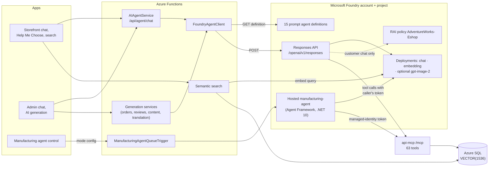
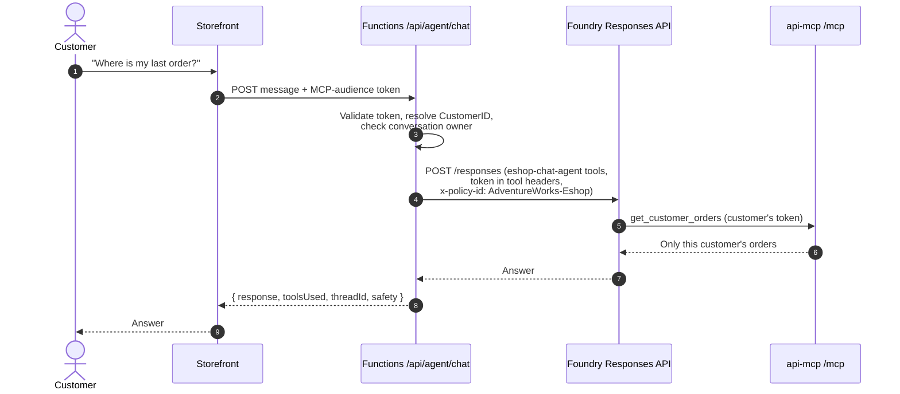

# AI architecture: Microsoft Foundry, agents, MCP tools and models

AdventureWorks uses AI for the storefront shopping assistant, the admin assistant, the
"Help Me Choose" wizard, semantic search, content and data generation, and an
autonomous manufacturing agent. All models and agents live in **one Microsoft Foundry
account**. Conversational and planning agents read and act on business data through the
**63 MCP tools** in api-mcp, and every tool call is authorized as a real user or an
allow-listed service identity. Content-generation agents (for example promotions) instead
receive the SQL-derived data they need in the prompt from Azure Functions.

## Components

## Foundry account and models

- One `AIServices` account (local key auth disabled) and one project `av-aiproject-*`,
  provisioned by [`infra/modules/aiservices.bicep`](../../infra/modules/aiservices.bicep).
  The runtime managed identity has OpenAI User and AI Developer roles.
- Deployments are named by purpose, not model: **`chat`**, **`embedding`** and an optional
  **`gpt-image-2`** image deployment (created only when that model has quota).
  Each deployment uses one tenth of the available quota.

### Model and quota selection (preup)

Before provisioning, [`scripts/hooks/preup.sh`](../../scripts/hooks/preup.sh) creates the
Foundry account, lists models with quota in `FOUNDRY_LOCATION`, and picks:

- **Chat:** ranked by model family (newest first), version date, size, SKU
  (GlobalStandard, then DataZone, then Standard) and capacity. Override with
  `CHAT_MODEL_NAME_REGEX`, `CHAT_MODEL_COST_TIER` (`economy`, `balanced` default,
  `premium`) or `CHAT_MODEL_MIN_CAPACITY`.
- **Embedding:** prefers a model whose name contains "small".
- **Image:** only `gpt-image-2`; otherwise no image deployment.

Choices are stored in the azd environment, and discovery is skipped once they are set.

## Agents

The `postprovision` hook runs [`scripts/utilities/create-foundry-agents.sh`](../../scripts/utilities/create-foundry-agents.sh),
which creates **15 Foundry prompt agents**. `postdeploy` re-runs it only when the agent scripts change, and the
Functions postdeploy hook writes the agent IDs into `AI_AGENT_*` app settings. The full
catalog (purpose, tools, caller) is in [Foundry agents](../features/ai/foundry-agents.md).

| Group | Examples | MCP tools |
| ----- | -------- | --------- |
| Chat | `eshop-chat-agent` (8 tools), `admin-chat-agent` (15 read tools) | Delegated user token |
| Help Me Choose | `eshop-help-me-choose-agent` | 4 public catalog tools, `products.read` service token |
| Data generation | Order (12 tools) and customer (2 tools) generation | Service token |
| Content | Product content, translation, reviews, email, promotions, catalog suggestions, cart recovery, manufacturing instructions | None (data passed in the prompt) |

Every MCP tool definition uses the server label `adventureworks_mcp` with an explicit
allow-list. The Foundry project has no DAB `/mcp` connection; DAB's native MCP endpoint is
available to MCP clients such as the MCP Inspector.

## How Functions calls an agent

`FoundryAgentClient` does not run agents by reference. For each request it:

1. Fetches (and caches) the agent definition: model, instructions and tools.
2. Fills Handlebars placeholders such as `{{userName}}` and `{{cultureId}}` itself.
3. Copies the tool list and injects the caller's MCP bearer token and W3C `traceparent`
   into the `adventureworks_mcp` tool headers — the cached definition is never changed.
4. POSTs to `{project}/openai/v1/responses` with `previous_response_id` for conversation
   continuity, auto-approving MCP approval requests for up to 10 rounds.

### Storefront chat sequence

The admin chat uses the same path with `admin-chat-agent`; it additionally requires an
internal caller with `sales.read`, and Functions checks the agent's tool list against
its 15 reviewed read-only tools.

## Guardrails

Customer chat sends the RAI policy **`AdventureWorks-Eshop`** in the `x-policy-id` header
on every request (the policy is not bound to the deployment). It blocks hate, sexual,
violence and self-harm content at medium severity, jailbreak attempts and protected text,
and uses the `AdventureWorks-Chat-CodeOutput` blocklist to stop code-like output. A block
returns a canned reply with `safety.source = "foundry"`. Separately, MCP ownership rules
stop a customer reading another customer's data. The storefront includes six "safety
demo" prompts that show both protections.

## Hosted manufacturing agent

The `manufacturing-agent` azd service is a Foundry **hosted agent** built with the
Microsoft Agent Framework on .NET 10 and the Responses protocol.

- `ManufacturingAgentQueueTrigger` calls `MANUFACTURING_AGENT_ENDPOINT` with an Entra
  token for `https://ai.azure.com` and a message `Mode=<Name> (<n>)`.
- The agent exchanges its managed identity for an MCP token at api-mcp (client
  `adventureworks-agents`). api-mcp only accepts principals listed in
  `MCP_TRUSTED_SERVICE_PRINCIPAL_IDS`, which `postdeploy` sets.
- **ReadOnly** and **ProposePending** use 5 read scopes and 18 read tools.
  **FullyAutonomous** adds `manufacturing.write` with `begin_manufacturing_run` and
  `place_supply_order`. api-mcp's autonomy guard only allows those two tools while the
  agent configuration is in FullyAutonomous mode with an unexpired auto-shutoff time.
- The agent returns JSON `{findingsSummary, toolsUsed, recommendedActions, actionsExecuted}`.
  In ProposePending mode, Functions turns each recommended action into a proposal that a
  person approves in the manufacturing portal.

See [request flows](request-flows.md#7-hosted-manufacturing-agent-run),
[manufacturing agent feature](../features/manufacturing/manufacturing-agent.md) and
[hosted agent service](../services/manufacturing-agent.md).

## Embeddings and vector search

The database stores `VECTOR(1536)` embeddings for product descriptions, translated product
names and review comments, seeded from CSV files by the seed job.
`POST /api/search/semantic` (public) embeds the query with the `embedding` deployment and
runs three parallel `VECTOR_DISTANCE('cosine', …)` queries — descriptions and names in the
requested culture, plus reviews — then merges the results. Admin utilities can regenerate
embeddings. See [data stores](data-stores.md#ai-additions).

## Telemetry

Functions records `Foundry.Responses.Completed` events, input and output token metrics per
agent, and chat events such as `Agent.ChatRequest` and `Agent.GuardrailBlocked` in
Application Insights. The `traceparent` header links agent tool calls to api-mcp traces.

## Related documentation

- [Foundry agents](../features/ai/foundry-agents.md)
- [Identity and authentication](identity-and-auth.md)
- [api-mcp service](../services/api-mcp.md)
- [TOOL_SCOPE_MATRIX.md](../features/mcp-oauth/TOOL_SCOPE_MATRIX.md)
- [AI chat MCP testing](../testing/AI_CHAT_MCP_TESTING.md)
