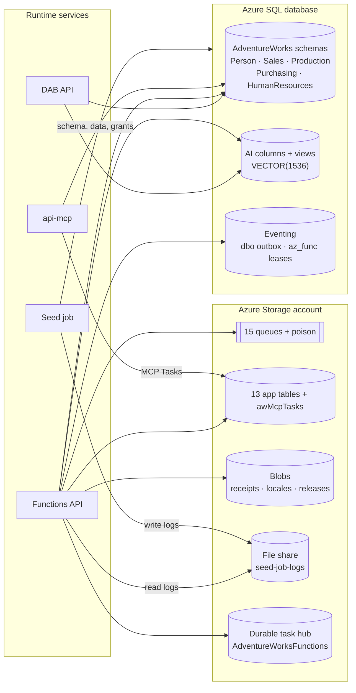
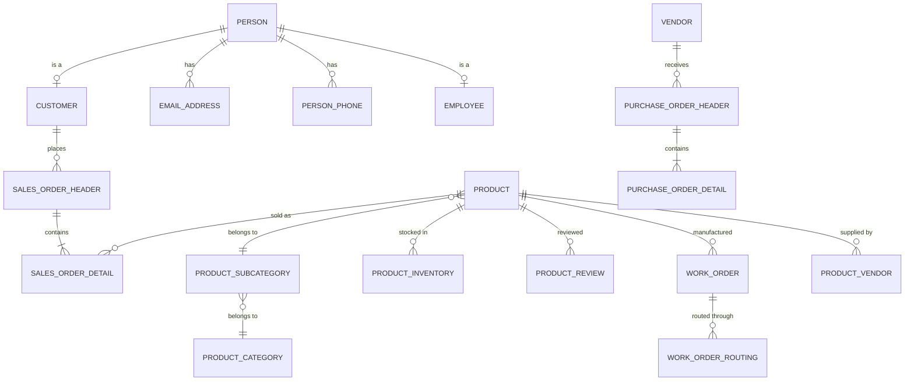
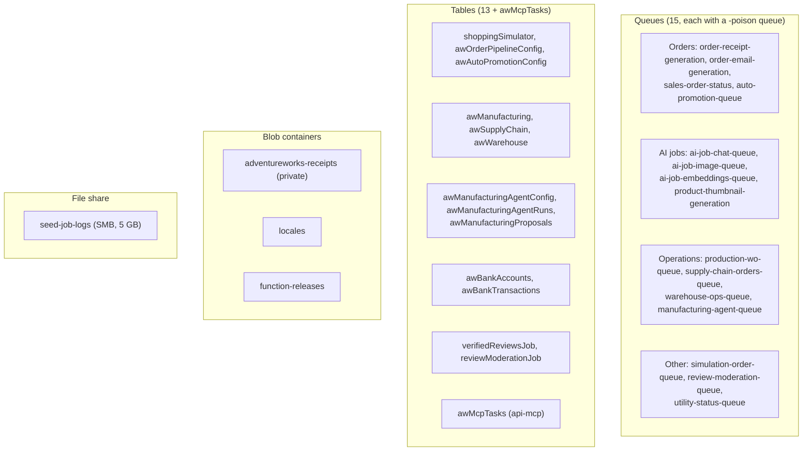

# AdventureWorks data stores — Azure SQL, Azure Storage and Durable Functions state

AdventureWorks keeps business records (products, customers, orders, production, purchasing)
in **Azure SQL** using the classic AdventureWorks schema plus AI additions. Fast-changing
simulation and configuration state, work queues, files and Durable Functions history live
in **Azure Storage**. Both are private (reachable only through the virtual network) and
both are accessed with managed identity — there are no passwords or account keys.

## Overview

## Azure SQL database

A serverless General Purpose database (`GP_S_Gen5_4`, 0.5 vCore minimum, auto-pause after
60 minutes, 32 GB) with Microsoft Entra-only authentication. The [seed job](../services/seed-job.md)
creates every object and loads the data; nothing is created at application runtime.

### Main schemas

| Schema | Holds | Examples |
| ------ | ----- | -------- |
| `Person` | People, contact details, addresses, passwords | `Person`, `EmailAddress`, `PersonPhone`, `Address`, `Password` |
| `Sales` | Customers, stores, orders, carts, offers, currencies | `Customer`, `SalesOrderHeader`, `SalesOrderDetail`, `ShoppingCartItem`, `SpecialOffer`, `GuestCartSession` |
| `Production` | Catalog, inventory, bills of materials, work orders, reviews | `Product`, `ProductInventory`, `BillOfMaterials`, `WorkOrder`, `ProductReview`, `ProductReviewReply` |
| `Purchasing` | Vendors and purchase orders | `Vendor`, `ProductVendor`, `PurchaseOrderHeader` |
| `HumanResources` | Employees and departments (used for staff roles) | `Employee`, `EmployeeDepartmentHistory`, `vEmployee` |
| `dbo` | Eventing outbox and utility procedures | `RealtimeNotificationOutbox`, `uspFindDateHighWatermark`, `uspShiftDatesForward` |
| `az_func` | Azure Functions SQL trigger leases | `GlobalState`, `Notifications_SalesOrderHeader`, `Notifications_RealtimeNotificationOutbox` |

Most tables are exposed through DAB as 69 entities (66 tables + 3 views); see the
[DAB entity reference](../reference/dab-entities.md). `Person.Address` is not, because its
`geography` column is unsupported by DAB; address data goes through Functions.

### AI additions

| Object | Purpose |
| ------ | ------- |
| `Production.ProductDescription.DescriptionEmbedding` `VECTOR(1536)` | Semantic search over descriptions |
| `Production.ProductReview.CommentsEmbedding` `VECTOR(1536)` | Semantic search over reviews |
| `Production.ProductName.ProductNameEmbedding` `VECTOR(1536)` | Translated product names (one row per product and culture) with embeddings |
| `Production.ProductReviewReply` | AI-generated or staff replies to reviews |
| `Production.vProductSearch`, `Production.vHelpMeChoose`, `Production.vProductAndDescription` | Views used by search and Help Me Choose |

Embeddings are seeded from CSV files and searched with `VECTOR_DISTANCE('cosine', …)`.
See [AI architecture](ai-architecture.md#embeddings-and-vector-search).

### Eventing objects

| Object | Used by |
| ------ | ------- |
| `RealtimeNotify_<Table>` DML triggers on 22 tables | Write change rows into the outbox |
| `dbo.RealtimeNotificationOutbox` (Change Tracking on) | `DatabaseChanges` Functions SQL trigger |
| Change Tracking on `Sales.SalesOrderHeader` (2-day retention) | `OrderPlacedSqlTrigger` |
| `az_func.*` lease tables | Functions SQL trigger extension |

How these produce live updates is in [real-time eventing](realtime-eventing.md).

### Database access

- The **seed managed identity** is the server's Entra admin. The seed job uses it to build
  the schema and grant the **runtime managed identity** its database permissions by SID:
  `db_datareader`, `db_datawriter`, `EXECUTE`, `VIEW CHANGE TRACKING`, XML schema
  collection access and `VIEW DEFINITION`.
- DAB, Functions and api-mcp connect as the runtime identity with
  `Authentication=Active Directory Default`.
- Public network access is disabled, so a developer machine cannot connect directly.
  Use DAB or Functions through `scripts/utilities/azure-auth.py`. See [networking](networking.md).

## Azure Storage

One StorageV2 account (LRS, Cool access tier) with shared-key access and public network
access disabled. Every queue, table, container and share is declared in
[`infra/modules/storage.bicep`](../../infra/modules/storage.bicep). The
[storage resource reference](../reference/storage-resources.md) lists each one with its
producers and consumers.

| Kind | Notes |
| ---- | ----- |
| Queues | Functions host settings: batch size 16, max dequeue count 5 (then the `-poison` queue), visibility timeout 30 minutes |
| Tables | Manufacturing, warehouse, supply chain, bank and simulator state live here rather than in SQL. Writes publish `state-changed` events. `awMcpTasks` stores MCP Tasks for api-mcp |
| Blobs | Receipts are private and served through an authenticated Functions route. `locales` holds translated language files. `function-releases` holds the Flex Consumption deployment package. The Functions host also uses `azure-webjobs-hosts` and `azure-webjobs-secrets` |
| File share | `seed-job-logs` is mounted into the seed job at `/logs` with managed-identity SMB access (no account key). `GET /api/seed/status` reads it |

### Durable Functions task hub

Durable orchestrations use the task hub `AdventureWorksFunctions` in the same storage
account: control queues `control-00` to `control-03`, a `workitems` queue, `History`,
`Instances` and `Partitions` tables, and lease and large-message blob containers. New
utility orchestrations run as version `push-v1`.

## Provisioning rules

- **Infrastructure as code only.** Queues, tables, blob containers and the file share
  come from `storage.bicep`; SQL objects come from the seed job. Application code never
  calls `CreateIfNotExistsAsync`, `CreateIfNotExists` or `CreateTableIfNotExistsAsync`.
- **New queue or table?** Add queues to `applicationQueueDescriptions` (the module creates
  the matching poison queue) or tables to `tableServices.tables`, then update the matching
  `DependencyHealthService.Application*` list.
- **Tests** may create a temporary, randomly named table and delete it in cleanup; they
  must not touch application tables or add test tables to IaC.

## Health checks

At startup Functions checks every listed application resource and logs a warning for
anything missing; it does not create resources or fail startup. Queues and blob containers
are checked with `GetPropertiesAsync`; tables with a one-row `QueryAsync`. The same checks
back `GET /api/health/readiness`. See
[HEALTH_DIAGNOSTICS.md](../features/monitoring/HEALTH_DIAGNOSTICS.md).

## Related documentation

- [Storage resource reference](../reference/storage-resources.md)
- [DAB entity reference](../reference/dab-entities.md)
- [Real-time eventing](realtime-eventing.md)
- [Seed job](../services/seed-job.md)
- [Networking](networking.md)
