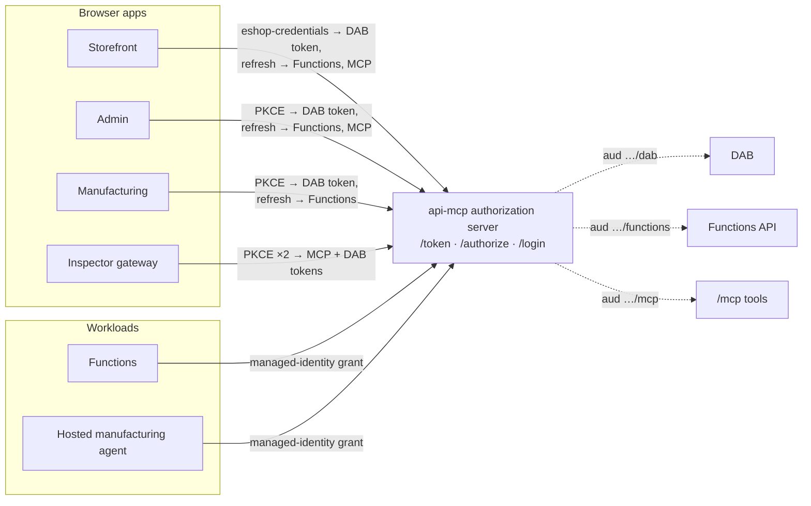
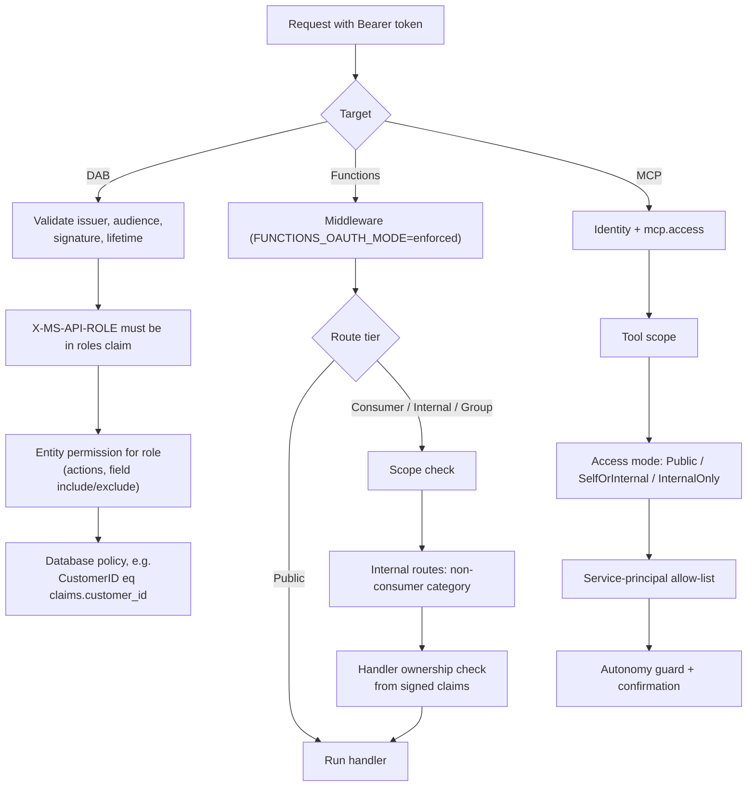

# Identity, authentication and authorization overview

AdventureWorks has two separate identity worlds:

1. **Azure infrastructure identity.** Services reach SQL, Storage, Key Vault, Web PubSub,
   Communication Services and Foundry with **managed identities**. No passwords or keys.
2. **Application users.** Customers and employees are rows in the AdventureWorks database.
   The **api-mcp** service runs an OpenIddict OAuth 2.0 authorization server that checks
   their AdventureWorks credentials and issues short-lived, audience-bound JWTs. This is
   not Microsoft Entra ID and needs no app registrations.

This page is the overview. For the complete trust model and assurance evidence read the
[end-to-end authentication guide](../features/authentication/END_TO_END_AUTHENTICATION.md).
For details see [MCP OAuth](../features/mcp-oauth/README.md) and
[Functions OAuth](../features/functions-oauth/README.md).

## Resources (audiences)

api-mcp is the issuer. Each token is bound to exactly one resource with an RFC 8707
`resource` parameter, so a token for one API is rejected by the others.

| Resource | Audience | Validated by |
| -------- | -------- | ------------ |
| MCP tools | `{issuer}/mcp` | api-mcp `/mcp` |
| Data API Builder | `{issuer}/dab` | DAB (JWT provider pointed at api-mcp) |
| Azure Functions | `{issuer}/functions` | `FunctionsAuthorizationMiddleware` |

## Clients and grants

| Client | Used by | Grant | Notes |
| ------ | ------- | ----- | ----- |
| `adventureworks-eshop` | Storefront | `urn:adventureworks:params:oauth:grant-type:eshop-credentials` | Consumers only; email + password posted to `/token` |
| `adventureworks-admin` | Admin portal | Authorization Code + PKCE (S256) | Employees only |
| `adventureworks-manufacturing` | Manufacturing portal | Authorization Code + PKCE | Manufacturing staff only |
| `adventureworks-inspector` | Hosted MCP Inspector | Authorization Code + PKCE | Employees and manufacturing staff |
| `mcp-inspector` | A separately run Inspector | Authorization Code + PKCE | Untrusted: shows a consent page |
| `adventureworks-agents` | Functions, hosted manufacturing agent | `urn:adventureworks:params:oauth:grant-type:managed-identity` | Entra managed-identity assertion; MCP resource only |

Trusted first-party clients (all except `mcp-inspector`) skip consent and may request
`offline_access`. Their refresh token can be exchanged for a token for a **different**
resource, which is how each app gets its DAB, Functions and MCP tokens from one sign-in.



| Token | Lifetime |
| ----- | -------- |
| Access token | 10 minutes (configurable 1–60) |
| Authorization code | 5 minutes, single use |
| Refresh token | 12 hours absolute, not sliding (configurable 1–168) |
| Login cookie | 30 minutes |

Tokens are signed with RS256 using the `mcp-signing` certificate from Key Vault, which
api-mcp reads with its managed identity. The `/token` credentials grant is limited to 20
requests per minute per IP (code, refresh and managed-identity grants to 300), and `/login`
to 10.

## Users, roles and scopes

A user's **role** comes from the database, never from the user name. An individual
customer (`PersonType` `IN`) is a `consumer`; employees (`EM`) get a role from their current
department. Other person types (store, vendor and general contacts, sales persons) cannot
sign in.

| Role | Department(s) | Scopes besides `mcp.access`, `realtime.connect`, `products.read` |
| ---- | ------------- | ----------------------------------------------------------------- |
| `consumer` | Individual customer (`IN`) | `orders.read`, `orders.write`, `customers.read`, `customers.write` |
| `sales-admin` | Sales (3) | `sales.read`, `customers.read`, `customers.write`, `orders.read`, `admin.read` |
| `marketing-admin` | Marketing (4) | `sales.read`, `customers.read`, `customers.write`, `admin.read`, `admin.write` |
| `inventory-admin` | Purchasing (5), Shipping and Receiving (15) | `inventory.read`, `manufacturing.read`, `admin.read` |
| `manufacturing-engineer` | Production (7), Production Control (8) | `inventory.read`, `manufacturing.read`, `manufacturing.write` |
| `executive-admin` | Executive (16) | All other scopes except `manufacturing.write` |
| `operations-admin` | Any other department | `sales.read`, `customers.read`, `customers.write`, `orders.read`, `inventory.read`, `admin.read` |

There are 14 scopes: `mcp.access`, `realtime.connect`, `products.read`, `sales.read`,
`customers.read`, `customers.write`, `inventory.read`, `orders.read`, `orders.write`,
`manufacturing.read`, `manufacturing.write`, `admin.read`, `admin.write`, `mcp.admin`.

Token claims: `sub` (the lowercased `Person.rowguid`), `name`, `category`
(consumer, employee, manufacturing or service), `app`, `role`, `roles` and `scope`.
Consumer DAB and Functions tokens also carry **ownership claims** `customer_id` and
`business_entity_id`. No ID token is issued.

## Where authorization is enforced



- **DAB** — role permissions on each of the 69 entities, with row filters such as
  `@item.CustomerID eq @claims.customer_id`. Without a token the caller is `anonymous`
  (read-only catalog). See the [DAB entity reference](../reference/dab-entities.md).
- **Functions** — all 205 HTTP functions are anonymous at the platform level; the worker
  middleware applies the per-route policy from `FunctionAuthorizationRegistry`: Public 20,
  Authenticated group-scoped 1 (Web PubSub negotiate), Consumer 20, Internal 164.
  Unclassified functions are denied. See
  [ROUTE_SCOPE_MATRIX.md](../features/functions-oauth/ROUTE_SCOPE_MATRIX.md).
- **MCP** — each of the 63 tools has a required scope and access mode (Public 7,
  SelfOrInternal 3, InternalOnly 53). Self-or-internal tools replace a consumer's
  `customerId` with the caller's own. See
  [TOOL_SCOPE_MATRIX.md](../features/mcp-oauth/TOOL_SCOPE_MATRIX.md).
- **Web PubSub** — group grants are computed from scopes at negotiate time; see
  [real-time eventing](realtime-eventing.md#groups-and-who-may-join).

## Service identities in the token system

- **Functions → MCP**: AI agents call MCP tools with the signed-in user's MCP token
  (delegated). Server-initiated AI jobs use a managed-identity token whose principal must
  be listed in `MCP_TRUSTED_SERVICE_PRINCIPAL_IDS`; it is limited to 12 tools.
- **Hosted manufacturing agent → MCP**: managed-identity grant; limited to 20 tools, and
  write tools need the agent configuration to be in FullyAutonomous mode.
- **api-mcp → Functions**: proxy tools call Functions with a 5-minute service token
  (`sub=service:api-mcp`, `obo_sub` = the user) after the user's own scope has been checked.

## Hosted MCP Inspector

The Inspector gateway runs two PKCE flows (MCP, then DAB) with client
`adventureworks-inspector`, keeps both tokens server-side behind a `__Host-aw-inspector`
cookie, and proxies only the api-mcp `/mcp` and DAB `/mcp` endpoints. See
[MCP Inspector](../apps/mcp-inspector.md).

## Testing with real tokens

Use `scripts/utilities/azure-auth.py` to sign in as a seeded identity and call the deployed
APIs: `--identity manufacturing` (Peter, `manufacturing-engineer`) or `--identity admin`
(Ken, `executive-admin`).

```bash
python3 scripts/utilities/azure-auth.py request \
  --identity manufacturing --resource functions --path /api/manufacturing/status
```

See [Authenticated local scripts](../testing/AZURE_AUTHENTICATED_SCRIPTS.md).

## Related documentation

- [End-to-end authentication assurance](../features/authentication/END_TO_END_AUTHENTICATION.md)
- [MCP OAuth authorization server](../features/mcp-oauth/README.md)
- [Functions OAuth resource server](../features/functions-oauth/README.md)
- [Request flows](request-flows.md)
- [api-mcp service](../services/api-mcp.md)
