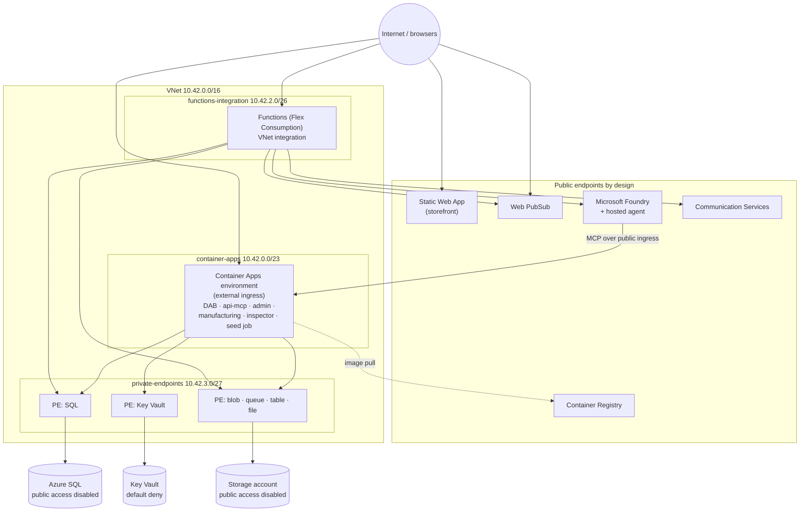

# Networking and private connectivity

The data tier (Azure SQL, Storage and Key Vault) is reached over **private endpoints** in
one virtual network. The Container Apps environment and the Functions app are joined to
that network, so they reach data privately, while their HTTPS front doors stay public for
browsers. The network is defined in
[`infra/modules/sql-private-network.bicep`](../../infra/modules/sql-private-network.bicep).

## Network diagram



## Subnets

| Subnet | Range | Delegation | Used by |
| ------ | ----- | ---------- | ------- |
| `container-apps` | 10.42.0.0/23 | `Microsoft.App/environments` | Container Apps environment (VNet-injected, external ingress) |
| `functions-integration` | 10.42.2.0/26 | `Microsoft.App/environments` | Flex Consumption regional VNet integration |
| `private-endpoints` | 10.42.3.0/27 | None (endpoint network policies disabled) | All private endpoints |

## Private endpoints and DNS

| Target | Private DNS zone |
| ------ | ---------------- |
| Azure SQL server | `privatelink.database.windows.net` |
| Storage blob | `privatelink.blob.core.windows.net` |
| Storage queue | `privatelink.queue.core.windows.net` |
| Storage table | `privatelink.table.core.windows.net` |
| Storage file | `privatelink.file.core.windows.net` |
| Key Vault | `privatelink.vaultcore.azure.net` |

Each zone is linked to the VNet, so the normal public host names (for example
`<server>.database.windows.net`) resolve to private IPs from inside the network.

## Public network access per service

| Service | Public access | Notes |
| ------- | ------------- | ----- |
| Azure SQL | Disabled | Set at creation. The `postup` hook re-applies `Disabled` and removes the temporary deployer firewall rule. |
| Storage account | Disabled, default deny | Blob public access off. Used by Functions, Durable Functions and the seed job over private endpoints. |
| Key Vault | Enabled with default **Deny** | Azure services bypass. `postprovision` adds a temporary deployer IP rule while it creates the `mcp-signing` certificate. |
| Container Apps | Public ingress | DAB, api-mcp, admin, manufacturing and Inspector apps serve HTTPS. The seed job has no ingress. |
| Functions | Public HTTPS | Protected by OAuth (`FUNCTIONS_OAUTH_MODE=enforced`). |
| Static Web App, Web PubSub, Foundry, Container Registry, Communication Services | Public | Access is controlled by identity and OAuth, not network rules. |

The Foundry hosted manufacturing agent runs outside the VNet and calls api-mcp through
its public ingress with a managed-identity OAuth token.

## Developer access

Because SQL and Storage are private, a local `sqlcmd` or Storage SDK call from your machine
will fail even with valid Entra credentials. Do not reopen public access. Use the deployed
APIs with a real application token instead:

```bash
python3 scripts/utilities/azure-auth.py request \
  --identity manufacturing --resource dab --path '/api/Product?$first=5'
```

See [Authenticated local scripts](../testing/AZURE_AUTHENTICATED_SCRIPTS.md).

## Related documentation

- [System overview](system-overview.md)
- [Data stores](data-stores.md)
- [Identity and authentication](identity-and-auth.md)
- [Azure resources reference](../reference/azure-resources.md)
- [Deployment](../operations/deployment.md)
