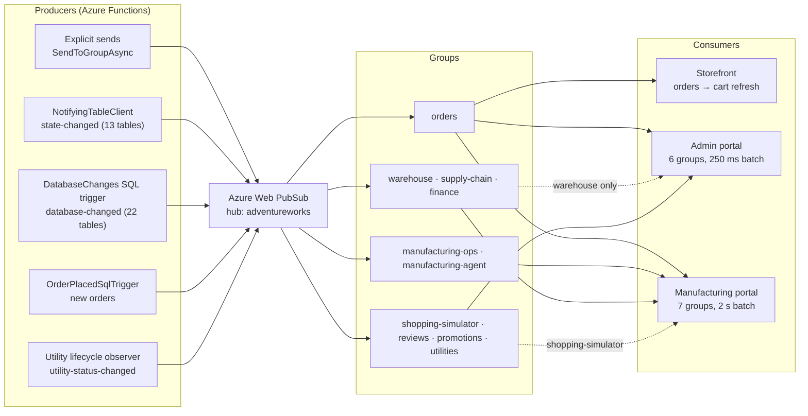
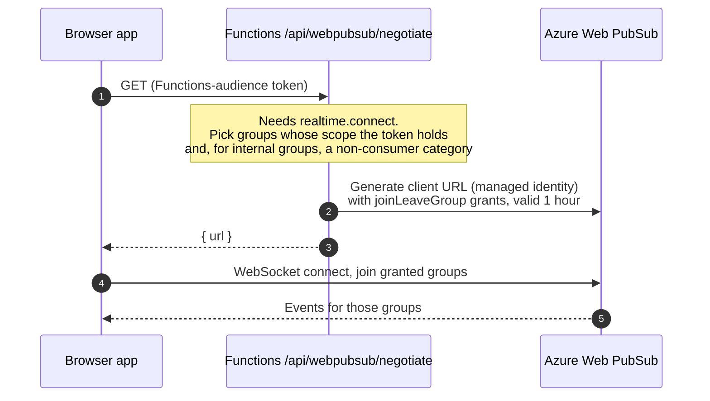
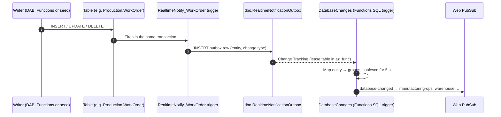

# Real-time updates with Azure Web PubSub (no polling)

When data changes — an order is placed, a work order completes, a review is moderated —
the server tells every interested browser straight away. The browsers then re-read only
the data that changed. No page polls on a timer and no page has a manual refresh button
for live data.

The push channel is **Azure Web PubSub** (Free tier, hub `adventureworks`). Azure
Functions is the only publisher. The storefront, admin portal and manufacturing portal
are subscribers. The complete list of event names and payloads is in the
[Web PubSub event reference](../reference/webpubsub-events.md).

## How it fits together



## Connecting: the negotiate endpoint

A browser never chooses its own groups. It asks Functions for a connection URL and the
server decides which groups the signed-in user may join.



| Response | Meaning |
| -------- | ------- |
| `200 { url }` | Connected; join the granted groups |
| `401 authentication_required` | No valid Functions token |
| `403 insufficient_scope` | Token lacks `realtime.connect` |
| `403 no_authorized_groups` | Token has `realtime.connect` but no group's business scope |
| `503` | Web PubSub is not configured |

### Groups and who may join

| Group | Business scope required (any of) | Internal category required | Joined by |
| ----- | -------------------------------- | -------------------------- | --------- |
| `orders` | `orders.read`, `manufacturing.read` | No | Storefront, admin, manufacturing |
| `manufacturing-ops` | `manufacturing.read` | Yes | Manufacturing |
| `manufacturing-agent` | `manufacturing.read` | Yes | Manufacturing |
| `warehouse` | `inventory.read` | Yes | Admin, manufacturing |
| `supply-chain` | `inventory.read`, `manufacturing.read` | Yes | Manufacturing |
| `finance` | `sales.read`, `manufacturing.read` | Yes | Manufacturing |
| `shopping-simulator` | `admin.read`, `manufacturing.read` | Yes | Admin, manufacturing |
| `reviews` | `admin.read` | Yes | Admin |
| `promotions` | `admin.read` | Yes | Admin |
| `utilities` | `admin.read` | Yes | Admin |

A consumer token can only join `orders`. Because grants follow scopes, an admin role
without a group's scope (for example a sales admin without `inventory.read`) does not
receive that group's events.

## Producers

All sends are fire-and-forget: a failed publish is logged and never fails the business
operation.

### 1. Explicit domain events

Services call `WebPubSubService.SendToGroupAsync(group, payload)` after a mutation, for
example `manufacturing-ops: wo-completed` or `orders: order-status-changed`. High-rate
events use `SendCoalescedAsync`: the first event is sent immediately and further events
for the same key within a **5-second window** are merged into one trailing send.

### 2. Table Storage state changes

Simulation and configuration state lives in Azure Table Storage. Services wrap their
tables in `NotifyingTableClient`, which sends a coalesced `state-changed` event after
every successful write:

| Table(s) | Group |
| -------- | ----- |
| `shoppingSimulator` | `shopping-simulator` |
| `awManufacturingAgentConfig`, `awManufacturingAgentRuns`, `awManufacturingProposals` | `manufacturing-agent` |
| `awBankAccounts`, `awBankTransactions` | `finance` |
| `awWarehouse` | `warehouse` |
| `awSupplyChain` | `supply-chain` |
| `awOrderPipelineConfig` | `orders` |
| `awManufacturing` | `manufacturing-ops` |
| `awAutoPromotionConfig` | `promotions` |

### 3. SQL changes through the outbox

DAB writes straight to SQL, so Functions code never sees those changes. To catch them,
the seed job installs `RealtimeNotify_<Table>` DML triggers on 22 tables. Each trigger
writes a row to `dbo.RealtimeNotificationOutbox` inside the same transaction. One
Functions SQL trigger, `DatabaseChanges`, watches the outbox and publishes a coalesced
`database-changed` event (`{entity, changeTypes}`) to the mapped groups.



| Entity | Groups |
| ------ | ------ |
| `ShoppingCartItem`, `SalesOrderDetail` | orders |
| `WorkOrder`, `WorkOrderRouting`, `BillOfMaterials`, `ProductModel` | manufacturing-ops |
| `ProductInventory`, `Product` | manufacturing-ops, warehouse, supply-chain |
| `Location` | manufacturing-ops, warehouse |
| `ProductCostHistory`, `ProductListPriceHistory` | manufacturing-ops, finance |
| `TransactionHistory`, `TransactionHistoryArchive` | manufacturing-ops, warehouse, finance |
| `Vendor` | supply-chain, warehouse |
| `ProductVendor` | supply-chain, manufacturing-ops |
| `PurchaseOrderHeader` | supply-chain, warehouse, finance |
| `PurchaseOrderDetail` | supply-chain, warehouse |
| `ProductReview`, `ProductReviewReply` | reviews |
| `SpecialOffer`, `SpecialOfferProduct` | promotions |
| `CurrencyRate` | finance |

`Sales.SalesOrderHeader` is **not** in the outbox. New and changed orders are handled by
`OrderPlacedSqlTrigger`, which uses Change Tracking on the header table directly and
drives the order pipeline (see [request flows](request-flows.md#3-checkout-and-the-order-pipeline)).

Both SQL triggers run on their own Flex Consumption always-ready instance (two in total)
so changes are picked up without a cold start. A daily timer at 03:00 deletes outbox rows
older than seven days. The outbox, DML triggers, Change Tracking and lease tables are all
provisioned by the seed job, not at runtime.

### 4. Durable utility jobs

Long-running utilities (`TranslateLanguageFile`, `GenerateProductNameEmbeddings`) run as
Durable Functions orchestrations versioned `push-v1`. They register with a lifecycle
activity, and an observer on `utility-status-queue` checks the orchestration server-side
every 3 seconds and sends `utilities: utility-status-changed`
(`{instanceId, jobType, changeType}`). The browser never receives Durable management URLs.
`host.json` sets `defaultVersion: push-v1` and `versionMatchStrategy: CurrentOrOlder`.

### Payload sanitizing

Events in `orders` and `finance` can reach users who must not see other people's data.
Before sending, `SanitizePayloadForGroup` replaces any payload in those groups with a
generic signal: `{"event":"orders-changed"}` or `{"event":"finance-changed"}`. No event in
any group carries tokens, private records or Durable management URLs.

## Consumers

Each app mounts a `useRealTimeUpdates` dispatcher at its root, built on a shared
`useWebPubSub` connection hook.

| App | Groups | Behaviour |
| --- | ------ | --------- |
| Storefront | `orders` | Any event (and every connect) triggers one batched invalidation of the `["shoppingCart"]` query after 250 ms |
| Admin portal | `orders`, `warehouse`, `shopping-simulator`, `reviews`, `promotions`, `utilities` | Invalidates the mapped React Query keys and dispatches a `webpubsub` DOM event; status pages use `useLiveUpdates` |
| Manufacturing portal | `manufacturing-agent`, `manufacturing-ops`, `warehouse`, `supply-chain`, `orders`, `shopping-simulator`, `finance` | Collects events for a fixed 2-second window, then invalidates the mapped query keys once |

### Batching rules

- **Fixed-window batching, not trailing debounce.** The first event opens a window
  (250 ms in admin and storefront, 2 s in manufacturing); everything that arrives inside
  it causes one refresh when it closes. A steady stream cannot postpone refreshes forever.
- **One read in flight.** If an event arrives while a refresh is running, a single
  follow-up refresh is queued.
- **Listener before first read.** Admin `useLiveUpdates` subscribes before its initial
  read so no event is missed during load.
- **Recovery.** On connect and reconnect, apps invalidate the caches they own
  (admin also dispatches `webpubsub-reconnected`). When a hidden tab becomes visible
  again, status reads recover, and React Query's normal window-focus refetch acts as a
  fallback.
- **Admin utilities** filter `utility-status-changed` by `instanceId` and report
  completion once per job.

### When live updates are unavailable

If negotiation or the WebSocket fails, every app shows a "live updates unavailable"
notice. The app does **not** fall back to polling; data refreshes the next time the user
navigates or focuses the window.

## Limits

The Free tier allows **20 concurrent connections** and **20,000 messages per day**
across all three apps. Coalescing keeps message counts down, but long, high-rate
simulations can still reach the daily limit.

## Adding a new live query

1. **Publish.** In the Functions mutation path, call
   `WebPubSubService.SendToGroupAsync` (or `SendCoalescedAsync`) for the right group. For
   a Table Storage table use `NotifyingTableClient`; for a new SQL table add a
   `RealtimeNotify_<Table>` trigger in the seed job and an entry in the
   `DatabaseChanges` entity map.
2. **Subscribe.** Register the query key under that group in
   `app/src/hooks/useRealTimeUpdates.ts` or
   `app-manufacturing/src/hooks/useRealTimeUpdates.ts`. In the admin portal, add the key
   to the dispatcher or handle the `webpubsub` DOM event with `useLiveUpdates`.
3. **Do not poll.** Never add `refetchInterval` or a manual refresh button. Run the
   regression test:

   ```bash
   node --experimental-vm-modules --test tests/scripts/test-live-updates.mjs
   ```

   It checks batching, in-flight follow-ups, reconnect and focus recovery, cleanup, and
   fails if recurring network polling appears in any of the three frontends.

## Related documentation

- [Web PubSub event reference](../reference/webpubsub-events.md)
- [Data stores](data-stores.md) — outbox, Change Tracking and lease tables
- [Identity and authentication](identity-and-auth.md) — scopes behind group grants
- [Storefront](../apps/storefront.md), [Admin portal](../apps/admin-portal.md),
  [Manufacturing portal](../apps/manufacturing-portal.md)
