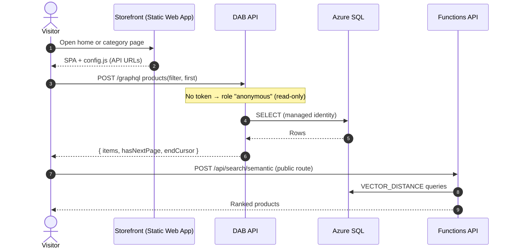
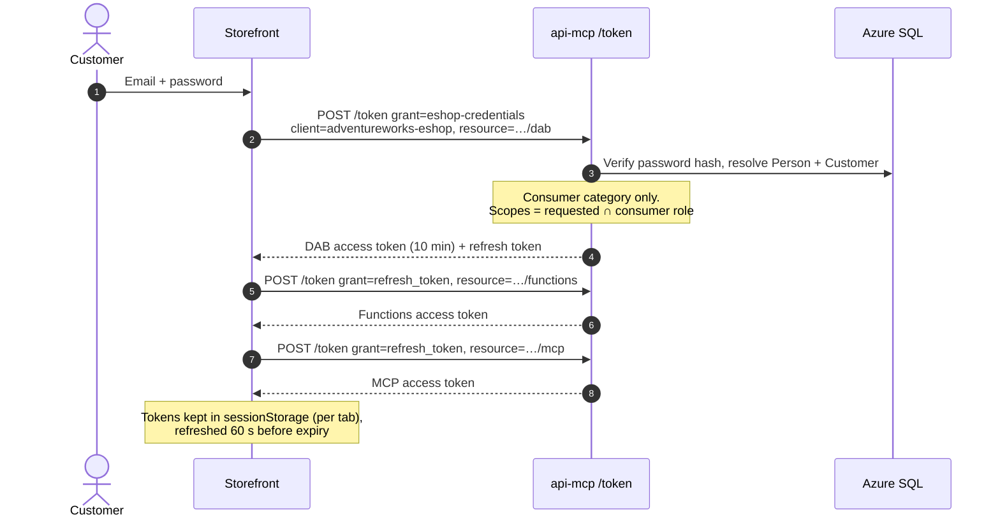
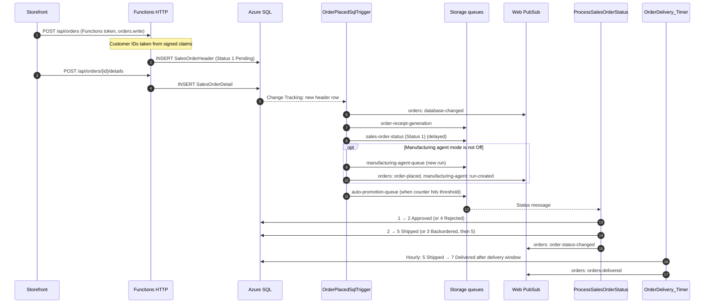
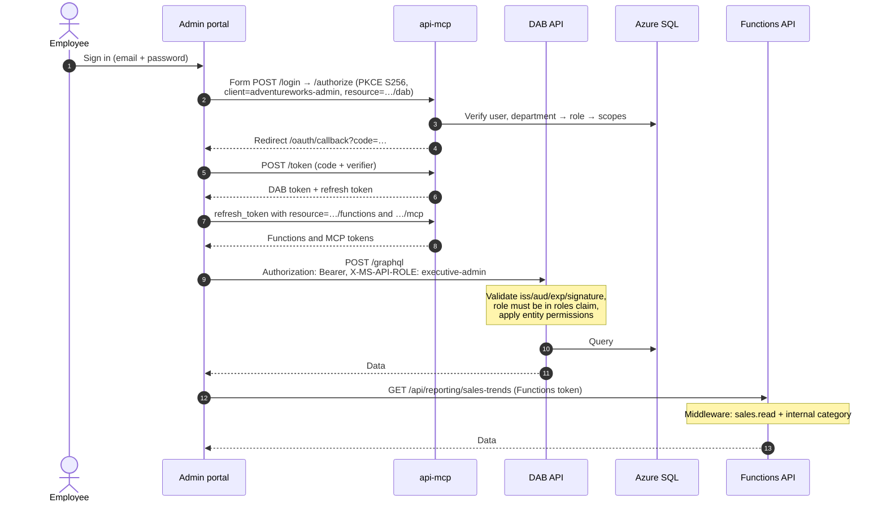
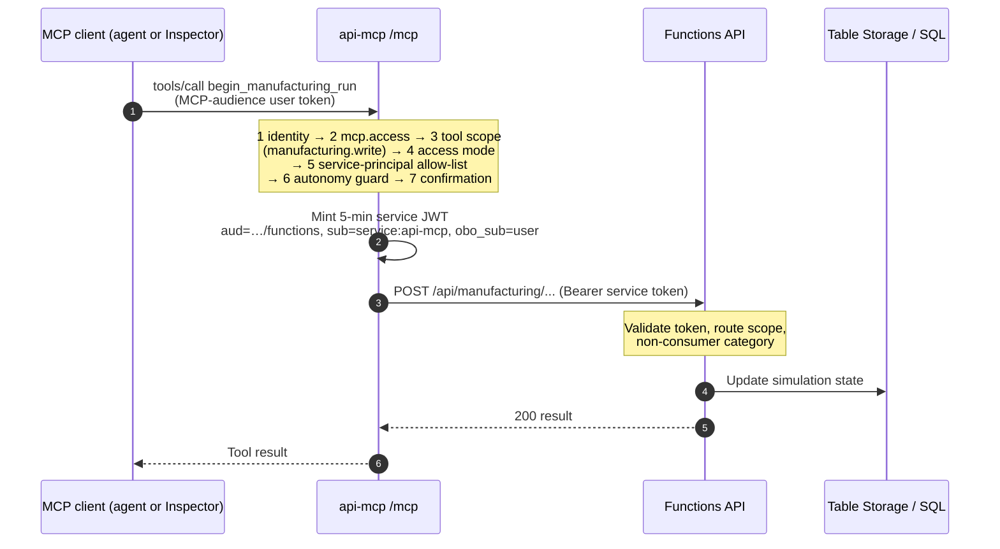
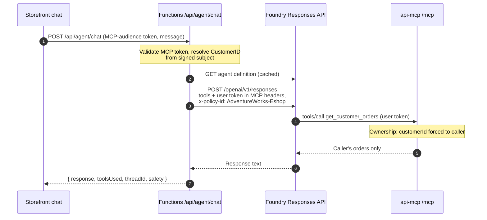
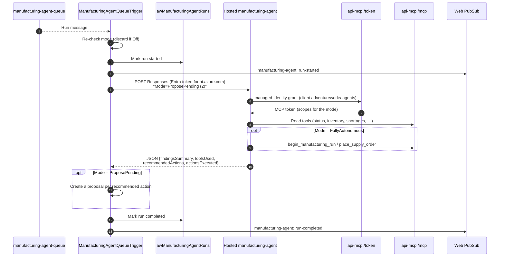

# AdventureWorks request flows (end-to-end sequence diagrams)

These diagrams show what happens, hop by hop, for the most important requests in the
demo. Read the [system overview](system-overview.md) first for the component map, and
[identity and authentication](identity-and-auth.md) for how tokens are issued.

## 1. Anonymous storefront browsing

A visitor who has not signed in can browse the catalog. The storefront calls DAB with
no token, so DAB applies the `anonymous` role: read-only access to 33 catalog entities,
with internal fields such as `StandardCost` excluded.

Public Functions routes (Tier P) include semantic search, Help Me Choose, catalog
helpers, signup, password-reset pre-auth and health. Everything else needs a token.

## 2. Customer sign-in (e-shop credentials grant)

The storefront keeps its own email/password sign-in form. Behind the scenes it trades the
credentials for api-mcp tokens; there is no redirect to an OAuth login page.

Consumer DAB and Functions tokens carry `customer_id` and `business_entity_id` claims,
which DAB policies and Functions ownership checks use to limit the customer to their own
records.

## 3. Checkout and the order pipeline

Placing an order writes `Sales.SalesOrderHeader` and `Sales.SalesOrderDetail` rows
through Functions. A SQL trigger then fans the new order out to queues that simulate the
rest of the business.

Order statuses: 1 Pending, 2 Approved, 3 Backordered, 4 Rejected, 5 Shipped,
6 Cancelled, 7 Delivered. Delays and delivery windows come from the order pipeline
configuration (`awOrderPipelineConfig`). Shipped and delivered emails are only sent
when `ORDER_NOTIFICATIONS_EMAIL_ENABLED` is `true`; otherwise the content is logged.
The receipt queue produces a PDF in the private `adventureworks-receipts` container.

Events on the `orders` group are sanitized to a generic `orders-changed` signal before
they leave the server. See [real-time eventing](realtime-eventing.md).

## 4. Admin data call with a DAB role

Employees sign in with Authorization Code + PKCE. Every DAB request includes the bearer
token and an `X-MS-API-ROLE` header naming one of the roles in the token.

The manufacturing portal follows the same pattern with client
`adventureworks-manufacturing` and the `manufacturing-engineer` role.

## 5. MCP tool call via the Functions proxy

Some MCP tools (manufacturing, supply chain, bank and simulator) are thin proxies over
Functions routes. api-mcp checks the **user's** scope first, then calls Functions with a
short-lived service token that records the user as `obo_sub`.

The service token never widens access: the user's own scope has already been checked.
Forty Functions routes are reachable this way. The tool-to-scope list is in
[TOOL_SCOPE_MATRIX.md](../features/mcp-oauth/TOOL_SCOPE_MATRIX.md).

## 6. Storefront AI chat (delegated MCP token)

Details are in [AI architecture](ai-architecture.md).

## 7. Hosted manufacturing agent run

When the manufacturing agent mode is not Off, every new order triggers an agent run.

Modes: Off (0, default), ReadOnly (1), ProposePending (2) and FullyAutonomous (3).
Failed calls are retried with exponential backoff (10 s × 2^n, up to 8 attempts). See
[manufacturing agent](../features/manufacturing/manufacturing-agent.md) and the
[hosted agent service](../services/manufacturing-agent.md).

## Related documentation

- [System overview](system-overview.md)
- [Identity and authentication](identity-and-auth.md)
- [Real-time eventing](realtime-eventing.md)
- [Functions route reference](../reference/functions-routes.md)
- [ROUTE_SCOPE_MATRIX.md](../features/functions-oauth/ROUTE_SCOPE_MATRIX.md)
