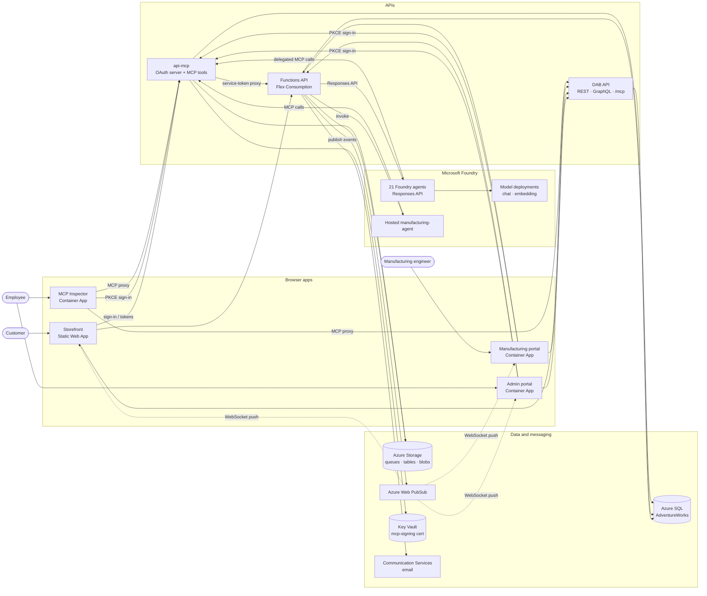
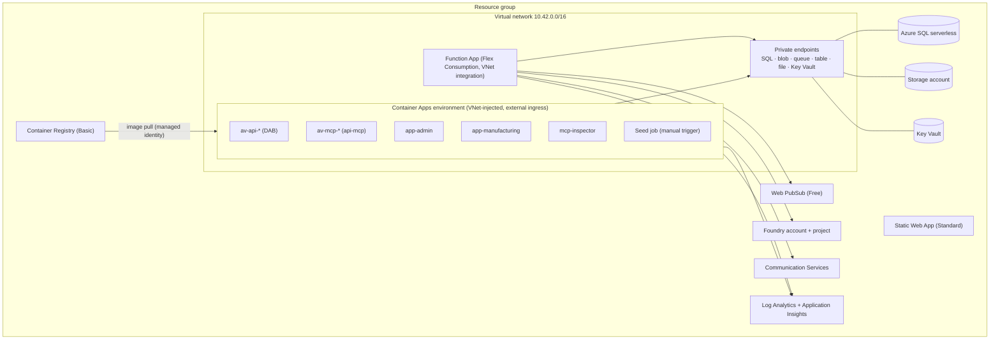
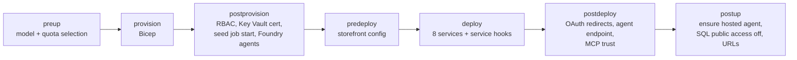

# AdventureWorks system architecture overview

AdventureWorks is a demo e-commerce and manufacturing business running entirely on
Azure. Three browser apps talk to two data APIs (a code-free Data API Builder and a
custom Azure Functions app), an OAuth/MCP server issues user tokens and exposes AI
tools, Microsoft Foundry hosts the AI agents, and everything stores data in Azure SQL
and Azure Storage. Azure Web PubSub pushes live changes back to the browsers so no
page needs to poll.

This page is the map. Each linked page goes deeper.

## Components at a glance

| Component | What it does | Source | Detail |
| --------- | ------------ | ------ | ------ |
| Storefront | Customer shop: browse, search, cart, checkout, account, AI assistant (23 locales) | [`app/`](../../app/) | [Storefront](../apps/storefront.md) |
| Admin portal | Employee back office: catalog, orders, customers, reviews, promotions, simulators | [`app-admin/`](../../app-admin/) | [Admin portal](../apps/admin-portal.md) |
| Manufacturing portal | Shop floor, planning, supply chain, warehouse, finance, AI agent control | [`app-manufacturing/`](../../app-manufacturing/) | [Manufacturing portal](../apps/manufacturing-portal.md) |
| DAB API | Data API Builder: REST, GraphQL and MCP over 69 entities (66 tables + 3 views) | [`api/`](../../api/) | [DAB API](../services/dab-api.md) |
| Functions API | 245 Azure Functions (200 HTTP) for business logic, AI, simulators and eventing | [`api-functions/`](../../api-functions/) | [Functions](../services/functions.md) |
| OAuth + MCP server | OpenIddict authorization server and 63 protected MCP tools | [`api-mcp/`](../../api-mcp/) | [api-mcp](../services/api-mcp.md) |
| MCP Inspector | Hosted, authenticated MCP Inspector for the two MCP endpoints | [`mcp-inspector/`](../../mcp-inspector/) | [MCP Inspector](../apps/mcp-inspector.md) |
| Manufacturing agent | Foundry hosted agent that analyses and acts on manufacturing state | [`manufacturing-agent/`](../../manufacturing-agent/) | [Manufacturing agent](../services/manufacturing-agent.md) |
| Foundry agents | 21 prompt, workflow and intent agents (chat, search, generation) | [`scripts/utilities/agents/`](../../scripts/utilities/agents/) | [Foundry agents](../features/ai/foundry-agents.md) |
| Seed job | Container Apps Job that creates the schema, loads data and grants runtime SQL access | [`seed-job/`](../../seed-job/) | [Seed job](../services/seed-job.md) |
| Infrastructure | Bicep modules and azd hooks | [`infra/`](../../infra/), [`scripts/hooks/`](../../scripts/hooks/) | [Deployment](../operations/deployment.md) |

## System context (C4 container view)

Key points:

- **Browsers never touch SQL or Storage directly.** They call DAB for table-shaped data
  and Functions for business logic; both validate a token issued by api-mcp.
- **api-mcp is both the identity provider and an API.** It signs user tokens for three
  audiences (MCP, DAB, Functions) and serves the MCP tools used by agents.
- **Functions is the integration hub.** It owns queues, timers and SQL triggers, calls
  Foundry, sends email and publishes Web PubSub events.
- **Agents act as the user.** Functions forwards the user's MCP-audience token so every
  tool call is authorized as the signed-in person.

See [request flows](request-flows.md) for step-by-step sequences.

## azd services

`azd deploy` deploys eight services defined in [`azure.yaml`](../../azure.yaml):

| Service | Path | Host | Build and deploy |
| ------- | ---- | ---- | ---------------- |
| `api` | `api/` | Azure Container Apps | Remote build in ACR (DAB image plus `dab-config.json`) |
| `api-functions` | `api-functions/` | Azure Functions Flex Consumption | .NET publish package; no container image |
| `api-mcp` | `api-mcp/` | Azure Container Apps | Docker remote build in ACR |
| `app` | `app/` | Azure Static Web Apps | Local Vite build via `app/scripts/build-with-env.sh`, then upload |
| `app-admin` | `app-admin/` | Azure Container Apps | Docker remote build in ACR |
| `app-manufacturing` | `app-manufacturing/` | Azure Container Apps | Docker remote build in ACR |
| `mcp-inspector` | `mcp-inspector/` | Azure Container Apps | Docker remote build in ACR |
| `manufacturing-agent` | `manufacturing-agent/mcp-tools/src/mcp-tools/` | Foundry hosted agent (`host: azure.ai.agent`) | .NET 10 hosted agent, Responses protocol |

The **seed job is not an azd service.** The `postprovision` hook builds its image with
`az acr build` and starts the Container Apps Job asynchronously. Later runs use
`SEED_SKIP_EXISTING=true`. See [seed job](../services/seed-job.md).

## Deployment topology

Network details are in [networking](networking.md); every resource and its SKU is in the
[Azure resource reference](../reference/azure-resources.md).

## Hosting, scaling and ports

| Workload | Size | Replicas / instances | Port |
| -------- | ---- | -------------------- | ---- |
| Functions (Flex Consumption FC1, .NET 10 isolated) | 2048 MB instance memory | Up to 5 instances; 2 always-ready (`OrderPlacedSqlTrigger`, `DatabaseChanges`) | HTTPS |
| DAB (`api`) | 2 vCPU / 4 GiB | 0–3 | 80 |
| api-mcp | 1 vCPU / 2 GiB | 0–1 | 8080 |
| Admin portal | 0.25 vCPU / 0.5 GiB | 0–3 | 80 |
| Manufacturing portal | 0.25 vCPU / 0.5 GiB | 0–3 | 80 |
| MCP Inspector | 0.25 vCPU / 0.5 GiB | 0–1 | 80 (nginx; internal gateway on 127.0.0.1:6274) |
| Seed job | 2 vCPU / 4 GiB | Manual trigger, 2,000 s timeout, no retries | — |
| Storefront | Static Web Apps Standard (East US 2) | Managed | HTTPS |
| Hosted manufacturing agent | 0.5 vCPU / 1 GiB | Managed by Foundry | Responses protocol |

Container Apps scale to zero when idle, so the first request after a quiet period can be
slow while a replica starts.

Azure SQL is a serverless General Purpose database (`GP_S_Gen5_4`, minimum 0.5 vCore,
auto-pause after 60 minutes). See [data stores](data-stores.md).

## Managed identities

Two user-assigned managed identities (UAMI) are used for Azure resource access. Neither
is an application user; app users are covered in [identity and authentication](identity-and-auth.md).

| Identity | Used by | Grants |
| -------- | ------- | ------ |
| Runtime UAMI (`av-identity-*`) | DAB, Functions, api-mcp, admin, manufacturing and inspector apps, Static Web App | SQL runtime user (reader, writer, execute, change tracking), Storage data roles, Web PubSub Service Owner, Communication Services, Foundry, Key Vault Secrets User, ACR pull |
| Seed UAMI (`av-seed-identity-*`) | Seed job | Microsoft Entra admin of the SQL server, ACR pull |

The seed job connects as the SQL admin, creates the schema and grants the runtime
identity its database roles by SID. Runtime services connect with
`Authentication=Active Directory Default`, so no SQL passwords exist.

## Deployment lifecycle (summary)

All hooks are bash scripts in [`scripts/hooks/`](../../scripts/hooks/). The full
lifecycle is in [deployment](../operations/deployment.md).

## Related documentation

- [Request flows](request-flows.md)
- [Real-time eventing](realtime-eventing.md)
- [Data stores](data-stores.md)
- [Identity and authentication](identity-and-auth.md)
- [AI architecture](ai-architecture.md)
- [Networking](networking.md)
- [DAB naming conventions](dab-naming-conventions.md)
- [Glossary](../glossary.md)
