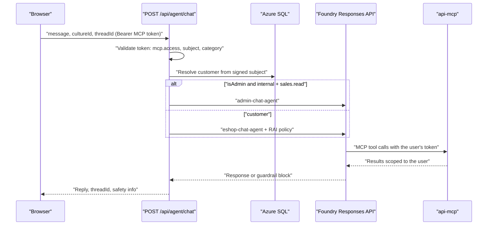

# AI chat

## What it does

Two chat experiences share one backend route:

| Chat | Where | Agent | Can do |
|---|---|---|---|
| **Customer support** | Storefront chat widget (signed-in customers) | `eshop-chat-agent` (`AI_AGENT_CHAT_ID`) | Look up the customer's own orders, search products, recommend items, summarize reviews, check availability |
| **Admin assistant** | Admin portal dashboard | `admin-chat-agent` (`AI_AGENT_ADMIN_CHAT_ID`) | Business statistics, top customers, orders by status, sales and product performance, inventory and promotions |

The agent calls MCP tools **as the signed-in user**, so api-mcp applies the same scopes and ownership checks as any other request. A customer can only see their own orders.

## Try it

**Storefront:** sign in, open the chat bubble and ask "What did I order last time?". The widget also offers safety demo prompts that show guardrail and ownership protection.

**Admin:** sign in to the Admin portal and use the assistant on the dashboard. Conversations are kept in the browser's local storage.

**API:** chat needs an **MCP-audience** user token sent to the Functions endpoint, so use `token --resource mcp` rather than `request --resource functions`:

```bash
MCP_TOKEN=$(python3 scripts/utilities/azure-auth.py token --identity admin --resource mcp)
FUNCTIONS_URL=$(azd env get-value API_FUNCTIONS_URL --no-prompt)

# Supply the header on stdin so the token is not visible in process arguments.
printf 'Authorization: Bearer %s\n' "$MCP_TOKEN" |
  curl --silent --show-error --fail-with-body --header @- \
    --header 'Content-Type: application/json' \
    --data '{"message": "How many orders are pending?", "isAdmin": true}' \
    "${FUNCTIONS_URL%/}/api/agent/chat"
unset MCP_TOKEN
```

See [Authenticated local scripts](../../testing/AZURE_AUTHENTICATED_SCRIPTS.md) for the exact helper options, and [AI chat MCP testing](../../testing/AI_CHAT_MCP_TESTING.md) for end-to-end tests. Each message is an AI call.

## How it works



1. The route is anonymous at the Functions gateway; the function validates the MCP-audience token itself. It requires `mcp.access`, a subject and a category.
2. Customer identity comes from the signed token, not the request body. Messages are limited to 4,000 characters.
3. `isAdmin: true` selects the admin agent only for internal users with `sales.read`. If `AI_AGENT_ADMIN_CHAT_ID` is not set, the customer agent is used.
4. Customer chat sends the `AdventureWorks-Eshop` RAI policy. A blocked request returns a friendly reply with `safety.source = "foundry"` and `blocked = true`.
5. Follow-up messages pass the returned `threadId`. The function checks that the conversation belongs to the same user and agent.

`GET /api/agent/status` is anonymous and returns basic feature information.

## Data & storage

- Conversation state: Foundry Responses API (`previous_response_id`).
- Admin conversation list: browser `localStorage`.
- Agent memory: Foundry memory stores, keyed by `x-memory-user-id`.

## Events

None. Chat is request/response.

## Security

- Delegated MCP token per user; ownership and scope checks happen in api-mcp.
- Admin mode requires an internal category and `sales.read`.
- Customer chat uses the Foundry guardrail policy from `infra/modules/eshop-chat-guardrails.bicep`.
- Tokens are never stored in agent definitions.

## Configuration

| Setting | Purpose |
|---|---|
| `AI_AGENT_CHAT_ID` | Customer agent |
| `AI_AGENT_ADMIN_CHAT_ID` | Admin agent |
| `AI_FOUNDRY_PROJECT_ENDPOINT` | Foundry project |
| `MCP_SERVICE_URL` | MCP server for tools |

## Limits

- Maximum message length is 4,000 characters.
- Suggested follow-up questions are fixed text.

## Related code & docs

- `api-functions/Functions/AIAgentFunctions.cs`, `api-functions/Services/AIAgentService.cs`, `ChatIdentityService.cs`, `FoundryAgentClient.cs`
- `app/src/components/AIChatOverlay.tsx`, `app/src/lib/mcpService.ts`
- `app-admin/src/components/AiAgentChat.tsx`, `app-admin/src/services/agentService.ts`
- [Foundry agents](foundry-agents.md) · [OAuth server](../mcp-oauth/README.md)
