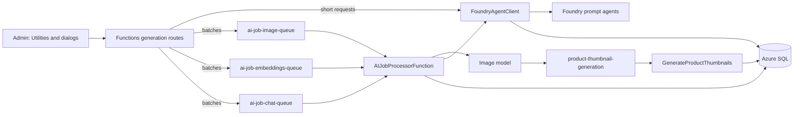

# AI content generation

## What it does

The Admin portal can grow and refresh the AdventureWorks catalog with AI:

| Content | Agent or model | Route (`/api/...`) |
|---|---|---|
| Product descriptions and copy | `admin-product-content-agent` | `POST products/generate-content` |
| Product images | Image model deployment | `POST products/{productId}/generate-images`, `POST GenerateProductImages_HttpStart` (all products that need images) |
| Thumbnails | Resized from generated images | Queue `product-thumbnail-generation` |
| New categories | `admin-catalog-suggestion-agent` | `POST GenerateCategoryWithAI` (`GET GetSubcategoryProductCount` helps choose) |
| Customers | `admin-customer-agent` | `POST customers/generate-with-ai` |
| Orders | `admin-order-agent` | `POST GenerateOrderWithAI`, `POST GenerateOrdersBulk` |
| Reviews | `admin-review-agent`, `admin-review-batch-agent` | `POST generate-verified-reviews/start`, `POST products/{productId}/generate-reviews-with-replies` |
| Review analysis | `admin-review-analysis-agent` | `POST reviews/analyze-batch` |
| Translations | `admin-translation-agent` | `TranslateProductDescriptions_HttpStart`, `TranslatePromotion`, `TranslateCategoryName`, `TranslateLanguageFile_HttpStart` |
| Promotions | `admin-promotion-agent` | `POST GeneratePromotion` |
| Cart recovery | `admin-cart-recovery-agent` | `POST carts/analyze-recovery` |
| Marketing email | `admin-email-content-agent` | `POST email/generate-ai-content` |
| Embeddings | `embedding` deployment | `GenerateProductEmbeddings_HttpStart` and related routes |

Manufacturing instructions and diagrams are covered in [manufacturing content](../manufacturing/manufacturing-content.md).

## Try it

**UI:** in the Admin portal open **Utilities** (`/utilities`). Generators are grouped there, along with the product creation wizard (generated copy and images), category, customer, order, review and translation tools, and the [shopping simulator](../simulators/shopping-simulator.md).

**API:**

```bash
python3 scripts/utilities/azure-auth.py request --identity admin \
  --resource functions --path /api/ai-job-queue/status
```

Generation routes make AI calls and write data; use them deliberately.

## How it works



- **Short requests** call an agent directly through `FoundryAgentClient`. Most content agents use no MCP tools; the Functions code passes the needed data in the request. The customer and order agents call MCP tools with a narrowly scoped service token.
- **Batches** go to three model-specific queues, one per model deployment, so image, embedding and chat work are processed independently. The shared `host.json` queue settings apply (up to 16 messages per batch, 5 dequeue attempts before the poison queue):

  | Queue | Job types |
  |---|---|
  | `ai-job-image-queue` | `image` |
  | `ai-job-embeddings-queue` | `product-embeddings`, `review-embeddings` |
  | `ai-job-chat-queue` | `translation`, `review`, `generate-order` |

- `GET ai-job-queue/status` (`admin.read`) returns the approximate pending count per queue.
- **Images:** the bulk route clears the image and thumbnail queues, then queues one job per product that still needs photos. Each job generates an image, saves it as `Production.ProductPhoto` and links it with `ProductProductPhoto`, then queues a thumbnail job.
- **Long translations** (`TranslateLanguageFile_*`) and review batches run as Durable orchestrations with status routes.

## Data & storage

| Store | Contents |
|---|---|
| SQL `Production.Product*`, `ProductPhoto`, `ProductReview`, `ProductCategory` / `ProductSubcategory` | Generated catalog content |
| SQL `Person.*`, `Sales.*` | Generated customers and orders |
| Queues `ai-job-image-queue`, `ai-job-embeddings-queue`, `ai-job-chat-queue`, `product-thumbnail-generation` (each with a poison queue) | Background jobs |

## Events

Generated orders flow through the order pipeline and publish `orders` events; review changes publish `reviews` events; promotions publish `promotions` events. See [real-time eventing](../../architecture/realtime-eventing.md).

## Security

Generation routes need `admin.write`; status and helper reads need `admin.read`. Only internal admin roles hold these scopes.

## Configuration

| Setting | Purpose |
|---|---|
| `AI_AGENT_*_ID` | Agents listed above; see [Foundry agents](foundry-agents.md) |
| `imageDeploymentModelName` | Image model selected at deployment; optional and dependent on regional quota |
| `embeddingDeploymentModelName` | Embedding model |
| `chatGptDeploymentName` | Model used by prompt agents |

## Limits

- Image generation depends on an image model deployment being available in `FOUNDRY_LOCATION`. When none is deployed, image jobs fail and other generators keep working.
- Image jobs are slow and limited by the image deployment's quota; large batches can hit rate limits.
- Bulk image generation clears any previously queued image and thumbnail jobs.

## Related code & docs

- `api-functions/Functions/GenerateProductContentFunction.cs`, `GenerateProductImages.cs`, `GenerateProductThumbnails.cs`, `AIJobProcessorFunction.cs`
- `api-functions/Services/AIService.cs`, `FoundryAgentClient.cs`
- `app-admin/src/pages/UtilitiesPage.tsx`, `app-admin/src/services/utilityService.ts`, `app-admin/src/components/GenerateProductsWizardDialog.tsx`
- [Foundry agents](foundry-agents.md) · [Admin portal](../../apps/admin-portal.md)
