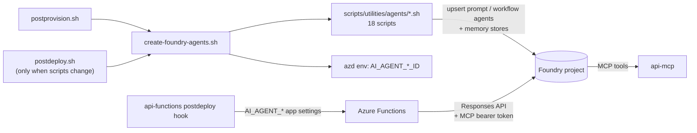

# Foundry agents

## What it does

AdventureWorks keeps its AI instructions and tool lists in Microsoft Foundry agent definitions rather than in application code. The deployment hooks create **21 agents** in the Foundry project:

- **15 prompt agents** called by Azure Functions for chat, order generation, content, reviews, translation and manufacturing content.
- **3 workflow agents** and **3 intent agents** that show declarative Foundry workflows. They are deployed for exploration in the Foundry portal and are not called by the app.

The **hosted manufacturing agent** is a separate code-based agent deployed as an azd service; see [manufacturing agent](../manufacturing/manufacturing-agent.md).

## Try it

**Portal:** open the Foundry project (`AI_FOUNDRY_PROJECT_ENDPOINT`) → **Agents** to see the definitions, instructions and tools.

**App:** sign in to the storefront and open the chat widget, or use the Admin dashboard assistant; see [AI chat](ai-chat.md).

**Agent IDs:**

```bash
azd env get-value AI_AGENT_CHAT_ID --no-prompt
azd env get-value AI_AGENT_ORDER_ID --no-prompt
```

## How it works



### Creation

- `postprovision.sh` runs `scripts/utilities/create-foundry-agents.sh` after RBAC propagates. It runs all 18 scripts in `scripts/utilities/agents/` and stores a hash of the scripts as `FOUNDRY_AGENT_CONFIG_HASH`.
- `postdeploy.sh` re-runs creation only when the hash changes.
- The `api-functions` postdeploy hook re-upserts the Help-Me-Choose agent and copies the `AI_AGENT_*` IDs, `MCP_SERVICE_URL`, `MANUFACTURING_AGENT_ENDPOINT` and `API_FUNCTIONS_URL` into Function app settings.

Each prompt agent uses the `chatGptDeploymentName` model. Tools are built by `scripts/utilities/agents/lib/build-agent-tools.py` with an explicit allow-list against the `adventureworks_mcp` server; an empty allow-list means no MCP tool. Agent definitions never store an MCP authorization header.

To change an agent, edit its script and run `azd deploy --no-prompt`; the hooks detect the change and upsert the agents.

### Runtime

`api-functions/Services/FoundryAgentClient.cs` reads the agent definition, then calls the Foundry Responses API with the definition's instructions and tools. It:

- fills Handlebars placeholders such as `{{userId}}`, `{{userName}}` and `{{cultureId}}` before sending;
- injects a per-request MCP bearer token and a W3C `traceparent` into the MCP tool headers;
- enforces the expected tool allow-list for guarded agents;
- continues conversations with `previous_response_id` and checks that a conversation belongs to the caller;
- sends `x-memory-user-id` for agents with memory.

### Agent catalog

| Foundry name | Kind | Env var | Purpose | MCP tools | Memory | Used by |
|---|---|---|---|---|---|---|
| `eshop-chat-agent` | prompt | `AI_AGENT_CHAT_ID` | Storefront customer support | 8 (orders, products, recommendations, reviews, availability) | yes | `POST /api/agent/chat` (delegated user token) |
| `admin-chat-agent` | prompt | `AI_AGENT_ADMIN_CHAT_ID` | Admin assistant | 15 read tools | yes | `POST /api/agent/chat` with `isAdmin` |
| `admin-order-agent` | prompt | `AI_AGENT_ORDER_ID` | AI order generation | 12 | yes | Shopping simulator, `GenerateOrderWithAI`, `GenerateOrdersBulk` |
| `admin-promotion-agent` | prompt | `AI_AGENT_PROMOTION_ID` | Promotion suggestions | none | yes | `GeneratePromotion`, auto-promotion queue |
| `admin-cart-recovery-agent` | prompt | `AI_AGENT_CART_RECOVERY_ID` | Abandoned-cart strategy | none | yes | `carts/analyze-recovery` |
| `admin-review-agent` | prompt | `AI_AGENT_REVIEW_ID` | Single verified review | none | yes | Verified review generation |
| `admin-customer-agent` | prompt | `AI_AGENT_CUSTOMER_ID` | Fictitious customer profiles | `generate_random_customer`, `generate_random_customer_for_locale` | yes | `customers/generate-with-ai` |
| `admin-product-content-agent` | prompt | `AI_AGENT_PRODUCT_CONTENT_ID` | Product descriptions | none | yes | `products/generate-content` |
| `manufacturing-content-agent` | prompt | `AI_AGENT_MANUFACTURING_CONTENT_ID` | Assembly instructions, diagrams, part sheets | none | no | `manufacturing/content/*` |
| `admin-translation-agent` | prompt | `AI_AGENT_TRANSLATION_ID` | Translations | none | yes | `Translate*` routes, AI job queue |
| `admin-review-batch-agent` | prompt | `AI_AGENT_REVIEW_BATCH_ID` | Batch reviews with replies | none | yes | Review generation routes |
| `admin-review-analysis-agent` | prompt | `AI_AGENT_REVIEW_ANALYSIS_ID` | Review sentiment and moderation | none | yes | `reviews/analyze-batch`, moderation queue |
| `admin-email-content-agent` | prompt | `AI_AGENT_EMAIL_CONTENT_ID` | Marketing email content | none | yes | `email/generate-ai-content` |
| `admin-catalog-suggestion-agent` | prompt | `AI_AGENT_CATALOG_SUGGESTION_ID` | New category suggestions | none | yes | `GenerateCategoryWithAI` |
| `eshop-help-me-choose-agent` | prompt | `AI_AGENT_HELP_ME_CHOOSE_ID` | Anonymous product wizard | 4 catalog tools | no | `/api/helpme/*` (catalog-only service token) |
| `eshop-workflow-agent` | workflow | `AI_AGENT_WORKFLOW_CHAT_ID` | Routes chat to help-me-choose or support | — | — | Not called by the app |
| `admin-promotion-workflow-agent` | workflow | `AI_AGENT_WORKFLOW_PROMOTION_ID` | Guided promotion creation | — | — | Not called by the app |
| `admin-order-workflow-agent` | workflow | `AI_AGENT_WORKFLOW_ORDER_ID` | Guided order generation | — | — | Not called by the app |
| `eshop-intent-agent` | intent | — | Classifier inside the chat workflow | none | no | Workflow only |
| `admin-order-intent-agent` | intent | — | Classifier inside the order workflow | none | no | Workflow only |
| `admin-promotion-intent-agent` | intent | — | Classifier inside the promotion workflow | none | no | Workflow only |

Workflow definitions are in `workflows/*.yaml`.

### Memory stores

13 prompt agents have a Foundry memory store (`AI_AGENT_*_MEMORY_STORE`, created with the `embedding` deployment). Functions sends the caller's ID in `x-memory-user-id`. How much the stores influence responses has not been verified in this project.

### Guardrails

`infra/modules/eshop-chat-guardrails.bicep` defines the RAI policy `AdventureWorks-Eshop` (blocking): hate, sexual, violence and self-harm filters at medium, jailbreak detection, protected-material text blocking and a custom blocklist that rejects code output. Functions applies it to customer chat requests by policy ID. See [AI chat](ai-chat.md).

### Other project resources

The hooks also create a Foundry connection `adventureworks-dab-mcp` to the DAB MCP endpoint. No agent currently uses it.

## Data & storage

Agent definitions and memory stores live in the Foundry project. Conversation state is kept by the Responses API (`store: true`). Agent IDs are azd environment values and Function app settings.

## Events

None directly. Features that call agents publish their own events.

## Security

- Hooks use an Azure CLI token for `https://ai.azure.com`. Functions uses its managed identity.
- MCP calls carry either the signed-in user's delegated token (chat) or a narrowly scoped service token (generation agents). See [OAuth server](../mcp-oauth/README.md).

## Configuration

| Setting | Purpose |
|---|---|
| `AI_FOUNDRY_PROJECT_ENDPOINT` | Foundry project |
| `chatGptDeploymentName` | Model for prompt agents |
| `AI_AGENT_*_ID`, `AI_AGENT_*_MEMORY_STORE` | Agent and memory IDs |
| `FOUNDRY_AGENT_CONFIG_HASH` | Detects script changes |
| `MCP_SERVICE_URL` | MCP server used by agent tools |

`AI_AGENT_MANUFACTURING_ID` and `AI_AGENT_WORKFLOW_HELP_ME_CHOOSE_ID` appear in some settings files but are not used.

## Limits

- The workflow and intent agents are for portal exploration only.
- Agent creation needs model capacity in `FOUNDRY_LOCATION`; preup selects available models.

## Related code & docs

- `scripts/utilities/create-foundry-agents.sh`, `scripts/utilities/agents/`
- `scripts/hooks/postprovision.sh`, `scripts/hooks/postdeploy.sh`, `scripts/hooks/api-functions-postdeploy.sh`
- `api-functions/Services/FoundryAgentClient.cs`
- `infra/modules/eshop-chat-guardrails.bicep`, `workflows/`
- [AI architecture](../../architecture/ai-architecture.md) · [AI content generation](ai-content-generation.md)
