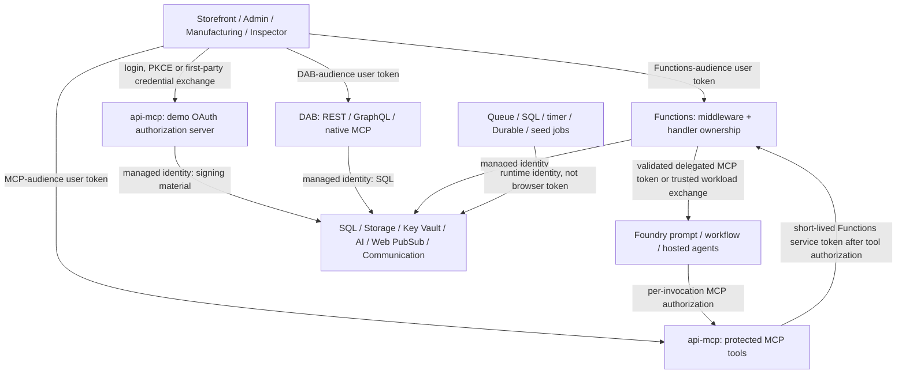

# End-to-end authentication and authorization assurance (OAuth, managed identity, RBAC and validation)

This guide is the assurance deep dive for AdventureWorks identity. It explains
how authentication and authorization are verified end to end: the threat model
and trust paths, the invariants every service must hold, the accepted exceptions,
and the test suites and gates that produce evidence.

For the overview of clients, audiences, scopes, roles, token lifetimes and
signing, read [Identity and authentication](../../architecture/identity-and-auth.md)
first. Per-scope and per-tool detail lives in the
[MCP OAuth guide](../mcp-oauth/README.md), the
[Functions OAuth guide](../functions-oauth/README.md), the
[MCP tool scope matrix](../mcp-oauth/TOOL_SCOPE_MATRIX.md) and the
[Functions route scope matrix](../functions-oauth/ROUTE_SCOPE_MATRIX.md).
This document does not repeat those tables.

## Contents

- [Target and assurance status](#target-and-assurance-status)
- [Two identity systems, not one](#two-identity-systems-not-one)
- [Trust paths](#trust-paths)
- [Enforcement invariants](#enforcement-invariants)
- [Accepted exceptions](#accepted-exceptions)
- [Reproducible validation](#reproducible-validation)
- [Live mutation and email safety](#live-mutation-and-email-safety)
- [Deployment and clean-environment verification](#deployment-and-clean-environment-verification)
- [Test and gate map](#test-and-gate-map)
- [Related documentation](#related-documentation)

## Target and assurance status

The target is authenticated and authorized access to every business API by every
site and agent, with managed identity and Entra authorization for Azure dependencies.
Explicit public and platform exceptions are permitted, but must be bounded and tested.

The assurance runner, [`tests/auth/validate.py`](../../../tests/auth/validate.py)
(wrapped by `tests/scripts/validate-auth.sh`), records one status per check:

| Status | Meaning |
| --- | --- |
| `PASS` | The assertion ran in this run and held. |
| `FAIL` | The assertion ran and did not hold, or an exception is unreviewed. |
| `BLOCKED` | Required evidence was unavailable, incomplete, duplicated or ambiguous. Never a pass. |
| `ACCEPTED_EXCEPTION` | A reviewed, exactly bounded exception recorded with its justification. |
| `NOT_APPLICABLE` | The obligation genuinely does not apply to the selected profile. |

`required:*` checks are umbrella gates. Each reconciles exact same-run evidence
from its sub-checks: missing, skipped, duplicate or unclassified evidence leaves
it `BLOCKED`, and any failed sub-check fails it. `PASS` counts are never a
percentage of every solution path. Coverage is reported per group as
completed/applicable, with failed assertions counted as executed, not passed.
Accepted exceptions and inapplicable assertions do not inflate protected-operation
coverage.

Functions `GET` routes must be read-only; state changes use `POST`. The contract in
[`contracts.json`](../../../tests/auth/contracts.json) lists the reviewed read
routes as `safeFunctionReadRoutes` (probed live). Live denial sweeps probe only
the reviewed safe list; unknown or changed routes stay `BLOCKED` without a
request, and `inventory:functions-get-review-closure` fails when a registered
protected `GET` handler is not on the list.

#### Reviewed mutation denial fixtures

The Functions middleware rejects unauthenticated requests before any handler
runs, but `FUNCTIONS_OAUTH_MODE=disabled|audit` would let a request through. A
live denial probe is therefore sent to a mutation only when
`functionMutationDenialFixtures` in [contracts.json](../../../tests/auth/contracts.json)
has a reviewed fixture for it. Each fixture is keyed `<FunctionName>:<METHOD>`
and holds:

- the route and path values
- a body, or a short verbatim `rawBody`
- the expected regression status if auth were bypassed (400–599)
- the reason it is safe

The fixture is chosen so that, if auth were bypassed, the handler would reject
the request before writing anything. Anonymous and forged-token probes must
return 401 with the middleware challenge `Bearer realm="adventureworks-functions"`
and `error="missing_token"` or `error="invalid_token"`. No handler emits that
realm, so a handler's own 401/403 cannot pass as a middleware denial.

Mutations without a safe fixture are not probed live and stay `BLOCKED` in that
sweep. Their token, scope and category denials are covered instead by the
[isolated Functions host](#runner-behavior).

The fixture contract is validated strictly. Methods must be mutations, keys are
an allow-list, path values must match the route placeholders and
`[A-Za-z0-9-]{1,64}`, and `rawBody` is at most 64 characters. The
`inventory:function-mutation-fixtures` gate fails when a fixture no longer binds
a protected handler and method, so route drift forces a re-review before any
probe is sent.

#### Customer-profile substitution

The retained [reusable consumers](#reusable-demo-consumer-fixtures) have no
Customer row, so DAB `SalesOrderHeader` owner-row cells and MCP consumer
ownership cells cannot run against them. After the
[order canary](#bounded-order-canary-with-cancellation) runs, the report
reconciles each such `BLOCKED` cell to `PASS` only when every same-run substitute
exists exactly once and passed:

- `dab:owner-rows:*` uses `dab:owner-rows-customer:<same case>`
- `mcp-consumer:{A|B}:<tool>:<case>` uses the canary's
  `order:mcp:owner:*` and `order:mcp:foreign:*` checks

Each reconciled cell cites its substitutes. Without the canary, or if any
substitute is missing, duplicated or not `PASS`, the cell stays `BLOCKED`.

## Two identity systems, not one

| Layer | Authentication | Authorization |
| --- | --- | --- |
| AdventureWorks users | Demo database-backed login, self-hosted OpenIddict OAuth in api-mcp | Resource-bound JWTs, application category, business scopes/roles, record ownership |
| Azure workloads | Entra managed identity | Azure resource/data-plane RBAC; SQL contained Entra users and SQL grants |
| Seed-job bootstrap | Dedicated seed UAMI | SQL Entra administrator and AcrPull on the selected registry only; the seed log Azure Files SMB mount uses the ACA environment's runtime UAMI |
| Browser real-time connection | Functions-audience user JWT for negotiation; short-lived Web PubSub client token for the socket | Signed business scopes and category select server-issued groups |
| Deployment/platform integration | Deployment identity, and limited platform credentials where required | Deployment roles and explicitly scoped platform exceptions |

Users do **not** sign in through Entra ID. The demo identity provider is not an
enterprise identity system, and its limitations must not be confused with Azure
managed-identity authentication. See
[Identity and authentication](../../architecture/identity-and-auth.md) for the
clients, audiences, scopes, roles and lifetimes.

Assurance consequences:

- SQL Entra-only login does not by itself prove least privilege. Azure management
  RBAC does not grant SQL table access; contained users, database roles and
  explicit grants are checked separately (see
  [SQL-only effective permissions](#sql-only-effective-permissions)).
- The seed identity is separate from runtime access. Its SQL administrator role is
  a bootstrap boundary, not evidence about the runtime UAMI's permissions.
- The infrastructure profile checks that the DAB, api-mcp, Admin, Manufacturing and
  Inspector Container Apps use the runtime UAMI as their only ACR image-pull
  identity, with no username/password references, and that the seed job uses the
  seed UAMI with registry-scoped AcrPull. It also fails if the ACR admin user,
  anonymous pull or enabled repository-scoped tokens are found.
- Web PubSub and Communication Services deploy with `disableLocalAuth: true`; the
  infrastructure profile fails if local authentication is enabled. Functions
  creates its email client with managed identity.
- The Functions app is checked for the attached UAMI, matching `AZURE_CLIENT_ID`
  and the identity-based Functions Storage `clientId`.

Seed identity probes (read-only, opt-in):

- `python3 tests/scripts/test-seed-sql-identity.py` correlates a uniquely matched
  retained seed log with the selected execution settings, job identity, SQL target
  and script hash. Ambiguous or missing evidence is `BLOCKED`; raw logs and tokens
  never enter the report. See
  [seed log mount authentication](../../../tests/scripts/README.md#seed-log-mount-authentication).
- `python3 tests/scripts/test-seed-sql-principal.py` runs a read-only SQL query
  under the seed identity using a digest-pinned, non-seeding execution override.
  It verifies the SQL token and session identity, database and bootstrap
  `CONTROL`; the runtime contained user's SID, reader/writer memberships and
  `EXECUTE` grant; direct and nested privileged fixed-role memberships; and
  administrative and grant-option permission records for contained Entra
  principals, their roles and `public`. Incomplete traversal is `BLOCKED`. See
  [seed SQL principal diagnostic](../../../tests/scripts/README.md#seed-sql-principal-diagnostic).
- `python3 tests/scripts/test-seed-log-mount.py` verifies the SMB managed-identity
  mount with two non-seeding execution overrides (write, cross-execution read and
  exact cleanup) while Shared Key is disabled. See the
  [seed-job guide](../../../seed-job/README.md#persistent-seed-logs-managed-identity-smb-mount-preview).

These catalog checks are not a full effective-permission inventory: `DENY`s,
directory-group memberships, server grants and ownership chains are outside them.

## Trust paths



### Browser and delegated calls

- Each resource has a separate audience derived from deployment configuration.
  MCP, DAB and Functions tokens are not interchangeable.
- Admin and Manufacturing use public-client PKCE S256 flows and portal category
  checks. The storefront uses the first-party consumer credential exchange.
- Storefront user state and its resource tokens are tab-scoped in `sessionStorage`;
  another tab does not inherit the signed-in user. Sign-out and account switching
  clear that tab's tokens and bound cart state before the next identity is used.
- First-party refresh sessions can request an allowed target resource. Refresh
  tokens do not authorize API operations directly.
- Chat is different from other Functions calls: `/api/agent/chat` validates an
  **MCP-audience** bearer token before forwarding it, and binds conversation
  continuation to the caller.
- On logout or user switch, tokens, user-bound caches and conversation references
  are cleared. A route guard alone is not API authorization.
- Origin checks prevent tokens reaching other hosts or redirect destinations.

### Autonomous agents and proxies

- Functions and the hosted Manufacturing agent obtain an Entra assertion with their
  actual runtime identity. The managed-identity assertion grant validates
  signature, tenant, audience, lifetime and a principal-object-ID allow-list, then
  issues an MCP-resource service token. A client ID, blueprint ID or agent name is
  not a substitute for the deployed instance principal.
- Server-owned workload profiles in
  [`ServicePrincipalPolicy`](../../../api-mcp/AdventureWorks/Auth/ServicePrincipalPolicy.cs)
  restrict both issued scopes and tool dispatch:

  | Principal | Scopes | Tools |
  | --- | --- | --- |
  | Shared runtime UAMI (Functions) | `mcp.access`, `products.read`, `inventory.read`, `customers.read`, `orders.read`, `admin.write` | 12 prompt-agent tools |
  | Hosted Manufacturing agent instance | `mcp.access`, `products.read`, `orders.read`, `inventory.read`, `manufacturing.read`, `manufacturing.write` | 20 manufacturing and supply tools |

  Missing, untrusted, unprofiled or overlapping identities fail closed. Task
  creation, results, input and cancellation recheck current principal trust and
  the tool profile. The shared UAMI's `admin.write` token cannot call other admin
  tools. Startup validation fails if a profiled tool lacks a matching scope policy.
- Service-token grants require explicit, recognized scopes; an omitted scope is
  rejected rather than expanded. Callers validate the returned grant set when the
  response includes `scope`.
- Functions injects user or workload tokens only into the configured api-mcp
  endpoint (exact path; host case, default port and one trailing slash
  normalized). Query strings, fragments, userinfo, noncanonical paths and
  non-loopback HTTP are rejected, as are static authorization or credential
  headers and stored project connections on that endpoint.
- Functions' token-exchange and Foundry HTTP clients, and the hosted agent's
  token client, do not follow redirects. Credential-bearing error bodies and
  warmup details are not logged.
- Agent tool allow-lists are enforced on the definition actually used
  ([`FoundryAgentClient`](../../../api-functions/Services/FoundryAgentClient.cs)):

  | Agent path | Token | Allowed tools |
  | --- | --- | --- |
  | Help Me Choose (public) | Service, `products.read` | 4 catalog tools |
  | Customer chat | Delegated user MCP token | 8 tools |
  | Admin chat | Delegated user MCP token | 15 read-only tools |
  | Customer generation | Service, `admin.write`, `tool_choice=auto` | 2 generator tools |
  | Order generation | Service, `products.read inventory.read customers.read orders.read admin.write`, `tool_choice=required` | 12 tools |

  The guard checks cached definitions too, rejects unexpected tool calls and
  approves only reviewed requests. Data-supplied generation can omit MCP tools;
  its SQL, Storage and Foundry calls still use workload identity.
- The hosted Manufacturing agent uses read scopes in ReadOnly and ProposePending
  modes and receives `manufacturing.write` with the two autonomous write tools only
  in FullyAutonomous mode. Before a service caller can dispatch
  `begin_manufacturing_run` or `place_supply_order`,
  [`ManufacturingAutonomyGuard`](../../../api-mcp/AdventureWorks/Auth/ManufacturingAutonomyGuard.cs)
  reads the persisted agent configuration through a Functions-audience service
  token and denies the action unless the mode is FullyAutonomous and any shutoff
  time is in the future. It checks before task creation and again before
  execution; unavailable configuration fails closed.
- MCP authorizes each tool before a proxy uses its backend Functions service token
  (5-minute lifetime, `sub=service:api-mcp`). `obo_sub` is audit context, not
  delegated authorization. The proxy clients bind that token to the exact
  configured `API_FUNCTIONS_URL` HTTPS origin, reject supplied
  Authorization/Host headers and do not follow redirects; HTTP is allowed only on
  loopback.
- Delegated requests retain user authority; failure never promotes a user to a
  service identity. Agent definitions do not store bearer tokens.
- All 63 MCP tools are driven through the real in-process HTTP/OpenIddict/MCP SDK
  pipeline (`required:mcp-tool-http-dispatch`): anonymous, wrong-audience and
  missing-scope denials, service-token allows, and two consumers for every
  owner-bound tool. An innermost sentinel records allowed dispatch without
  executing SQL or business mutations; denied calls must never reach it or
  create a task.
- Task authorization runs in the SDK's alternate-result filter, before `WithTasks`
  can schedule background work. Tasks persist `OwnerSubject`, `OwnerApplication`,
  `OwnerCategory`, `OwnerTool` and `RequiredScope`; every read, completion,
  cancellation and input operation rechecks the bound principal, its current
  scope and the originating tool policy. Category changes also deny. Records
  missing any binding fail closed (`required:mcp-task-ownership-offline`,
  `required:mcp-task-ownership`).
- Agent inventory: prompt agents, workflow sub-agents and the hosted agent are
  discovered with pagination (21 provisioned agents plus the hosted agent). Each
  version gets a stable ID and definition fingerprint; workflow action references
  must resolve to classified source provisioners, and each configured MCP tool
  edge gets its own runtime-evidence blocker. Credential-bearing static headers
  fail the inventory. The infrastructure profile also confirms api-mcp trusts
  exactly the shared runtime identity and the hosted instance principal.

#### Web PubSub capability authorization

Web PubSub negotiation (`GET /api/webpubsub/negotiate`) is an authenticated
Functions API. Each site sends a Functions-audience user token carrying
`realtime.connect`;
[`WebPubSubService`](../../../api-functions/Services/WebPubSubService.cs) derives
group grants from that token's signed scopes and category. The browser cannot
request or escalate group membership.

- Every group except `orders` requires an internal category plus one of its mapped
  domain scopes.
- `orders` is granted for `orders.read` (consumers) or `manufacturing.read`, and
  broadcasts only `{ "event": "orders-changed" }`. The internal `finance` group
  broadcasts only `{ "event": "finance-changed" }`. Identifiers, amounts,
  statuses, counts and table metadata are stripped at the publisher boundary, so
  every producer (including SQL-triggered changes) shares the same
  non-identifying payload.
- Tokens and negotiate URLs are not logged; capability URLs never appear in reports.

Verification: Functions unit tests cover group grants and payload reduction; the
live profile checks positive and negative negotiation; and
`python3 tests/scripts/test-functions-webpubsub.py` verifies a real Functions
publisher with one exactly cleaned test fixture.

### Background work

Queue, timer, SQL and Durable triggers are not public HTTP bearer-token endpoints,
but remain in the identity and dependency inventory. Verify identity-based host
storage, SQL trigger permissions, callback authorization, management URLs and job
identity. The absence of an HTTP route is not proof of authorization. The
[ownership closure](#ownership-handler-two-owner-closure) requires queue workers
never to resume a user conversation.

## Enforcement invariants

- Unknown Functions and MCP tools fail closed.
- A protected request needs a valid signature, issuer, audience, lifetime and
  subject. Functions accepts only the `consumer`, `employee`, `manufacturing` and
  `service` categories; internal access is not inferred from "anything except
  consumer". MCP tool decisions also reject missing subjects and unrecognized
  categories.
- Missing scope and forbidden category are reported separately from missing or
  invalid tokens.
- Consumer ownership derives from validated identity and server-resolved records,
  never a trusted caller-supplied owner ID.
- `FUNCTIONS_OAUTH_MODE` accepts `enforced`, `audit` or `disabled`. `enforced` or
  `audit` with missing configuration, or an invalid value, fails startup. An unset
  mode is `disabled`; deployments set `enforced`.
- Enforced-denial tests must prove handlers and side effects were not reached;
  registry membership tests cannot establish this alone.
- Resource-server metadata or key outages never become authorization success.
- Every Azure SDK client in Functions, MCP and the hosted agent receives an Entra
  token credential, with no key, SAS or connection-string fallback (see
  [Service-client token credentials](#service-client-token-credentials)).

## Accepted exceptions

Exceptions are not wildcard bypasses. Each has an exact operation/resource,
rationale, exposure boundary, compensating control and executable assertions, and
expansion requires review. Exceptions with an ID are emitted as
`ACCEPTED_EXCEPTION` checks.

| Exception | Boundary | Assurance treatment |
| --- | --- | --- |
| Public catalog, status and discovery | Functions Public tier and the DAB anonymous read entities | Exact names are pinned in `contracts.json` (`publicFunctions`, `anonymousDabReads`); expansion fails. Cost/replenishment and shelf/bin fields are excluded, verified by live field/select/filter/order checks. |
| Public Help Me Choose agent | Service token limited to `products.read`; Foundry definition allows four catalog tools | The live profile checks the deployed definition and the anonymous question/recommendation flow, which returns no caller identity or Foundry response IDs. |
| Pre-authentication | Signup, login, token, discovery and password-reset flows | Reset-token binding, enumeration resistance and rate limits are tested separately. |
| Alternate chat enforcement | Middleware classifies chat as public; the handler requires a validated MCP token | Not anonymous chat. A request without that token must receive 401. |
| Web PubSub capability | Negotiation requires `realtime.connect` plus mapped scopes and category | Not anonymous; see [Web PubSub capability authorization](#web-pubsub-capability-authorization). |
| Demo user identity and state | Database login, in-memory OAuth state, Key Vault signing certificate | Documented demo design, not enterprise SSO or multi-instance session persistence. |
| Same-portal distinct-user switch (`exception:session:deployed-distinct-user-switch`) | Admin and Manufacturing each have one seeded demo login | Test-coverage exception only; see [Internal session-transition matrix](#internal-session-transition-matrix). |
| Azure Files SMB managed-identity mount | ACA environment UAMI with Storage File Data SMB MI Admin at account scope | Platform-required for SMB OAuth with Shared Key disabled. Verified by `test-seed-log-mount.py`. |
| Web PubSub runtime data role (`infra:runtime-broad-builtin:webpubsub`) | Built-in Web PubSub Service Owner at the single Web PubSub resource | Exactly one assignment and the reviewed data-action-only definition shape (`infra:runtime-builtin-shape:webpubsub`). Browser group authorization remains server-selected. |
| Communication email role (`infra:runtime-sensitive-management:*`) | Built-in Communication and Email Service Owner at the single Communication resource | Exact role ID/name, scope, principal and unconditional assignment; the infrastructure profile separately checks `disableLocalAuth`. |
| Foundry data role (`infra:runtime-broad-builtin:foundry-data`) | Cognitive Services OpenAI User and Azure AI Developer, plus Cognitive Services Data Contributor (Preview) at the project | Reviewed data-action-only shape (`infra:runtime-builtin-shape:foundry-data`). |
| Shared SQL grants | Runtime UAMI holds `db_datareader`, `db_datawriter` and database `EXECUTE` | Applications enforce ownership above SQL; see [SQL-only effective permissions](#sql-only-effective-permissions). |
| Application Insights ingestion | Browsers need a connection string; all producers share one resource | The connection string is not a read credential. Telemetry-based checks use fresh random per-run trace IDs and correlate independent services; telemetry is corroborating, not cryptographic, evidence. |
| Static Web App deployment token | Used only by deployment | Kept out of reports; not an application credential. |
| Guest cart capability | Public session issuance; handlers accept a one-day opaque capability or a consumer bearer | No anonymous DAB cart access and no DAB cart writes; see [Guest cart verification](#guest-cart-verification). |
| Public reviews | Anonymous reads; authenticated create | Create binds `UserID` to the signed `business_entity_id`; consumers have no DAB update or delete; reviewer email is excluded from public reads. Helpful votes use Functions `POST`/`DELETE /api/reviews/{id}/vote`, which records one vote per signed consumer. |
| Service-principal deployer (`infra:deployer-service-principal-rbac-admin`) | GitHub Actions fallback only | See [Service-principal (GitHub Actions) deployment path](#service-principal-github-actions-deployment-path). |

DAB `create` database policies (Customer and review creation) are verified by
cross-owner denial with independent unchanged-state SQL evidence in the
[mutation profile](#disposable-demo-mutation-profile), because DAB documentation
and runtime behavior for create predicates have differed across releases.

### Deployer permissions and the built-in role compromise

Deploying users hold **Contributor** plus a conditioned role-assignment role,
not Role Based Access Control Administrator or any `roleDefinitions/write`
permission. The custom role [azd-deployer-role.json](../../../infra/azd-deployer-role.json)
adds only `roleAssignments/write` and `roleAssignments/delete`, and its ABAC
condition permits only the built-in role IDs in
[azd-role-assignment-allowlist.json](../../../infra/azd-role-assignment-allowlist.json).
The administrator justification and grant commands are in
[Deployer Permissions: Why Contributor Is Not Enough](../../AZD_DEPLOYER_PERMISSIONS.md).

The templates therefore create no custom role definitions, and the runtime UAMI
uses broader built-in roles. These are accepted exceptions to least privilege,
not to the RBAC-only target: no keys or connection secrets are used.

| Built-in role and scope | Additional runtime privilege |
| --- | --- |
| Communication and Email Service Owner, Communication resource | Resource, key and Email Service/domain management at that resource |
| Web PubSub Service Owner, Web PubSub resource | All Web PubSub data actions, including user/connection management; no management actions |
| Cognitive Services Data Contributor (Preview), Foundry project | All Cognitive Services data actions at the project; no management actions |

Executable coverage:

| Check | Kind | What it proves |
| --- | --- | --- |
| `test_deployer_role_allowlist_matches_infrastructure_role_assignments` | Offline source | No Bicep file or hook declares a role definition; every Bicep and hook role reference resolves to the allow-list |
| `test_deployer_condition_parser_accepts_only_the_reviewed_shape`, `test_documented_deployer_conditions_match_the_allowlist` | Offline source | Only the reviewed write/delete ABAC condition parses, and every documented condition allows exactly the allow-listed roles |
| `test_every_role_assignment_declares_a_principal_type` | Offline source | Every Bicep/AVM assignment declares `ServicePrincipal` or `deployerPrincipalType`; every hook assignment passes `--assignee-principal-type` |
| `infra:azd-role-assignments-allowlisted` | Live, read-only | Runtime UAMI, seed UAMI and deployer assignments in the resource group use only allow-listed role IDs |
| `infra:no-template-custom-roles` | Live, read-only | No custom role definition is assignable only within the resource group |
| `infra:azd-allowlist-excludes-privileged` | Live contract | The allow-list excludes the role-administration roles |
| `infra:runtime-builtin-shape:{webpubsub,foundry-data}` | Live, read-only | The live built-in definition keeps its reviewed data-action-only shape |
| `infra:runtime-broad-builtin:*`, `infra:runtime-sensitive-management:*` | `ACCEPTED_EXCEPTION` | Records each broad built-in with its justification and detected sensitive grants |
| `infra:deployer-access-management` | Live, read-only | Direct, transitive-group and inherited assignments for the deployer; Owner, User Access Administrator or unreviewed role-assignment authority fails |
| `infra:azd-assignee-principal-types` | Live, read-only | Deployer assignments use the declared `DEPLOYER_PRINCIPAL_TYPE` |
| `infra:deployer-service-principal-rbac-admin` | `ACCEPTED_EXCEPTION` (SP path only) | Records the conditioned RBAC Administrator grant held by the GitHub Actions service principal |

The condition limits which roles the deployer can assign, not who receives them
or where in the subscription; the administrator guide documents that residual risk.

#### Service-principal (GitHub Actions) deployment path

When the user cannot be granted Contributor directly, the
[azd-up-service-principal workflow](../../../.github/workflows/README.md) deploys
with a dedicated service principal. That principal holds **Contributor plus
built-in Role Based Access Control Administrator** at subscription scope, an
**accepted exception** to the "no RBAC Administrator" deployer rule. The workflow
sets `OBJECT_ID` to the service principal object ID and
`DEPLOYER_PRINCIPAL_TYPE=ServicePrincipal`; Bicep (`deployerPrincipalType`) and
the hooks (`--assignee-principal-type`) pass that type through.

The grant must carry the reviewed ABAC condition: for both write and delete, the
role ID must be in the allow-list **and** the assignee must be a
`ServicePrincipal`. The SP can therefore assign only allow-listed built-in roles
to managed identities and service principals, never to users or groups, and
cannot assign Owner, User Access Administrator or RBAC Administrator. An
unconditioned grant, a role set that differs from the allow-list, a missing
SP-only clause, or a direct Owner/User Access Administrator assignment fails
`infra:deployer-access-management`. If Azure cannot return effective assignments
or role definitions, the result is `BLOCKED`.

The workflow's azd state is temporary and the user may have no Azure access.
Setting the workflow input `validate_auth_infra=true` runs
`validate-auth.sh --infra` read-only on the runner as the SP after deployment and
uploads only a sanitized status-count `summary.md`; detailed reports and
`report.json` are withheld. Application, MCP and agent profiles still need local
`azd` access and the seeded demo logins.

To run those profiles locally after an SP deployment, recover the azd state with
`scripts/utilities/recover-azd-env.py`. `OBJECT_ID` then remains the SP, so the
template's Foundry data-plane roles belong to the SP, not the local operator.
Without separate Foundry `agents/read` access, Foundry-derived checks (deployed
agent discovery, the Help Me Choose definition, hosted-agent api-mcp trust and
agent dependency closure) report `BLOCKED` with a sanitized permission-denied
cause. Do not add an operator role assignment in place; per the demo policy,
template changes are applied by recreating the environment.

For complete local evidence, sign in to both `az` and `azd` as the deploying SP
(for example `az login --service-principal` and
`azd auth login --client-id ... --tenant-id ...` with a federated or certificate
credential the administrator issues). Application, DAB and MCP checks still
authenticate as the seeded demo users through api-mcp.

A recovered azd environment has no `AGENT_MANUFACTURING_AGENT_RESPONSES_ENDPOINT`
(azd writes it only when it deploys the hosted agent). The root `postdeploy.sh`
falls back to the published `MANUFACTURING_AGENT_ENDPOINT`, which
`recover-azd-env.py` restores from the Functions settings, so a service-scoped
`azd deploy` keeps the hosted instance principal trusted.
`scripts/utilities/hosted-agent-mcp-trust.py` re-reads the agent from Foundry and
trusts only a live hosted instance principal. `infra:mcp-service-grant-trust` and
`infra:mcp-service-principal-profiles` verify the result.

### Runtime RBAC verification

- `python3 tests/scripts/test-runtime-rbac.py` probes the runtime managed
  identity's actual permissions from an existing container. Options:
  `--keyvault-probe`, `--webpubsub-probe`, `--service-profile-probe` and
  `--send-email` (opt-in, never retried automatically).
- `scripts/utilities/reconcile-runtime-rbac.py` reports runtime role assignments
  against source.
- The infrastructure profile checks resource-server settings, Key Vault RBAC,
  Entra-only SQL, disabled AI keys, host storage identity, runtime roles and their
  definitions, revisions and deployed agents. Validated, fresh Functions
  `/api/health/readiness` and MCP `/ready` responses supply operation-limited
  identity observations (including an optional sanitized SQL-principal check);
  absent, stale or contradictory evidence is `BLOCKED`.

## Reproducible validation

Prerequisites: Bash/Linux, Python 3.10+, Node, the repository .NET SDK, existing
frontend dependencies, azd and Azure CLI. Install the assurance Python
dependencies in an isolated environment (the private runner and offline CI
install the same file):

```bash
python3 -m venv .venv
source .venv/bin/activate
python3 -m pip install -r tests/auth/container/requirements.txt
```

Select the intended azd environment and authenticate with normal local-development
credentials. No hostnames, subscription IDs, resource names or principal IDs
belong in test source. The live profile also needs Chromium for the storefront's
Playwright dev dependency (`cd app && npx playwright install --with-deps chromium`;
set `PLAYWRIGHT_SKIP_BROWSER_GC=1` in shared environments). Missing browser
prerequisites are `BLOCKED`, never browser success.

```bash
bash tests/scripts/validate-auth.sh --offline
bash tests/scripts/validate-auth.sh --environment <environment> --infra
bash tests/scripts/validate-auth.sh --environment <environment> --live
bash tests/scripts/validate-auth.sh --environment <environment> --all
```

Exactly one profile is required: `--offline`, `--infra`, `--live`, `--all`,
`--browsers`, `--chat`, `--mcp-functions`, `--catalog-agent`, `--promotion-agent`,
`--email-content-agent`, `--product-content-agent`,
`--manufacturing-content-agent`, `--analysis-agent` or `--order-canary`.
Opt-in flags add paid or mutating work and are validated against the profile:

| Flag | Requires | Effect |
| --- | --- | --- |
| `--functions-host` | `--offline` or `--all` | Real local Functions worker (see [Runner behavior](#runner-behavior)) |
| `--public-agent-canary` | `--catalog-agent`, `--live` or `--all` | Bounded paid Help Me Choose requests |
| `--customer-agent-canary`, `--admin-agent-canary` | `--chat`, `--live` or `--all` | One paid chat request each |
| `--promotion-agent-canary`, `--email-content-agent-canary`, `--product-content-agent-canary` | The matching profile, `--live` or `--all` | Bounded paid inferences |
| `--manufacturing-content-agent-canary`, `--analysis-agent-canary` | The matching profile only | Bounded paid inferences |
| `--hosted-agent-canary` | `--live` or `--all` | One paid no-tool hosted Manufacturing agent call |
| `--order-cancellation-canary` | `--order-canary` or `--all` | Creates and cancels two orders |
| `--agent-tool-sweep` | A chat canary, or the order canary with cancellation | Per-tool chat prompts with telemetry correlation |
| `--generation-agent-canary` | `--live`, `--all`, or the order canary with cancellation | AI customer and order generation |

`--environment <name>` selects an azd environment; `--output <new-directory>`
selects a new evidence directory.

### Runner behavior

- Every profile builds and reflects the current Functions and MCP assemblies.
  `--offline` and `--all` run both complete .NET test projects, the Python
  helper/verifier tests, selected Node and Vitest auth tests,
  `npm --prefix mcp-inspector test` and the seed-job Python tests.
- `--functions-host` runs the real Functions host in a loopback-only Linux user
  and network namespace with local Azurite, temporary signing keys and OpenID
  metadata. It needs `func`, `azurite`, `dotnet`, `openssl`, `unshare` and `ip`
  on `PATH`, plus permission to create the namespace. Non-HTTP triggers are
  disabled. It covers every protected route/method binding for invalid, missing
  and expiry-less tokens, category and scope denials, and unsupported
  `HEAD`/`OPTIONS`, without handler entry (`required:functions-middleware-host-denials`).
  Missing tools or unsupported isolation are `BLOCKED`.
- Runs are serialized because they share build outputs. Do not start concurrent
  profiles against the same checkout.
- Live checks exercise safe Functions `GET` denials, forged tokens, alternate chat
  enforcement, discovery, staff Functions/DAB reads, MCP proxy allow/deny,
  consumer cart ownership and browser sign-in. They never run global resets or
  clear queues. Long profiles renew the shared ten-minute internal tokens with
  paced logins. Network failures are not counted as auth denials.
- CLI output from auth/settings commands and response bodies are not dumped.
  Tokens stay in process memory.

Reports go to the ignored `.auth-results/<run-id>/` directory: reflected
inventories, `report.json`, `junit.xml`, .NET TRX logs and a Markdown summary.
Source revision, diff fingerprint, selected environment, deployed agent versions
and Container App revisions identify what was tested. Do not publish raw logs or
`report.json` without review; it contains the discovered resource inventory.

Exit codes:

- `0`: all selected assertions passed with no blocked evidence.
- `1`: a failed assertion or unreviewed exception.
- `2`: required evidence unavailable or incomplete, with no failure.

The [Build-Checker workflow](../../../.github/workflows/build-checker.yaml) runs
`--offline` weekly and on manual dispatch, without Azure credentials. It accepts
exit 0 or 2, fails on any `FAIL`, and requires these nine gates to `PASS` exactly
once: `required:entra-assertion-real-signature-negatives`,
`required:functions-worker-middleware`, `required:address-handler-ownership`,
`required:password-handler-ownership`, `required:receipt-handler-ownership`,
`required:consumer-handlers-offline`, `required:guest-cart-service-lifecycle`,
`required:mcp-tool-http-dispatch` and `required:mcp-task-ownership-offline`.
CI success is not end-to-end conformance.

### Standalone private-network suite runner

SQL is private after deployment. The manual
[private runner](../../../tests/scripts/run-auth-assurance-job.py) runs the suite
inside the existing networked Container Apps environment. It is separate from
`azd up`: no application Bicep module, azd service, hook or schedule invokes it.

```bash
python3 tests/scripts/run-auth-assurance-job.py --preflight   # read-only discovery
python3 tests/scripts/run-auth-assurance-job.py               # full private suite
```

The full run inspects infrastructure locally, prepares the reusable consumers,
builds a curated test image, deploys only the
[temporary manual job](../../../infra/testing/auth-assurance-job.bicep), waits for
its single execution, verifies report upload and removes the exact job in a
`finally` path. The deployer owns ARM/ACR operations; the job uses only the
existing runtime UAMI, with no new role assignments, ingress or forwarded deployer
credentials. The default command also runs the `--functions-host` harness on the
local control plane and carries its gate result into the combined report.

PDF, HTML, JSON and JUnit results share one assertion source and are uploaded,
create-only and readback-checksummed, to the private
`adventureworks-receipts/auth-assurance/<UTC timestamp>-<UUID>/` prefix. Local
lifecycle ledgers are ignored, mode-0600 files.

Execution modes are mutually exclusive:

| Mode | Purpose |
| --- | --- |
| `--preflight` | Read-only discovery; no image, job or fixture |
| *(none)* | Full private suite |
| `--mutations` | [Disposable-demo mutation profile](#disposable-demo-mutation-profile) |
| `--sql-only` | [SQL-only effective permissions](#sql-only-effective-permissions) |
| `--browser-only` | All-site Chromium scenarios with isolated cart mutations |
| `--address-only` | API-created private address fixtures, owner denials and verified cleanup |
| `--cleanup <ledger>` | Recover exact job deletion from an existing ledger |
| `--recover-reports <ledger>` | Re-read uploaded private reports with the runtime identity |

`--browser-only` runs the storefront guest/cart/sign-in/merge flow, a consumer
A-to-B switch and new-tab isolation, Admin/Manufacturing login, renewal and DAB
reads, and Inspector user, tab and MCP-session isolation. The same scenarios run
locally with `bash tests/scripts/validate-auth.sh --browsers`.

The full private suite also runs a workload boundary probe that obtains an
assertion with `ManagedIdentityCredential` for the runtime UAMI only, exchanges it
for `mcp.access products.read`, and checks the issued service claims, a catalog
positive, scope denials, a non-profile tool denial and cross-audience denials.

#### Disposable-demo mutation profile

The deployed demo is disposable business data, not a production environment.
Mutation tests may create and update records and intentionally leave audit/history
or run-owned fixtures. They must still verify authorization, persisted state and
denied-write side effects. Permission to change data is not permission to change
Azure networking, grants, infrastructure or authentication settings.

```bash
# Direct deployed API iteration, with local reports:
python3 tests/auth/mutation_suite.py

# Reproducible private job, timestamped Storage reports and exact compute removal:
python3 tests/scripts/run-auth-assurance-job.py --mutations
```

The default private job also runs this suite. Both modes retain run-owned fixtures
and record their IDs or uncertain create states in the report. They do not need a
pristine deployment, reseeding or environment recreation.

The [mutation suite](../../../tests/auth/mutation_suite.py) uses new run-owned
consumer accounts, discovers a valid product and state/province through DAB, and
does not assume seed counts. Selected scenarios:

- **Customer creation.** Two new people without Customer rows attempt cross-owner
  REST and GraphQL creates in both directions under `consumer` and
  `authenticated`, plus anonymous, forged and Functions-audience attempts. Every
  attempt is recorded before sending and bracketed by independent private SQL
  reads. Cross-owner denials must be DAB's database-policy failure, not a
  constraint error. Owner-bound positive creates then confirm person, territory,
  null store and that freshly issued tokens carry the new `customer_id` claim.
  Client-supplied `StoreID` is denied for both protocols and roles with SQL-confirmed
  absence. Direct runs without private SQL block before sending any create.
- **Catalog creation.** Each consumer attempts category and subcategory creates
  with anonymous, forged, DAB-audience and consumer Functions credentials (the
  last must fail the internal `admin.write` boundary). Pre/post public reads prove
  no marker-matched row exists. Uncertain results are never retried.
- **Addresses** (`--address-only`, [`address_fixture_suite.py`](../../../tests/auth/address_fixture_suite.py)).
  API-created private address fixtures with owner and foreign-owner checks and
  verified cleanup; the C# helper is [`AddressFixtures.cs`](../../../tests/auth/private/AddressFixtures.cs).

#### SQL-only effective permissions

The read-only `--sql-only` mode obtains effective permission evidence from the
shared runtime UAMI inside the private SQL network:

```bash
python3 tests/scripts/run-auth-assurance-job.py --sql-only
```

For the same evaluator without a temporary job, use the existing MCP container
(requires Container Apps exec access and a restored .NET project):

```bash
python3 tests/scripts/test-runtime-sql.py
```

It builds the probe locally, runs it with the container's managed identity and
verifies removal of its exact temporary files; unverifiable cleanup is `BLOCKED`.

The [SQL evaluator](../../../tests/auth/private/SqlPermissions.cs) verifies:

- the contained principal's SID against the selected client ID;
- required `db_datareader`/`db_datawriter` membership and database `EXECUTE`;
- no effective administrative-role membership or database DDL/administration rights;
- object `VIEW DEFINITION` and visible default-constraint definitions (needed for
  DAB creates with defaulted fields);
- USER-scoped `IMPERSONATE` on visible users;
- `CONTROL`, `ALTER` and `TAKE OWNERSHIP` on visible schemas and objects, DML on
  every visible table and `EXECUTE` on routines.

These are catalog and effective-permission reads, not attempted privileged
operations. A denied required grant fails; null or empty evidence blocks. The
shared reader/writer/`EXECUTE` contract is a recorded demo exception. The checks do
not certify other principals, server grants or invisible metadata.

### Reusable demo consumer fixtures

`--live` and `--all` may create two dedicated test users in the selected **demo**
deployment. Do not run this against a real customer environment. Signup uses
`@example.invalid` addresses and sends no email. New users have a business-entity
owner before any purchase creates a Customer row.

Credentials are generated once and retained in the ignored local azd environment
as `AUTH_TEST_CONSUMER_A_EMAIL`, `AUTH_TEST_CONSUMER_A_PASSWORD`,
`AUTH_TEST_CONSUMER_A_BUSINESS_ENTITY_ID` and `AUTH_TEST_CONSUMER_A_STATE`, with
equivalent `B` keys. Pending state is persisted before signup; an interrupted run
logs in before creating again, and passwords are never reset. The runner requires
an owned, Git-ignored dotenv file restricted to mode 0600 and never passes secrets
as CLI arguments. Do not print or publish `azd env get-values` output; it includes
these passwords.

Browser credentials and cleanup tokens pass only through the child process
environment. Evidence contains only fixture labels and owner IDs. Exact cart
fixtures are cleaned after every run; the accounts remain until the user tears the
environment down. The verifier never runs `azd down`.

### Service-client token credentials

`contract:service-clients:token-credential` runs in every profile. It scans the
non-test C# sources of `api-functions/`, `api-mcp/` and `manufacturing-agent/`
for every construction of a Storage (Blob, Queue, Table, Files), Key Vault,
Web PubSub, Communication Services email, Foundry/OpenAI or Azure Monitor client.
Each must pass a token credential: `DefaultAzureCredential`,
`ManagedIdentityCredential`, a selected-identity wrapper or an injected credential.
The scan fails on any `AzureKeyCredential`, `StorageSharedKeyCredential`,
`AzureSasCredential`, `ApiKeyCredential`, `AccountKey=`, `SharedAccessKey=`,
`UseDevelopmentStorage`, SAS-URI generation or a read of the `AzureWebJobsStorage`
connection string. A missing service URI fails closed rather than selecting a key
path; deployments use the identity-based `AzureWebJobsStorage__*` app settings.

SQL connection strings are not SDK credentials; `Authentication=Active Directory
Default` is covered by the SQL identity checks. The scan proves source intent;
deployed key disablement is proven by the ARM `disableLocalAuth` and
`allowSharedKeyAccess` checks.

### Guest cart verification

The guest-cart exception uses a server-issued 256-bit capability, stored only as
a SHA-256 hash, with a fixed one-day expiry. The server resolves every cart owner
from that capability or a validated consumer bearer; a caller-provided cart ID is
never authentication. Guest capabilities cannot authorize checkout or other APIs.

Sign-in merges guest items into the account in one SQL transaction. Failed or
uncertain merges keep the proof for retry; only confirmed success clears it.
Account switches and logout evict the previous cart cache, and Web Locks serialize
guest bootstrap across tabs. DAB allows only consumer-owner-filtered cart reads.

Coverage:

- `required:guest-cart-service-lifecycle`: real `OwnedCartService` expiry and
  lock-wait lifecycle tests (offline).
- Live: both capabilities' isolation, quantity, ownership denial and exact cleanup,
  plus anonymous DAB `GET`/`POST`/`PATCH`/`DELETE` denials.
- Browser: add while signed out, persist, reload, checkout redirects to sign-in,
  merge on sign-in and retirement (the retired capability returns 401).
- `guest-cart:cleanup:timer-execution`: reads aggregate Application Insights
  requests for the `CleanupExpiredGuestCarts` timer over 24 hours. Only
  invocations after the latest successful seed execution count, because the seed
  creates `Sales.GuestCartSession` asynchronously. No samples is `BLOCKED`;
  failed invocations fail.

### Internal session-transition matrix

`required:internal-session-transition-races` reconciles only in `--all`. It
derives each portal's asynchronous session exchanges from the exported functions
in `app-admin/src/services/dabAuth.ts` and `app-manufacturing/src/services/dabAuth.ts`.
Admin exports callback, refresh, Functions and MCP exchanges; Manufacturing
exports callback, refresh and Functions. A new exchange extends every requirement
below automatically.

| Evidence | Check | Cells |
| --- | --- | --- |
| Local node races and request sessions (TAP titles) | `required:internal-session-transition-local` | Per portal: account-switch token reads, stale portal state across a different user, stale profile attachment, superseded callback, stale refresh 200/400, Functions 200/401 and MCP 200/401 (where exported), and DAB/Functions/agent requests across account switches |
| Local real-browser two-tab switches | `browser:internal:cross-tab-local` | One case per exported exchange after cross-tab logout and a different user's sign-in, plus the route-removal guard |
| Deployed portals | `browser:internal:complete` and its per-scenario checks | Concurrent success/rejected races for every exported exchange, same-user new generation, stale-tab no-adoption, logout/cross-tab sign-out and wrong-category distinct-user denial |
| Accepted exception | `exception:session:deployed-distinct-user-switch` | Deployed same-portal distinct-user switching (one seeded identity per portal) |

Any `FAIL` fails the requirement. A missing deployed cell, local title or the
exception record leaves it `BLOCKED`.

### Hosted Inspector authentication

The hosted MCP Inspector is fronted by an
[OAuth gateway](../../../mcp-inspector/gateway.mjs). The pinned Inspector UI is
served as static files; its generic proxy, STDIO launcher, SSE transport and
arbitrary-target forwarding are not started. Nginx exposes only the loopback-bound
gateway.

Gateway design:

- The first-party `adventureworks-inspector` public PKCE client admits only
  employee and manufacturing categories and uses the deployed
  `OAUTH_INSPECTOR_REDIRECT_URIS`. The third-party `mcp-inspector` registration
  (with consent) remains for separately run developer clients.
- Two Authorization Code/S256 exchanges obtain separate custom-MCP and DAB tokens.
  The gateway validates signatures against issuer-pinned JWKS, exact
  issuer/audience/app, subject, internal category, role and expiry, and requires
  both tokens to identify the same user, category and role. Discovery, token, JWKS
  and target calls reject redirects.
- Tokens stay in bounded server memory. The browser receives only an opaque
  `Secure; HttpOnly; SameSite=Lax` `__Host-aw-inspector` cookie. Sign-in state is
  cookie-bound, single-use and expires after five minutes. Sessions end no later
  than either resource token, with no refresh or service-identity fallback; a
  restart requires sign-in again.
- Each sign-in first clears the authorization server's SSO login, so a previous
  portal user cannot silently become the Inspector user. Logout revokes the
  gateway session and terminates only its own MCP sessions. A callback whose
  exchange was cancelled by logout is rejected.
- Only the configured `API_MCP_URL` and `API_DAB_MCP_URL` targets are accepted.
  Browser-supplied Authorization, role and custom-auth headers are not forwarded.
  Backend MCP session IDs are bound to the gateway session and target; replay from
  another session returns `403 session_not_owned`. Unsafe methods require the exact
  Origin, the referrer policy is `strict-origin`, CSP limits UI network access to
  the gateway, and only `transportType=streamable-http` is accepted.
- Anonymous access is limited to the landing page, OAuth start/callback and a
  process-only `/health`. The iframe sets `MCP_SERVER_REQUEST_TIMEOUT` and
  `MCP_REQUEST_MAX_TOTAL_TIMEOUT` to 240,000 ms so scale-to-zero startup is not
  cancelled early.

Verification:

- `npm --prefix mcp-inspector test` (`gateway.test.mjs`) covers fail-closed
  configuration, real signed JWT verification, cookie-bound PKCE state,
  Origin/target/session isolation, logout, expiry at the earlier resource token,
  account switching, in-flight exchange cancellation and telemetry redaction.
- [`test-inspector-browser-auth.mjs`](../../../tests/scripts/test-inspector-browser-auth.mjs)
  runs in `--live`, `--all` and `--browsers` (`browser:inspector:complete`). It
  checks anonymous denial, real internal PKCE, the opaque cookie, no browser
  bearer tokens, both UI connections, delegated catalog and DAB reads,
  manufacturing Employee denial despite a forged role header, arbitrary-target,
  STDIO and Origin denial, a second tab, an independent admin context, MCP session
  replay denial, logout invalidation, a distinct-user switch with a held OAuth
  callback, and zero business mutations. Codes, state, cookies and tokens are
  never exported. Incomplete, duplicate or mutation-attempt evidence cannot pass.

### DAB role and field checks

The live profile reads every DAB entity under REST and GraphQL for each caller
(anonymous, executive-admin, manufacturing-engineer and both consumers under
`consumer` and `authenticated`), checks excluded fields (for example reviewer
email and cost fields) and verifies signed role-header denials: every explicit
business role missing from a caller's grants must return 403 under both protocols.
Invalid-token responses, 500s and empty pages cannot count as authorization proof.

#### DAB write-decision matrix

`required:dab-all-role-operation-decisions` is computed from same-run evidence. It
passes only when all of the following pass in one run:

- the offline contract `contract:dab:write-decisions`
- every live read-role cell
- every live write-role cell
- the signed role-header denials

Any failure makes it `FAIL`. Missing evidence leaves it `BLOCKED`.

**Offline contract.** The contract resolves every entity × role × create/update/delete
cell in `api/dab-config.json` (69 entities × 9 roles × 3 = **1,863** cells), using
DAB REST role inheritance: named role → `authenticated` → `anonymous`. Wildcard
actions and unclassified roles fail the contract. It asserts:

- no anonymous writes and no view writes
- every consumer/`authenticated` write has an exact
  `@item.X eq @claims.business_entity_id` owner policy
- consumer and `authenticated` decisions are identical
- manufacturing-engineer's explicit grants are limited to `Production.*` tables
- executive-admin holds every write granted to any other role
- every other admin role (and manufacturing-engineer) writes an entity only when it
  holds that entity's Functions write scope in api-mcp `ApplicationRoles`:
  `customers.write` for customer data, `orders.write` for orders,
  `manufacturing.write` for manufacturing tables, `admin.write` or
  `manufacturing.write` for `Product`, `ProductModel` and `ProductInventory`, and
  `admin.write` for everything else. `inventory-admin` has no write scope, so it is
  read-only. See [DAB entities](../../reference/dab-entities.md#roles).
- an internal role may inherit an `authenticated` write only through an owner
  policy. api-mcp adds `business_entity_id` only to consumer DAB/Functions tokens
  (`AuthorizationEndpoints.cs`), so such inherited grants fail closed for staff.
  Live REST reads by manufacturing-engineer on inherited owner-policy entities
  return 403 "User does not possess all the claims required".

**Live probes.** The live matrix sends zero-effect write probes. Each is rejected
by DAB request validation *after* authorization, so no SQL statement runs:

| Probe | Request | Allowed response | Denied response |
| --- | --- | --- | --- |
| `rest-create` | `POST /api/{Entity}` with body `[]` | 400 BadRequest (multi-entity mutation unsupported) | 403 `AuthorizationCheckFailed` |
| `rest-upsert` | `PATCH /api/{Entity}/NotAColumn/x` | 400 `InvalidIdentifierField`, or BadRequest for a composite-key mismatch | 403 `AuthorizationCheckFailed` |
| `rest-delete` | `DELETE /api/{Entity}/NotAColumn/x` | 400 (as above) | 403 `AuthorizationCheckFailed` |
| `graphql-update` | `update{Entity}(<keys>: -1, item: {})` | `BadRequest` "Update mutation does not update any values" | `AUTH_NOT_AUTHORIZED`, or `AUTH_NOT_AUTHENTICATED` when anonymous |

DAB behaviors these probes rely on:

- REST `PATCH` is an upsert, so DAB authorizes it against **both** create and
  update. `If-Match: *` does not change this.
- GraphQL mutations use only the role's explicit entity permission, with no
  inheritance, so the GraphQL update probe is the update-only oracle.
- GraphQL create with an empty item fails schema validation before authorization,
  so it is not used as a probe.

Probe shapes to avoid:

- `POST` with only unknown fields (could insert on all-optional tables)
- `PATCH`/`PUT` on a real nonexistent key (an upsert)
- `DELETE` on a real key

GraphQL update selectors are discovered from the deployed mutation schema and must
close exactly over the source tables that have any update grant. Callers are
anonymous, executive-admin (Ken), manufacturing-engineer (Peter) and both retained
consumers under `consumer` and `authenticated`. The matrix renews its own tokens
with paced logins; transport failures are retried once, then `BLOCKED`.

sales-admin, marketing-admin, inventory-admin and operations-admin have no seeded
identity, and adding one would be a database change. Their cells are decided by
the offline contract and the signed role-header denials (a held token cannot
assume an unheld role), not by live calls.

#### Ownership-handler two-owner closure

`required:all-ownership-handlers-two-owners` is an umbrella gate. It passes only
when every owner-bound surface has current-run evidence with two distinct owners:

| Surface | Gate | Evidence |
| --- | --- | --- |
| 20 consumer Functions handlers (`SelfOrInternal`) | `required:consumer-handlers-offline` | Exact registry closure, plus the address, password and receipt gates and 22 named two-owner payment, order-read, cart, server-priced checkout and review-vote cases (including transactional checkout rollback) |
| MCP `SelfOrInternal` tools | `required:mcp-tool-http-dispatch` | Real HTTP/OpenIddict dispatch with two consumer owners |
| MCP tasks | `required:mcp-task-ownership-offline` | Owner, scope and app bound across store recreation; foreign operations denied |
| Chat and agent continuations | `required:chat-continuation-ownership-offline` | Source-derived closure plus handler cases |
| DAB owner database policies | `contract:dab:write-decisions` and live `dab:owner-rows:*` (plus `dab:owner-rows-customer:*` from the order canary) | Every source policy of the form `@item.X eq @claims.Y`, read by both consumers under `consumer` and `authenticated` |

**Chat and agent continuations.** The runner finds every service with a
`string? conversationOwner` parameter: chat, order generation, product content and
promotion. Each Functions class that references one of these services must belong
to a known group:

- **HTTP handlers** must bind `caller.SubjectId`: AIAgentFunctions,
  GenerateOrderWithAIFunction, GenerateProductContentFunction and
  GeneratePromotionFunction.
- **Queue workers** must never resume a conversation: AIJobProcessorFunction,
  SimulationOrderQueueTrigger and AutoPromotionQueueTrigger.

Any new caller leaves the gate `BLOCKED` until it is classified. The handler tests
send owner B's continuation of owner A's stored response with a forged body owner.
Promotion, product-content and order handlers return 403; chat returns a blocked
`conversation-ownership` safety result. In both cases no follow-up Foundry response
is created, and the original owner can still resume.

**Receipts.** Receipt status and download check the order's `CustomerID` against
the signed consumer owner before any blob access; unbound consumers are denied
without SQL or blob work. Generation verifies the order/customer/email relationship
and confirms queue persistence before returning 202, and the email worker
revalidates it before delivery (`required:receipt-handler-ownership`).

**DAB owner rows.** For each owner policy, entity, role and protocol (GraphQL, plus
REST where enabled), each consumer makes two read-only probes:

- **Own read:** every returned row must carry the signed claim value.
- **Foreign filter:** a filter naming the other consumer's claim value must return
  no rows.

Filter literals follow the owner column's declared SQL type in
`seed-job/sql/AdventureWorks.sql`. `Sales.ShoppingCartItem.ShoppingCartID` is
`nvarchar`, so its value is quoted; an unclassified column type fails the gate
before any request. An empty own read proves nothing; the foreign filter is the
isolation evidence. Values are never reported. Cross-owner DAB *writes* are
exercised by the [mutation suite](#disposable-demo-mutation-profile).

The retained consumers have no Customer rows, so their `customer_id` cells (today
only `SalesOrderHeader`) are `BLOCKED` with "Both fixtures need distinct non-empty
customer_id claims". With `--all --order-cancellation-canary`, the order canary
repeats the probe with its two Customer-bound consumers as
`dab:owner-rows-customer:*` (see
[Customer-profile substitution](#customer-profile-substitution)).

### Native DAB MCP checks

The live profile also calls DAB's native MCP endpoint with each caller's
DAB-audience token and role. DAB keeps MCP sessions in replica memory, so the probe
restarts once with a fresh session after a mid-session 404. If the session is lost
again it reports `dab-mcp:session-continuity` as `BLOCKED` and evaluates no
authorization outcome from that session; a lost first session's cleanup is kept
as `dab-mcp:lost-session-cleanup`.

## Live mutation and email safety

Permission to test mutations is not permission for uncontrolled workloads. The
runner never starts the shopping simulator; simulator validation is reported as
`BLOCKED`. Canaries that create data are opt-in, bounded, recorded before sending
and never retried after an uncertain result.

### Reserved-domain email suppression

`EmailService` is the only Azure Communication Services client factory
(`CreateEmailClient`). Before creating a client, both `SendCustomerEmailAsync`
and `SendEmailDirectAsync` (which also backs `SendPersonEmailByIdAsync` and
password-reset mail) drop recipients in RFC 2606/6761 reserved domains
([`EmailRecipientPolicy`](../../../api-functions/Services/EmailRecipientPolicy.cs)):
`.invalid`, `.test`, `.example`, `.localhost` and `example.com/.net/.org`,
including subdomains. They log `[EmailSuppressed]` and return `false`.
Disposable test consumers use `@example.invalid`, so even indirect receipt and
status emails for test orders never reach ACS. The source contract
`contract:email:reserved-domain-boundary` fails if another source file uses the
ACS email SDK or if a send path creates a client before the guard.
`EmailRecipientPolicyTests` covers the policy and the no-client behavior.

### Bounded order canary with cancellation

`python3 tests/auth/validate.py --order-canary` runs read-only preflight gates;
add `--order-cancellation-canary` to create orders. The same flag with `--all`
runs the canary inside the consolidated live profile, before the required
reconciles, so its Customer-bound evidence can close the ownership umbrella.

- **Preflight (any failure is `BLOCKED`, no order sent):**
  `ORDER_NOTIFICATIONS_EMAIL_ENABLED` is not `true`, auto-promotion is disabled,
  the shopping simulator is idle with an empty queue, the Manufacturing agent is
  Off (this `GET` can only switch an expired agent Off) and the pipeline's
  `processingToApprovedMinMinutes` is at least one minute.
- **Storefront:** two fresh `@example.invalid` consumers bind their own Customer
  rows through DAB, and refreshed tokens must carry `customer_id`. The owner
  creates one address and places one server-priced order through
  `POST /api/orders/checkout`. The runner then asserts:
  - Denied: anonymous checkout, a foreign customer checking out to the owner's
    address, and consumer self-cancel and manufacturing cancel through DAB. The
    order must remain in process after the denied cancels.
  - Admin cancellation: the Admin UI's Functions route
    `POST /api/orders/{id}/cancel` sets Status 6, and a separate read confirms it.
  - Reads: the owner can read the header (DAB `customer_id` policy) and its line
    (Functions); a foreign customer and anonymous callers cannot.
  - Email: Application Insights shows `[EmailSuppressed]` and no `Email sent`
    entry for that customer. A sent email is `FAIL`; absent telemetry is `BLOCKED`.
- **MCP two-owner order tools (after cancellation, read-only):** a source closure
  check requires the registry's `SelfOrInternal` tools to be exactly
  `get_customer_orders`, `get_order_details` and
  `get_personalized_recommendations`. For both consumers, an omitted owner is
  injected from the signed subject's Customer row. The owner lists and reads the
  canary order; the foreign customer gets "No orders found" and "does not belong
  to customer". Each tool denies the other customer's ID, zero and
  string/array/object owners with "You can only access your own records."
- **DAB `customer_id` owner rows (after cancellation, read-only):** both consumers
  repeat the [DAB owner-row probe](#ownership-handler-two-owner-closure) for every
  `customer_id` read policy, as `dab:owner-rows-customer:*`.
- **Store (B2B):** the first scanned store whose Customer rows all have no
  `PersonID` and that already has an address receives one single-unit admin
  order. Manufacturing cancel is denied, then the admin cancels it.
- Cancellation must be confirmed before the approval minimum elapses; the status
  pipeline does not overwrite Status 4, 6 or 7. Each create is one request,
  recorded as a residual before sending.
- **Accepted residuals until environment recreation:** cancelled orders,
  disposable consumers, Customers and addresses, plus the store order's one-unit
  `ProductInventory` decrement and `TransactionHistory` row. Cancellation does not
  restock.

### Telemetry coverage and SQL session-principal evidence

Every first-party producer sends to the deployment's single Application Insights
resource. The connection string comes from Bicep app settings, never from source.

| Producer | Mechanism | Sampling |
| --- | --- | --- |
| Storefront, Admin, Manufacturing | `appInsights.ts` JavaScript SDK with runtime config | SDK default |
| DAB | Built-in Application Insights runtime option | DAB default |
| Functions (isolated worker) | Worker-service SDK and `InvocationTraceMiddleware`, which parents each invocation on the incoming W3C `traceparent` | Host: requests, events and exceptions excluded. Worker: adaptive at 20/s, events and exceptions excluded |
| api-mcp | ASP.NET Core SDK | Adaptive at 20/s, events and exceptions excluded |
| Hosted Manufacturing agent | OpenTelemetry in the `AgentHost` hosting package, exporting to the `APPLICATIONINSIGHTS_CONNECTION_STRING` that Foundry injects through the account's `AppInsights` connection. Role `manufacturing-agent` | Exporter default |
| Inspector gateway | [`telemetry.mjs`](../../../mcp-inspector/telemetry.mjs) sends `RequestData` labelled only from a fixed route allow-list; other paths collapse to `/proxy/*` or `/assets/*` | None (low volume) |
| Seed job | [`SeedTelemetry.psm1`](../../../seed-job/SeedTelemetry.psm1) sends `Sql.SessionPrincipal` and `Seed.Completed` (mode, outcome, duration, script version) | None |

Browser SDKs batch telemetry for about 15 seconds, and the browser suites close
pages sooner. Before querying, the runner therefore runs
[`test-frontend-telemetry.mjs`](../../../tests/scripts/test-frontend-telemetry.mjs),
which loads each SPA anonymously, aborts every request except same-origin assets
and the ingestion `track` POST, and waits for at least one accepted item per cloud
role (`telemetry:browser:<role>`). It also calls the Inspector's `/health` with a
fresh `traceparent` (`telemetry:exercise:mcp-inspector`). No sign-in, API call or
mutation occurs.

At the end of `--live`/`--all`, `telemetry:producer:<role>` checks query every
producer. A producer passes only if it reported after the run started; one the run
did not exercise is `BLOCKED`. The seed job is checked over 30 days through
`Seed.Completed`, because it runs only during provisioning. Two producers are
exercised directly:

- **Hosted Manufacturing agent.** `--hosted-agent-canary` sends one paid
  ReadOnly message that is not a sales order and tells the agent to call no tools.
  `agent:manufacturing-agent:hosted-invoke` requires a completed JSON response with
  no tool items, recommendations or actions (the agent's own error object, such as
  `missing_sales_order_id`, also counts). `telemetry:hosted-manufacturing-agent:trace`
  then requires, on the probe's trace: the agent's `POST /responses` under role
  `manufacturing-agent`, its `POST /token` call to api-mcp (the managed-identity
  assertion exchange), api-mcp's successful `/token` request and no
  `McpToolAuthorization` decision.
- **Seed job.** `telemetry:seed-job:module-ingestion` runs the real
  `SeedTelemetry.psm1` locally under `pwsh` and requires exactly one
  `Seed.TelemetryProbe` event with a random nonce under role `seed-job`. The
  connection string and nonce pass through the environment, never argv. The
  deployed seed's own session principal is checked separately by
  `sql-identity:seed-job:session`.

`az monitor app-insights query` limits every query to the last hour unless
`--offset` is given, so the runner always passes `--offset 30d` and each query's
own `ago()` filter sets the real window. The Inspector avoids SDK
auto-instrumentation because the OAuth callback URL carries `code` and `state`; a
test drives a real PKCE flow and asserts no code, state or `?` reaches an
envelope. Neither custom exporter retries, so telemetry cannot change gateway or
seed outcomes.

**SQL session principal.** `SqlPrincipalTelemetry`, shared by Functions and
api-mcp, asks SQL for `SUSER_SNAME()` and `SUSER_SID()` over the workload's own
connection and derives the Entra client ID. On the first SQL connection per trace
and scope it emits `Sql.SessionPrincipal` with:

- `Service`;
- `Scope` (`function:<name>`, `tool:<mcp tool>` or `none`);
- `PrincipalMatch` (`match`, `mismatch`, `unverified` or `unconfigured`);
- SHA-256 hashes of the observed and expected client IDs;
- `ConnectionMatchesProbe`.

Raw client IDs, logins, SQL text and row data are never exported. The seed job
emits the same event with `Service=seed-job` and its own administrator identity
as the expected client. The runner computes the expected hash from the
ARM-reported runtime UAMI; `sql-identity:*` checks pass only if every SQL event on
the check's trace is a recent `match` from the expected service with
`ConnectionMatchesProbe=true`. Any other event fails; missing events are
`BLOCKED`. Tools without SQL pass only if no SQL event appears.

### Agent tool sweep and generation-agent canaries

`--agent-tool-sweep` sends one targeted prompt per registered tool to the real
`/api/agent/chat` path, each with a fresh `traceparent` and a token holding exactly
the scopes the source registry assigns:

- **Admin:** every tool in the Admin chat allow-list, as executive-admin.
- **Customer:** the read-only catalog tools, with a retained consumer's
  `mcp.access products.read` token.
- **Owner:** `get_customer_orders`, `get_order_details` and
  `get_personalized_recommendations`, inside the order canary with the disposable
  owner and its cancelled order.

The tool-to-scope registry is parsed from `ToolAuthorizationPolicy` and
`OAuthScopes` and fails closed on duplicate or unknown entries. A tool counts only
when api-mcp's `McpToolAuthorization` event on that trace records the expected
tool, scope, client application and subject hash. An uncorrelated tool gets one
retry, then leaves the sweep `BLOCKED`. Every correlated tool also gets a
`sql-identity:<label>:tool:<tool>` check.

`--generation-agent-canary` exercises the service-identity agents:

- **Customer generation:** `POST /api/customers/generate-with-ai` as the admin
  creates one AI-generated customer. Its MCP calls must be recorded under the
  Functions runtime subject `service:<principalId>` and the `adventureworks-agents`
  client. The new customer ID is recorded as a residual without PII.
- **Order generation:** `POST /api/GenerateOrderWithAI` with an
  `existing-customer` persona seeded by the canary owner must not create a new
  customer. The order is cancelled in a `finally` block and recorded as an
  `ai-generated-order` residual.

Both reconcile correlated tools against the expected list for that generator and
the deployed agent version, producing `sql-identity:admin-customer:*` and
`sql-identity:admin-order:*` checks.

**Model throttling.** Help Me Choose, order planning and the manufacturing content
agents use the `FoundryAgentClient` bounded transient retry
(`retryTransientResponses`), which is safe because their tools are read-only
lookups or pure generators. Agents whose tools can write keep retry off. Before
invoking an agent, `FoundryAgentClient` sends an anonymous MCP `tools/list`
warm-up; its HTTP 401 in telemetry is expected. On a rejected request it logs only
identifier-shaped `error.code`/`error.type`, `x-ratelimit-remaining-*` headers and
request part sizes, never bodies or prompts. A canary failure is downgraded from
`FAIL` to `BLOCKED` only when Application Insights shows
`Foundry Responses API failed (429)` on that canary's own trace after the bounded
retries; throttling is capacity, not an authorization result.

[`test_localized_catalog_queries.py`](../../../tests/scripts/test_localized_catalog_queries.py)
guards prompt size: it fails if any Functions or api-mcp SQL literal returns a
localized category name without choosing a culture or aggregating it with `MIN`.

## Deployment and clean-environment verification

Agents may deploy source changes with targeted `azd deploy <service> --no-prompt`.
Infrastructure provisioning, teardown and recreation are user-only; never repair
the deployed demo with ad hoc resource, setting or SQL changes. If source changes
need new infrastructure or a fresh database, stop and ask the user to recreate the
environment. After deployment, verify readiness, rediscover configuration and rerun
affected checks.

**Never run `azd down` as part of this suite or an agent workflow.** The user owns
teardown.

After the user completes recreation and the asynchronous seed job succeeds,
rediscover the selected azd outputs and validate:

```bash
bash tests/scripts/validate-auth.sh --environment <environment> --all
```

Fresh resources, identities, agent versions and signing material must be
rediscovered from azd and Azure; do not reuse old reports or session tokens.

### Post-deployment verification sequence

Before using Azure, run the source-only profile:

```bash
bash tests/scripts/validate-auth.sh --offline
```

It normally exits `2`: deployed, browser and agent evidence is `BLOCKED` offline,
which is not a pass. It includes the `OwnedCartService` lifecycle tests, the DAB
write-decision contract and the MCP dispatch and task-ownership tests; it does not
replace the live DAB owner-row or role/operation matrices.

Use the selected azd environment rather than copying names or URLs from an earlier
deployment. These commands only read azd outputs and list seed executions:

```bash
ENV_NAME="$(azd env get-value AZURE_ENV_NAME --no-prompt)"
RESOURCE_GROUP="$(azd env get-value AZURE_RESOURCE_GROUP --no-prompt)"
SEED_JOB="$(azd env get-value SERVICE_SEED_JOB_NAME --no-prompt)"
printf 'Selected environment: %s\n' "$ENV_NAME"
az containerapp job execution list \
  --name "$SEED_JOB" \
  --resource-group "$RESOURCE_GROUP" \
  --output table
```

Confirm the newest seed execution succeeded; an older success does not prove the
current deployment is seeded.

Run the complete profile with the isolated Functions host. The order canary
creates and cancels one storefront and one store order; omit
`--order-cancellation-canary` unless that bounded mutation is intended.
`--hosted-agent-canary` makes one paid no-tool call so the hosted agent's
telemetry producer can pass while its configuration is Off.

```bash
set -euo pipefail
OUT=".auth-results/post-up-${ENV_NAME}-$(date -u +%Y%m%dT%H%M%SZ)"
set +e
bash tests/scripts/validate-auth.sh \
  --environment "$ENV_NAME" \
  --all \
  --functions-host \
  --order-cancellation-canary \
  --hosted-agent-canary \
  --output "$OUT"
RESULT=$?
set -e

python3 - "$OUT/report.json" <<'PY'
import json
import sys
from collections import Counter

with open(sys.argv[1], encoding="utf-8") as report_file:
    checks = json.load(report_file)["checks"]
counts = Counter(check["status"] for check in checks)
for status in ("PASS", "ACCEPTED_EXCEPTION", "BLOCKED", "FAIL"):
    print(f"{status}: {counts.get(status, 0)}")
for check in checks:
    if check["id"].startswith("infra:deployer-"):
        print(f"{check['status']} {check['id']}: {check['detail']}")
PY

exit "$RESULT"
```

Exit `0` means nothing blocked or failed; `2` means evidence remains blocked and
needs review; any `FAIL` needs investigation. Keep the report in the ignored
`.auth-results/` directory.

Totals vary with environment-dependent evidence, so compare against a previous
run of the same deployment path rather than a fixed threshold. The deployer
checks differ by path:

| Deployment identity | Deployer checks | Expected status |
| --- | --- | --- |
| Interactive user | `infra:deployer-access-management`, `infra:azd-assignee-principal-types` | Two `PASS` |
| GitHub Actions service principal | The two checks above plus `infra:deployer-service-principal-rbac-admin` | Two `PASS` and one `ACCEPTED_EXCEPTION` |

An inherited group or management-group grant is reported `BLOCKED` because its
condition cannot be read from the subscription assignment view. If the host
suspends during a run, browser suites can time out on cold services; rerun
`--browsers` before treating such a failure as an authorization regression.

If a private endpoint or identity is inaccessible from the developer machine, use
an approved runtime execution path such as the
[private runner](#standalone-private-network-suite-runner). Do not expose private
services or grant the runner broad roles to make a test pass.

## Test and gate map

| Area | Offline evidence | Deployed evidence |
| --- | --- | --- |
| Managed-identity assertion grant | `required:entra-assertion-real-signature-negatives` ([`ManagedIdentityAssertionValidatorTests`](../../../api-mcp/AdventureWorks.Tests/ManagedIdentityAssertionValidatorTests.cs)) | Private workload boundary probe; `test-runtime-rbac.py --service-profile-probe` |
| Functions middleware | `required:functions-worker-middleware`, `required:functions-middleware-host-denials` (`--functions-host`) | Reviewed mutation denial fixtures; safe `GET` sweep |
| Consumer ownership | `required:consumer-handlers-offline`, address/password/receipt gates ([`PasswordOwnershipTests`](../../../api-functions.Tests/PasswordOwnershipTests.cs)) | `required:all-ownership-handlers-two-owners`; order canary |
| MCP tools and tasks | `required:mcp-tool-http-dispatch`, `required:mcp-task-ownership-offline` | `required:mcp-task-ownership`; agent tool sweep |
| Agent token targets | `required:agent-token-target-offline`, `required:mcp-functions-token-target-offline` | Hosted-agent canary; generation canaries |
| Chat continuation | `required:chat-continuation-ownership-offline` | Customer/admin chat canaries |
| Guest cart | `required:guest-cart-service-lifecycle` | Live cart and browser checks; `guest-cart:cleanup:timer-execution` |
| DAB | `contract:dab:write-decisions` | `required:dab-all-role-operation-decisions`; `dab:owner-rows:*` |
| Portal sessions | `required:internal-session-transition-local` | `required:internal-session-transition-races`; `required:browser-real-login-all-sites` |
| Inspector | `npm --prefix mcp-inspector test` | `browser:inspector:complete` |
| Hosted agent | — | `required:hosted-agent-auth`; `--hosted-agent-canary` |
| SDK credentials | `contract:service-clients:token-credential` | ARM `disableLocalAuth` / `allowSharedKeyAccess` checks |
| Email | `contract:email:reserved-domain-boundary`, `EmailRecipientPolicyTests` | Order canary suppression telemetry |
| Deployer RBAC | `test_validate.py` deployer tests | `infra:deployer-*`, `infra:azd-*` |
| SQL permissions | [`SqlPermissions.cs`](../../../tests/auth/private/SqlPermissions.cs) unit cases | `--sql-only`, `test-runtime-sql.py`, `sql-identity:*` |
| Seed identity | `seed-job/tests` | `test-seed-sql-identity.py`, `test-seed-sql-principal.py`, `test-seed-log-mount.py` |

## Related documentation

- [Identity and authentication](../../architecture/identity-and-auth.md) — overview of clients, audiences, scopes and roles
- [MCP OAuth](../mcp-oauth/README.md) and [MCP tool scope matrix](../mcp-oauth/TOOL_SCOPE_MATRIX.md)
- [Functions OAuth](../functions-oauth/README.md) and [Functions route scope matrix](../functions-oauth/ROUTE_SCOPE_MATRIX.md)
- [Authenticated local scripts](../../testing/AZURE_AUTHENTICATED_SCRIPTS.md)
- [AI chat and MCP testing](../../testing/AI_CHAT_MCP_TESTING.md)
- [Deployer permissions](../../AZD_DEPLOYER_PERMISSIONS.md)
- [Test scripts](../../../tests/scripts/README.md)
- [DAB API](../../../api/README.md)
