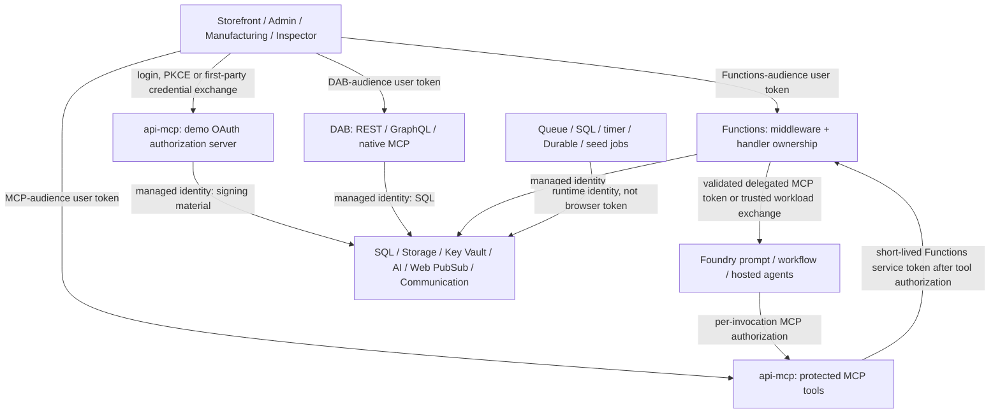

# End-to-end authentication and authorization

## Target and assurance status

The target is authenticated and authorized access to every business API by every
site and agent, with managed identity and Entra authorization for Azure dependencies.
Explicit public and platform exceptions are permitted, but must be bounded and tested.

### Current deployment and source checkpoint

The user recreated the selected `adventureworks981` demo environment and its seed
job succeeded. The refreshed read-only infrastructure report records **213 PASS,
21 accepted exceptions, 91 BLOCKED and zero FAIL**. The Key Vault private endpoint,
DNS integration and VNet link are now present; MCP readiness, OAuth discovery and
Functions readiness respond successfully. No in-place Azure repair was performed.
The certificate provisioning hook used by recreation fails closed on inaccessible
or malformed inventories and does not retry an uncertain create.

Runtime Foundry role assignments match source, but configured roles do not prove
every Foundry or agent data path or complete effective RBAC. Individual unexecuted
agent-tool paths and other missing principal/dependency evidence remain BLOCKED.
Functions readiness covers selected dependency operations, not all writes, event
delivery or every runtime principal.

A focused deployed run recorded **11 PASS**, including an optional Functions SQL
identity probe. It compared the actual connection's current external-principal
SID with the configured client ID, independently verified as the selected attached
Functions managed identity. This establishes that SQL connection's identity, not
other credentials or complete effective permissions.

After deploying the additional read-only identity probes, a focused selected-azd
run recorded **21 PASS**. SQL, Blob, Queue, Table, Files and Web PubSub reads
used the selected Functions identity and selected endpoints; the public readiness
response exposed neither identity IDs nor JWTs. These are specific read
operations, not proof of write permissions, other identities or complete RBAC.

The local real Functions host additionally passed **2,907 cases** over all 182
protected route/method bindings. It checked invalid/missing tokens, missing
expiration, category/scope denials and unsupported HEAD/OPTIONS without handler
entry, plus selected public controls and six authorized destructive operations
with deliberately unavailable dependencies; all 45 non-HTTP triggers were
disabled. The reset now reports partial failure as HTTP 500 without exception
details, and the MCP proxy returns an error rather than success. This uses
isolated local dependencies and does not prove deployed side effects, SQL
ownership or dependency identities. No live reset was executed.

A read-only probe in the existing MCP container verified the actual shared runtime
identity's SQL permissions: **32 PASS and one accepted exception**, including
current-user role/DDL checks and five visible-object permission inventories.
Its exact temporary runtime files were removed. The shared `db_datareader`,
`db_datawriter` and database `EXECUTE` grants remain a documented demo exception;
other SQL principals, server grants, invisible metadata and executable-module
escalation are not established. A separate existing-admin-container probe passed
all eleven real managed-identity MCP service-grant, scope and audience checks;
this is not evidence that each Functions or hosted-agent instance made those calls.
The read-only runtime Storage/ACR probe also passed without sending email.

The latest integrated run with the reviewed-read, browser-network and traced
public-agent guards recorded **1,958 PASS, 21 accepted exceptions, 265 BLOCKED
and zero FAIL**. Its all-sites browser gate passed and all four public catalog
tools were correlated as described below. A consumer-cart GET, one DAB read-role
cell and three Functions readiness probes timed out; these remain BLOCKED in that
report, not authorization denials. A later isolated cart rerun passed all 33
checks with exact cleanup, the exact DAB read-role cell passed separately, and a
separate readiness check passed. These do not rewrite the earlier report or close
other API, identity or agent obligations.

The later private mutation run
`20261117T055528Z-aadaddb8-63c5-4f99-a7a3-1256a2c67df5` recorded **469 PASS,
two accepted exceptions and zero FAIL/BLOCKED**. Two SQL-verified Customer
owners passed own calls and foreign/zero/malformed Customer-ID denials for three
read-only MCP tools. The order-detail positive uses order ID zero, not a real
order. Four reports were recovered and checksum-verified; the exact temporary job
and random test table were confirmed absent. The report inventories 12 intentionally
retained and 60 verified-absent fixtures; an earlier timed-out run retained two
additional consumers. An earlier report's anonymous-DAB expectation was incorrect
and remains unchanged; a later SQL read found no Customer row for that fixture but
did not recover its original response.
The live Functions denial sweep now uses an explicit function-name and exact-route
allow-list: GET alone is not proof of a read-only handler. Unknown or changed
routes remain BLOCKED without a request.

The internal browser guard restricts DAB and Functions requests and stubs the
synthetic manufacturing status and its exact synthetic supply-catalog read.
A targeted deployed run passed **36 assertions and its aggregate**. An anonymous
storefront run passed its five cart and cleanup assertions, but did not exercise
either consumer and cannot satisfy the complete-browser gate. A subsequent
all-sites run passed 85 checks but recorded three failures when the guard blocked
an unreviewed storefront GET during account switching. Both run-owned cart
fixtures were verified cleaned; that result is retained rather than overwritten.
After the reviewed guard was corrected, the integrated all-sites gate passed:
36 Admin/Manufacturing, 30 Inspector and 13 storefront assertions, including
both consumer sign-ins, account switching and exact cart cleanup. This does not
prove natural token expiry or every role/tool combination.
An earlier interrupted run left a guest session whose retirement could not be
confirmed. Its capability was not retained, so no speculative cleanup is
attempted; expiry-timer execution is not proof that this particular row was removed.

The public Help-Me-Choose client now validates the cached definition actually
used by Functions: exactly the configured MCP target, four catalog tools, no
static headers or alternate connection, and only the `products.read` service
scope. It rejects missing/fallback definitions, broader approval requests and
enumeration fallbacks. Policy errors are surfaced instead of becoming successful
fallback responses. Local regression tests cover these boundaries. A latest-agent
definition read alone cannot establish what an older running worker cached; the
paid public AI canary is therefore opt-in and must only be enabled after the
matching Functions source is deployed. The runner records unique W3C traces and
correlates completed MCP results with the selected runtime principal's
`products.read` authorization where telemetry is available. The latest integrated
run correlated all four catalog tools to the loaded version and matching trace.
The runner makes at most four read-only telemetry queries, 20 seconds apart, to
allow for ingestion; missing or sampled observations remain BLOCKED. This does
not prove downstream SQL/embedding identity, other callers or other agent paths.

Customer chat now requires the caller's delegated MCP token and validates the
cached agent definition used by Functions against its exact eight read-only
tools and configured MCP target. It rejects fallback definitions, static headers,
alternate connections and unreviewed approvals. The new
`get_product_availability` tool returns only the product ID and an in-stock
boolean, or null for a missing finished good; detailed inventory remains
internal-only. The selected deployment's direct MCP checks passed for two
consumers: an in-stock product, a missing product, missing-scope denial and
detailed-inventory denial. A subsequent focused run recorded **29 PASS and
25 BLOCKED** and verified an out-of-stock result for both consumers against
an independent DAB finished-product read and complete zero-positive inventory
rows. The remaining blockers are owner checks and the opt-in inference.
The inventory and finished-product checks are repeated after both MCP calls, so
an intervening stock change cannot be mistaken for an authorization result.

After normal MCP and Functions deployment, the opt-in customer-chat canary
recorded **30 PASS, 24 BLOCKED and zero FAIL**. Its completed availability call
was correlated by trace to the same delegated consumer's allowed `products.read`
decision and the loaded `eshop-chat-agent:2` definition. The 24 owner-argument
checks in that report remain BLOCKED because those retained consumers have no
Customer profile. A later private run using two different, SQL-verified Customer
profiles recorded **469 PASS, two accepted exceptions and zero FAIL/BLOCKED**.
For each owner, the `get_customer_orders`, `get_order_details` and
`get_personalized_recommendations` controls passed for the signed owner and
denied the other owner, zero and malformed customer arguments. Its order-detail
positive uses order ID zero, not a nonempty order; actual order ownership and
other tools and downstream identities remain separate obligations. All four
reports were recovered and checksum-verified; the exact temporary job and
randomized table were independently confirmed absent. The report inventories
12 deliberately retained and 60 verified-absent fixtures. See the
[focused chat guide](../../testing/AI_CHAT_MCP_TESTING.md).

Admin chat likewise requires the delegated MCP token and validates the loaded
agent definition against the configured server and exactly 15 reviewed read-only
tools. An opt-in deployed canary recorded **36 PASS, 25 BLOCKED and zero FAIL**.
The admin could read the business dashboard, a manufacturing caller without
`sales.read` was denied, and a completed `get_business_stats` call joined the
loaded guarded version to that admin's allowed `sales.read` decision by trace.
Other tools, callers and downstream identities remain separate obligations.

Source changes remove unscoped consumer DAB order-detail reads, restrict public
catalog and review fields, and remove direct consumer DAB order-header writes.
The Functions header route binds the signed customer, person and both address
links in one serializable transaction. Address reads and updates use SQL
ownership checks, and shared-address edits return 409. The refreshed deployment
includes these source changes. Consumer DAB customer creation is source-configured
to accept only the signed person and territory. The targeted private run above
verified cross-owner denials and owner-bound creation on the selected deployment;
extra-field/StoreID denial and complete checkout remain separate obligations.

Functions now rejects structurally malformed JWTs before fetching OAuth metadata;
well-formed tokens still require the normal metadata and cryptographic checks.
The deployed, safe invalid-payload order probes
`.auth-results/order-host-safe-61568045-30ba-4261-9d58-bd0e81e2e9b2/report.json`
recorded **four PASS** for anonymous and malformed-token header/detail requests.
Before that change, the malformed probes timed out while metadata was unavailable;
that earlier report remains BLOCKED. Neither run creates an order or proves
valid-token ownership, SQL side effects or complete route coverage.

The pre-refresh integrated offline run records
**78 PASS, 20 accepted exceptions, 25 BLOCKED and zero FAIL**; all nine exact
evidence gates pass, with **1,321 Functions** and **672 MCP** tests. The
later integrated run passed **1,347 Functions** and **672 MCP** tests; the
API-created shared-address fixtures and read-only SQL audit also passed in the
targeted private run described below. The latest source-only integrated run
recorded **80 PASS, 20 accepted exceptions, 25 BLOCKED and zero FAIL**, including
**1,359 Functions** and **685 MCP** tests. Twelve Key Vault hook/template tests pass.
Focused frontend checks, a storefront
development build and targeted lint also pass.
The full storefront type-check still reports five pre-existing errors in
unchanged calendar/ProductPage files. The DAB validator cannot connect to local
SQL; schema comparison found no new error paths relative to the committed
configuration. None of these local results proves deployment.

An offline investigation reproduced an internal Admin callback restoring a token
after logout. Both internal portals now scope token and user records to a random
sign-in generation, bind PKCE to it, and reject superseded callback, refresh and
resource-exchange results. Generation-specific revocation markers persist in
browser storage to prevent stale writes from resurrecting a logged-out session.
Each internal tab stays bound to its own generation across reloads. A request
started under one generation cannot retry or return under a later sign-in, and
superseded Web PubSub negotiations and callbacks are ignored. New tabs can use the
currently shared session; existing tabs do not silently adopt a later identity.
Both internal portals clear their React Query caches at sign-in, sign-out and
session loss; cancelled in-flight queries cannot restore old cached data. Admin
chat history is stored under the sign-in generation, so a later session cannot
read an earlier session's conversation. Previously unscoped chat history is
left in browser storage but is not loaded by the updated chat; session-scoped
history is not carried into a new sign-in.
Legacy unscoped sessions remain usable until logout or a new sign-in. Deterministic
tests cover overlapping transitions and mounted portal contexts and callback pages;
12 local Chromium two-tab cases exercise the source token modules against a mock
OAuth server. Request and Web PubSub regression tests exercise source modules
with controlled token, network and socket responses.
The refreshed deployment passed real two-tab logout and same-user new-generation
checks in both portals, including a protected DAB read and a stale-tab deep-link
denial. Distinct-user switching and delayed transition races in the full deployed
portals remain **BLOCKED**; local mocked races are not equivalent evidence.
Local logout does not revoke already-issued bearer tokens at the authorization
server; they remain valid until their normal expiry.
An already-dispatched request can still complete on the server under its original
identity, even if the client discards its response after a session change.

Checkout no longer modifies `Product.SafetyStockLevel` or deletes cart rows
directly through DAB. `SafetyStockLevel` is a replenishment threshold, not stock
quantity; removing that update does **not** implement inventory allocation or
decrement actual inventory. Cart clearing uses the existing owner-bound Function.
Header amounts and line prices remain client-supplied; ownership checks do not
validate prices. A first-time buyer's resource tokens are refreshed after Customer
creation so subsequent order requests carry the new signed customer claim.

### Web PubSub capability authorization

Web PubSub negotiation is an authenticated Functions API, not an anonymous
capability issuer. Each site obtains a Functions-audience user token carrying
`realtime.connect`; the server derives the client's Web PubSub group grants from
that token's signed business scopes and category. The browser cannot request or
escalate group membership. Internal groups require both an internal category and
one of their mapped domain scopes. Consumers can receive only `orders` invalidation events through their own
`orders.read` entitlement. Manufacturing also receives that generic event under
`manufacturing.read` so its demand caches stay current without exposing order data.

The shared `orders` group broadcasts only `{ "event": "orders-changed" }`, and
the cross-domain `finance` group only `{ "event": "finance-changed" }`.
Order identifiers, customer identifiers, amounts, statuses, references, counts,
and table metadata are stripped at the publisher boundary, so every producer
(including SQL-triggered changes) shares a non-identifying payload. This is a
deliberately privacy-preserving cache-invalidation signal; data remains behind
the normal authenticated business APIs. The web clients send the Functions bearer token
on negotiation and ignore groups outside the site's own handlers. Tokens and
negotiate URLs are not logged.

The new `realtime.connect` grant is mirrored in `OAuthScopes`, default role
scopes, first-party client scope allow-lists, the authenticated local test
helper, and the auth seed script. The refreshed `adventureworks721` environment's
seed job succeeded; no ad hoc database grant was used.

Final local validation for this change passed 798 focused Functions
authorization/realtime tests, all 330 MCP tests, 59 Python assurance tests, all
13 cross-frontend live-update regressions, all four Manufacturing hook tests,
18 authenticated-helper tests, and targeted frontend ESLint. The latest
integrated live report `.auth-results/live-promotion-agent-20261112/report.json`
recorded **406 PASS, 20 accepted exceptions, 118 BLOCKED, zero FAIL**. All six
deployed Web PubSub checks passed. Four warehouse read-denial checks were
temporarily blocked by network/TLS timeouts in that run; a focused repeat later
passed all four, but the original integrated result remains BLOCKED.

The deployed Admin promotion agent also passed its four-call assurance case:
anonymous/wrong-audience callers received 401, manufacturing without
`admin.write` received 403, and one admin request returned a typed suggestion
through its SQL/Foundry path. Generated content was omitted from evidence.
This does not close the separate deployed-principal/tool-correlation obligation.
After deploying the storefront session-isolation change, the browser-only report
`.auth-results/browser-tab-isolation-20261112/report.json` recorded **69 PASS**,
including an unauthenticated new tab, same-tab A-to-B account switching, cleared
A credentials, B-only cart reads, and exact preservation of B's cart. Overall
assurance remains BLOCKED by unrelated obligations.

**Complete end-to-end conformance has not been established.** The assurance runner
reports missing evidence as `BLOCKED` and unreviewed exceptions as `FAIL`, even when
all unit tests pass. It must not be used to claim complete coverage while required
assertions remain unimplemented or unavailable.

**Earlier selected-environment continuation:** `adventureworks706` live run
`.auth-results/d94f1250-bb0d-4471-97ca-f9ee0b4f5ffd/report.json` recorded
**435 PASS, 20 accepted exceptions, 113 BLOCKED, zero FAIL**. It verified that
two consumer identities cannot update order headers or create order details
directly through DAB, and that the deployed Functions order-detail route rejects
anonymous and malformed credentials before handler work. The DAB probes use
invalid identifiers and are non-mutating; they do not prove successful checkout
or downstream side-effect safety. An earlier read-only infrastructure report
`.auth-results/16a0f8b6-33ae-487c-8162-18a41ff16b52/report.json` recorded
**143 PASS, 21 accepted exceptions, 36 BLOCKED, zero FAIL**. An earlier offline
report `.auth-results/32b9b3c7-85d0-4e3a-85b5-26230f2b59d3/report.json` recorded
**33 PASS, 20 accepted exceptions, 24 BLOCKED, zero FAIL**. These profiles
remain incomplete; their counts are phase-specific and not unique gap counts.

**Earlier integrated private run:** after user-owned recreation and successful
seeding, run `20261112T004345Z-b2ec7424-838d-43cf-b45c-459b86a4887e` records
**740 PASS, 44 accepted exceptions, 136 BLOCKED, four NOT_APPLICABLE, zero FAIL**.
It includes eight mutation host-denial gates and the reviewed read-only
subcategory-count POST gate. All four reports
were independently recovered and checksum-verified; the exact temporary job was
absent. Blockers include mutation denial fixtures, agent runtime trust edges,
complete DAB policies, and broader browser/ownership matrices. Counts are
phase-specific, not unique obligations: the local infrastructure inspection
and private suite repeat some assertions. The previous integrated run
`20261111T235302Z-9bdba3c2-cbd4-47b5-90f8-d7743426fc66` recorded **688 PASS,
44 exceptions, 138 BLOCKED, four NOT_APPLICABLE, zero FAIL**. The prior integrated run
`20261111T225808Z-06217c4d-0875-49e6-8dc5-2afbd1849bee` recorded **678 PASS,
44 exceptions, 139 BLOCKED, four NOT_APPLICABLE, zero FAIL**; its address-create
gate is supported by 19 private SQL and response checks. The previous integrated run
`20261111T213955Z-47691dba-b9ee-49cb-b114-7e62f802583d` recorded **637 PASS,
44 exceptions, 140 BLOCKED, four NOT_APPLICABLE, zero FAIL**. The earlier integrated run
`20261111T204312Z-60376666-131e-434b-ab59-3e24f6ad0008` reported **491 PASS,
43 exceptions, 145 BLOCKED, four NOT_APPLICABLE, zero FAIL**. In the earlier run
`20261111T201813Z-aee0e713-8a81-49cc-9f7f-3964a0fb6811`, four local unit gates
were BLOCKED because that phase does not run unit tests, although the exact
private suite gates passed; its total was **491 PASS, 43 exceptions, 149 BLOCKED,
zero FAIL**. The latest run verifies the runner reconciles those four to
NOT_APPLICABLE only when the corresponding private gate passes, retaining
failures and other blockers.

**Earlier private run:** the subsequent user-started job records **437 PASS,
43 accepted exceptions, 144 BLOCKED and 3 FAIL**. All 15 Inspector browser checks
and their aggregate gate pass privately. The failures are the initial Admin DAB
read, its phase and aggregate gate: no response arrived within the 90-second
deadline. Increasing the deadline did **not** solve that intermittent problem.
The controller parsed the completion marker automatically and verified uploaded
artifacts. Cleanup was initially unverified; read-only recovery independently
verified all four blobs and confirmed the exact job absent. A concrete cleanup
parser defect was found: successful `az containerapp job delete` can return empty
stdout, which the shared wrapper incorrectly required to be JSON. Source now
accepts empty output only for that deletion command, keeps reads strict, and
persists sanitized cleanup errors. Subsequent targeted and integrated runs verified
the corrected uninterrupted lifecycle.

**Worker authorization follow-up:** the real worker middleware/validator now has
**733 passing cases over all 196 registered HTTP policies**, and the complete
Functions suite now passes **1,053 tests**, including the address cases below. Each protected policy exercises
missing-token and wrong-scope denial, matching signed internal identity projection
and consumer category behavior. Explicit public policies, signature/issuer/
audience/lifetime/configuration failures, unknown functions and passthrough modes
are also tested. Denials assert zero handler calls and the actual invocation
result; forged owner/role headers cannot replace signed identity. Tests use SDK
HTTP/result features, including the real internal gRPC binding feature via
test-only reflection, not a mocked authorization decision.

The assurance report now requires exact current-run passing TRX cases reconciled
with the reflected inventory and records their SHA256. Missing, skipped,
duplicated, failed or newly untested policy cases cannot pass. This does **not**
close the separate full running-host/route-binding/mutation-side-effect or
SQL-backed ownership obligations.

The new tests found and fixed a double-slash `resource_metadata` challenge URL
when the issuer ends in `/`. A normal targeted
`azd deploy api-functions --no-prompt` succeeded. Seven actual read-only deployed
denials passed: missing/malformed credentials, DAB/MCP audience tokens,
manufacturing's missing admin scope, forged internal headers and a consumer at
the internal manufacturing route. Each requires the expected status, JSON policy
error and canonical metadata challenge. The consumer denial proves its current
scope boundary; the signed-token worker tests separately prove category denial.
The same targeted report retains an initial readiness **503** as a failure.
A separate follow-up records healthy dependency readiness and an authenticated
manufacturing read (**2 PASS**); it does not overwrite that initial failure.
No mutations, email or simulator operations were invoked.
Current Python assurance regressions: **81 PASS**. See the
[Functions worker coverage](../functions-oauth/README.md#executable-worker-boundary-coverage).

`GetSubcategoryProductCount` is a reviewed read-only POST: its service issues two
SQL count queries in [ProductService](../../../api-functions/Services/ProductService.cs).
The full suite tests an existing DAB-discovered subcategory
with a valid admin positive response, then exact anonymous, malformed, DAB/MCP
wrong-audience, manufacturing, spoofed-header and two consumer denials. Passing
manufacturing audience and consumer identity controls are prerequisites; denied
responses must not contain counts. The gate passes only when every same-run
check passes. This tests that one read-only route, not the general POST
mutation/side-effect matrix. An earlier targeted attempt timed out and remained
BLOCKED; a subsequent direct read-only attempt passed all nine route checks
using previously reflected inventory. Integrated run
`20261111T235302Z-9bdba3c2-cbd4-47b5-90f8-d7743426fc66` passed the exact gate,
all nine route checks, and all five prerequisite identity controls. Its four
reports were independently recovered and checksum-verified; its temporary job
was verified absent.

**Password ownership follow-up:** the
[password handler tests](../../../api-functions.Tests/PasswordOwnershipTests.cs)
exercise 30 cases using the production camelCase serializer and an
`IPasswordService` persistence seam. Both distinct consumers can set/verify only
their own password; cross-owner and missing-owner denials make zero persistence
calls. Internal categories can reset only individual-customer passwords, after a
customer-type lookup, and verification remains self-only even for internal users.
Missing or unrecognized identity context now fails closed in the handlers;
the worker remains responsible for token validation and route scopes. Public
signup is unchanged. Persistence failures and invalid-password results are not
replaced with successful outcomes.

Offline/all requires the exact 30 current-run TRX cases to pass once and records
their hashes. The local complete Functions suite passes **1,094 tests**, and
**102 Python regressions** pass, including missing/skipped/duplicate/unreconciled
test-evidence rejection and strict live-response validation.
Normal `azd deploy api-functions --no-prompt` succeeded. The deployed targeted
verification passed **9 checks**: the exact handler-evidence gate, two retained
consumer authentications, and six verification-only calls covering correct and
incorrect own passwords plus exact other-owner denials in both directions.
Only `POST /api/password/verify` was called; no password was set/reset and no
account, order or email was created. Credentials and raw payloads are omitted.
Evidence:
`.auth-results/password-ownership-live-20261111T162746Z-d7500ade-87f2-450e-8b7a-84f7f5d1a764/`.
Live/all now runs these six verification checks. Fake writes prove handler
selection/denial only, not SQL mutation or deployed reset behavior. Full host
binding, reset-token lifecycle and remaining ownership/DAB/agent obligations
remain separate; this targeted result does not replace the full-suite report.

**Address ownership follow-up:** 22 new handler tests cover both distinct
consumer owners, own reads, cross-owner GET/PUT/DELETE/type denial with zero
data or mutation calls, missing-owner denial, signed-owner overrides for create/
person-query/type operations and internal pagination compatibility. They use fake
persistence and the deployed camelCase serializer; they are not private SQL or
running-host mutation evidence. The report requires every exact current-run TRX
case to pass once and records the evidence hash. Missing, skipped, duplicate,
failed or unreconciled cases cannot pass.

The tests exposed a real pagination defect: consumer address listings previously
fetched a global page before discarding other owners' records. The
[address service](../../../api-functions/Services/AddressService.cs) now applies a
parameterized owner `EXISTS` predicate before SQL pagination; missing consumer
owners cannot trigger a global read. Internal pagination remains unrestricted.
Normal `azd deploy api-functions --no-prompt` succeeded.

An earlier read-only deployed verification against both retained azd consumer
fixtures recorded **4 PASS and 2 BLOCKED**: address and person-address requests returned valid
200 lists, but both fixtures have no persisted addresses. Empty results do not
prove owned-record reads, cross-owner denial or nonempty SQL pagination.
The live/all runner now includes these GET-only scenarios, requiring own-record
success and the exact other-owner denial when fixtures exist. That earlier run
created no addresses; the later private fixture run below supplies separate
nonempty ownership and cleanup evidence. The complete Functions
suite at that checkpoint was **1,047 PASS**, Python assurance regressions **85 PASS**. This is targeted
follow-up evidence, not a replacement for the full private result above.

**Opt-in private address fixture lifecycle:** the standalone runner supports
`python3 tests/scripts/run-auth-assurance-job.py --address-only`. This is separate
from normal deployment and the full assurance mode. Read-only SQL checks both
signed consumer identities and their email/owner links and requires no existing
owner links or run-marker addresses. Five addresses are created via the consumer
Functions API; an authenticated administrator adds the second owner's shared link
through DAB. Four addresses are exclusive and one is shared. Each fixture-creation
request is recorded before sending in a randomly named temporary table in the existing Storage
account. The application's first-address default applies only to the verified
empty test accounts; no prior default is demoted.
If the table-create outcome is uncertain, the run fails before mutations and
reports the exact table name; it does not blindly delete a possibly pre-existing
table. Ownership must be established before cleanup.
The [targeted scenario](../../../tests/auth/address_fixture_suite.py) requires
exact run-marker records, all nonempty one-record pagination pages, actual own
reads and cross-owner GET denial, followed by six cross-owner PUT/DELETE/type
denials through the deployed Functions host. Each owner also saves the shared
address unchanged and is denied a physical edit with HTTP 409; both owners'
subsequent reads must remain identical. Writes stop at the first unexpected
result. The [SQL helper](../../../tests/auth/private/AddressFixtures.cs) is
read-only and compares all five fixture addresses and owner links before and
after the probes. After checking recorded IDs, owner links, foreign links and
order references, cleanup uses the consumer delete API; SQL and owner listings
must verify absence. No direct SQL fixture writes are performed.

An uncertain setup or interrupted probe can still be in flight, so cleanup stops
rather than racing it; foreign links, order references or failed deletion also
stop cleanup. The report marks unverified cleanup as FAIL and retains residual
inventory independently of the temporary-table snapshot. A missing, malformed
or inconsistent suite report, interruption or timeout also fails the private
address run rather than implying cleanup succeeded; the temporary compute
`--cleanup` does not remove application data. Hard termination or node loss can
still interrupt reporting and cleanup. No orders,
email, simulator, new permissions or public SQL access are involved.

The revised API-created lifecycle ran privately in
`20261117T040646Z-011499b6-aacf-4a66-b488-e7122f18b27c`, with **96 PASS and
zero FAIL/BLOCKED**. Both consumers' three one-record pages, own/foreign reads,
six cross-owner Functions mutation denials, shared-address behavior and all
consumer/authenticated REST/GraphQL address-link mutation denials passed.
Independent SQL verified unchanged fixtures and their removal through the APIs;
both owner listings were empty afterward. The random temporary Storage table was
removed. All four report formats were independently recovered and checksum
verified, and the exact temporary job was absent. This proves only the tested
address paths, not all Functions ownership or order scenarios.

**Historical private address run:** run
`20261111T141415Z-7a96c423-5957-4841-8cc2-43bcdccb6368` completed with
**29 PASS, zero FAIL/BLOCKED**. Both consumers' two nonempty SQL pagination pages,
own-record reads, cross-owner GET denials and all six deployed mutation denials
passed. It used the former direct-SQL fixture setup and cleanup, which has since
been removed. Its results do not validate the current API fixture lifecycle or
the later shared-address extension.

The uninterrupted controller lifecycle published all four PDF/HTML/JSON/JUnit
artifacts with readback checksums and verified exact temporary job deletion.
Independent read-only recovery rechecked their hashes, run/image provenance and
the job's absence. The immutable cloud report correctly retains compute cleanup
as pending from the container's perspective; the local lifecycle ledger supplies
the subsequent verified deletion evidence. This verifies the narrowly scoped
empty-delete-output parser fix in an actual completed lifecycle.

The earlier full private report's **437 PASS, 43 exceptions, 144 BLOCKED, 3 FAIL** remains
unchanged; later full-run evidence is reported separately above.

**Cost-aware follow-up:** low idle cost takes precedence over response latency in
this demo. DAB remains at min 0/max 3 replicas (2 vCPU/4Gi per replica); SQL remains
serverless with 0.5 minimum/4 maximum vCores and a 60-minute auto-pause delay.
The [browser policy](../../../tests/auth/browser-policy.json) now permits a single
initial deep-link/login redirect and initial read per site to take up to 240 seconds,
and renewed reads up to 90 seconds.
There are no retries or warm-up requests. Responses taking 30 seconds or longer
are explicitly flagged as slow; successful authorization is not proof of a cold
start. HTTP denials, invalid data, exceeded deadlines and attempted business
mutations still fail. The aggregate gate requires all four real read results,
their correct budgets and the exact policy, not just PASS-named assertions.
The child runner has a bounded 1,200-second budget covering both sites.

The new policy passed all 20 real deployed internal-browser assertions in a
local container: initial Admin read **75,407ms**, renewed Admin **72ms**, initial
Manufacturing **75ms**, renewed Manufacturing **219ms**, with zero business
mutations. The current report gate also accepts that actual evidence and
preserves the slow-read flag. This is not a new private-job result.

The read-only [capacity diagnostic](../../../tests/scripts/diagnose-dab-capacity.py)
discovers resources from the selected azd environment and writes a timestamped,
private local JSON report:

```bash
python3 tests/scripts/diagnose-dab-capacity.py
```

Use `--environment NAME` or `--hours 1..24` to select the environment/window.
It collects per-replica DAB CPU/memory, replicas/restarts, SQL CPU/IO/workers/
sessions, actual CreateIndex advisor recommendations and aggregate sampled DAB SQL
dependency timings. It does not expose SQL text or DDL, warm endpoints, reopen SQL,
change advisor settings, provision infrastructure or prevent scale-to-zero.
Exit 0 means observations were collected, not performance certification; exit 1
means review sustained pressure/restarts/index advice/slow or failed SQL calls;
exit 2 means evidence is unavailable. Missing samples are BLOCKED, never zero load.

The verified six-hour report found DAB CPU peak **15%**, memory peak **8%** and
zero restarts; SQL CPU peak **3%**, reported data/log IO peaks **0%**, and no
CreateIndex recommendations. Its 1,717 sampled DAB SQL calls had zero failures,
maximum **348.862ms**, p95 **8.863ms**. There is no observed justification for a
larger container/database or speculative indexes. These sampled observations do
not rule out short bursts, missing indexes for other workloads, or all query-plan
problems; private Query Store/plan investigation remains separate. Current
Python assurance regressions at that checkpoint: **78 PASS**. Prior failed reports stay unchanged.

Two subsequent targeted local-container browser executions each passed all 20
internal-site assertions. One initial Admin read nevertheless took **76,150ms**;
its browser preflight and test routing completed promptly, with the delay before
the GET response. The next execution's reads took 61–117ms. These are diagnostic
observations, not a root-cause fix or replacement for private failed evidence.
The runner now preserves bounded Chromium request/preflight/routing/failure and
DNS/connect/send/header timings, plus generated W3C trace IDs for server
correlation. It exports no raw URLs, headers, tokens or records. Diagnostic
fields are whitelisted again when included in the published report.

**Latest targeted verification:** hosted Inspector OAuth protection is deployed.
All 15 Inspector browser checks and 20 Admin/Manufacturing browser checks pass,
plus their two aggregate evidence gates (37 PASS). This is a targeted local-container
run against real deployed sites, not a new full/private-job result. All 330 MCP,
81 Python assurance and seven Inspector gateway test groups pass. These targeted
results do not supersede the subsequent private failures above; private
FAIL/BLOCKED reports are retained unchanged. See
[hosted Inspector authentication](#hosted-inspector-authentication).

**Post-refresh continuation:** the full selected-environment live run
`.auth-results/3a9d2030-64e4-4f25-95c1-0870431b4e68/` recorded 382 PASS,
21 accepted exceptions, 114 BLOCKED and two FAIL. Both failures belong to the
manufacturing anonymous deep-link scenario: its navigation timed out before the
anonymous-no-data assertion ran, and the aggregate consequently failed. This is
not evidence of an anonymous request or a pass; the full report remains FAIL.
The browser runner now allows 240 seconds for that initial ACA navigation and
classifies Playwright `TimeoutError` as a timeout. It records any anonymous API
attempts only as site/service/method, without exporting paths or payloads. A
subsequent isolated deployed Admin/Manufacturing run
`.auth-results/internal-browser-7a7960f6-2666-4bdd-9e1c-04331c44f6fc/`
passed all 20 functional assertions plus the completeness gate (21 PASS), with
no anonymous API attempts or business mutations. This targeted rerun does not
rewrite or supersede the earlier full-run failure.

The previously network-blocked private disposable mutation profile was then
rerun once after the services were warm:
`20261112T170736Z-55b27154-db19-4183-a614-f3cde892983d`. It passed 321 checks
with two accepted exceptions: shared SQL datareader/datawriter/EXECUTE grants
across runtime services, and intentionally retained run-owned test fixtures.
All four private reports were recovered and checksum-verified through the
existing runtime identity; the exact temporary job was absent. This closes the
transient Product-read blocker for this run, not the broader Functions, DAB,
agent, or RBAC completeness obligations.

### Initial deployed verification checkpoint

The full `--all` run after targeted Functions and MCP redeployments recorded:

- 280 passing assertions, 18 existing exception classifications, six failures
  and 119 blocked obligations. Assertion counts are not unit-test counts.
- Both complete .NET test projects passed: 264 Functions tests and 303 MCP tests.
  The existing Python/Node auth suites and 20 assurance-runner tests also passed.
- Inventory: 236 Functions (192 HTTP), 62 custom MCP tools and 22 deployed agents,
  including workflow references and the hosted agent.
- 195 live denial assertions passed, including forged tokens, cross-resource
  audiences and manufacturing-to-sales scope isolation. Staff Functions/DAB reads
  and actual MCP-to-Functions proxy reads also passed.
- Five failing operations are anonymous cart CRUD and anonymous review creation.
  The sixth finding is broad runtime management roles, requiring justification or
  least-privilege remediation. These findings are not accepted exceptions.

This is a partial checkpoint, not completion of the assurance plan. Browser,
ownership, per-agent runtime, effective SQL and bounded mutation evidence remain
incomplete. No simulator was started and no test email was sent. The deployment
was preserved; clean-from-scratch verification has not occurred.

After the review-policy decision and DAB/storefront redeployment, the subsequent
full run recorded **289 PASS, 18 ACCEPTED_EXCEPTION, five FAIL and 119 BLOCKED**.
All 567 .NET tests, 24 assurance-runner tests and 22 frontend auth tests passed,
as did the existing Python auth-helper suites. Public review reads remained
available and anonymous POST/PATCH/DELETE each returned 403. The DAB revision was
confirmed ready; its original zero minimum replica count was restored after
startup diagnostics. The five remaining failures are cart CRUD and broad runtime
management roles. This does not resolve the remaining blocked obligations.

### Deployed guest-cart implementation checkpoint

The approved guest-cart exception uses a server-issued 256-bit capability,
stored only as a SHA-256 hash in SQL, with a fixed one-day expiry. The server
resolves every cart owner from that capability or a validated consumer bearer;
a caller-provided cart ID is only an ownership assertion, never authentication.
Guest capabilities cannot authorize checkout or unrelated business APIs.

The storefront automatically merges guest items into the signed-in account,
combining matching quantities in one SQL transaction. Failed or uncertain
merges preserve the proof for retry; only confirmed success clears it. Retried
merges to the same account are idempotent while the session remains unexpired.
Account switches/logout evict the previous cart query cache. Web Locks serialize
guest bootstrap across browser tabs; unsupported browsers explicitly require
sign-in instead. Expired sessions are rejected and deleted in bounded timer batches.

The deployed DAB policy removes anonymous cart access and all DAB cart writes, retaining
only consumer-owner-filtered reads. Deployment order is schema-only migration,
Functions, storefront, then DAB; do not enforce the new DAB restriction before
the replacement client/server path is healthy. The private schema-only execution
succeeded without reseeding data. Both cart capabilities passed live isolation,
quantity, ownership-denial and exact cleanup assertions; anonymous DAB
GET/POST/PATCH/DELETE each returned an authorization denial.

A real Chromium session also added a product while signed out, verified persisted
quantity and ownership, reloaded the cart, and proved checkout redirects to sign-in.
Its exact cart was retired and the capability subsequently returned 401. The
browser test blocks non-cart Functions mutations. The runner persists sanitized
fixture ledgers before mutation and never writes capability tokens to evidence.
Retired session audit rows remain until their original expiry and bounded timer
cleanup; cart items are deleted during retirement.

The cart service now rechecks capability expiry after acquiring the guest cart
lock and, during merge, after acquiring the destination account lock. A request
that waits past expiry cannot continue to cart access or writes. Deterministic
tests exercise the actual service with `TimeProvider` and an isolated database
transport: immediately before/at/after expiry, expiry during either lock wait,
retired-session denial, same-owner merge replay, fixed one-day issuance and
hashed-only persistence. The assurance runner requires all 17 current-run TRX
cases before passing `required:guest-cart-service-lifecycle`. These tests do not
establish live SQL cleanup-batch selection or deployed timer execution.

The final guest-rollout `--all` checkpoint recorded **327 PASS,
21 ACCEPTED_EXCEPTION, one FAIL and 122 BLOCKED**. All 292 Functions tests,
303 MCP tests, 37 frontend auth tests and 28 verifier tests passed, together with
the existing Python helper suites. Inventory now includes 241 Functions (196 HTTP),
62 custom MCP tools and 22 deployed agents. DAB's latest revision is ready and its
original minimum replica count remains zero. The remaining failure is runtime
Contributor grants on ACR and Communication Services, not cart CRUD. At that
checkpoint, actual consumer merge/rollback/overflow/retry and expiry-timer effects
remained blocked; guest/browser success was not proof of those paths or overall conformance.

### Reusable consumers and stronger RBAC verification

The user subsequently authorized reusable demo test users. The live profile now
creates two dedicated consumers once, then reuses them. It verifies real
Functions/DAB audience tokens, two-account cart ownership, cross-account item
PATCH/DELETE denials, both DAB consumer read roles, and a real read-only token's
read allowance/write denial. Real SQL merge tests prove exact quantity combination,
same-account retry idempotency, other-account retry rejection, stale-account
assertion denial, and quantity-overflow rollback preserving both carts and proof.

Chromium also signs in through the actual storefront credential form, without
fabricating browser authentication state. It observes automatic merge, proof
retirement, the resulting account-owned line and its UI persistence after reload.
The checkout return state is cleared before login so this scenario cannot initiate
checkout. Non-cart Functions mutations remain blocked.

Consumer scenarios select products absent from the initial account cart snapshots.
Cleanup removes only those run-owned products and compares all remaining rows
with the snapshots. Guest capabilities are retired; users are intentionally
retained for subsequent runs. Sanitized ledgers identify accounts, products and
cleanup outcomes, never passwords or tokens. No order, review or email is created.

RBAC verification now reads actual assigned role definitions, not only role names.
It expands action wildcards, subtracts NotActions within each permission block,
retains assignment conditions, and checks enumerated management/key-retrieval
operations against the assignment's resource scope. An ACR-scoped Contributor
assignment does not imply access to sibling Storage or Key Vault resources.
This remains a targeted privilege check, not complete effective-access proof:
group membership, conditional access, deny assignments and SQL grants still need
their dedicated validation.

The pre-remediation checkpoint recorded **379 PASS, 21 ACCEPTED_EXCEPTION,
five FAIL and 120 BLOCKED**. All 292 Functions tests, 303 MCP tests, 37 frontend
auth tests and 35 verifier tests passed. The five failed assertions represent
four runtime role assignments plus the aggregate broad-role gate:

- Resource-group Managed Identity Operator, including deployment write permission.
- The custom deployment-script role, including Storage management/key retrieval,
  Container Instances and deployment-script permissions.
- Resource-scoped Contributor on ACR; a separate AcrPull assignment already exists.
- Resource-scoped Contributor on Communication Services.

The increased failure count comes from detecting additional permissions, not
relaxing the target or introducing application regressions. At that checkpoint,
none of these grants had been removed or accepted as an exception. The subsequent
remediation below preserves email authentication and removes these bindings. Expiry-timer,
other sites/Inspector, broader ownership, agent runtime, SQL and simulator
obligations remain incomplete; full conformance is still not established.

### Runtime IAM remediation

The user subsequently authorized remediation of all four findings, superseding
the earlier documentation-only decision. All four exact runtime bindings have
now been removed from the selected deployment and their declarations removed or
replaced in Bicep. No administrator binding was removed.

| Runtime assignment | Verified scope and permissions | Source and disposition |
| --- | --- | --- |
| Managed Identity Operator | Selected resource group; built-in definition includes `Microsoft.Resources/deployments/*` | Removed. [Identity module](../../../infra/modules/identity.bicep) now creates only the identity. Deployment remains the responsibility of the deployer, not the application runtime. |
| Deployment-script custom role | Selected resource group; Storage, Container Instances, deployments and deployment-script wildcards | Binding removed. No deployed ARM deployment-script resource was found. The old custom definition may remain inert/unassigned in an upgraded environment; Bicep no longer creates it. No Storage key or deployment wildcard remains assigned to this runtime identity. |
| ACR Contributor | Selected registry; registry write/delete and credential retrieval | Removed. Existing registry-scoped AcrPull and separate seed-identity AcrPull remain. The actual runtime UAMI successfully exchanged an ACR token and fetched its deployed image manifest; its ARM registry metadata request returned 403. |
| Communication Services Contributor | Selected Communication resource; write/delete and key retrieval/regeneration | Replaced by the exact custom role below. The separate administrator Contributor binding remains unchanged. |

**Bounded platform permission, not a send-only role:** `AdventureWorks Email Sender`
allows exactly `Microsoft.Communication/communicationServices/read` and
`Microsoft.Communication/communicationServices/write`, with both assignment and
assignable scope restricted to the selected single Communication resource.
It grants no wildcard, key retrieval/regeneration, deletion, Email Service write,
or role administration. The retained service write action can modify that resource's
properties; it is an explicit exception to the data-plane-only target.
That write permission can also change the Communication Service's authentication
setting, so disabling access-key authentication is not an immutable boundary against
the runtime identity.
The [contract](../../../tests/auth/contracts.json) accepts only this exact role
shape, scope, principal and unconditional assignment, not similarly named roles
or arbitrary Communication permissions.

An actual ACA runtime probe first tried read-only email authorization: the send
returned 401. Adding only Communication service write resulted in 202 and the
email operation reached `Succeeded`, after Contributor had been removed.
This proves the tested REST send/poll path, not independently observed mailbox
delivery or every application email path. Controlled test emails were separately
authorized; recipients are supplied only in process environment, never evidence.
Microsoft's [SMTP role guidance](https://learn.microsoft.com/azure/communication-services/quickstarts/email/send-email-smtp/smtp-authentication)
also discusses management actions, but its additional Email Service write
permission was not required by the tested REST path and is not granted here.

Incremental ARM deployment does not delete assignments removed from a template.
The [postprovision hook](../../../scripts/hooks/postprovision.sh) therefore invokes
the [exact reconciliation utility](../../../scripts/utilities/reconcile-runtime-rbac.py)
before other postprovision work. It verifies the narrow replacements first,
rechecks each principal/role/scope before deletion, preserves unrelated bindings,
and records exact removal IDs in an ignored evidence ledger. A second apply found
zero targets and confirmed preservation. Fresh deployments also verify replacements
without requiring obsolete bindings to exist. An unexpected role definition or
missing replacement fails explicitly; no bulk principal/resource-group cleanup occurs.

Reproduce the read-only inspection using
`bash tests/scripts/validate-auth.sh --environment <environment> --infra`.
The selected azd environment supplies the resource group and runtime identity;
the runner discovers principal IDs and role definitions rather than embedding them.
JSON evidence records `runtimeRoleAssignments` and `runtimeRolePermissions`,
including scopes, permission blocks, assignment conditions and the enumerated
sensitive management operations. Do not interpret a successful data request,
Entra-only configuration, or absence of one probed operation as full least-privilege
or effective-access proof. No destructive capability is exercised by these checks.

Run the standalone read-only runtime probe with
`python3 tests/scripts/test-runtime-rbac.py --environment <environment>`.
It executes the actual test source inside the existing admin container, acquires
tokens from its managed-identity endpoint with explicit client/principal checks,
verifies Storage and ACR ARM reads return 403, and fetches the deployed ACR image
manifest. Opt-in `--webpubsub-probe` sends one unique, nonpersistent `utilities`
marker from that same identity and requires an authenticated admin socket to
receive it. It may invalidate active admin utility caches; it neither creates
business data nor proves an actual Functions mutation or every group. The
selected deployment passed this probe under its existing broad owner role; rerun
it after recreation to establish whether the new role permits actual delivery.
Opt-in `--send-email` additionally requires an explicitly approved
`AUTH_RBAC_TEST_RECIPIENT` environment variable and sends one message without
POST retries; operation-origin checking prevents forwarding a token elsewhere.
These probes do not create an order or change customer data. An uncertain invocation
is `BLOCKED`, not a successful email test, and must be investigated before retrying.
Full deployment/agent/SQL assurance remains incomplete.

The final post-remediation `--all` checkpoint recorded **389 PASS,
22 ACCEPTED_EXCEPTION, zero FAIL and 120 BLOCKED**. The additional exception is
the exact Communication service write permission above, not a blanket waiver.
All 292 Functions tests, 303 MCP tests, 41 assurance/reconciliation tests and five
runtime-probe safety tests passed, together with the existing frontend/helper
suites. The real runtime identity probe passed all six checks, including the
approved email operation; the post-removal SMB persistence probe passed all six.
Functions/file-data readiness and the normal seed-log reader passed after the
readiness probe was corrected to read directory data rather than share-level
properties. No new Storage management role was introduced. These results retire
the four IAM findings but do not complete the remaining 120 obligations.

### Seed log mount: approved SMB managed identity migration

The user separately approved migrating the existing Azure Files seed-log mount
to the existing ACA environment user-assigned identity, including preview
features. The four unrelated IAM bindings were remediated under the subsequent,
separate authorization described above.

The `/logs` mount and existing log files are preserved. Storage now enables SMB
OAuth and Kerberos, defaults to OAuth, and sets `allowSharedKeyAccess: false`.
The environment storage definition uses `azureFile.identity` with
`2026-03-02-preview`, not an account key or a key stored in Key Vault.
The existing environment identity has the platform-required **Storage File Data
SMB MI Admin** role at Storage account scope. This is a deliberately documented
file-data privilege: the preview requires administrator-level file access,
including ACL administration, across the account's shares. It is not proof of
per-share least privilege or an excuse for broader management roles.

Two non-seeding execution overrides proved an SMB write, cross-execution
persistence/read and exact probe deletion **with Shared Key disabled**. The stored
job template was unchanged, and the normal seed-status log reader still returned
`completed`; Functions health returned `healthy`. No database seeding, reset or
resource deletion occurred. The repeatable
[mount verifier](../../../tests/scripts/test-seed-log-mount.py) discovers the
selected azd deployment and records exact execution/cleanup evidence.
See the [seed-job guide](../../../seed-job/README.md#persistent-seed-logs-managed-identity-smb-mount-preview)
for provisioning requirements, preview limitations, test commands and recovery.
Clean-from-scratch provisioning remains unverified pending user-owned teardown.

After this migration, the full assurance checkpoint recorded **384 PASS,
21 ACCEPTED_EXCEPTION, five FAIL and 120 BLOCKED**. The five failures are the
same four unrelated runtime IAM findings plus their aggregate gate; no new
failure was introduced by disabling Shared Key. Both .NET suites (292 Functions,
303 MCP), the 35 verifier tests and frontend/helper suites passed. The separate
SMB persistence probe passed all six checks; the seed deployment/probe regression
suite passed all 13 tests. This is feature-specific verification, not overall
authentication conformance.

Related component designs:

- [Functions resource server](../functions-oauth/README.md) and
  [route matrix](../functions-oauth/ROUTE_SCOPE_MATRIX.md).
- [MCP authorization server/resource server](../mcp-oauth/README.md) and
  [tool matrix](../mcp-oauth/TOOL_SCOPE_MATRIX.md).
- [DAB configuration](../../../api/dab-config.json) and [DAB guide](../../../api/README.md).
- [Authenticated local scripting](../../testing/AZURE_AUTHENTICATED_SCRIPTS.md).
- [Executable assurance contracts](../../../tests/auth/contracts.json) and
  [validation implementation](../../../tests/auth/validate.py).

## Two identity systems, not one

| Layer | Authentication | Authorization |
| --- | --- | --- |
| AdventureWorks users | Demo database-backed login, self-hosted OpenIddict OAuth | Resource-bound JWTs, application category, business scopes/roles, record ownership |
| Azure workloads | Entra managed identity | Azure resource/data-plane RBAC; SQL contained Entra users and SQL grants |
| Seed-job bootstrap | Dedicated seed UAMI | SQL Server Entra administrator and AcrPull on the selected registry only; seed log Azure Files SMB uses the ACA environment's separate runtime UAMI |
| Browser real-time connection | Functions-audience user JWT for negotiation; short-lived Web PubSub client token for the socket | Signed business scopes and category constrain server-issued groups |
| Deployment/platform integration | Deployment identity, and limited platform credentials where required | Deployment roles and explicitly scoped platform exceptions |

Users are **not signing in through Entra ID**. The self-contained demo identity
provider is not a production enterprise identity system. Its known limitations
must not be confused with Azure managed-identity authentication.

SQL Entra-only login does not itself prove least privilege. Azure management RBAC
does not grant SQL table access: contained users, database roles and explicit grants
must be checked separately.
The seed identity is deliberately separate from application runtime access. Its
SQL server-administrator role is a bootstrap boundary, not evidence that the
runtime UAMI has schema-management permissions; its Azure role assignment is
limited to registry-scoped AcrPull.
The infrastructure inventory checks the DAB, api-mcp, Admin, Manufacturing and
Inspector Container Apps for the runtime UAMI as their sole configured ACR
image-pull identity, without username/password references. It separately checks
the seed job's attached seed UAMI and its registry-scoped AcrPull assignment.
These checks do not prove that other registry authentication paths are disabled.

**Unresolved ACR finding:** the selected deployment has the shared ACR admin
user enabled. This non-Entra credential permits push and pull regardless of the
workload identity bindings and is **not an accepted exception**. Anonymous pull
is disabled and the registry has no enabled repository-scoped tokens. The Bicep
defaults now disable the admin user; the read-only infrastructure profile fails
if it is enabled or an enabled repository token or anonymous pull is found.
Changing this infrastructure requires a user-owned environment recreation;
`azd deploy` alone cannot apply it. Build, seed and hosted-agent deployment
with the admin account disabled must be verified after recreation.

**Unresolved Web PubSub finding:** the selected deployment also permits local
access-key authentication. Source now disables it and explicitly preserves
Entra authentication. The Functions SDK uses the attached managed identity to
request service-issued client capabilities. The selected deployment still has
the broad `Web PubSub Service Owner` role. Source replaces it with a custom role
scoped to the selected service, granting only client-token generation, client
connection, group send and group read. The required client-connection
permission also permits closing connections; group send can broadcast to any
group, and the identity is shared with other workloads. These residual
privileges are not per-workload or per-group isolation. The infrastructure
profile rejects extra overlapping Web PubSub data grants and checks the exact
role, but cannot prove effective access. The current deployment passed an
authorized WebSocket upgrade and an anonymous HTTP 401; these observations
predate both source changes. Recheck negotiation, socket upgrades and actual
push delivery after user-owned recreation. Removing local authentication
invalidates tokens signed with the old access keys.

**Unverified Communication Services setting:** the selected deployment's ARM
response omits `disableLocalAuth`, so access-key denial is not established.
Source now requests `disableLocalAuth: true` using the supported Communication
Services API. Functions creates its email client with managed identity, but a
fresh deployment's actual Entra email send remains unverified until a controlled,
explicitly authorized recipient is available; no order or email canary is run
automatically. The retained service-write role exception above still applies.
The Functions app is also checked for the same attached UAMI, matching
`AZURE_CLIENT_ID` and identity-based Functions Storage `clientId`; the selected
deployment passed this configuration check.

## Trust paths



### Browser and delegated calls

- Each resource has a separate audience, derived from deployment configuration.
  MCP, DAB and Functions tokens are not interchangeable.
- Admin/manufacturing use public-client PKCE S256 flows and portal category checks.
  Storefront uses the existing first-party consumer exchange.
- Storefront user state and its resource tokens are tab-scoped in
  `sessionStorage`; opening another tab does not inherit the signed-in user.
  Signing out and switching accounts clears that tab's old tokens and bound cart
  state before the next identity is used.
- First-party refresh sessions can request an allowed target resource. Refresh
  tokens do not authorize API operations directly.
- The Functions fetch interceptors and storefront helpers obtain Functions tokens.
  Chat is different: its handler validates an **MCP-audience** bearer token before
  forwarding it, and binds conversation continuation to the caller.
- On logout/user switch, tokens, user-bound caches and conversation references must
  be cleared. A route guard alone is not API authorization.
- Origin checks must prevent tokens reaching other hosts or redirect destinations.

### Autonomous agents and proxies

- Functions and the hosted manufacturing agent obtain an Entra assertion using
  their actual runtime identity. The custom assertion grant validates signature,
  tenant, audience, lifetime and a principal-object-ID allowlist.
- The grant issues an MCP-resource service token. A client ID, blueprint ID or
  agent name is not a substitute for the deployed instance principal.
- Service-token grants require explicit, recognized scopes; an omitted scope is
  rejected rather than expanded to every MCP scope. Functions validates the
  returned grant set when the token response includes `scope`; OAuth permits
  omitting `scope` when the grant matches the request. It then treats that
  omission as the requested set. Functions only injects user or
  workload MCP tokens into the configured api-mcp server, never other MCP hosts.
- The order/customer generation agents request only their configured tool-scope
  sets. The hosted manufacturing agent uses read scopes in ReadOnly and
  ProposePending modes; it receives `manufacturing.write` only in
  FullyAutonomous mode. Data-supplied Foundry calls omit tools and need no MCP
  token. Help-Me-Choose requests only `products.read`.
- Delegated requests must retain user authority; failure must not promote a user
  to a service identity.
- MCP authorizes each tool before a proxy uses its backend Functions service token.
  `obo_sub` is audit context, not delegated authorization.
- Agent definitions do not store bearer tokens. Invocation code supplies headers
  per request. A deployed tool URL alone does not demonstrate token propagation.
- Data-supplied generation can intentionally omit MCP tools. Its upstream SQL,
  Storage and Foundry calls still require authenticated workload access.
- Prompt agents, intent sub-agents, workflows and the hosted agent must all be
  inventoried. Both agent and per-agent version discovery are paginated; one
  page is not full discovery. Every deployed version receives a stable ID and
  sanitized definition fingerprint. A newly added or changed version invalidates
  the inventory fingerprint; historical versions without version-pinned runtime
  evidence remain explicitly blocked.
- The current source/deployment inventory resolves all 21 named provisioner
  declarations plus the hosted manufacturing agent to 22 deployed agents. All
  22 latest versions expose an assigned instance principal, all three workflow
  agents' seven static sub-agent references resolve, and all 21 provisioned
  MCP tool allow-lists match their deployed definitions. The selected deployment
  currently exposes 22 versions total, one per agent. The inventory stores
  stable version and dependency-edge IDs and a definition fingerprint, not
  principal IDs. Workflow discovery parses action structure, including Foundry's
  single-line Power Fx values, rather than counting agent-name text. The seven
  distinct references correspond to **eight invocation paths**: the Admin order
  workflow invokes the same agent separately for new and existing customers.
  Each action has its own stable surface ID and runtime-evidence blocker.
  Explicit agent-version bindings resolve only to that deployed version, never
  silently to latest; dynamic, duplicate, cyclic or unclassified invocation
  definitions fail closed. Every workflow YAML file must also have exactly one
  classified source provisioner; each latest deployed workflow's action IDs,
  branch paths and version bindings must match that source. Each configured
  tool now also has its own version-bound runtime-evidence blocker, including
  non-MCP tools and servers without a complete allow-list. The latest read-only
  discovery identifies **41 MCP-tool edges**, each with a matching blocker;
  configured tool declarations are not evidence of runtime execution. All five
  deployed MCP tool definitions have no static headers. Credential-bearing
  headers fail the inventory check; other static headers remain blocked pending
  review, and header values are never exported.
  These configuration checks do not prove which principal a live
  call used or that its downstream authorization succeeded; per-agent execution
  and dependency correlation remain open. Read-only inspection also confirms
  api-mcp trusts exactly the selected
  shared runtime identity and hosted manufacturing-agent instance principal, in
  the selected tenant; it does not establish authorization on every downstream
  dependency.
- MCP dispatch assurance now drives all **62 registered tools** through the real
  in-process HTTP/OpenIddict/MCP SDK pipeline: **321 cases** cover anonymous,
  wrong-audience and missing-business-scope denials, service-token allows, and
  two consumers for every owner-bound tool. Consumer tokens use real PKCE;
  service tokens use the real token endpoint with the existing deterministic
  assertion-validator fixture, not a live Entra identity. An innermost sentinel
  records allowed dispatch/arguments without executing SQL, proxy business calls
  or business mutations. Task-capable cases retain actual SDK task dispatch.
  Denied calls must never reach the sentinel or create a task. These tests do not
  prove deployed business execution.
- Task authorization runs in the SDK alternate-result filter **before** `WithTasks`
  can create or schedule background work. An ordinary call-tool filter runs too
  late for this SDK extension. The necessary experimental hook has a narrowly
  scoped `MCPEXP002` suppression against the pinned SDK, not a project-wide waiver.
- New tasks persist `OwnerSubject`, `OwnerApplication`, `OwnerCategory`, `OwnerTool` and
  `RequiredScope` in the existing `awMcpTasks` records. Every read, completion,
  failure, cancellation and input operation checks the bound principal and its
  current scope and originating tool policy. Changed/unclassified policies deny
  rather than preserving a historically mistaken scope. Category changes also deny: consumers and internal users share
  some business scopes, so scope alone cannot preserve an internal-only boundary
  after demotion. Background execution captures the original authorized context.
  Old records missing any binding fail closed and remain untouched; no migration,
  SQL schema, new table, IaC change or environment recreation is required.
  Ten real task-store transport cases cover persisted bindings across store
  recreation, both owners, category/scope loss, different clients and legacy state;
  HTTP cases separately exercise actual issued-token task get/update/cancel.
- Live/all creates exactly one SQL-read-only catalogue task per retained consumer,
  then verifies foreign-owner and reduced-scope denial on get/update/cancel and
  original-owner completion with real catalogue output. Status reads are bounded
  to this test, not an application polling feature. Task IDs/statuses are recorded,
  not contents or tokens. Normal task history is retained through the application
  API; the application table is not used as a test-run ledger or ephemeral test
  backing store. An uncertain creation is never retried. This does not authorize
  AI, order, simulator, password-reset or email task execution.
- Final task follow-up verification: **191** Python regressions, **1,167**
  Functions tests and **669** MCP tests pass; all seven exact offline CI gates
  pass. Offline report
  `.auth-results/e1241191-090d-40fd-b6df-b1f54fe8adb9/` retains **36 PASS,
  20 accepted exceptions, 24 BLOCKED, zero FAIL**. Normal MCP deployment
  succeeded without recreation. Targeted deployed report
  `.auth-results/mcp-task-owner-live-5f94c089-1915-44aa-917e-abde807794d0/`
  has **20 PASS**: latest revision/readiness, two retained consumer logins and
  all 16 catalogue-task creation, ownership/scope control-denial and original-owner
  completion assertions. Both completed application task records are retained;
  no business output or token is exported. This does not prove every agent's
  task/continuation path, natural expiry or all-principal Azure dependency access.
- A later least-privilege regression reproduced two actual HTTP dispatch failures:
  a catalogue-only issued service token could invoke personalized recommendations
  normally or as a background task. The tool queries order history and reveals
  purchased categories, so it now requires `orders.read`, with existing consumer
  ownership unchanged. Public catalogue tools retain `products.read`; the anonymous
  Help Me Choose workload still receives only that public scope. Originating-tool
  task binding also prevents old or changed scope policies from preserving access
  to private results. Existing order-generation service scopes already include
  `orders.read`; user chat tokens retain their existing granted order scopes.
- The final catalogue/current-policy refinement passes **194** Python
  regressions, **1,167** Functions tests and **672** MCP tests, including
  **321** HTTP dispatch and **10** task-store cases. All seven exact offline
  gates pass in `.auth-results/d2a316eb-445c-42a3-8b9f-41a14adc9ebe/`
  (**36 PASS, 20 accepted exceptions, 24 BLOCKED, zero FAIL**). Normal MCP
  deployment succeeded; targeted deployed evidence
  `.auth-results/mcp-catalogue-policy-live-90cfd4c4-c4f5-41f9-9fdb-8547055fc5f7/`
  records **26 PASS**, including catalogue-only consumer scope denials,
  current task ownership and denial of the earlier unbound task records.
  The issued service-token boundary is proven in-process, not yet with a live
  managed-identity service token. Earlier reports remain historical evidence,
  not proof of this refinement.
- The integrated task-ownership requirement now reconciles both exact current-run
  offline gates with all 21 deployed scope/ownership assertions and two distinct
  completed task IDs. Missing, duplicate, skipped or blocked evidence cannot turn
  the requirement green; a failed assertion fails it. A live-only profile without
  current-run offline evidence remains BLOCKED. This closes only the task boundary,
  not every agent continuation or mutation/no-email safety obligation.
  Integrated report
  `.auth-results/70cabd87-2760-49a8-bb6f-aef75f06f257/` verifies that requirement
  PASS with both distinct completed tasks and all seven offline gates PASS
  exactly once: **1,610 PASS, 21 accepted exceptions, 149 BLOCKED, zero FAIL**.
  Functions **1,181**, MCP **672**; all **966** REST/GraphQL read cells pass.
- Those tests found malformed consumer owner arguments were treated as omitted
  and replaced with the caller's ID. Present but unparseable owners now receive
  the normal ownership denial; omitted/null owners still self-scope and matching
  numeric-string owners retain their existing behavior. The source fix was
  deployed normally with `azd deploy api-mcp --no-prompt`, without SQL/IaC changes.
- Read-only deployed consumer MCP checks use a Functions credentials token with
  `offline_access`, then a resource-bound refresh exchange for MCP. The credentials
  grant itself intentionally accepts only DAB/Functions resources, not MCP.
  Missing refresh material or a mismatched audience fails closed; credentials and
  refresh tokens stay in memory. Targeted deployed verification records **13 PASS,
  24 BLOCKED, zero FAIL**: healthy MCP readiness, both retained consumer logins,
  actual SQL-backed catalogue rows, consumer internal-category denials, and the
  three owner-bound tools' missing-scope denials. Both retained consumers lack a
  Customer profile, so its earlier denial prevents proving their live malformed
  owner boundary. Those cases remain blocked; no SQL fixture/order was created,
  and refreshing the environment is not a remedy.
- The deployed Admin promotion agent has one bounded live execution with valid
  `admin.write`, plus anonymous, wrong-audience and insufficient-scope denials.
  The handler performs a read-only SQL product query and a Foundry inference;
  no suggestion content is stored in the test report. The live runtime principal,
  exact dependency telemetry correlation and all remaining agent execution paths
  remain open.

### Background work

Queue, timer, SQL and Durable triggers are not public HTTP bearer-token endpoints,
but remain in the identity/dependency inventory. Verify identity-based host storage,
SQL trigger permissions, callback authorization, management URLs and job identity.
Do not treat the absence of an HTTP route as proof of authorization.

## Enforcement invariants

- Unknown Functions and MCP tools fail closed.
- A protected request needs a valid signature, issuer, audience, lifetime and subject.
  Functions accepts only the recognized `consumer`, `employee`, `manufacturing` and
  `service` categories. Internal access is not inferred from “anything except consumer.”
- MCP tool decisions also reject missing subjects and unrecognized categories.
- Missing scope and forbidden category are separate from missing/invalid tokens.
- Consumer ownership derives from validated identity and server-resolved records,
  never a trusted caller-supplied owner ID.
- Explicit `FUNCTIONS_OAUTH_MODE=enforced` or `audit` with missing configuration
  fails startup instead of silently disabling protection. Invalid mode strings
  fail startup. An unset mode remains disabled for existing local development;
  deployed assurance requires `enforced`.
- Enforced-denial tests must prove handlers and side effects were not reached.
  Registry membership tests cannot establish this by themselves.
- Resource-server metadata/key outages must not become authorization success.

## Exceptions and unresolved findings

Exceptions are not wildcard bypasses. An accepted exception must have an exact
operation/resource, rationale, exposure boundary, compensating control, provenance
and executable assertions. Expansion requires review.

| ID / category | Boundary and provenance | Assurance treatment |
| --- | --- | --- |
| Public catalog/status/discovery | Existing Functions Public tier and route matrix; storefront browsing and DAB read catalog | Exact Functions names and DAB read entities are pinned in the contract; expansion fails. Updated source excludes product cost/replenishment fields and inventory shelf/bin, and removes public Location access. Live field/select/filter/order checks remain pending. ProductInventory still exposes per-location IDs and quantities because the storefront sums them client-side; the MCP `get_categories_with_products` tool also exposes aggregate numeric stock to `products.read` holders. Both are documented demo exposures, not boolean-only availability. |
| Public Help Me Choose agent | Source configuration requests an api-mcp service token limited to `products.read`; the Foundry definition allow-lists only four product-catalog tools and excludes DAB MCP and memory. | Intended public catalog exception only. Customer IDs/Foundry response IDs are removed from the public contract. Targeted Functions deployment and selected-azd live checks passed: the deployed definition has the expected tool boundary, anonymous questions return five four-option questions, and recommendations return live search terms/products without caller identity or Foundry response IDs. App Insights telemetry from the deployed call confirmed catalog-tool execution. `tests/auth/validate.py --live` now repeats the definition and public-flow checks. Other agents and effective cross-service authorization remain open. Profile fields are personalization inputs, never identity or authorization claims. |
| Pre-authentication | Signup, login/token/discovery and password-reset flows must precede an authenticated session | Not unrestricted password administration. Test reset-token binding, enumeration resistance and rate limits separately. |
| Alternate chat enforcement | Public middleware classification, but handler requires validated MCP token | Not accepted as anonymous chat access. A valid request without that token must receive 401. |
| Web PubSub capability | Protected negotiation requires `realtime.connect`; group grants also require the mapped signed domain scope and, except for `orders`, an internal category | Not an anonymous exception. Consumer access is limited to a generic order-cache invalidation event; publisher-boundary sanitization removes order/customer IDs, statuses, counts and table metadata. The capability URL remains short-lived and must never appear in reports. The refreshed deployment passed all six Web PubSub positive/negative authorization checks. |
| Demo user identity/state | Self-hosted database login, in-memory OAuth state and self-signed signing certificate | Existing documented demo limitations, not enterprise user authentication or multi-instance session guarantees. |
| Azure Files SMB managed-identity mount | Existing ACA environment UAMI; SMB OAuth; Storage File Data SMB MI Admin at account scope | **Approved preview/platform privilege**: preserves seed file logging without account keys. Shared Key is disabled. Live cross-execution write/read/cleanup and existing log reader pass, including after runtime management-binding retirement. Required account-wide file-administrator access is broader than per-share ACLs. |
| ACR shared admin user | Enabled in the selected deployment; grants registry push and pull outside Entra RBAC | **Unresolved failure, not an accepted exception.** Source defaults disable it, but a user-owned environment recreation and end-to-end build/pull verification are still required. Anonymous pull and repository-scoped tokens are checked separately. |
| Web PubSub local access keys | Enabled in the selected deployment alongside managed identity | **Unresolved failure, not an accepted exception.** Source disables access-key authentication and keeps Entra enabled. Validate fresh capability negotiation, socket connections and event delivery after user-owned recreation. |
| Web PubSub runtime data role | Selected deployment uses `Web PubSub Service Owner`; source replaces it with four service-scoped data actions | **Pending recreation and delivery verification.** The required client-connection action can close connections, group send is not restricted to individual groups, and the UAMI is shared. The scoped role and absence of overlapping grants are checked separately from effective access. |
| Communication Services local access keys | Selected ARM response omits the local-auth setting | **Blocked, not an accepted exception.** Source explicitly disables access-key authentication; recreate and verify the setting and an authorized Entra email send. The required, bounded runtime service-write role can change the setting. |
| Application Insights telemetry ingestion | All three browsers use the JavaScript SDK with a browser-visible connection string. DAB, Functions and MCP also configure the same Application Insights resource, whose source explicitly leaves local authentication enabled. | **Unresolved shared-ingestion exception**, not proof of workload RBAC. The connection string is not a security token or read credential, but local ingestion can be abused to inject telemetry. The [JavaScript SDK guidance](https://learn.microsoft.com/azure/azure-monitor/app/javascript-sdk) recommends separating browser telemetry if server ingestion must require Entra. Verify each producer and redesign before disabling local authentication. |
| Container Apps platform logging | The environment's Log Analytics configuration receives the workspace shared key from deployment, not from application code. | **Unresolved platform credential exception.** The key is a credential, unlike the Application Insights connection string. An [Azure Monitor diagnostic-settings destination](https://learn.microsoft.com/azure/container-apps/log-options) may avoid that key, but changes log tables and portal access; preserve and verify log delivery before replacing the current setup. |
| Static Web App deployment | Provisioning exposes a Static Web App deployment token for service deployment; application users do not authenticate with it. | Deployment-only credential exception, not evidence that application APIs use RBAC. Keep it out of reports and verify its scope and consumers separately. |
| Guest cart bootstrap and capability authentication | Public session issuance; cart handlers validate a fixed-one-day opaque capability or consumer bearer | **Approved bounded exception**: no anonymous DAB cart access, no DAB cart writes, guest proof authorizes only its own cart. Live isolation/retirement, real-consumer merge/rollback/retry, browser sign-in/merge and six sampled successful normal cleanup-timer invocations pass. Natural expiry and SQL cleanup selection/deletion effects remain blocked. |
| DAB sales-order ownership | Source keeps `SalesOrderHeader` reads owner-scoped and removes consumer/authenticated header writes and direct `SalesOrderDetail` reads/creates. Functions binds the signed customer/person and both owned address links for header creation, checks the signed customer for detail writes, and checks each order in batch reads. | The refreshed deployment includes these restrictions and passed safe anonymous/malformed-token host probes. Nonempty two-owner deployed SQL proof, successful checkout, client-computed price integrity and downstream safety remain open. No order mutation is authorized before P9 controls. |
| DAB Customer creation | Source allows consumers to create a Customer only with `PersonID` and `TerritoryID`, with a signed-person database policy; direct updates/deletes and client-supplied `StoreID` are unavailable. Existing Customer rows can legitimately link both a person and store. | The selected deployment denied cross-owner, anonymous, forged and wrong-audience REST/GraphQL creates with independent unchanged-state SQL evidence; four owner-bound controls passed. Extra-field/StoreID denial and successful first-customer checkout remain unverified. |
| Public reviews, protected mutations | Anonymous users may read reviews; creating or liking requires authentication, as confirmed by the user | Consumer/authenticated creation binds UserID to the signed business_entity_id; update permits only HelpfulVotes. Updated source excludes reviewer email from all public-role reads while preserving author IDs used by the UI. Public UserIDs remain a privacy exposure, client-supplied review email is not independently bound to the identity, and voting integrity is not server-enforced. Field restrictions and create-response redaction still require deployed verification. |
| Communication email authorization | Exact resource-scoped read/write custom role on the single Communication service | **Bounded platform permission**: write is required for the tested managed-identity email path and also permits resource-property updates. Exact scope/actions/principal are checked; keys, delete, wildcards and role administration are not granted. The four former runtime management bindings are removed. |
| Foundry model/agent access | Runtime account-scoped Cognitive Services OpenAI Contributor was replaced by OpenAI User; Azure AI Developer account/project bindings and the custom project `AIServices/*` role remain | After user recreation, the read-only infrastructure report confirms the source-declared built-in and custom bindings and rejects the previous extra binding. Deployer/user Contributor bindings are unchanged. Remaining Developer/custom data privileges and actual runtime data paths are **not certified as least privilege**. |

Microsoft Learn's [database-policy guidance](https://learn.microsoft.com/en-us/azure/data-api-builder/concept/security/database-policies#supported-actions)
currently says `create` policies are unsupported, whereas the released
[DAB v2.1.5 SQL builder](https://github.com/Azure/data-api-builder/blob/v2.1.5/src/Core/Resolvers/MsSqlQueryBuilder.cs#L79-L89)
implements create predicates with `INSERT ... SELECT ... WHERE`. The configured
runtime image is not pinned to that release. The selected deployment passed
cross-owner denial and independent unchanged-state checks for Customer and
review creates, but the documentation/runtime discrepancy and future image drift
still require review and repeat deployed evidence.

### Earlier Foundry role finding, rechecked after recreation

The previous deployment's runtime UAMI had two project-scoped custom roles whose
names start with `AdventureWorks Foundry Agents`: the one source-declared role
and an additional `AdventureWorks Foundry Agents Reader` assignment. The latter
is not declared anywhere in the repository; its live role definition grants the
same broad `Microsoft.CognitiveServices/accounts/AIServices/*` data action.
This was not an accepted exception. The exact source-role closure check failed;
no deployed role was changed in place. The
provisioning hook contained an ambiguous Foundry custom-role name lookup and
redundantly assigned its result to the runtime UAMI, although Bicep already
assigns the source-declared role. The hook now selects only the source-shaped
role for the deployer and no longer makes a runtime custom-role assignment.
This is a plausible source of the extra assignment, but the origin of the live
`Reader` assignment has not been independently established. After user-owned
recreation, the current read-only infrastructure report passes the built-in and
single-custom-role source checks. This is assignment evidence, not proof of
every Foundry operation or effective permission.

The runner deliberately does not convert an existing permissive DAB configuration
into an accepted exception. Guest carts use capability-checked Functions rather
than anonymous DAB CRUD; public review reading does not imply permission to create
or like reviews.

### Review behavior and validation limits

The storefront already displayed sign-in prompts for review creation and hid voting
buttons from anonymous users. The underlying anonymous DAB create permission and
local-storage submission fallback did not match that UI boundary. Creation and
voting helpers now reject anonymous/mismatched sessions, and failed submissions
propagate to the form rather than producing a success toast.

Database policies may reference only columns accessible to the same action.
Referencing UserID in a HelpfulVotes-only update policy prevents DAB startup.
The runner detects this invalid configuration; **do not** grant UserID write access
to make that policy pass. Self-vote prevention remains a UI rule, not proven
server-side vote integrity or duplicate-vote protection.

Anonymous create probes use a complete request shape with a verified nonexistent
product, so a permissive regression cannot normally create a review. An empty
body is not an adequate denial test: DAB validates its shape before authorization.
Existing admin/manufacturing tokens intentionally lack consumer owner claims;
they cannot substitute for real consumer fixtures in positive review-write tests.

The storefront production/development builds and focused review lint/tests pass.
The full storefront type-check still reports five pre-existing errors in untouched
calendar and product-page files; it must not be reported as passing. The cart
optimistic-row type mismatch was removed while replacing the legacy cart transport.

### Confirmed cart scope

The original [cart provider](../../../app/src/context/CartContext.tsx) required
sign-in; unrestricted anonymous DAB access did not implement genuine guest carts.
The approved replacement adds real server-validated guest sessions, fixed one-day
expiry and automatic sign-in merge that combines matching quantities atomically.
Failed or uncertain merge responses preserve the guest proof for retry. Checkout
remains authenticated, and account switches/logout remove the prior cart cache.

The actual provider regressions cover proof-retirement/render races: successful
merge must invalidate the account query even when clearing the guest session
renders before the awaiting continuation. Stale merge failures must not overwrite
the next account's UI state. The live profile separately exercises the real
consumer two-owner and merge transaction paths; neither replaces expiry-timer proof.

## Reproducible validation

### Standalone private-network suite runner

#### Disposable-demo mutation profile

The deployed demo is disposable business data, not a production environment.
Mutation tests may create/update records and intentionally leave audit/history
or run-owned fixtures. They must still verify authorization, persisted state and
denied-write side effects; permission to change data is not permission to change
Azure networking, grants, infrastructure or authentication settings.

Run the API mutation profile manually, independently of `azd up`:

```bash
# Direct deployed API iteration, with local reports:
python3 tests/auth/mutation_suite.py

# Reproducible private job, timestamped Storage reports and exact compute removal:
python3 tests/scripts/run-auth-assurance-job.py --mutations
```

The default integrated private job also runs this disposable mutation suite,
in addition to its offline, live and browser checks. Both modes intentionally
retain the new run-owned fixtures and record their IDs or uncertain create states
in the portable report. They do not require a pristine or unused deployment.

These are integration/end-to-end tests, not unit tests. The
[mutation suite](../../../tests/auth/mutation_suite.py) uses two new run-owned
consumer accounts for its existing scenarios and, when private Customer checks
reach their positive controls, two additional accounts. It discovers a currently valid product and
state/province through DAB, and does not assume global seed counts or unused
retained consumers. Normal repeat runs do **not** require reseeding, an unused
site, data restoration or environment recreation.

Selected scenarios:

- Customer creation: the private profile starts with two new people who have no
  Customer rows. It checks cross-owner REST and GraphQL creates in both directions
  under `consumer` and `authenticated`, plus anonymous, forged and
  Functions-audience denials. Every attempt is recorded before sending and uses
  independent private SQL reads of both people before and after the request.
  Cross-owner denials require DAB's specific database-policy failure rather than
  a constraint or validation error. Four distinct people then provide a single
  owner-bound positive create for each protocol/role combination, avoiding
  duplicate Customer rows. SQL confirms person, territory, null store and
  unchanged companion state; freshly issued Functions and DAB tokens must be
  accepted and carry the new customer claim. The exact evidence gate also
  requires matching entries in the temporary Storage ledger. Private run
  `20261117T044655Z-eea10970-6720-46bf-90e1-ac1e8f953125` passed this gate and
  all supporting assertions. Direct runs without private SQL and the ledger
  block before sending any Customer create. Extra-field/StoreID denial, actual
  checkout, prices and order creation remain separate obligations.
- Catalog creation: valid category and subcategory create payloads with unique
  run-owned names are attempted by each consumer using anonymous, forged,
  DAB-audience and consumer Functions credentials. The last must fail the
  internal `admin.write` scope boundary. A positive public DAB name-filter
  control and pre/post reads prove no marker-matched row exists, not merely
  that an HTTP denial was returned. Attempted creates are inventoried before
  sending; an uncertain result is never retried or automatically cleaned up.
  Private targeted run `20261112T002943Z-488163e3-ac4e-4d28-8521-8c5e39d2c7d3`
  recorded **263 PASS and two accepted exceptions**, including 25 distinct
  checks per catalog operation. All four reports were independently recovered
  and checksum-verified; the exact temporary job was absent. The positive
  control verifies the public read filter, not an authorized admin create;
  broader role and mutation/side-effect coverage remains separate. Integrated
  run `20261112T004345Z-b2ec7424-838d-43cf-b45c-459b86a4887e` verified
  both exact gates and all 50 supporting assertions. Its immutable source
  snapshot predates a subsequent fail-closed check for an empty marker page
  with a continuation link. Direct run `mutations-7fff1a90404c4984` exercised
  the final marker-read implementation and passed all 50 catalog assertions;
  its overall result was BLOCKED solely because direct mode lacks the separate
  private-SQL address-create evidence.
- Consumer password changes: other-owner writes denied; original password still
  verifies and attempted replacement does not; own change persists; new OAuth
  login succeeds and old password cannot issue new tokens. Existing access-token
  revocation is a separate obligation.
- Deployed Functions host: password set/verify and address update/type/delete
  receive anonymous, malformed and DAB-audience requests for both run-owned
  consumers. Each must return the exact 401 bearer challenge, followed by
  independent password or address/link reads proving no fixture change. The
  DAB-audience control token is also checked with an authenticated DAB product
  read for each consumer. Direct deployed run
  `.auth-results/mutations-beadc24210b8478b/` recorded **143 PASS and one
  accepted exception**, including all 60 response/state assertions. Private
  targeted run `20261111T214237Z-7a02ea49-4dc9-4ada-aa11-7cac9111201d`
  recorded **173 PASS and two accepted exceptions**, using the earlier snapshot
  without the two later positive-control assertions. All four reports were
  independently recovered/checksummed and the exact temporary job was absent. The
  integrated report credits an operation's previously blocked host-denial gate
  only when all 12 exact response/state assertions pass in the same mutation
  run. This does not claim full scope, category, ownership or route coverage.
- Addresses: actual create with a supplied foreign owner, owned read/update,
  owner/type links checked through DAB, cross-owner PUT/type/DELETE denials and
  separate reads proving both address and link state remained unchanged. In the
  private job, both consumers also supply valid create payloads with anonymous,
  forged and DAB-audience credentials. A read-only private SQL probe checks
  unique markers before and after each request, counting `Person.Address` rows
  even when unlinked and their `BusinessEntityAddress` links. A positive control
  must find the two known addresses and links. Uncertain requests are recorded
  before sending; no database setup or cleanup is performed by this probe.
  Direct runs without private SQL mark this scenario BLOCKED and do not send
  the create-denial requests. Private run
  `20261111T224402Z-d36d8ac5-e049-4d83-ad30-96595c91211a` recorded **213 PASS
  and two accepted exceptions**, including all 19 address-create marker-control,
  denial and persisted-absence checks. Its four reports were independently
  recovered and checksum-verified; the exact temporary job was absent. The
  integrated runner credits the `CreateAddress` host-denial gate only when
  the complete unique private evidence passes in the same mutation run.
- Reviews: actual owner-bound DAB create, persisted author/content, forbidden
  content/owner/delete operations with unchanged-state checks, and another
  consumer's vote-only update with a separate persisted read. For each of the
  two consumers, valid review creates are also attempted anonymously, with a
  forged token, a Functions-audience token and the other consumer's owner ID.
  The Functions token is first verified with an owner-bound password check.
  A public marker-filtered read first finds a known created review; unique markers are checked absent
  both before and after each denied request. Each attempted create is recorded
  before sending so a timeout or failed follow-up leaves an uncertain residual.
  These REST checks do not establish the full DAB role or ownership matrix.
  Direct run `mutations-b73e40ec0699435d` recorded **162
  PASS and one accepted exception**. Private run
  `20261111T220914Z-3d0cc6b9-48b0-4165-85b9-57d7c9a4ce84` recorded **194 PASS
  and two accepted exceptions**, including all 19 distinct marker-control,
  denial and persisted-absence checks. Its four reports were independently
  recovered and checksum-verified; the exact temporary job was absent. Those
  older cross-owner REST probes used a product already reviewed by the target
  owner, so a uniqueness conflict could confound the denial; they do not prove
  the owner policy. The revised probes use a separate valid product and reject
  incomplete marker pagination. Direct run `mutations-9517f40e36974eb6` passed
  both revised cross-owner cases, both Functions-audience cases and their
  independent before/after reads. It recorded **250 PASS, one BLOCKED and one
  accepted exception**; the blocker was the separate private-only address test.
  Targeted private run `20261112T021548Z-d7250289-61d5-45b9-b4a7-c2628affdeeb`
  passed **301 checks with two accepted exceptions**, including all 24 revised
  REST/GraphQL cross-owner and cross-audience baseline, denial and absence
  assertions and both token controls. All 16 REST/GraphQL denial markers were
  verified absent; all four reports were independently recovered and
  checksum-verified, and the exact temporary job was absent.
  An earlier direct run had a DAB read timeout after a forged-token denial and
  remained BLOCKED with an uncertain residual; it was not treated as an
  authorization success.
- GraphQL review creates: each consumer creates a separate owner-bound review
  and its owner and content are independently read back. For each consumer,
  anonymous, forged-token, Functions-audience and cross-owner requests use
  distinct marker payloads with positive filter controls and before/after
  persisted-absence reads.
  Anonymous and cross-owner responses must match the specific GraphQL error,
  path and extension code; forged and Functions-audience tokens must receive
  HTTP 401. The review
  uniqueness constraint requires distinct products for REST positive, GraphQL
  positive and GraphQL denial fixtures so duplicate-key failures cannot stand
  in for ownership enforcement. Direct run `mutations-7db7be19732346d2` passed
  all 24 GraphQL assertions but was overall BLOCKED by missing private SQL
  address evidence and a later catalog network timeout. Subsequent direct run
  `mutations-316d0e8dc52e4a3f` passed all 24 with the added persisted product,
  rating and comment comparisons; its sole blocker was the private-only address
  evidence. Targeted private run
  `20261112T012600Z-ffb92bd2-ca7d-4202-9315-6aa72d65c7ac` recorded **287 PASS
  and two accepted exceptions**, including the 24 GraphQL assertions; all four
  reports were independently recovered and checksum-verified, and the exact job
  was absent. Its immutable source snapshot predates the added product, rating
  and comment comparisons verified in the later direct run. Both runs retained
  two successful GraphQL reviews and verified all six denial markers absent.
  Integrated run `20261112T013912Z-dc56783c-174f-4d27-a646-fd747cfb4ca3`
  passed all 24 GraphQL assertions using the final checks. Its overall result
  was **764 PASS, 136 BLOCKED, 44 accepted exceptions, four NOT_APPLICABLE,
  zero FAIL**; these are phase-specific counts, not unique coverage gaps. All
  four reports were independently recovered and checksum-verified, and the
  exact temporary job was absent.
  Direct run `mutations-9517f40e36974eb6` additionally passed both
  Functions-audience GraphQL denials with independently verified absence.
  These checks do not establish the complete DAB role, action or ownership matrix.
- GraphQL review votes: before the authorized other-consumer vote on each of
  the two run-owned reviews, anonymous, forged-token and Functions-audience
  requests attempt the same valid vote. Each request has a separate baseline
  read and an independent full-record unchanged-state read; anonymous GraphQL
  denial requires the expected error, path and code, while forged and
  wrong-audience tokens must receive HTTP 401. The later authorized vote and
  its persisted value provide a positive control for the same operation.
  Direct run `mutations-7d22e4c90ef54c8e` passed all 18 denial baseline,
  response and unchanged assertions and both positive vote controls. Its overall
  result was **208 PASS, two BLOCKED and one accepted exception**: an address
  read timed out, so the dependent private address-create scenario could not run.
  Targeted private run `20261112T023538Z-c8a2ec08-afb6-4661-8d30-6e5a56202533`
  passed **321 checks and two accepted exceptions**, including all 18 vote
  denial assertions and both positive vote/persistence controls. Its four
  reports were independently recovered and checksum-verified; the exact
  temporary job was absent.
  These checks do not establish server-side prevention of repeat or self votes.
- In the private job, shared-UAMI SQL effective-permission/default-metadata
  checks remain separate evidence from application-user API calls.

This profile creates up to four consumers, two addresses and four successful
review fixtures per normal private run; password writes target only the first
two new accounts. The extra consumers provide distinct Customer-create controls.
There is no blind write retry. A failed/uncertain create is inventoried before
the request; known record IDs and retained/uncertain states are carried into the
portable report. An immediate absent read does not resolve an unconfirmed denial:
the residual stays pending, and address cleanup refuses to race an uncertain
address write. Account credentials remain in process memory, not reports or
the reusable-consumer azd settings. Intentional retained records are an accepted
disposable-data exception, not a cleanup failure. Password-reset tokens, all DAB
roles/actions, orders/inventory and every agent workflow are not claimed by this
selected profile.

Email, paid AI calls, order generation and simulators remain separately gated.
`--include-orders` still fails closed pending server-enforced budgets, expiry,
idempotency and no-email lineage. No new mutation command starts those workflows,
changes deployed grants/settings or resets seed data. Existing cart/browser
profiles retain their own verified fixture lifecycles.

A pristine seed baseline may be a prerequisite for a future test that genuinely
depends on global initial state. Such a test must explicitly document that
requirement, verify the asynchronous seed job succeeded and run before site use.
It must not infer cleanliness from `azd up` returning, reset an existing database
silently, or force recreation for ordinary mutation tests. User-only recreation
remains the exception when source provisioning/schema changes require it.

Initial real mutation execution exposed a review-create failure that read-only
checks had not detected: DAB reports missing defaulted system fields. A temporary
create-timestamp experiment did not solve it and was reverted in source and via
normal service deployment; moderation/vote/system fields are not broadened to
make the test pass. Original failed reports and residual inventories are retained
under `.auth-results/mutations-9ab51961e8124bfb/` and
`.auth-results/mutations-e388d88dffce4a98/`. Private SQL diagnosis independently confirms the runtime cannot read all four
required review default definitions: the default-constraint IDs exist, but
object `VIEW DEFINITION` and definition visibility both fail. The
[seed metadata helper](../../../seed-job/RuntimeDatabaseAccess.psm1) now grants
object-scoped `VIEW DEFINITION` only on user tables with defaults/computed
columns, after schema setup in both normal seed paths. Source tests cover
identifier quoting, bound identity, narrow scope, missing-target failure and
lifecycle wiring. SQL hides these expressions without the metadata permission
([Microsoft metadata visibility reference](https://learn.microsoft.com/en-us/sql/relational-databases/security/metadata-visibility-configuration)).
This is a source/provisioning correction, not an ad hoc deployed grant.
Agents do not run ad hoc SQL, seed repair jobs or in-place grant updates.
After user-owned recreation and successful asynchronous seeding, private SQL run
`20261111T192547Z-e388c499-c559-4c85-8536-43274ee3fa5b` recorded **32 PASS,
one accepted exception**, including all three review-default metadata checks.
All four report formats were independently recovered and checksum-verified; the
exact temporary job was absent. Ordinary subsequent mutation runs need no rebuild.

Private mutation run `20261111T170812Z-642ddb18-43d9-4537-9db8-a9adc2b753db`
completed with **77 PASS, three FAIL, one BLOCKED, two accepted exceptions**.
The three failures are missing review metadata permission/visibility and actual
consumer review creation; remaining review mutations are blocked after that
failed prerequisite. Password rotations and address mutations/unchanged-state
assertions passed. All four report formats were independently recovered with
verified hashes/run/image provenance; the exact temporary job was confirmed
absent. Portable provenance retains both run-owned consumer IDs, both address
IDs and the uncertain/rejected review-create state, not credentials.
Evidence:
`.auth-results/job-20261111T170812Z-642ddb18-43d9-4537-9db8-a9adc2b753db/recovered-7e050c20-ac71-4e91-9491-6366cd47982c/`.
The separate SQL-only diagnosis recorded **29 PASS, one FAIL, one exception**
and was also independently recovered with compute removal verified.
On the recreated deployment the first private mutation run
`20261111T193022Z-13a006a0-067e-47d8-82e8-aab7454d44d0` recorded **58 PASS,
one FAIL, two BLOCKED, two accepted exceptions**. Both review creations passed;
an address prerequisite encountered a network/timeout blocker, and REST review
voting returned 403. The reports were independently recovered and checksum-verified
and exact job deletion was verified. Subsequent direct API runs passed address
checks and reproduced the vote denial. DAB REST PATCH checks both create and
update field permissions; the create policy intentionally does not allow
`HelpfulVotes`. The storefront now uses a GraphQL update restricted to
`HelpfulVotes`, rather than broadening create or update fields. Two-owner live
checks require exact GraphQL authorization errors for attempted content, owner
and delete mutations, then independently read unchanged state; vote updates
require an exact GraphQL result and independent persisted read. Live direct run
`.auth-results/mutations-724393910a354825/` recorded **81 PASS, one accepted
exception**; this is not a full-suite result. Private mutation run
`20261111T195139Z-242b2383-2a1e-4b02-a68f-4bab7ee670ac` then recorded
**109 PASS, two accepted exceptions**, including private SQL checks. Its four
reports were independently recovered and checksum-verified; the exact temporary
job was absent. A second private run on the already-used environment,
`20261111T200334Z-07124db1-730c-481b-999c-2f6dff722941`, recorded **113 PASS,
two accepted exceptions**, including the added strict GraphQL delete denials.
Its four reports were independently recovered and checksum-verified, and the
exact temporary job was absent.
The application was redeployed normally and its served bundle was verified;
that is not a browser interaction test.

Source validation passes **1,095 Functions tests**, **110 Python assurance
tests**, **14 Python seed tests**, both PowerShell seed/runtime-contract scripts
and seven review-hook tests. These targeted results do not certify the full
authentication matrix or unrelated agents and services.

#### SQL-only effective permissions

The read-only `--sql-only` targeted mode obtains actual effective permission
evidence from the shared runtime UAMI inside the private SQL network:

```bash
python3 tests/scripts/run-auth-assurance-job.py --sql-only
```

For the same read-only SQL evaluator without provisioning a temporary job, use
the existing MCP container and selected azd environment:

```bash
python3 tests/scripts/test-runtime-sql.py
```

The script requires existing Container Apps exec access and a restored .NET
project. It builds the probe locally, runs it with the container's existing
dependencies and managed identity, then verifies removal of its exact temporary
runtime files. Failed or unverifiable cleanup is reported as BLOCKED. This
targeted report does not include the separate private DNS, workload or other
principal checks.

The [SQL evaluator](../../../tests/auth/private/SqlPermissions.cs) verifies the
current external contained principal SID against the selected client ID, required
`db_datareader`/`db_datawriter` membership and database `EXECUTE`; it rejects
effective administrative-role membership and database DDL/administration rights.
Review default metadata is checked separately: object `VIEW DEFINITION`, four
actual default-constraint IDs and visible definitions. These are required for
correct DAB creation of records with defaulted system fields; earlier permission
reports did not cover this added obligation.
Visible impersonatable users other than the current principal are checked with
USER-scoped `IMPERSONATE`; database-level `IMPERSONATE ANY USER` is not a supported
permission and is not treated as an access denial.
Visible non-system schemas/objects are checked for `CONTROL`, `ALTER` and
`TAKE OWNERSHIP`; every visible user table is checked for SELECT/INSERT/UPDATE/
DELETE and executable scalar routines/procedures for EXECUTE. These are read-only
catalog/effective-permission calls, not attempted privileged operations, business-row
reads or fixture creation. A denied required grant fails; NULL/empty evidence
blocks rather than asserting access is absent.

The intentionally shared reader/writer/database EXECUTE contract is an explicit
demo exception: applications enforce resource/user ownership above SQL, and
services are not isolated into distinct SQL permission identities. Category
counts/hashes bound report size; failed/unknown observations are retained up to
50 per category, with explicit incomplete-detail blocking above that limit.
Checks do not certify other principals, server grants, invisible metadata or
escalation through executable modules/ownership chains. No consumer credentials,
application calls, browser/API suites or business mutations are needed in this
mode. Twelve evaluator unit cases and the Python regressions cover positive/negative/
unknown values, unknown policy shapes, required evidence completeness, duplicate
assertions and process-result mismatch. Incomplete or contradictory evidence
cannot downgrade an observed failure to a blocker. Actual private results remain
separate.

Private run `20261111T155647Z-4b6981f1-6859-4ec5-8397-db5725ede465`
completed with **29 PASS, one accepted exception, zero FAIL/BLOCKED**.
The category summaries cover 2 user-impersonation, 27 schema-administration,
270 object-administration, 320 table-DML and 5 routine-EXECUTE observations.
All four report formats were uploaded to private Storage and independently
recovered with verified checksums/run/image provenance; the exact temporary job
was independently confirmed absent. Recovered artifacts are under
`.auth-results/job-20261111T155647Z-4b6981f1-6859-4ec5-8397-db5725ede465/recovered-1e2cccee-edb5-4253-959a-d30a5d36737f/`.
The previous run's unsupported database-level impersonation query remains
recorded as BLOCKED, rather than being rewritten. This targeted success does not
replace the earlier full-suite result or certify the SQL surfaces excluded above.

The [manual runner](../../../tests/scripts/run-auth-assurance-job.py) is separate
from `azd up`: no application Bicep module, azd service, deployment hook or
scheduled execution invokes it. Select the local azd environment after successful
deployment, then run:

```bash
python3 tests/scripts/run-auth-assurance-job.py --preflight
python3 tests/scripts/run-auth-assurance-job.py
```

For the same private Chromium fixture without the unrelated runtime API/.NET/
SQL suites, use:

```bash
python3 tests/scripts/run-auth-assurance-job.py --browser-only
```

The browser-only profile runs all four deployed sites: storefront guest/cart
persist/sign-in/merge/cleanup, a real consumer A-to-B switch and new-tab session
isolation, Admin/Manufacturing login/renewal and DAB reads, and Inspector
independent users, shared tabs and real MCP-session replay isolation. It reuses
the full immutable image but skips runtime inventory
reflection/contracts, .NET/API suites, SQL probes and address fixtures. A profile label
appears in the local lifecycle ledger and cloud report provenance.
The controller prepares reusable consumers; only exact cart fixtures may be
mutated. No orders, simulator, AI, email, new RBAC grants or network changes are
involved. The job's UAMI persists private report artifacts; application users
still authenticate through OAuth in Chromium. The same scenarios can run locally
using installed Chromium with `python3 tests/auth/validate.py --browsers`.
Unexecuted full-solution obligations are not converted into browser PASS evidence.
Execution modes are mutually exclusive, including in the secure configuration.
Missing fixture authentication blocks storefront verification rather than
silently substituting guest-only checks; one site's failure does not skip the
other site's independently guarded scenarios. All 95 Python regressions pass.

**Verified private browser-only run:** run
`20261111T150002Z-5c65a0f0-68d0-4ce8-8cc3-db44188e824c` completed with
**66 PASS, zero FAIL/BLOCKED** inside the private ACA fixture. This includes
20 Admin/Manufacturing browser assertions plus their aggregate, all 30 expanded
Inspector assertions plus their aggregate, nine storefront guest/consumer
assertions plus their aggregate, two authenticated consumer fixtures and two
explicit scope assertions. Storefront exact guest retirement and consumer
fixture removal passed; no order, AI, simulator or email workload was invoked.

All four report artifacts were uploaded with readback checksums; the controller
verified temporary job deletion. Independent read-only recovery reverified the
PDF/HTML/JSON/JUnit hashes, exact run/image provenance and job absence.
This closes private execution of the expanded Inspector/user/tab/session matrix
and verifies the all-site Chromium fixture path. The current selected-environment
browser-only run `.auth-results/browser-tab-isolation-20261112/report.json`
passes 69 assertions after the storefront's new tab-scoped session change. These
are not a full offline/API/RBAC/agent-suite rerun, natural token-expiry proof or
a clean-environment result.
The prior full private FAIL/BLOCKED report remains intact; a subsequent integrated
run after recreation is reported above.

The first command is read-only discovery. The second performs local infrastructure
inspection, reuses/initializes the approved consumer fixtures, builds a curated
test image, deploys only the [temporary manual job](../../../infra/testing/auth-assurance-job.bicep)
into the existing networked ACA environment, waits for its single execution,
verifies report upload and attempts exact compute cleanup in a `finally` path.
The deployer owns ARM/ACR operations; the job uses only the existing runtime UAMI,
with no added role assignments, ingress, runtime infrastructure creation or
deployer credential forwarding.

PDF, HTML, JSON and JUnit results share one structured assertion source and are
retained at the selected Storage account's private
`adventureworks-receipts/auth-assurance/<UTC timestamp>-<UUID>/` prefix.
PDF rendering uses local packaged Chromium without third-party assets. Blob
uploads are create-only and readback-checksummed; customer receipt prefixes are
not touched. Upload/PDF failures cannot become successful reporting results.
Local lifecycle ledgers are ignored, mode-0600 files. The remote report describes
its compute cleanup as pending; only the local controller can confirm actual
deletion. Its ledger records that independent result.

The default (no targeted-mode flag) executes **all currently implemented** offline and live suite tests, plus
private DNS and an actual shared-UAMI SQL connection/effective-permission probe.
It does not turn the existing coverage backlog into passing evidence. ARM
configuration checks are performed locally as the deployer and identified as
such in the combined report; they are not mislabeled runtime management access.
The runner supplies a restricted secure configuration rather than reading a
deployer login cache in Azure. Reusable consumers must be ready before remote
execution; the private job cannot persist/update local azd credentials.

Order mode remains deliberately blocked before provisioning until the planned
100-order/run, two-active-run, rolling combined 30/minute, 60-minute expiry,
retry-safety and no-email controls are implemented and deployed. No test email,
simulator start, broad reset, queue clearing or reseeding is part of the current
command. Inspector and remaining browser scenarios, complete workload identity and
SQL grants, safe mutation matrices and deployed expiry-timer proof remain open.

An unstarted container or inaccessible Storage cannot guarantee a cloud report;
the local failure ledger and nonzero exit are authoritative. Interrupted cleanup
uses `--cleanup <local lifecycle.json>` with the same selected environment.
Private report blob locations are not public links. Recover an existing run with:

```bash
python3 tests/scripts/run-auth-assurance-job.py --recover-reports /absolute/path/to/lifecycle.json
```

The [read-only report reader](../../../tests/auth/read-reports.cjs) executes in the
existing admin container through the existing bounded runtime executor, using its
actual attached UAMI. It creates/deletes no Azure resources and does not reopen
Storage networking. The four artifacts must match the private manifest's SHA256s,
run/prefix, immutable image digest and consistent detailed assertion counts.
Only after all checks pass are local mode-0600 artifacts saved under a new
mode-0700 directory. Combined downloads are bounded to 1 MiB. Original lifecycle
errors remain in the ledger; only read-only job-absence verification reconciles
cleanup, and the recovered report's FAIL/BLOCKED exit status is preserved.
See the
[script guide](../../../tests/scripts/README.md#authentication-tests) for prerequisites
and exit codes. Fresh infrastructure verification remains user-owned.

**Verification state:** the curated image builds and runs the existing full
offline profile without failing assertions: 292 Functions tests, 325 MCP tests,
56 Python assurance tests and the configured helper/seed/frontend suites pass.
Actual in-image Chromium produces all four report formats. This profile retains
25 blocked obligations and 21 accepted exceptions; these are not passing tests.
Standalone Bicep compilation and selected-environment read-only preflight pass.
This initial offline verification preceded the user-started private execution
documented below. Mocked lifecycle tests cover partial provisioning, execution
and cleanup failures, but do not replace live evidence. The MCP key-cache change was separately deployed via
`azd deploy api-mcp --no-prompt`; readiness is healthy and authenticated resource
token login/DAB access still succeeds.

Subsequent coverage adds real signed assertions through the in-process `/token`
endpoint, validates the issued token's public-key signature, subject/category/app,
exact configured lifetime and MCP-only audience, and rejects invalid assertions
without issuing access or refresh tokens. The full offline suite passes 292
Functions and 326 MCP tests; 58 Python assurance tests pass. Its assertion summary
is 18 PASS, 21 accepted exceptions and 24 BLOCKED. The signed-assertion obligation
requires all 23 named real-validator/endpoint cases to pass exactly once in the
current run's TRX, with report checksums; missing/skipped/duplicated evidence cannot
close it. Deployed identity exchanges remain a distinct obligation.

The [internal-site browser runner](../../../tests/scripts/test-internal-browser-auth.mjs)
also passes 20 real deployed Admin/Manufacturing checks using Chromium in a local
container: anonymous deep-link gating without data requests, actual PKCE sign-in,
audience/role/subject binding, an authorized DAB read, real refresh exchange,
retained destination, renewed-token role/subject/resource binding and DAB access,
logout token removal and a fresh logged-out document gate.
Renewal is triggered by expiring only client-side expiry metadata, not changing
server clocks or claiming natural token expiry. Browser interception blocks
business writes, GraphQL mutations and MCP tool POSTs while allowing only the
required OAuth login/token exchanges and read queries. No test business mutation
was attempted. Inspector, multi-tab/user switching and origin negatives remain
open. The new browser scenarios run under `--live`/`--all`; missing local Chromium
dependencies are explicit blockers, while the suite image includes them.

An earlier combined local-container offline/live run records **321 PASS,
21 accepted exceptions, 111 BLOCKED, zero FAIL**, including current-run signed
assertion evidence and all 20 internal-site browser checks. It intentionally
omits deployer ARM inspection and cannot prove Azure managed identity or private
SQL access. Its PDF/HTML/JSON/JUnit outputs identify this execution plane. An
earlier combined run failed during the initial Admin DAB read; its evidence is
retained, with subsequent targeted and combined runs passing. Status-only read
diagnostics now distinguish HTTP/JSON failures without exporting records, tokens
or raw browser errors. No assertion was relaxed or converted to a passing retry.

### Hosted Inspector authentication

**Multi-user/tab follow-up:** the expanded deployed Chromium scenario now passes
**30 browser assertions plus its aggregate evidence gate (31 PASS)** using the
locally installed browser against the selected azd endpoints. A second tab shares
the manufacturing session and retains its denied Employee access. An independent
admin browser context starts anonymous, signs in through real PKCE with a
different opaque session and successfully reads one Employee identifier.
The manufacturing session remains denied despite the admin login. Replaying a
real DAB MCP session ID from that admin context or against the other MCP target
returns the exact `403 session_not_owned`; the original owner's session still
works and is explicitly terminated. Manufacturing logout invalidates its other
tab and old cookie without revoking the admin session. Admin logout then rejects
its own saved cookie. All contexts are signed out and closed; zero business
mutations are attempted. Session IDs, cookies, credentials and records are not
exported.

The aggregate runner now requires every new assertion, the exact shared timeout
policy and a valid measured initial 401 read within the startup budget; older
15-check results cannot satisfy it. Ten gateway unit-test groups pass, including
independent-user isolation and expiry at the earlier of the two resource tokens
without refresh or identity fallback. These use a deterministic clock; **natural
token expiry in a deployed browser remains unverified**, as does the full role/tool
matrix. The subsequent browser-only fixture run above verifies this expanded
scenario privately as part of its 66 passing assertions.

The first local follow-up retained an initial anonymous-request timeout; the next
retained a DAB UI-connect timeout. Inspection of the pinned Inspector 0.15 client
confirmed a default MCP request deadline of only 10 seconds. The hosted iframe
now uses its supported `MCP_SERVER_REQUEST_TIMEOUT` and
`MCP_REQUEST_MAX_TOTAL_TIMEOUT` query settings, both bounded to 240,000ms, so the
UI does not cancel a legitimate scale-to-zero startup after ten seconds. Normal
`azd deploy mcp-inspector --no-prompt` succeeded, followed by the actual 31-PASS
run. The browser test separately applies the shared 240-second allowance to its
first anonymous request, records elapsed time/status/slow flag, and permits
read-only MCP cancellation notifications without counting them as business
mutations. There are no prewarming requests, automatic retries, resource-size
changes or minimum-replica changes. The two failed reports remain unchanged;
successful warm verification is not proof of every cold-start condition.

The previously public generic Inspector proxy is replaced by the
[OAuth gateway](../../../mcp-inspector/gateway.mjs), deployed through normal
`azd deploy api-mcp --no-prompt` and `azd deploy mcp-inspector --no-prompt`.
The pinned Inspector UI is served as static files; its generic proxy, STDIO
command launcher, SSE transport and arbitrary-target forwarding are not started.
Nginx exposes only the loopback-bound gateway. No new Azure infrastructure,
workload credentials or application secrets are required.

The separate first-party `adventureworks-inspector` public PKCE client admits
only employee/manufacturing categories. It reuses the exact deployed
`OAUTH_INSPECTOR_REDIRECT_URIS` callback configured by the existing normal
postdeploy hook, without inheriting the third-party client's localhost redirects.
The existing third-party `mcp-inspector` registration and consent behavior remain
available for separately run developer clients; they are not the hosted gateway.

Two Authorization Code/S256 exchanges obtain separate custom-MCP and DAB tokens.
The gateway cryptographically validates signatures against issuer-pinned JWKS,
exact issuer/audience/app, subject, internal category, role and expiry, and requires
both authorizations to identify the same user/category/role. Discovery, token,
JWKS and target calls reject redirects to prevent credential forwarding.
Tokens remain in bounded server memory, never browser storage or cookies.
The browser receives only an opaque Secure/HttpOnly/SameSite=Lax `__Host-` cookie.
Sign-in state/verifiers are cookie-bound, one-use and expire after five minutes.
Sessions expire no later than either resource token, with no refresh or service
identity fallback. A restart/revision switch requires sign-in again; this demo
does not add distributed session persistence or promise seamless multi-replica SSO.

Each sign-in first clears the authorization server's existing SSO login so a
previous portal user cannot silently become the Inspector user. Inspector logout
revokes its own opaque session and terminates only its owned MCP sessions. It does
not revoke unrelated portal tokens. New sign-in requires credentials again.
The two-user/two-tab browser scenario is verified above; natural-expiry proof
remains a distinct obligation.

Only the exact deployment-configured `API_MCP_URL` and `API_DAB_MCP_URL` targets
are accepted, using their respective resource tokens and the validated user's
role. Browser-supplied Authorization/role/custom-auth headers are not forwarded.
Backend session IDs are bound to the gateway user session and target, with
bounded session counts. Unsafe methods require the exact Origin; hostile and
`null` Origins are rejected. `strict-origin` referrer policy suppresses paths and
query strings while preserving browser form-POST Origin validation. UI network
access is restricted to the gateway by CSP. The pinned UI's
`transportType=streamable-http` query is supported; other transports are rejected.

Anonymous access is limited to the sign-in landing page, OAuth start/callback
processing and a process-only `/health` response. UI assets, proxy configuration,
proxy health and MCP dispatch require the internal session. Landing/health
responses expose no records, tokens, environment settings or tool inventory.

All seven gateway test groups and four new in-process OpenIddict tests pass; the
complete MCP suite passes 330 tests. Actual deployed Chromium completes 15
assertions: anonymous denial/UI gate, real internal PKCE, opaque secure cookie,
no browser bearer tokens, both Inspector UI connections, delegated custom catalog
and DAB product read, manufacturing Employee denial despite a forged elevated-role
header, arbitrary-target/STDIO/Origin denial, logout replay denial and zero business
mutations. The [browser scenario](../../../tests/scripts/test-inspector-browser-auth.mjs)
runs in `--live`/`--all`; missing prerequisites are BLOCKED and incomplete,
duplicate, failed-process or mutation-attempt evidence cannot pass.

The intermittent Admin browser read was reproduced with an aborted request and a
timeout diagnostic at the original 30-second deadline. A later 90-second deadline
also timed out in the private job. Initial reads now use the cost-aware 240-second
allowance described above; renewed reads retain 90 seconds. Status/duration and
sanitized network/timeout failures are retained, and requests are never retried.
A subsequent real 20-check run with the previous policy passed; its measured reads
were 86-234 ms. This confirms the failure mode, not the underlying cause of the
occasionally slow request or full cold-start reliability. Earlier failed reports
remain unchanged. A final combined targeted report passed all 35 browser checks
and both aggregate gates (37 PASS), with PDF/HTML/JSON/JUnit outputs. The gateway
also rejects an OAuth callback whose in-flight exchange was cancelled by logout,
preventing a late response from resurrecting an abandoned sign-in.

**First user-started private-job attempt:** ACR built the suite image, but Azure
rejected the temporary job name because it exceeded the 32-character limit.
The lifecycle ledger verifies that no run-owned job remains; this does not prove
deletion of a running job. No private tests ran and no cloud report was uploaded.
The controller now generates a 32-character name, retaining the full UUID in its
tags, ledger and report prefix; Bicep enforces the name-length bound.
That failed attempt is retained separately from the second run below.

**Second user-started private job and recovered cloud evidence:** the corrected
job provisioned and executed. The installed Container Apps CLI unescaped nested
quotes in its JSON log envelope, preventing the controller from parsing the final
completion marker. The controller now requests text logs and strictly validates
the application marker; focused regressions cover this and bounded eventually
consistent deletion verification without repeated deletes.

Read-only recovery independently retrieved all four actual private Storage blobs,
verified checksums and run/image provenance, and confirmed the exact temporary
job absent. The original parsing error remains in the lifecycle ledger. The
report records **420 PASS, 43 accepted exceptions, 144 BLOCKED and 2 FAIL**.
The SQL hostname resolved exclusively to private addresses; the configured
runtime UAMI obtained the SQL token; an actual SQL connection and effective
`SELECT` on `Production.Product` passed without exporting records. This does
not prove complete SQL grants, other identities or all Azure dependency paths.

The failures are the initial Admin browser DAB-read phase and its aggregate
scenario. A subsequent targeted local-container run reproduced the failure;
another passed all 20 real Admin/Manufacturing checks with no attempted business
mutations. The intermittent root cause is not established, and the original
private report remains FAIL. Browser diagnostics now retain bounded service/error
codes and a whitelisted failure category, never raw URLs, errors or credentials;
the aggregate published report preserves the category. All 70 Python assurance
and 44 focused Node regressions pass locally. These newer changes were not part
of the recovered immutable job image and require another user-started private
run before claiming the corrected controller's uninterrupted lifecycle.

**Native DAB MCP:** a deployed probe first found that `/mcp` rejected its own
non-loopback hostname before authentication. The
[startup wrapper](../../../api/entrypoint.sh) now derives one exact canonical
hostname from Container Apps platform metadata, with loopback-only local defaults,
rejecting wildcard/URL/port overrides and incomplete Azure metadata. This source
change was deployed with `azd deploy api --no-prompt`; no infrastructure or
ad hoc settings repair was required.

Earlier deployed protocol runs passed the 13 session, tool-schema, role, audience,
origin and cleanup assertions. A later integrated run found the MCP
`notifications/initialized` request intermittently returned HTTP 404
`Session not found`. Five immediate initialize/notification cycles reproduced
the failure three times (two returned 202). Read-only Azure inspection found
three active DAB replicas, HTTP ingress in single-revision mode, and no sticky
sessions. The 13-assertion protocol result is therefore not currently reliable;
the integrated run `d5e8feb3-deca-4565-87ff-4bb06cdb6511` records the failure.

The test client now keeps one cookie-aware HTTP opener for the complete MCP
session, and [the DAB Container App module](../../../infra/modules/aca-api.bicep)
explicitly configures single-revision mode and sticky ingress affinity. The
cookie-retention regression passes locally, and the changed Bicep compiles.
At that checkpoint these infrastructure settings were not deployed: ingress
changes required user-owned environment recreation under the demo policy.
The user has since recreated the environment. Read-only inspection of the current
selection confirms single-revision mode and sticky ingress affinity; the later
integrated `492ea077-7027-4308-b71d-60c29a776cbd` report passes the native
MCP lifecycle checks. This is not an in-place infrastructure repair. Complete native
entity/action/field/owner and mutation-tool coverage remains blocked. Existing
public-catalog read exceptions apply to native MCP as well as REST/GraphQL; MCP
session initialization is not authorization to read protected entities.

**DAB role proof:** a separate live GraphQL test uses actual admin and
manufacturing DAB tokens, selects only `Employee.BusinessEntityID`, and checks
executive-admin access, manufacturing denial with the exact authorization error,
and denial when the manufacturing token spoofs the executive role header.
All three checks passed in `.auth-results/dab-employee-role-022f021bdd674e50/`;
no employee identifiers are included in the report. The later integrated run
also passed these three checks, despite its independent Inspector and MCP
failures.

**DAB credential-field correction:** field exclusions belong to each permission
action, not the role permission itself. The source had password hash/salt
exclusions at role level, where DAB's permission model does not enforce them.
They now attach to `Password`'s admin read action. The two existing consumer
`Customer` permission blocks likewise carry their intended `rowguid`/
`ModifiedDate` exclusions on every read/create/update action; owner policies and
business-field access are unchanged. Inventory validation rejects role-level
`fields` rather than silently accepting ineffective restrictions.

Normal `azd deploy api --no-prompt` deployed this correction without SQL/IaC
changes or recreation. The credential follow-up report
`.auth-results/dab-credential-fields-132ba250-5763-4bc1-b892-6021ec35a0a0/`
has **13 PASS**: ready revision, two retained consumer logins, and ten
actual-row metadata/role assertions. Admin reads of only the two dedicated
test accounts return exactly `BusinessEntityID`, `rowguid` and `ModifiedDate`;
hash/salt values are not returned. Consumer own-row and manufacturing reads,
including forged executive-role headers, are denied. Response values and
credentials are never exported. Empty/nonexistent-row projection queries do
**not** prove field exclusion; this follow-up checks actual fixture-row column
sets instead. No password reset, new account, order or email operation occurs.

DAB authorizes its signed role claims and configured entity/action/field/database
policies. It does not use OAuth business scopes as per-operation permissions;
do not infer that narrowing a DAB token's scopes narrows its role rights. Functions
and custom MCP enforce their mapped business scopes separately. Resource audiences,
role forgery, ownership and field constraints therefore need distinct tests.

**All-entity DAB read-role matrix:** live/all discovers deployed GraphQL list
selectors and requires exact closure over all **69** source entities. For each,
it selects only a schema-validated source primary/composite-key column and tests
anonymous, executive-admin, manufacturing-engineer, and both retained consumers
under both `consumer` and the built-in `authenticated` role: **483 decisions**.
The targeted report
`.auth-results/dab-all-entity-read-roles-7f8c047f-0e47-47d0-b3b6-269a6c18eed8/`
records **485 PASS**, including the two fixture logins. Response values are
withheld; an allowed empty page proves neither ownership nor record counts.

The oracle includes inherited public anonymous reads. Protected anonymous
GraphQL reads return `AUTH_NOT_AUTHENTICATED`; authenticated role denials return
`AUTH_NOT_AUTHORIZED`, both with the exact authorization message and selector
path. An earlier targeted run recorded 37 failures from incorrect oracle
assumptions about those two behaviors; it remains unchanged and is not evidence
of an application exposure or subsequent permission widening. The corrected
five-caller run recorded 347 PASS before adding the two `authenticated` contexts.
This original GraphQL-only matrix does not cover the other employee roles, all
fields/actions, native MCP parity, ownership or agent execution. REST was added
in the follow-up below. The remaining obligations remain
open. Targeted reports identify the environment/profile; only reports that
actually capture source provenance can establish a source fingerprint.

**REST parity and saved-card ownership:** extending the matrix to both REST and
GraphQL adds **966** read decisions. The first complete dual-protocol report
`.auth-results/dab-rest-graphql-read-roles-a73c95f7-458c-4242-a3c4-ae83616078d7/`
retains **968 PASS, one FAIL** (including fixture/provenance checks). REST allowed
the manufacturing token's CreditCard read, unlike GraphQL with that explicit role.
Source inspection also found broad `authenticated`/`consumer` CreditCard reads:
client-side filtering and masking in the storefront were not an ownership boundary.
No card values were exported. The earlier partial REST run retains its transport
BLOCKED result; a later independent anonymous probe returned 403 promptly.
Per-cell transport failures now remain BLOCKED while the other matrix cells
continue; invalid JSON is a failure, never an authorization success.

The correction removes consumer/built-in authenticated direct CreditCard access
and uses `GET /api/payment-methods` with `customers.read`. Its SQL query joins
existing PersonCreditCard links for the signed BusinessEntityID and returns only
ID, brand, last four digits and expiry; full card numbers never leave SQL through
this route. Existing internal-role DAB card permissions are unchanged.
Request IDs/role headers cannot choose another owner. Staff/service tokens
normally have no consumer person claim and are denied, not silently elevated.
Existing owner-scoped PersonCreditCard read/delete stays unchanged; self-service
link creation is already forbidden. The storefront keeps its existing masked
display and deletion flow. No SQL/IaC change, new fixture, password reset, order,
email or environment refresh is needed. Normal Functions/storefront/DAB deployment
has succeeded. Integrated report
`.auth-results/251157af-dfc0-4725-825d-d7c5623b1c31/` records **1,609 PASS,
21 accepted exceptions, 150 BLOCKED, zero FAIL**, including all **966**
REST/GraphQL read decisions. All seven exact offline gates pass exactly once;
Functions **1,181**, MCP **672**. Both consumers' empty payment results match
their independently queried owned links, foreign-owner parameters have no effect,
and unbound staff/wrong-audience calls return 403/401 respectively. Nonempty
SQL masking remains explicitly BLOCKED. No usable existing seeded cardholder
was found in a bounded read-only discovery; that is not proof the link table is empty.

Nine handler cases cover both signed owners, forged headers/query IDs, missing/
invalid identities and storage failure. Three frontend tests cover masked display,
unsigned reads and error/unmasked payloads. **198** Python regressions pass;
the touched hook has zero TypeScript diagnostics. Full storefront type-check
still reports five pre-existing diagnostics in unchanged calendar/ProductPage
files; they were not altered to make this work appear green. The deployed bundle
was independently fetched and contains the new payment endpoint. Empty retained
consumer results will not be represented as nonempty SQL masking proof. A focused
regression also covers query-bearing DAB next links across multiple owned-link
pages; foreign-origin/path links remain rejected. That pagination hardening and
the integrated task-requirement reconciliation postdate the report above.

**Receipt ownership follow-up:** the policy registry already classified receipt
status, downloads and generation as owner-bound, but their handlers did not
enforce that boundary. Status/download now query the existing order's CustomerID
against the signed consumer owner before any blob access; unbound consumers deny
without SQL/blob work. Internal readers retain their normal cross-customer
access, subject to order existence.

Generation verifies the persisted order/customer/selected-email relationship,
including for internal callers, and confirms queue persistence before returning
202. The email worker independently revalidates that relationship before receipt
retrieval or delivery, protecting delayed/older messages without modifying them.
Storage failures return sanitized errors rather than internal exception text.
SDK clients reuse the configured managed identity and provisioned resources.
No SQL schema, fixture, IaC change, queue repair or environment refresh is needed.
The existing `orders.read` scope for this generation POST is an explicit feature
exception; it does not make the endpoint read-only or authorize email canaries.

Twenty actual receipt-handler/worker cases cover both owners, forged
headers/query parameters, unbound identities, order/customer/email mismatches,
zero denied blob/queue access, queue failure and sanitized storage errors.
Cart merge and order-detail forwarding now cover both owners, with order-detail
handlers rejecting unauthenticated/nonpositive owners before storage. The new
`required:consumer-handlers-offline` gate now closes over all 17 registered consumer
handlers, the middleware/address/password/receipt gates and 26 named two-owner
payment/order/cart and guarded-header cases. A new consumer route, missing/duplicate/skipped evidence
or failed dependency cannot pass. These are isolated service/SDK tests, not SQL
transaction or deployed two-owner row proof. CI now requires nine deterministic
gates; the standalone report reconciles all nine with exact private evidence.

Targeted combined receipt/cart/order handler tests pass **66** cases and Python
assurance tests pass **201**. Initial receipt deployment succeeded; its read-only
`b0e188f4` report retains **four PASS, one BLOCKED**: admin status/download worked,
but the verifier initially misclassified the existing no-customer claim sentinel
`0`. The verifier now treats that as unbound without widening application claims.
The final batched Functions deployment succeeded. Corrected read-only target
`3ac42947-9cfa-4cae-8faf-676f40b603b5` records **nine PASS, one explicit
email-canary BLOCKED, zero FAIL**: both consumer logins, internal status/download
200/404, all-zero generation validation 400 and four forged-header/query
foreign/unbound receipt denials 403. These unbound consumers do not establish
nonempty two-owner SQL proof. Integrated report
`8f46ef19-cfa0-4af2-97ba-64a9dd86d9e4` verifies **1,620 PASS, 21 accepted
exceptions, 150 BLOCKED, zero FAIL**, including all nine exact deterministic
gates once each, all **966** DAB read-role cells, **1,210 Functions** and
**672 MCP** tests, the task-ownership aggregate and six successful normal cleanup
timer samples. Its only new blocker versus `70cabd87` is the explicit receipt
email canary; no prior failure is erased. It predates the subsequent role-header
and private-workload harness additions. No valid generation request, order,
simulator or email workload has been started.

**Complete ungranted-role header follow-up:** the read-only verifier now derives
every explicit business role from the DAB source and tests every role missing
from each signed caller's actual grants, using both REST and GraphQL. Admin,
manufacturing and both retained consumers produce **48 exact HTTP 403 decisions**
in targeted report `a393fb5a-ccad-4276-823f-eac36d3e0a6c`, plus two fixture
logins (**50 PASS, zero FAIL/BLOCKED**). Invalid token/500 responses, successful
empty pages and response data cannot masquerade as authorization proof. No row
values are exported. Python regressions now pass **203** tests. This establishes
role-header membership denial, not positive login/action/field coverage for the
other employee departments; those obligations remain open.

**Private workload boundary probe:** the full private suite now obtains a fresh
assertion using only `ManagedIdentityCredential` for the selected runtime UAMI,
not deployer/user credentials. It verifies the client/principal/tenant and
exchange audience, exchanges for exactly `mcp.access products.read`, and verifies
the issued service subject/category, MCP audience and absent consumer owner
claims. Its eleven read-only assertions include a SQL-backed catalogue positive,
four exact scope denials with/without task capability, both cross-resource
audience denials and both forbidden service-grant targets. No model invocation,
order, mutation tool, task creation on success or email is requested. Tokens,
assertions and returned records remain in memory and out of reports.

The probe runs only in the full private profile, not browser/SQL/address/mutation
targets. Isolated transport tests and profile-wiring tests pass; the Python suite
now has **208 PASS**. Its private-job execution is not yet claimed. The job uses
the shared runtime UAMI: even a successful run does not establish that an actual
Functions, seed, project or hosted-agent instance executed the same path. Those
principal/origin and agent-correlation obligations remain separate.

The equivalent read-only diagnostic from the **existing admin container's actual
runtime UAMI** passed all **eleven** deployed checks in
`b42194af-3b49-4f98-be20-0e3a254158c9`, without creating compute, changing Azure
settings or mutating business data. This establishes that shared principal's real
Entra assertion/service grant, catalogue access and exact scope/audience/target
denials, not an actual Functions or hosted-agent invocation. Initial diagnostic
`508eab1f` retains one FAIL/one BLOCKED from an incorrect audience oracle: Entra
normalized the exchange URI to its well-known application ID. Both forms were
already accepted by the server validator; the probes now mirror that exact
two-audience allow-list, with a regression rejecting unrelated audiences.

**Foundry role reduction, subsequently recreated:** read-only inspection of the three built-in
Foundry role definitions confirms the runtime OpenAI Contributor grant includes
model-deployment, RAI-policy and commitment-plan writes/deletes. Application
runtime code has no management-plane use of those operations. Bicep now assigns
OpenAI User instead; its inference/Responses permissions and the retained
Developer/project roles are expected to preserve runtime data paths, subject to
validation. Local deployer roles remain unchanged. After the user recreated the
environment and seeding succeeded, the current read-only infrastructure profile
confirmed the exact declared runtime built-in and custom bindings. This proves
the assignment state, not the actual Foundry data paths or all effective
permissions. The earlier `8f46ef19` full report predates the reduction. No agent
provisioning, teardown or in-place Azure repair was performed.

The **current** recreation boundary is instead the source-only Key Vault private
endpoint/DNS fix described at the beginning of this guide. MCP readiness and the
blocked deployed role, catalog, agent and browser checks must be rerun after the
user recreates the environment and seeding succeeds. P9 and other broad
obligations remain open; no order/simulator/email canary is enabled by this change.

**Normal guest-cart cleanup observation:** the infrastructure profile now reads
only aggregate Application Insights requests for the exact
`CleanupExpiredGuestCarts` timer name over the preceding 24 hours. Successful
samples establish observed execution, not expired-row selection, the 500-row
batch limit, deletion effects or natural capability expiry. No samples means
BLOCKED, not proof the timer never ran; observed failed invocations fail this
check. No timer is forced and no SQL fixture or clock change is made.
Targeted source-bound report
`.auth-results/guest-cleanup-timer-74dd6896-e1ce-45c5-ad75-8d8b9f000c96/`
records **six successful sampled invocations, zero failures**; actual SQL
lifecycle effects remain BLOCKED. The initial `fc8eda02` report remains BLOCKED
because Python 3.10 could not parse Kusto's seven-digit fractional timestamp;
normalization is now covered by the real timestamp regression. This follow-up
postdates the `70cabd87` integrated snapshot and is verified independently by the
targeted report and **198** current Python regressions.

Prerequisites: Bash/Linux, Python 3.10+, Node, the repository .NET SDK, existing
frontend dependencies, azd and Azure CLI. Install the assurance Python dependencies
in an isolated environment (also installed by the private runner and offline CI):

```bash
python3 -m venv .venv
source .venv/bin/activate
python3 -m pip install -r tests/auth/container/requirements.txt
```

Select the intended azd environment and
authenticate using normal local-development credentials. No hostnames, subscription
IDs, resource names or principal IDs belong in test source.

The live profile also requires Chromium for the declared storefront Playwright
development dependency. Install its browser and required OS libraries using
`cd app && npx playwright install --with-deps chromium` when absent. In a shared
environment, preserve other cached browser versions with
`PLAYWRIGHT_SKIP_BROWSER_GC=1`; local extracted libraries and `LD_LIBRARY_PATH`
can avoid system-wide package changes. Missing browser prerequisites are
`BLOCKED`, never browser-test success.

```bash
bash tests/scripts/validate-auth.sh --offline
bash tests/scripts/validate-auth.sh --environment <environment> --infra
bash tests/scripts/validate-auth.sh --environment <environment> --live
bash tests/scripts/validate-auth.sh --environment <environment> --all
```

### Reusable demo consumer fixtures

`--live` and `--all` may create two dedicated test users in the selected **demo**
deployment. This setup was explicitly approved; do not run it against a real
customer environment. Signup uses `@example.invalid` addresses and does not send
email. New users have a business-entity owner even before their first purchase
creates a Customer row.

Credentials are generated once and retained under the ignored local azd environment:
`AUTH_TEST_CONSUMER_A_EMAIL`, `AUTH_TEST_CONSUMER_A_PASSWORD`,
`AUTH_TEST_CONSUMER_A_BUSINESS_ENTITY_ID`, `AUTH_TEST_CONSUMER_A_STATE`, with
equivalent `B` keys. Pending state is persisted before signup; interrupted runs
attempt login before creating again. Existing passwords are never reset.
The runner requires an owned, Git-ignored local azd dotenv file, restricts it to
mode 0600, and passes updates through a private temporary file, not secret CLI
arguments. Missing or inconsistent retained credentials stop fixture setup rather
than silently creating replacements. Do not print or publish `azd env get-values`
output: it now includes retained test passwords.

Browser credentials and a fresh cleanup token pass only through the child process
environment, never arguments or evidence. The browser obtains its own tokens
through normal sign-in. Anonymous-only browser runs discard inherited consumer
fixture environment variables. Evidence inventories contain only fixture labels
and owner IDs. Users remain reusable; exact cart fixtures are cleaned after every
run. User-owned teardown eventually removes these demo accounts; the verifier
never runs `azd down`.

### Runner behavior

- Every profile builds and reflects current Functions/MCP assemblies. Offline/all
  run both complete .NET test projects, Python helper/verifier tests and existing
  frontend auth tests. Restore/install only when required dependencies are missing.
- Add `--functions-host` to offline/all to run the real local Functions host in a
  loopback-only Linux user/network namespace with local Azurite, temporary signing
  keys and OpenID metadata. It requires Functions Core Tools (`func`), `azurite`,
  `dotnet`, `openssl`, `unshare` and `ip` on `PATH`, plus permission to create
  that namespace. Non-HTTP triggers are disabled. The exact reflected inventory,
  isolated worker digest and per-case results are reconciled; missing tools,
  unsupported isolation or incomplete evidence remain BLOCKED.
- Runs are serialized because they share build outputs. Do not start concurrent
  validation profiles against the same checkout.
- Infra checks read the selected azd environment and Azure configuration. They
  check resource-server settings, Key Vault RBAC, Entra-only SQL, disabled AI keys,
  host storage identity, selected runtime roles and their actual permissions, revisions and paginated deployed
  agents/workflow references. A validated, fresh Functions readiness response
  supplies separate operation-limited observations; absent, stale, malformed or
  contradictory evidence is blocked, and configuration-only checks are not
  runtime-access proof. No configuration or role changes occur in this stage.
- Live checks currently exercise safe Functions GET denials, forged tokens,
  alternate chat enforcement, discovery, staff Functions/DAB reads, MCP proxy
  allow/scope-denial behavior, real consumer cart ownership/merge and storefront
  browser sign-in/merge. They do not execute global resets or clear queues.
- Missing non-cart mutation fixtures, other-site/Inspector browser flows,
  remaining ownership scenarios, workload probes and simulator safeguards remain
  explicit blocked obligations.
- CLI output from auth/settings commands and response bodies are not dumped.
  Tokens remain in process memory. Network failures are not counted as auth denials.

Reports are written under ignored `.auth-results/<run-id>/`: reflected inventories,
JSON assertions/coverage, JUnit XML, .NET TRX/unit-test logs and a Markdown summary.
Use `--output <new-directory>` for a different new evidence directory; do not
publish raw test logs without reviewing them. Source revision/diff fingerprint,
selected environment, deployed agent versions and Container App revisions identify
what was tested.

The [Build-Checker workflow](../../../.github/workflows/build-checker.yaml) runs
the offline profile without Azure login, credentials or live endpoints. It gates
the actual signed assertion, Functions middleware, address/password ownership
and guest-cart lifecycle TRX evidence, plus the registry-derived MCP HTTP dispatch
and persistent task-ownership gates. All seven gates require exact current-run cases; missing, skipped, duplicate
or unclassified cases cannot pass. Live-only blockers remain in its report;
they are not converted to passes, and CI success is not end-to-end conformance.

Exit codes:

- `0`: selected implemented assertions passed, with no known required blockers.
- `1`: failed assertion or unreviewed exception.
- `2`: required evidence unavailable/incomplete, with no failed assertion.

The current suite is intentionally partial and is expected to return nonzero until
the reported failures and blocked obligations are resolved. `PASS` counts must never
be presented as a percentage of every solution path.

Coverage is reported per group as completed/applicable, with passed counts separate.
Failed assertions count as executed, not passed. Accepted exceptions and truly
inapplicable assertions do not inflate protected-operation coverage.

## Live mutation and email safety

Permission to test mutations is not permission for uncontrolled workloads.
Before automatic simulator tests can run:

1. Implement the approved server-enforced maximum of 100 test orders per run,
   two active runs, a combined rolling limit of 30 orders/minute and a 60-minute
   authorization expiry. Reservations must be atomic across workers.
2. Make test-order creation retry-safe, and trace every queued message to the run.
   Stopping enqueue does not cancel already queued work.
3. Prove external-email suppression for both direct and indirect order/receipt flows.
4. Maintain a per-run fixture/cleanup ledger. Never overwrite another simulator,
   clear shared queues or reset the database.
5. Account for retained order/audit records explicitly; cleanup failure is visible.

These safeguards are **not implemented by this runner**. It reports simulator
validation as blocked and does not start a simulator. The ordinary simulator's
one-hour minimum and a client-process stop timer are insufficient safety controls.

## Deployment and clean-environment verification

During implementation, necessary azd redeployments are authorized without another
deployment approval. Agents may use targeted `azd deploy <service> --no-prompt`.
Infrastructure provisioning, teardown and recreation are user-only; never repair
the deployed demo with ad hoc resource/settings/SQL changes. If source changes
require new infrastructure or a fresh database, stop and request user recreation.
Verify readiness, rediscover configuration and rerun affected checks after deployment.

**Never run `azd down` as part of this suite or agent workflow.** The user owns
teardown. Keep the environment intact after in-place validation.

After the user has completed recreation/deployment and the asynchronous seed job
has succeeded, rediscover the newly selected azd outputs and validate:

```bash
bash tests/scripts/validate-auth.sh --environment <environment> --all
```

Fresh resources, identities, agent versions and signing material must be
rediscovered from azd and Azure; do not reuse old report/session tokens. Verify
auth wiring without manual repair. Clean-deployment verification remains a separate
pending result until that lifecycle has actually occurred.

## Remaining work required for complete assurance

- Real Functions worker-host side-effect and every ownership-handler test;
  the isolated host denial matrix does not establish deployed side effects.
- Real validator signature/tenant/audience/oid/lifetime negatives and key-cache
  rotation/outage regressions now exist in
  [ManagedIdentityAssertionValidatorTests](../../../api-mcp/AdventureWorks.Tests/ManagedIdentityAssertionValidatorTests.cs).
  The actual in-process grant endpoint now has real signed-validator coverage;
  distinct deployed workload exchanges still need their own evidence. The 12-hour key
  cache no longer falls back to expired keys during a JWKS outage; caller
  cancellation propagates rather than becoming an authentication failure.
- All DAB roles/actions/fields/database policies and native MCP transport.
- Remaining Inspector role/expiry/multi-user scenarios, internal-site multi-tab
  switching, cross-site, natural-expiry and origin-negative scenarios. Hosted Inspector's 15 bounded
  deployed browser checks now pass. Admin/Manufacturing real sign-in,
  resource reads, triggered refresh and logout now have deployed browser evidence.
- Every remaining enabled agent and nested workflow path, with correlated evidence
  of actual tool/dependency calls using the actual runtime identity. The Admin
  promotion endpoint now has a bounded scoped live execution, but its principal/
  dependency correlation and all other agent paths remain unproven.
- SQL contained-user/grant evidence from an approved private-network execution
  point, plus effective conditional/inherited RBAC across all workload principals.
- Bounded simulator mutation mode, retry-safe fixtures, cleanup and email exclusion.
- Exact platform exception verification and resolution of unreviewed anonymous operations.

If a private endpoint or identity is inaccessible from the developer machine, use
an existing approved runtime execution path. Do not expose private services or grant
the runner broad roles simply to make a test green.
