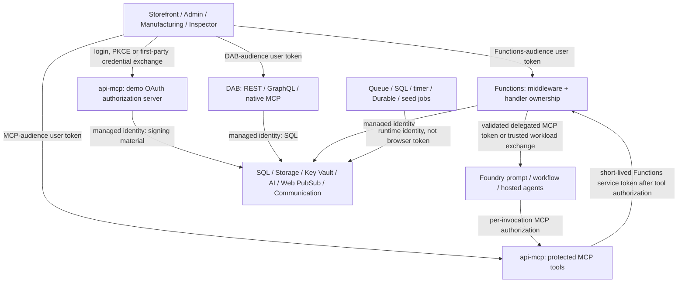

# End-to-end authentication and authorization

## Target and assurance status

The target is authenticated and authorized access to every business API by every
site and agent, with managed identity and Entra authorization for Azure dependencies.
Explicit public and platform exceptions are permitted, but must be bounded and tested.

**Complete end-to-end conformance has not been established.** The assurance runner
reports missing evidence as `BLOCKED` and unreviewed exceptions as `FAIL`, even when
all unit tests pass. It must not be used to claim complete coverage while required
assertions remain unimplemented or unavailable.

### Initial deployed verification checkpoint

The full `--all` run after targeted Functions and MCP redeployments recorded:

- 280 passing assertions, 18 existing exception classifications, six failures
  and 119 blocked obligations. Assertion counts are not unit-test counts.
- Both complete .NET test projects passed: 264 Functions tests and 303 MCP tests.
  The existing Python/Node auth suites and 20 assurance-runner tests also passed.
- Inventory: 236 Functions (192 HTTP), 62 custom MCP tools and 22 deployed agents,
  including workflow references and the hosted agent.
- 195 live denial assertions passed, including forged tokens, cross-resource
  audiences and manufacturing-to-sales scope isolation. Staff Functions/DAB reads
  and actual MCP-to-Functions proxy reads also passed.
- Five failing operations are anonymous cart CRUD and anonymous review creation.
  The sixth finding is broad runtime management roles, requiring justification or
  least-privilege remediation. These findings are not accepted exceptions.

This is a partial checkpoint, not completion of the assurance plan. Browser,
ownership, per-agent runtime, effective SQL and bounded mutation evidence remain
incomplete. No simulator was started and no test email was sent. The deployment
was preserved; clean-from-scratch verification has not occurred.

After the review-policy decision and DAB/storefront redeployment, the subsequent
full run recorded **289 PASS, 18 ACCEPTED_EXCEPTION, five FAIL and 119 BLOCKED**.
All 567 .NET tests, 24 assurance-runner tests and 22 frontend auth tests passed,
as did the existing Python auth-helper suites. Public review reads remained
available and anonymous POST/PATCH/DELETE each returned 403. The DAB revision was
confirmed ready; its original zero minimum replica count was restored after
startup diagnostics. The five remaining failures are cart CRUD and broad runtime
management roles. This does not resolve the remaining blocked obligations.

### Deployed guest-cart implementation checkpoint

The approved guest-cart exception uses a server-issued 256-bit capability,
stored only as a SHA-256 hash in SQL, with a fixed one-day expiry. The server
resolves every cart owner from that capability or a validated consumer bearer;
a caller-provided cart ID is only an ownership assertion, never authentication.
Guest capabilities cannot authorize checkout or unrelated business APIs.

The storefront automatically merges guest items into the signed-in account,
combining matching quantities in one SQL transaction. Failed or uncertain
merges preserve the proof for retry; only confirmed success clears it. Retried
merges to the same account are idempotent while the session remains unexpired.
Account switches/logout evict the previous cart query cache. Web Locks serialize
guest bootstrap across browser tabs; unsupported browsers explicitly require
sign-in instead. Expired sessions are rejected and deleted in bounded timer batches.

The deployed DAB policy removes anonymous cart access and all DAB cart writes, retaining
only consumer-owner-filtered reads. Deployment order is schema-only migration,
Functions, storefront, then DAB; do not enforce the new DAB restriction before
the replacement client/server path is healthy. The private schema-only execution
succeeded without reseeding data. Both cart capabilities passed live isolation,
quantity, ownership-denial and exact cleanup assertions; anonymous DAB
GET/POST/PATCH/DELETE each returned an authorization denial.

A real Chromium session also added a product while signed out, verified persisted
quantity and ownership, reloaded the cart, and proved checkout redirects to sign-in.
Its exact cart was retired and the capability subsequently returned 401. The
browser test blocks non-cart Functions mutations. The runner persists sanitized
fixture ledgers before mutation and never writes capability tokens to evidence.
Retired session audit rows remain until their original expiry and bounded timer
cleanup; cart items are deleted during retirement.

The final guest-rollout `--all` checkpoint recorded **327 PASS,
21 ACCEPTED_EXCEPTION, one FAIL and 122 BLOCKED**. All 292 Functions tests,
303 MCP tests, 37 frontend auth tests and 28 verifier tests passed, together with
the existing Python helper suites. Inventory now includes 241 Functions (196 HTTP),
62 custom MCP tools and 22 deployed agents. DAB's latest revision is ready and its
original minimum replica count remains zero. The remaining failure is runtime
Contributor grants on ACR and Communication Services, not cart CRUD. At that
checkpoint, actual consumer merge/rollback/overflow/retry and expiry-timer effects
remained blocked; guest/browser success was not proof of those paths or overall conformance.

### Reusable consumers and stronger RBAC verification

The user subsequently authorized reusable demo test users. The live profile now
creates two dedicated consumers once, then reuses them. It verifies real
Functions/DAB audience tokens, two-account cart ownership, cross-account item
PATCH/DELETE denials, both DAB consumer read roles, and a real read-only token's
read allowance/write denial. Real SQL merge tests prove exact quantity combination,
same-account retry idempotency, other-account retry rejection, stale-account
assertion denial, and quantity-overflow rollback preserving both carts and proof.

Chromium also signs in through the actual storefront credential form, without
fabricating browser authentication state. It observes automatic merge, proof
retirement, the resulting account-owned line and its UI persistence after reload.
The checkout return state is cleared before login so this scenario cannot initiate
checkout. Non-cart Functions mutations remain blocked.

Consumer scenarios select products absent from the initial account cart snapshots.
Cleanup removes only those run-owned products and compares all remaining rows
with the snapshots. Guest capabilities are retired; users are intentionally
retained for subsequent runs. Sanitized ledgers identify accounts, products and
cleanup outcomes, never passwords or tokens. No order, review or email is created.

RBAC verification now reads actual assigned role definitions, not only role names.
It expands action wildcards, subtracts NotActions within each permission block,
retains assignment conditions, and checks enumerated management/key-retrieval
operations against the assignment's resource scope. An ACR-scoped Contributor
assignment does not imply access to sibling Storage or Key Vault resources.
This remains a targeted privilege check, not complete effective-access proof:
group membership, conditional access, deny assignments and SQL grants still need
their dedicated validation.

The pre-remediation checkpoint recorded **379 PASS, 21 ACCEPTED_EXCEPTION,
five FAIL and 120 BLOCKED**. All 292 Functions tests, 303 MCP tests, 37 frontend
auth tests and 35 verifier tests passed. The five failed assertions represent
four runtime role assignments plus the aggregate broad-role gate:

- Resource-group Managed Identity Operator, including deployment write permission.
- The custom deployment-script role, including Storage management/key retrieval,
  Container Instances and deployment-script permissions.
- Resource-scoped Contributor on ACR; a separate AcrPull assignment already exists.
- Resource-scoped Contributor on Communication Services.

The increased failure count comes from detecting additional permissions, not
relaxing the target or introducing application regressions. At that checkpoint,
none of these grants had been removed or accepted as an exception. The subsequent
remediation below preserves email authentication and removes these bindings. Expiry-timer,
other sites/Inspector, broader ownership, agent runtime, SQL and simulator
obligations remain incomplete; full conformance is still not established.

### Runtime IAM remediation

The user subsequently authorized remediation of all four findings, superseding
the earlier documentation-only decision. All four exact runtime bindings have
now been removed from the selected deployment and their declarations removed or
replaced in Bicep. No administrator binding was removed.

| Runtime assignment | Verified scope and permissions | Source and disposition |
| --- | --- | --- |
| Managed Identity Operator | Selected resource group; built-in definition includes `Microsoft.Resources/deployments/*` | Removed. [Identity module](../../../infra/modules/identity.bicep) now creates only the identity. Deployment remains the responsibility of the deployer, not the application runtime. |
| Deployment-script custom role | Selected resource group; Storage, Container Instances, deployments and deployment-script wildcards | Binding removed. No deployed ARM deployment-script resource was found. The old custom definition may remain inert/unassigned in an upgraded environment; Bicep no longer creates it. No Storage key or deployment wildcard remains assigned to this runtime identity. |
| ACR Contributor | Selected registry; registry write/delete and credential retrieval | Removed. Existing registry-scoped AcrPull and separate seed-identity AcrPull remain. The actual runtime UAMI successfully exchanged an ACR token and fetched its deployed image manifest; its ARM registry metadata request returned 403. |
| Communication Services Contributor | Selected Communication resource; write/delete and key retrieval/regeneration | Replaced by the exact custom role below. The separate administrator Contributor binding remains unchanged. |

**Bounded platform permission, not a send-only role:** `AdventureWorks Email Sender`
allows exactly `Microsoft.Communication/communicationServices/read` and
`Microsoft.Communication/communicationServices/write`, with both assignment and
assignable scope restricted to the selected single Communication resource.
It grants no wildcard, key retrieval/regeneration, deletion, Email Service write,
or role administration. The retained service write action can modify that resource's
properties; it is an explicit exception to the data-plane-only target.
The [contract](../../../tests/auth/contracts.json) accepts only this exact role
shape, scope, principal and unconditional assignment, not similarly named roles
or arbitrary Communication permissions.

An actual ACA runtime probe first tried read-only email authorization: the send
returned 401. Adding only Communication service write resulted in 202 and the
email operation reached `Succeeded`, after Contributor had been removed.
This proves the tested REST send/poll path, not independently observed mailbox
delivery or every application email path. Controlled test emails were separately
authorized; recipients are supplied only in process environment, never evidence.
Microsoft's [SMTP role guidance](https://learn.microsoft.com/azure/communication-services/quickstarts/email/send-email-smtp/smtp-authentication)
also discusses management actions, but its additional Email Service write
permission was not required by the tested REST path and is not granted here.

Incremental ARM deployment does not delete assignments removed from a template.
The [postprovision hook](../../../scripts/hooks/postprovision.sh) therefore invokes
the [exact reconciliation utility](../../../scripts/utilities/reconcile-runtime-rbac.py)
before other postprovision work. It verifies the narrow replacements first,
rechecks each principal/role/scope before deletion, preserves unrelated bindings,
and records exact removal IDs in an ignored evidence ledger. A second apply found
zero targets and confirmed preservation. Fresh deployments also verify replacements
without requiring obsolete bindings to exist. An unexpected role definition or
missing replacement fails explicitly; no bulk principal/resource-group cleanup occurs.

Reproduce the read-only inspection using
`bash tests/scripts/validate-auth.sh --environment <environment> --infra`.
The selected azd environment supplies the resource group and runtime identity;
the runner discovers principal IDs and role definitions rather than embedding them.
JSON evidence records `runtimeRoleAssignments` and `runtimeRolePermissions`,
including scopes, permission blocks, assignment conditions and the enumerated
sensitive management operations. Do not interpret a successful data request,
Entra-only configuration, or absence of one probed operation as full least-privilege
or effective-access proof. No destructive capability is exercised by these checks.

Run the standalone read-only runtime probe with
`python3 tests/scripts/test-runtime-rbac.py --environment <environment>`.
It executes the actual test source inside the existing admin container, acquires
tokens from its managed-identity endpoint with explicit client/principal checks,
verifies Storage and ACR ARM reads return 403, and fetches the deployed ACR image
manifest. Opt-in `--send-email` additionally requires an explicitly approved
`AUTH_RBAC_TEST_RECIPIENT` environment variable and sends one message without
POST retries; operation-origin checking prevents forwarding a token elsewhere.
Neither probe creates an order or changes customer data. An uncertain invocation
is `BLOCKED`, not a successful email test, and must be investigated before retrying.
Full deployment/agent/SQL assurance remains incomplete.

The final post-remediation `--all` checkpoint recorded **389 PASS,
22 ACCEPTED_EXCEPTION, zero FAIL and 120 BLOCKED**. The additional exception is
the exact Communication service write permission above, not a blanket waiver.
All 292 Functions tests, 303 MCP tests, 41 assurance/reconciliation tests and five
runtime-probe safety tests passed, together with the existing frontend/helper
suites. The real runtime identity probe passed all six checks, including the
approved email operation; the post-removal SMB persistence probe passed all six.
Functions/file-data readiness and the normal seed-log reader passed after the
readiness probe was corrected to read directory data rather than share-level
properties. No new Storage management role was introduced. These results retire
the four IAM findings but do not complete the remaining 120 obligations.

### Seed log mount: approved SMB managed identity migration

The user separately approved migrating the existing Azure Files seed-log mount
to the existing ACA environment user-assigned identity, including preview
features. The four unrelated IAM bindings were remediated under the subsequent,
separate authorization described above.

The `/logs` mount and existing log files are preserved. Storage now enables SMB
OAuth and Kerberos, defaults to OAuth, and sets `allowSharedKeyAccess: false`.
The environment storage definition uses `azureFile.identity` with
`2026-03-02-preview`, not an account key or a key stored in Key Vault.
The existing environment identity has the platform-required **Storage File Data
SMB MI Admin** role at Storage account scope. This is a deliberately documented
file-data privilege: the preview requires administrator-level file access,
including ACL administration, across the account's shares. It is not proof of
per-share least privilege or an excuse for broader management roles.

Two non-seeding execution overrides proved an SMB write, cross-execution
persistence/read and exact probe deletion **with Shared Key disabled**. The stored
job template was unchanged, and the normal seed-status log reader still returned
`completed`; Functions health returned `healthy`. No database seeding, reset or
resource deletion occurred. The repeatable
[mount verifier](../../../tests/scripts/test-seed-log-mount.py) discovers the
selected azd deployment and records exact execution/cleanup evidence.
See the [seed-job guide](../../../seed-job/README.md#persistent-seed-logs-managed-identity-smb-mount-preview)
for provisioning requirements, preview limitations, test commands and recovery.
Clean-from-scratch provisioning remains unverified pending user-owned teardown.

After this migration, the full assurance checkpoint recorded **384 PASS,
21 ACCEPTED_EXCEPTION, five FAIL and 120 BLOCKED**. The five failures are the
same four unrelated runtime IAM findings plus their aggregate gate; no new
failure was introduced by disabling Shared Key. Both .NET suites (292 Functions,
303 MCP), the 35 verifier tests and frontend/helper suites passed. The separate
SMB persistence probe passed all six checks; the seed deployment/probe regression
suite passed all 13 tests. This is feature-specific verification, not overall
authentication conformance.

Related component designs:

- [Functions resource server](../functions-oauth/README.md) and
  [route matrix](../functions-oauth/ROUTE_SCOPE_MATRIX.md).
- [MCP authorization server/resource server](../mcp-oauth/README.md) and
  [tool matrix](../mcp-oauth/TOOL_SCOPE_MATRIX.md).
- [DAB configuration](../../../api/dab-config.json) and [DAB guide](../../../api/README.md).
- [Authenticated local scripting](../../testing/AZURE_AUTHENTICATED_SCRIPTS.md).
- [Executable assurance contracts](../../../tests/auth/contracts.json) and
  [validation implementation](../../../tests/auth/validate.py).

## Two identity systems, not one

| Layer | Authentication | Authorization |
| --- | --- | --- |
| AdventureWorks users | Demo database-backed login, self-hosted OpenIddict OAuth | Resource-bound JWTs, application category, business scopes/roles, record ownership |
| Azure workloads | Entra managed identity | Azure resource/data-plane RBAC; SQL contained Entra users and SQL grants |
| Browser real-time connection | Short-lived Web PubSub client capability | Hub/group membership and capability permissions |
| Deployment/platform integration | Deployment identity, and limited platform credentials where required | Deployment roles and explicitly scoped platform exceptions |

Users are **not signing in through Entra ID**. The self-contained demo identity
provider is not a production enterprise identity system. Its known limitations
must not be confused with Azure managed-identity authentication.

SQL Entra-only login does not itself prove least privilege. Azure management RBAC
does not grant SQL table access: contained users, database roles and explicit grants
must be checked separately.

## Trust paths



### Browser and delegated calls

- Each resource has a separate audience, derived from deployment configuration.
  MCP, DAB and Functions tokens are not interchangeable.
- Admin/manufacturing use public-client PKCE S256 flows and portal category checks.
  Storefront uses the existing first-party consumer exchange.
- First-party refresh sessions can request an allowed target resource. Refresh
  tokens do not authorize API operations directly.
- The Functions fetch interceptors and storefront helpers obtain Functions tokens.
  Chat is different: its handler validates an **MCP-audience** bearer token before
  forwarding it, and binds conversation continuation to the caller.
- On logout/user switch, tokens, user-bound caches and conversation references must
  be cleared. A route guard alone is not API authorization.
- Origin checks must prevent tokens reaching other hosts or redirect destinations.

### Autonomous agents and proxies

- Functions and the hosted manufacturing agent obtain an Entra assertion using
  their actual runtime identity. The custom assertion grant validates signature,
  tenant, audience, lifetime and a principal-object-ID allowlist.
- The grant issues an MCP-resource service token. A client ID, blueprint ID or
  agent name is not a substitute for the deployed instance principal.
- Delegated requests must retain user authority; failure must not promote a user
  to a service identity.
- MCP authorizes each tool before a proxy uses its backend Functions service token.
  `obo_sub` is audit context, not delegated authorization.
- Agent definitions do not store bearer tokens. Invocation code supplies headers
  per request. A deployed tool URL alone does not demonstrate token propagation.
- Data-supplied generation can intentionally omit MCP tools. Its upstream SQL,
  Storage and Foundry calls still require authenticated workload access.
- Prompt agents, intent sub-agents, workflows and the hosted agent must all be
  inventoried. Foundry list results are paginated; one page is not full discovery.

### Background work

Queue, timer, SQL and Durable triggers are not public HTTP bearer-token endpoints,
but remain in the identity/dependency inventory. Verify identity-based host storage,
SQL trigger permissions, callback authorization, management URLs and job identity.
Do not treat the absence of an HTTP route as proof of authorization.

## Enforcement invariants

- Unknown Functions and MCP tools fail closed.
- A protected request needs a valid signature, issuer, audience, lifetime and subject.
  Functions accepts only the recognized `consumer`, `employee`, `manufacturing` and
  `service` categories. Internal access is not inferred from “anything except consumer.”
- MCP tool decisions also reject missing subjects and unrecognized categories.
- Missing scope and forbidden category are separate from missing/invalid tokens.
- Consumer ownership derives from validated identity and server-resolved records,
  never a trusted caller-supplied owner ID.
- Explicit `FUNCTIONS_OAUTH_MODE=enforced` or `audit` with missing configuration
  fails startup instead of silently disabling protection. Invalid mode strings
  fail startup. An unset mode remains disabled for existing local development;
  deployed assurance requires `enforced`.
- Enforced-denial tests must prove handlers and side effects were not reached.
  Registry membership tests cannot establish this by themselves.
- Resource-server metadata/key outages must not become authorization success.

## Exceptions and unresolved findings

Exceptions are not wildcard bypasses. An accepted exception must have an exact
operation/resource, rationale, exposure boundary, compensating control, provenance
and executable assertions. Expansion requires review.

| ID / category | Boundary and provenance | Assurance treatment |
| --- | --- | --- |
| Public catalog/status/discovery | Existing Functions Public tier and route matrix; storefront browsing and DAB read catalog | Exact Functions names and DAB read entities are pinned in the contract; expansion fails. Data minimization still needs live assertions. |
| Pre-authentication | Signup, login/token/discovery and password-reset flows must precede an authenticated session | Not unrestricted password administration. Test reset-token binding, enumeration resistance and rate limits separately. |
| Alternate chat enforcement | Public middleware classification, but handler requires validated MCP token | Not accepted as anonymous chat access. A valid request without that token must receive 401. |
| Web PubSub capability | Negotiate is currently Public and issues group-bound client URLs | Existing demo behavior, **not proof** of role-appropriate group access. Group/data exposure and token lifetime/permissions remain required evidence. Never publish access URLs in reports. |
| Demo user identity/state | Self-hosted database login, in-memory OAuth state and self-signed signing certificate | Existing documented demo limitations, not enterprise user authentication or multi-instance session guarantees. |
| Azure Files SMB managed-identity mount | Existing ACA environment UAMI; SMB OAuth; Storage File Data SMB MI Admin at account scope | **Approved preview/platform privilege**: preserves seed file logging without account keys. Shared Key is disabled. Live cross-execution write/read/cleanup and existing log reader pass, including after runtime management-binding retirement. Required account-wide file-administrator access is broader than per-share ACLs. |
| Logging, telemetry, SWA deployment | Platform logging shared keys, telemetry ingestion configuration and deployment tokens | Classify separately from application data-plane credentials; do not assume every connection-string setting is a password. Exact consumers and restrictions remain to be verified. |
| Guest cart bootstrap and capability authentication | Public session issuance; cart handlers validate a fixed-one-day opaque capability or consumer bearer | **Approved bounded exception**: no anonymous DAB cart access, no DAB cart writes, guest proof authorizes only its own cart. Live isolation/retirement, real-consumer merge/rollback/retry and actual browser sign-in/merge pass; expiry-timer execution remains blocked. |
| Public reviews, protected mutations | Anonymous users may read reviews; creating or liking requires authentication, as confirmed by the user | Anonymous creation is removed. Consumer/authenticated creation binds UserID to the validated business_entity_id claim; update permits only HelpfulVotes. Full consumer mutation/ownership fixtures remain required. |
| Communication email authorization | Exact resource-scoped read/write custom role on the single Communication service | **Bounded platform permission**: write is required for the tested managed-identity email path and also permits resource-property updates. Exact scope/actions/principal are checked; keys, delete, wildcards and role administration are not granted. The four former runtime management bindings are removed. |

The runner deliberately does not convert an existing permissive DAB configuration
into an accepted exception. Anonymous cart CRUD remains unresolved; public review
reading does not imply permission to create or like reviews.

### Review behavior and validation limits

The storefront already displayed sign-in prompts for review creation and hid voting
buttons from anonymous users. The underlying anonymous DAB create permission and
local-storage submission fallback did not match that UI boundary. Creation and
voting helpers now reject anonymous/mismatched sessions, and failed submissions
propagate to the form rather than producing a success toast.

Database policies may reference only columns accessible to the same action.
Referencing UserID in a HelpfulVotes-only update policy prevents DAB startup.
The runner detects this invalid configuration; **do not** grant UserID write access
to make that policy pass. Self-vote prevention remains a UI rule, not proven
server-side vote integrity or duplicate-vote protection.

Anonymous create probes use a complete request shape with a verified nonexistent
product, so a permissive regression cannot normally create a review. An empty
body is not an adequate denial test: DAB validates its shape before authorization.
Existing admin/manufacturing tokens intentionally lack consumer owner claims;
they cannot substitute for real consumer fixtures in positive review-write tests.

The storefront production/development builds and focused review lint/tests pass.
The full storefront type-check still reports five pre-existing errors in untouched
calendar and product-page files; it must not be reported as passing. The cart
optimistic-row type mismatch was removed while replacing the legacy cart transport.

### Confirmed cart scope

The original [cart provider](../../../app/src/context/CartContext.tsx) required
sign-in; unrestricted anonymous DAB access did not implement genuine guest carts.
The approved replacement adds real server-validated guest sessions, fixed one-day
expiry and automatic sign-in merge that combines matching quantities atomically.
Failed or uncertain merge responses preserve the guest proof for retry. Checkout
remains authenticated, and account switches/logout remove the prior cart cache.

The actual provider regressions cover proof-retirement/render races: successful
merge must invalidate the account query even when clearing the guest session
renders before the awaiting continuation. Stale merge failures must not overwrite
the next account's UI state. The live profile separately exercises the real
consumer two-owner and merge transaction paths; neither replaces expiry-timer proof.

## Reproducible validation

Prerequisites: Bash/Linux, Python 3.10+, Node, the repository .NET SDK, existing
frontend dependencies, azd and Azure CLI. Select the intended azd environment and
authenticate using normal local-development credentials. No hostnames, subscription
IDs, resource names or principal IDs belong in test source.

The live profile also requires Chromium for the declared storefront Playwright
development dependency. Install its browser and required OS libraries using
`cd app && npx playwright install --with-deps chromium` when absent. In a shared
environment, preserve other cached browser versions with
`PLAYWRIGHT_SKIP_BROWSER_GC=1`; local extracted libraries and `LD_LIBRARY_PATH`
can avoid system-wide package changes. Missing browser prerequisites are
`BLOCKED`, never browser-test success.

```bash
bash tests/scripts/validate-auth.sh --offline
bash tests/scripts/validate-auth.sh --environment <environment> --infra
bash tests/scripts/validate-auth.sh --environment <environment> --live
bash tests/scripts/validate-auth.sh --environment <environment> --all
```

### Reusable demo consumer fixtures

`--live` and `--all` may create two dedicated test users in the selected **demo**
deployment. This setup was explicitly approved; do not run it against a real
customer environment. Signup uses `@example.invalid` addresses and does not send
email. New users have a business-entity owner even before their first purchase
creates a Customer row.

Credentials are generated once and retained under the ignored local azd environment:
`AUTH_TEST_CONSUMER_A_EMAIL`, `AUTH_TEST_CONSUMER_A_PASSWORD`,
`AUTH_TEST_CONSUMER_A_BUSINESS_ENTITY_ID`, `AUTH_TEST_CONSUMER_A_STATE`, with
equivalent `B` keys. Pending state is persisted before signup; interrupted runs
attempt login before creating again. Existing passwords are never reset.
The runner requires an owned, Git-ignored local azd dotenv file, restricts it to
mode 0600, and passes updates through a private temporary file, not secret CLI
arguments. Missing or inconsistent retained credentials stop fixture setup rather
than silently creating replacements. Do not print or publish `azd env get-values`
output: it now includes retained test passwords.

Browser credentials and a fresh cleanup token pass only through the child process
environment, never arguments or evidence. The browser obtains its own tokens
through normal sign-in. Anonymous-only browser runs discard inherited consumer
fixture environment variables. Evidence inventories contain only fixture labels
and owner IDs. Users remain reusable; exact cart fixtures are cleaned after every
run. User-owned teardown eventually removes these demo accounts; the verifier
never runs `azd down`.

### Runner behavior

- Every profile builds and reflects current Functions/MCP assemblies. Offline/all
  run both complete .NET test projects, Python helper/verifier tests and existing
  frontend auth tests. Restore/install only when required dependencies are missing.
- Runs are serialized because they share build outputs. Do not start concurrent
  validation profiles against the same checkout.
- Infra checks read the selected azd environment and Azure configuration. They
  check resource-server settings, Key Vault RBAC, Entra-only SQL, disabled AI keys,
  host storage identity, selected runtime roles and their actual permissions, revisions and paginated deployed
  agents/workflow references. No configuration or role changes occur in this stage.
- Live checks currently exercise safe Functions GET denials, forged tokens,
  alternate chat enforcement, discovery, staff Functions/DAB reads, MCP proxy
  allow/scope-denial behavior, real consumer cart ownership/merge and storefront
  browser sign-in/merge. They do not execute global resets or clear queues.
- Missing non-cart mutation fixtures, other-site/Inspector browser flows,
  remaining ownership scenarios, workload probes and simulator safeguards remain
  explicit blocked obligations.
- CLI output from auth/settings commands and response bodies are not dumped.
  Tokens remain in process memory. Network failures are not counted as auth denials.

Reports are written under ignored `.auth-results/<run-id>/`: reflected inventories,
JSON assertions/coverage, JUnit XML, .NET TRX/unit-test logs and a Markdown summary.
Use `--output <new-directory>` for a different new evidence directory; do not
publish raw test logs without reviewing them. Source revision/diff fingerprint,
selected environment, deployed agent versions and Container App revisions identify
what was tested.

Exit codes:

- `0`: selected implemented assertions passed, with no known required blockers.
- `1`: failed assertion or unreviewed exception.
- `2`: required evidence unavailable/incomplete, with no failed assertion.

The current suite is intentionally partial and is expected to return nonzero until
the reported failures and blocked obligations are resolved. `PASS` counts must never
be presented as a percentage of every solution path.

Coverage is reported per group as completed/applicable, with passed counts separate.
Failed assertions count as executed, not passed. Accepted exceptions and truly
inapplicable assertions do not inflate protected-operation coverage.

## Live mutation and email safety

Permission to test mutations is not permission for uncontrolled workloads.
Before automatic simulator tests can run:

1. Implement a server-enforced maximum of three test orders, one per minute, with
   one active run and an expiry. Reservations must be atomic across workers.
2. Make test-order creation retry-safe, and trace every queued message to the run.
   Stopping enqueue does not cancel already queued work.
3. Prove external-email suppression for both direct and indirect order/receipt flows.
4. Maintain a per-run fixture/cleanup ledger. Never overwrite another simulator,
   clear shared queues or reset the database.
5. Account for retained order/audit records explicitly; cleanup failure is visible.

These safeguards are **not implemented by this runner**. It reports simulator
validation as blocked and does not start a simulator. The ordinary simulator's
one-hour minimum and a client-process stop timer are insufficient safety controls.

## Deployment and clean-environment verification

During implementation, necessary azd redeployments are authorized without another
deployment approval. Prefer targeted `azd deploy <service> --no-prompt`; use azd
provisioning only when required by related IaC changes. Verify readiness, rediscover
configuration and rerun affected checks after each deployment.

**Never run `azd down` as part of this suite or agent workflow.** The user owns
teardown. Keep the environment intact after in-place validation.

After the user has separately torn down the environment and handed control back:

```bash
azd up --no-prompt
bash tests/scripts/validate-auth.sh --environment <environment> --all
```

Fresh resources, identities, agent versions and signing material must be
rediscovered from azd and Azure; do not reuse old report/session tokens. Verify
auth wiring without manual repair. Clean-deployment verification remains a separate
pending result until that lifecycle has actually occurred.

## Remaining work required for complete assurance

- Real Functions worker-host denial/side-effect tests and every ownership handler.
- Real Entra assertion signature/tenant/audience negatives, not only a stub grant validator.
- All DAB roles/actions/fields/database policies and native MCP transport.
- Actual browser sign-in, session restoration, user switching, refresh and logout
  across all sites and Inspector.
- Every enabled agent and nested workflow path, with correlated evidence of actual
  tool/dependency calls using the actual runtime identity.
- SQL contained-user/grant evidence from an approved private-network execution
  point, plus effective conditional/inherited RBAC across all workload principals.
- Bounded simulator mutation mode, retry-safe fixtures, cleanup and email exclusion.
- Exact platform exception verification and resolution of unreviewed anonymous operations.

If a private endpoint or identity is inaccessible from the developer machine, use
an existing approved runtime execution path. Do not expose private services or grant
the runner broad roles simply to make a test green.
