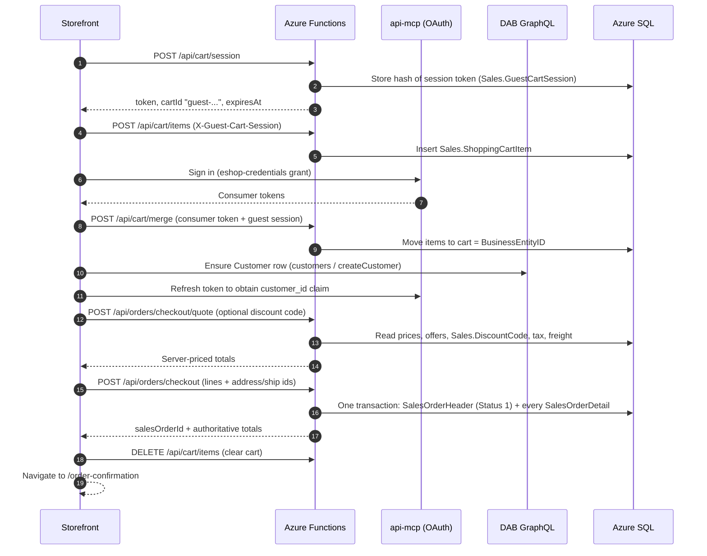

# Shopping cart and checkout

The storefront cart works for anonymous guests and signed-in customers. Checkout requires a customer account. It creates the order through Azure Functions, which then starts the [order pipeline](order-lifecycle.md) and [receipt generation](receipts.md).

## What it does

- **Guest cart:** an anonymous shopper gets a server-side guest cart session and can add, update and remove items.
- **Customer cart:** a signed-in consumer's cart is keyed by their `BusinessEntityID`.
- **Merge at sign-in:** the guest cart is merged into the customer cart when the shopper signs in.
- **Checkout:** choose billing and shipping addresses, a shipping method and a saved payment method, apply a demo discount code (validated by the server) and place the order in one server-priced call.
- **Order confirmation:** the shopper lands on `/order-confirmation?orderId=SO-{id}`.
- **Abandoned carts (admin):** the admin **Stale carts** page (`/stale-carts`) analyses abandoned carts with an AI agent and can email the shopper.

## Try it

- **UI:** add products to the cart as a guest, sign in or create an account, then go to **Checkout**.
- **API:** the guest-cart routes are public, so no token is needed:

  ```bash
  FUNCS=$(azd env get-value API_FUNCTIONS_URL --no-prompt)
  curl -s -X POST "$FUNCS/api/cart/session"   # returns { token, cartId, expiresAt }
  ```

  Send the returned token in the `X-Guest-Cart-Session` header on `/api/cart/items` calls. Checkout routes need a **consumer** token, not the canned internal identities; see [authenticated scripts](../../testing/AZURE_AUTHENTICATED_SCRIPTS.md).

## How it works



### Cart

| Route | Purpose |
|---|---|
| `POST /api/cart/session` / `DELETE /api/cart/session` | Create or end a guest cart session. Returns `{ token, cartId, expiresAt }`; the 64-hex-character token is sent back in the `X-Guest-Cart-Session` header. |
| `GET` / `POST` / `DELETE /api/cart/items?cartId=` | List, add or clear items |
| `PATCH` / `DELETE /api/cart/items/{id}` | Change quantity or remove one item |
| `POST /api/cart/merge` | Merge the guest cart into the signed-in consumer's cart |

The storefront keeps the guest session in `localStorage` (`adventureworks_guest_cart`), caches the cart under the React Query key `["shoppingCart", id]` and serializes cart writes across tabs with `navigator.locks`. Adding an item sends the `Product_AddToCart` telemetry event.

The `CleanupExpiredGuestCarts` timer runs every 10 minutes and deletes up to 500 expired guest sessions per run.

### Checkout

1. The storefront makes sure a `Sales.Customer` row exists for the person (DAB `customers` / `createCustomer`) and refreshes the token so it carries the signed `customer_id` claim.
2. Applying a discount code calls `POST /api/orders/checkout/quote` with the cart lines, the shipping address, ship method, code and display currency. The quote is read-only; an unknown or inactive code returns HTTP 400 with `reason: "invalid-discount-code"`.
3. `POST /api/orders/checkout` with `{ lines: [{ productId, quantity }], billToAddressId, shipToAddressId, shipMethodId, discountCode?, displayCurrency? }` places the order in one call. The browser sends no prices, totals or customer ids. The function:
   - takes `CustomerID` and `BusinessEntityID` from the signed token and checks that the customer belongs to that person and that both addresses are linked to them (otherwise HTTP 403);
   - prices each line from `Production.Product.ListPrice` and the best active `Customer` special offer for the product, combined with the discount code (unavailable or discontinued products return HTTP 400 with `reason: "unavailable-product"`);
   - computes tax and freight with the rules below, in USD;
   - inserts the header (`Status = 1`, `OnlineOrderFlag = 1`, due date 7 days out, `CurrencyRateID` for the display currency) and every detail line in a single SQL transaction, so a failure leaves no partial order;
   - returns `salesOrderId`, `salesOrderNumber` and the USD and display-currency totals.
4. The cart is cleared, `Purchase_Complete` is tracked with the server totals, and the confirmation page shows the server totals.

The browser still computes a preview of the totals, but the server result is authoritative. Pricing rules (all in USD, which is what `Sales.SalesOrderHeader` stores):

- **Line price:** `UnitPrice = ListPrice`; `UnitPriceDiscount = 1 − (1 − sale %) × (1 − code %)`; `SpecialOfferID` is the sale offer, or 1 (No Discount). The same line-pricing rules and catalogue query are reused by simulated consumer orders (which place orders through this checkout service) and by B2B store orders (with `Reseller` offers).
- **Tax:** `Sales.SalesTaxRate` for the shipping state; 8% when no rate exists.
- **Shipping:** free when the discounted subtotal is above USD 50 or with `FREESHIP`; otherwise the ship method's `ShipBase` (9.99 fallback). Ship method 5 is the default.
- **Display currency:** USD totals × the latest `Sales.CurrencyRate.AverageRate` for the currency.
- **Discount codes:** stored in `Sales.DiscountCode` (created and seeded by the seed job: `SAVE10`, `SAVE20`, `FREESHIP` and `ADVENTURE25`). Codes are matched case-insensitively and must be active and inside their start/end window. The browser holds no code list.
- **Limits:** up to 100 distinct products per order and 999 units per line.

Saved payment methods come from `GET /api/payment-methods`. Shoppers add a card from the account page with `POST /api/payment-methods`, and remove one through DAB REST (`PersonCreditCard`). The browser accepts only well-known public test card numbers (Luhn-valid and on its test list) and sends just the card type, last four digits and expiry; the full number never leaves the browser. The function validates those fields, rejects any other field (including a full card number), and stores a masked `CardNumber` (`************1234`) in `Sales.CreditCard` linked through `Sales.PersonCreditCard` to the signed-in consumer from the token. Card brands from the sample data are shown with familiar names (for example, Vista is shown as Visa).

## Data & storage

| Data | Store |
|---|---|
| Guest sessions | `Sales.GuestCartSession` (token hash only; 1-day lifetime) |
| Cart lines | `Sales.ShoppingCartItem` |
| Orders | `Sales.SalesOrderHeader`, `Sales.SalesOrderDetail` (USD) |
| Discount codes | `Sales.DiscountCode` (seed-provisioned) |
| Cards | `Sales.CreditCard`, `Sales.PersonCreditCard` |

## Events (Web PubSub)

- Cart changes are written to the database outbox and published as `database-changed` on the `orders` group. The storefront invalidates `["shoppingCart"]` when it receives an `orders` event.
- Placing an order fires `OrderPlacedSqlTrigger`; see [Order lifecycle](order-lifecycle.md#events-web-pubsub).
- `orders` payloads are generic invalidation signals with no record identifiers. See [Web PubSub events](../../reference/webpubsub-events.md).

## Security

| Route | Access |
|---|---|
| Guest session and cart item routes | Public; the handler binds the cart to the guest session token or the signed-in consumer |
| `POST /api/cart/merge` | Consumer, `orders.write` |
| `POST /api/orders/checkout` | Consumer, `orders.write`; owner from the signed `customer_id` and `business_entity_id` claims; both addresses must belong to that person |
| `POST /api/orders/checkout/quote` | Consumer, `orders.read`; same ownership checks; read-only |
| `GET /api/orders/details?orderIds=` | Consumer, `orders.read`, owner only; up to 100 ids |
| `GET /api/payment-methods` | Consumer, `customers.read`, self only |
| `POST /api/payment-methods` | Consumer, `customers.write`, self only (owner from the token) |
| `POST /api/carts/analyze-recovery` | Internal, `admin.read` |

DAB exposes `ShoppingCartItem` read-only to its owner. Full matrix: [Functions route scopes](../functions-oauth/ROUTE_SCOPE_MATRIX.md).

## Configuration

| Setting | Purpose |
|---|---|
| `API_FUNCTIONS_URL`, `API_URL` | Storefront runtime config |
| `AI_AGENT_CART_RECOVERY_ID` | Foundry agent for cart-recovery analysis |

## Limits

- Up to 10,000 live guest sessions; each lasts 1 day.
- Discount codes are demo codes stored in `Sales.DiscountCode`; they are separate from special offers. Adding a code requires a seed change and a fresh environment.
- No real payment is taken; saved cards are AdventureWorks sample data or masked public test cards.

## Related code & docs

- `app/src/context/CartContext.tsx`, `app/src/services/ownedCart.ts`, `app/src/hooks/useShoppingCart.ts`, `app/src/pages/CheckoutPage.tsx`
- `api-functions/Services/CheckoutService.cs` (pricing, validation, transactional insert), `seed-job/sql/discount-codes.sql`
- `api-functions/Functions/OwnedCartFunctions.cs`, `CheckoutFunctions.cs`, `OrderDetailFunctions.cs`, `PaymentMethodFunctions.cs`, `CartRecoveryAnalysisFunction.cs`
- [Order lifecycle](order-lifecycle.md) · [Receipts](receipts.md) · [Accounts](../customers/accounts-and-sign-in.md) · [Shopping simulator](../simulators/shopping-simulator.md)
