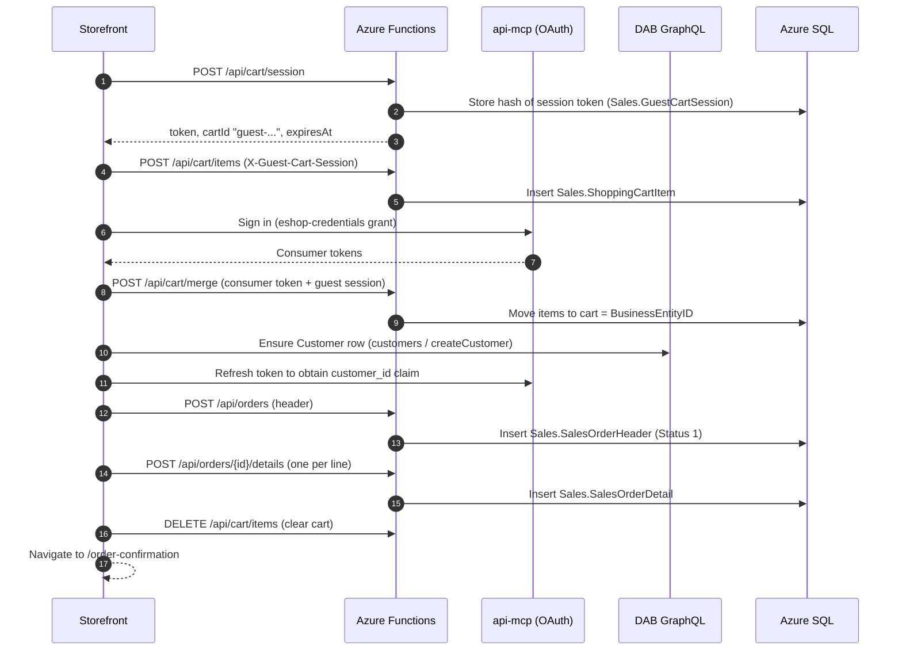

# Shopping cart and checkout

The storefront cart works for anonymous guests and signed-in customers. Checkout requires a customer account. It creates the order through Azure Functions, which then starts the [order pipeline](order-lifecycle.md) and [receipt generation](receipts.md).

## What it does

- **Guest cart:** an anonymous shopper gets a server-side guest cart session and can add, update and remove items.
- **Customer cart:** a signed-in consumer's cart is keyed by their `BusinessEntityID`.
- **Merge at sign-in:** the guest cart is merged into the customer cart when the shopper signs in.
- **Checkout:** choose billing and shipping addresses, a shipping method and a saved payment method, apply a demo discount code and place the order.
- **Order confirmation:** the shopper lands on `/order-confirmation?orderId=SO-{id}`.
- **Abandoned carts (admin):** the admin **Stale carts** page (`/stale-carts`) analyses abandoned carts with an AI agent and can email the shopper.

## Try it

- **UI:** add products to the cart as a guest, sign in or create an account, then go to **Checkout**.
- **API:** the guest-cart routes are public, so no token is needed:

  ```bash
  FUNCS=$(azd env get-value API_FUNCTIONS_URL --no-prompt)
  curl -s -X POST "$FUNCS/api/cart/session"   # returns { token, cartId, expiresAt }
  ```

  Send the returned token in the `X-Guest-Cart-Session` header on `/api/cart/items` calls. Checkout routes need a **consumer** token, not the canned internal identities; see [authenticated scripts](../../testing/AZURE_AUTHENTICATED_SCRIPTS.md).

## How it works



### Cart

| Route | Purpose |
|---|---|
| `POST /api/cart/session` / `DELETE /api/cart/session` | Create or end a guest cart session. Returns `{ token, cartId, expiresAt }`; the 64-hex-character token is sent back in the `X-Guest-Cart-Session` header. |
| `GET` / `POST` / `DELETE /api/cart/items?cartId=` | List, add or clear items |
| `PATCH` / `DELETE /api/cart/items/{id}` | Change quantity or remove one item |
| `POST /api/cart/merge` | Merge the guest cart into the signed-in consumer's cart |

The storefront keeps the guest session in `localStorage` (`adventureworks_guest_cart`), caches the cart under the React Query key `["shoppingCart", id]` and serializes cart writes across tabs with `navigator.locks`. Adding an item sends the `Product_AddToCart` telemetry event.

The `CleanupExpiredGuestCarts` timer runs every 10 minutes and deletes up to 500 expired guest sessions per run.

### Checkout

1. The storefront makes sure a `Sales.Customer` row exists for the person (DAB `customers` / `createCustomer`) and refreshes the token so it carries the signed `customer_id` claim.
2. `POST /api/orders` with `{ billToAddressId, shipToAddressId, shipMethodId, subTotal, taxAmt, freight }` inserts the header with `Status = 1`, `OnlineOrderFlag = 1` and a due date 7 days out. `CustomerID` and `BusinessEntityID` come from the signed token claims, not the request body.
3. `POST /api/orders/{id}/details` adds each line (`SpecialOfferID = 1`).
4. The cart is cleared, `Purchase_Complete` is tracked, and the shopper sees the confirmation page.

Totals are calculated in the browser:

- **Tax:** DAB `salesTaxRates` for the shipping state; 8% when no rate exists.
- **Shipping:** free when the discounted subtotal is above the equivalent of USD 50 (50 × the display currency's exchange rate) or with `FREESHIP`; otherwise the ship method's `ShipBase` (9.99 fallback). Ship method 5 is the default.
- **Demo discount codes:** `SAVE10`, `SAVE20`, `FREESHIP` and `ADVENTURE25`.

Saved payment methods come from `GET /api/payment-methods`. Shoppers remove a card through DAB REST (`PersonCreditCard`). Card brands from the sample data are shown with familiar names (for example, Vista is shown as Visa).

## Data & storage

| Data | Store |
|---|---|
| Guest sessions | `Sales.GuestCartSession` (token hash only; 1-day lifetime) |
| Cart lines | `Sales.ShoppingCartItem` |
| Orders | `Sales.SalesOrderHeader`, `Sales.SalesOrderDetail` |
| Cards | `Sales.CreditCard`, `Sales.PersonCreditCard` |

## Events (Web PubSub)

- Cart changes are written to the database outbox and published as `database-changed` on the `orders` group. The storefront invalidates `["shoppingCart"]` when it receives an `orders` event.
- Placing an order fires `OrderPlacedSqlTrigger`; see [Order lifecycle](order-lifecycle.md#events-web-pubsub).
- `orders` payloads are generic invalidation signals with no record identifiers. See [Web PubSub events](../../reference/webpubsub-events.md).

## Security

| Route | Access |
|---|---|
| Guest session and cart item routes | Public; the handler binds the cart to the guest session token or the signed-in consumer |
| `POST /api/cart/merge` | Consumer, `orders.write` |
| `POST /api/orders`, `POST /api/orders/{id}/details` | Consumer, `orders.write`, owner `CustomerID` |
| `GET /api/orders/details?orderIds=` | Consumer, `orders.read`, owner only; up to 100 ids |
| `GET /api/payment-methods` | Consumer, `customers.read`, self only |
| `POST /api/carts/analyze-recovery` | Internal, `admin.read` |

DAB exposes `ShoppingCartItem` read-only to its owner. Full matrix: [Functions route scopes](../functions-oauth/ROUTE_SCOPE_MATRIX.md).

## Configuration

| Setting | Purpose |
|---|---|
| `API_FUNCTIONS_URL`, `API_URL` | Storefront runtime config |
| `AI_AGENT_CART_RECOVERY_ID` | Foundry agent for cart-recovery analysis |

## Limits

- Up to 10,000 live guest sessions; each lasts 1 day.
- Discount codes are demo codes applied in the browser; they are not stored as special offers.
- No real payment is taken; saved cards are AdventureWorks sample data.

## Related code & docs

- `app/src/context/CartContext.tsx`, `app/src/services/ownedCart.ts`, `app/src/hooks/useShoppingCart.ts`, `app/src/pages/CheckoutPage.tsx`
- `api-functions/Functions/OwnedCartFunctions.cs`, `OrderHeaderFunctions.cs`, `OrderDetailFunctions.cs`, `PaymentMethodFunctions.cs`, `CartRecoveryAnalysisFunction.cs`
- [Order lifecycle](order-lifecycle.md) · [Receipts](receipts.md) · [Accounts](../customers/accounts-and-sign-in.md) · [Shopping simulator](../simulators/shopping-simulator.md)
