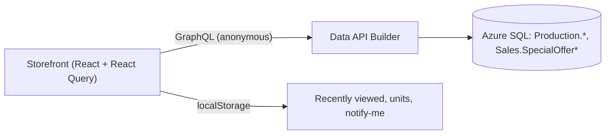

# Product catalog and browsing (storefront)

Shoppers browse the AdventureWorks bike and gear catalog without signing in. The storefront reads products, categories, photos, prices, offers and stock directly from Data API Builder (DAB) GraphQL.

## What it does

- **Home and category pages** list finished-goods products by category and subcategory.
- **Product page** shows photos, a localized description, price (with any active special-offer discount), stock level, reviews and related items.
- **Sale page** (`/sale`) lists products with active special offers.
- **Quick view** opens a product summary in a modal without leaving the list.
- **Compare** places up to 3 products side by side (`/compare`).
- **Recently viewed** remembers the last 8 products you opened.
- **Notify when available** lets you register interest in an out-of-stock product. This is a browser-only demo feature.
- **Localization**: product names, descriptions, currency and units follow the selected language. See [Localization](../i18n/localization.md).

## Try it

- **UI:** open the storefront (`azd env get-value APP_URL --no-prompt`), pick a category, open a product, and use **Compare** or **Quick view**.
- **API:** the catalog entities are readable anonymously, but the authenticated helper also works:

  ```bash
  python3 scripts/utilities/azure-auth.py request \
    --identity manufacturing --resource dab --path /graphql --method POST \
    --data '{"query":"{ products(first: 5, filter: { FinishedGoodsFlag: { eq: true } }) { items { ProductID Name ListPrice } } }"}'
  ```

## How it works



1. `app/src/data/apiService.ts` queries `products` (finished goods only) and enriches them with product descriptions, `specialOffers` / `specialOfferProducts`, photos and `productInventories`.
2. Localized product names come from the `productNames` query (CultureID is padded to the `NCHAR(6)` key) and fall back to English.
3. Prices are converted with `currencyRates` (AverageRate) using a language-to-currency map. JPY and KRW are shown without decimals.
4. React Query caches the results. Product views send the `Product_View` telemetry event to Application Insights.

## Data & storage

| Data | Source |
|---|---|
| Products, categories, subcategories, models, descriptions, photos | `Production.*` tables via DAB |
| Stock levels | `Production.ProductInventory` via DAB |
| Discounts | `Sales.SpecialOffer`, `Sales.SpecialOfferProduct` via DAB |
| Currency | `Sales.CurrencyRate` via DAB |
| Recently viewed | `localStorage` key `adventureworks_recently_viewed` (8 items) |
| Compare list | In-memory React state (up to 3 items; cleared on reload) |
| Notify-when-available | `localStorage` key `stockNotifications` |
| Unit system | `localStorage` key `unitSystem` (default imperial) |

DAB GraphQL list queries return `{ items: [] }`; see [DAB naming conventions](../../architecture/dab-naming-conventions.md).

## Events (Web PubSub)

The catalog has no dedicated push events. React Query's normal window-focus refetch keeps catalog data fresh. Promotion changes are pushed to the admin app only; see [Promotions](../promotions/promotions.md).

## Security

- 33 DAB entities, including the catalog entities, grant the `anonymous` role read-only access.
- Anonymous reads exclude internal fields: `Product.StandardCost`, `SafetyStockLevel`, `ReorderPoint` and `DaysToManufacture`; `ProductInventory.Shelf` and `Bin`.
- Only authenticated internal roles can change catalog data. See [DAB entities](../../reference/dab-entities.md).

## Configuration

| Setting | Where |
|---|---|
| DAB GraphQL endpoint | `API_URL` (generated into `app/public/config.js` by the predeploy hook) |

## Limits

- The demo uses the AdventureWorks sample catalog.
- Catalog pages load each list as a single large page (`first: 1000`, `2000` or `10000`) instead of following DAB pagination cursors.
- Compare, recently viewed and notify-when-available live only in the current browser.

## Related code & docs

- `app/src/pages/Index.tsx`, `CategoryPage.tsx`, `ProductPage.tsx`, `SalePage.tsx`, `ComparePage.tsx`
- `app/src/components/QuickViewModal.tsx`
- `app/src/data/apiService.ts`
- `api/dab-config.json`
- [Storefront app](../../apps/storefront.md) · [DAB API](../../services/dab-api.md) · [Semantic search](../search/semantic-search.md) · [Product reviews](../reviews/product-reviews.md) · [SEO](../seo/seo.md)
