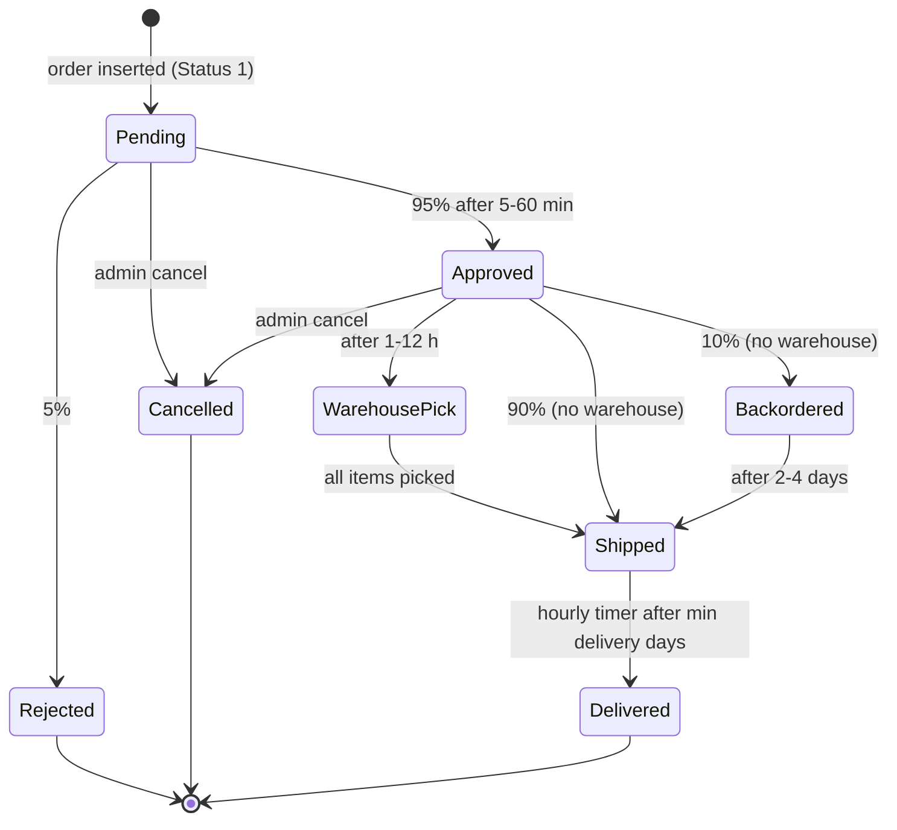
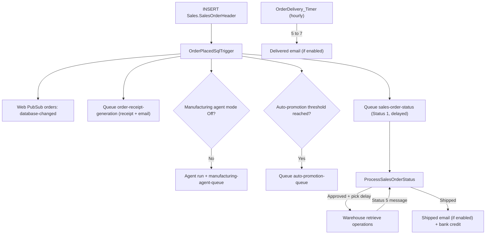

# Order lifecycle and pipeline

Every new sales order, whether from the storefront, a B2B store order or the [shopping simulator](../simulators/shopping-simulator.md), is advanced automatically by Azure Functions. The pipeline simulates approval, warehouse picking, backorders, shipping and delivery, and pushes each change to the apps in real time.

## What it does

| Status | Name | Meaning |
|---|---|---|
| 1 | Pending (In Process) | Order placed |
| 2 | Approved | Passed approval; waiting for warehouse pick |
| 3 | Backordered | Waiting for stock |
| 4 | Rejected | Terminal |
| 5 | Shipped | Picked and shipped; delivery pending |
| 6 | Cancelled | Terminal |
| 7 | Delivered | Terminal |

- Orders advance on their own with randomized, configurable delays.
- Admins can view the pipeline, tune delays, push orders forward, ship or cancel orders, and run delivery on demand from **Order pipeline** (`/order-pipeline`) and **Orders** (`/orders`).
- Admins can place B2B store orders from **Stores** (`/stores`) and generate AI orders.
- Customers follow their order on the storefront account and order-tracking pages.

## Try it

- **UI:** in the admin app open **Order pipeline**, then place a storefront order and watch it move.
- **API** (read-only):

  ```bash
  python3 scripts/utilities/azure-auth.py request \
    --identity admin --resource functions --path /api/orders/pipeline/status

  python3 scripts/utilities/azure-auth.py request \
    --identity admin --resource functions --path /api/orders/pipeline/config
  ```

## How it works



When a row is inserted into `Sales.SalesOrderHeader`, the `OrderPlacedSqlTrigger` SQL trigger fans out work:



1. **`OrderPlacedSqlTrigger`** enqueues the receipt job, enqueues a Status 1 message on `sales-order-status` with a random visibility delay, creates a manufacturing-agent run unless the agent mode is Off, and updates the auto-promotion counter (see [Promotions](../promotions/promotions.md)).
2. **`ProcessSalesOrderStatus`** (queue `sales-order-status`):
   - Status 1 becomes 4 (5%) or 2 (95%).
   - An approved order is re-queued after the approved-to-shipped delay and handed to the warehouse, which creates pick operations and enqueues Status 5 when every item is picked. See [Warehouse operations](../warehouse/warehouse-operations.md).
   - Without the warehouse service, Status 2 becomes 3 (10%) or 5 (90%); a backorder ships after 2–4 days.
   - On Shipped, it sends the shipped email (when enabled) and records the sale in the [bank simulator](../finance/bank-simulator.md).
3. **`OrderDelivery_Timer`** (`0 0 * * * *`) promotes Shipped orders to Delivered once `ShipDate` (or `ModifiedDate`) plus the minimum delivery days for the order type has passed, then sends the delivered email (when enabled).

### Pipeline control routes

| Route | Purpose |
|---|---|
| `GET` / `PUT /api/orders/pipeline/config` | Read or change pipeline delays |
| `GET /api/orders/pipeline/status` | Counts and timing by status |
| `POST /api/orders/pipeline/promote-pending` | Move Pending orders to Approved now |
| `POST /api/orders/pipeline/promote-approved` | Move Approved orders forward now |
| `GET /api/orders/delivery/trigger` | Run the delivery check now |
| `POST /api/orders/{id}/ship` | Ship one order |
| `POST /api/orders/begin-processing-order` | Start pipeline processing for an order |

Admin cancel is a DAB update that sets `Status = 6`.

### B2B store orders and AI orders

| Route | Purpose |
|---|---|
| `GET /api/stores`, `/api/stores/{id}`, `/api/stores/{id}/orders` | Store list, details and order history |
| `GET /api/store-territories`, `/api/store-products`, `/api/product-catalog` | Lookups for the store-order form |
| `GET /api/orders/{orderId}/lines` | Order lines |
| `POST /api/store-orders` | Place a B2B order |
| `POST /api/GenerateOrderWithAI`, `/api/GenerateOrdersBulk` | Generate realistic orders with the order agent |

## Data & storage

| Data | Store |
|---|---|
| Orders and lines | `Sales.SalesOrderHeader`, `Sales.SalesOrderDetail` |
| Pipeline config | Table `awOrderPipelineConfig`, row `config` / `order-pipeline` |
| Status messages | Queue `sales-order-status` |
| Receipt jobs | Queue `order-receipt-generation` |
| Auto-promotion jobs | Queue `auto-promotion-queue` |

Default delays: Pending→Approved 5–60 minutes; Approved→Shipped 1–12 hours; delivery 3–7 days for consumer (B2C) orders and 5–10 days for store (B2B) orders. `PUT` accepts 1–1440 minutes, 0–168 hours and 1–30 days. See [storage resources](../../reference/storage-resources.md).

## Events (Web PubSub)

All events go to the `orders` group:

| Event | Sent by |
|---|---|
| `database-changed` | `OrderPlacedSqlTrigger` and the database outbox |
| `order-placed` | Order trigger (when the manufacturing agent is on) and `POST /api/store-orders` |
| `order-status-changed` | `ProcessSalesOrderStatus` |
| `orders-delivered` | `OrderDelivery_Timer` |
| `state-changed` | Pipeline config saves |

`orders` payloads are reduced to a generic `orders-changed` invalidation signal with no identifiers or business values. Shipping also triggers a `finance` signal from the bank simulator. See [Web PubSub events](../../reference/webpubsub-events.md) and [real-time eventing](../../architecture/realtime-eventing.md).

## Security

| Route group | Scope |
|---|---|
| Pipeline config/status reads | `orders.read` (internal) |
| Pipeline changes, promote, delivery trigger, ship, begin-processing | `orders.write` (internal; `executive-admin` only) |
| Store reads | `admin.read` |
| Store orders and AI order generation | `admin.write` |

Customers see only their own orders through DAB ownership policies. See [Functions route scopes](../functions-oauth/ROUTE_SCOPE_MATRIX.md).

## Configuration

| Setting | Purpose |
|---|---|
| `ORDER_NOTIFICATIONS_EMAIL_ENABLED` | Sends shipped/delivered emails when `true` (default off); see [email notifications](../email/email-notifications.md) |
| `AI_AGENT_ORDER_ID` | Foundry agent for AI order generation |
| `SQL_CONNECTION_STRING` | SQL trigger and order updates |

`OrderPlacedSqlTrigger` runs in its own always-ready Flex Consumption scale group.

## Limits

- Outcomes are randomized for demo purposes; they do not reflect real stock or credit checks.
- Delivery uses the configured minimum delivery days; the maximum is stored for display.
- The storefront tracking page shows an "out for delivery" step that has no status code of its own.

## Related code & docs

- `api-functions/Functions/OrderPlacedSqlTrigger.cs`, `ProcessSalesOrderStatus.cs`, `OrderDeliveryTimerFunction.cs`, `OrderPipelineControlFunction.cs`, `OrderStatusFunctions.cs`, `StoreOrderFunctions.cs`
- `app-admin/src/pages/` order, order-pipeline and store pages; `app/src/pages/OrderTrackingPage.tsx`
- [Receipts](receipts.md) · [Email notifications](../email/email-notifications.md) · [Shopping simulator](../simulators/shopping-simulator.md) · [Admin portal](../../apps/admin-portal.md)
