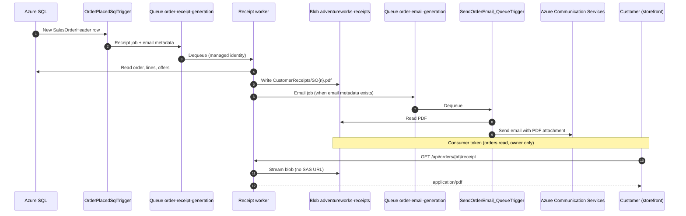

# Order receipts (PDF generation and email)

Every new order gets a branded PDF receipt. Azure Functions builds the PDF in the background, stores it in a private blob container and emails it to the customer. Customers can download or resend their own receipts, and admins can regenerate receipts in bulk.

## What it does

- Generates a PDF receipt automatically when an order is inserted.
- Emails the receipt as an attachment ("🎉 Demo Order Confirmed - SO…").
- Lets a signed-in customer check, download or resend the receipt for their own order from the storefront account page.
- Lets admins regenerate receipts for specific orders or fill in any missing receipts.

The PDF contains a header, order information, customer and shipping details, a line-item table, applied special offers and totals, styled with the storefront colours (`#FF5E5B` and `#4a7c59`).

## Try it

- **UI (customer):** sign in to the storefront, open **Account → Orders** and choose **Resend receipt**.
- **API (admin):** regenerate receipts for chosen orders (this sends email if the customer has a deliverable address):

  ```bash
  python3 scripts/utilities/azure-auth.py request \
    --identity admin --resource functions --path /api/GenerateOrderReceipts_HttpStart \
    --method POST --data '{"salesOrderNumbers":["SO43659"]}'
  ```

## How it works



1. `OrderPlacedSqlTrigger` enqueues a receipt job with the customer's email details on `order-receipt-generation`.
2. The receipt worker renders the PDF with QuestPDF and writes `CustomerReceipts/SO{n}.pdf` to the private `adventureworks-receipts` container.
3. If email metadata is present, it enqueues an email job on `order-email-generation`.
4. `SendOrderEmail_QueueTrigger` validates the recipient and sends the email with the PDF attached. See [email notifications](../email/email-notifications.md).

### Routes

| Route | Purpose |
|---|---|
| `POST /api/GenerateOrderReceipts_HttpStart` | Admin: regenerate receipts for `{ "salesOrderNumbers": [...] }` |
| `POST /api/orders/generate-missing-receipts` | Admin: generate receipts for orders without one |
| `GET /api/orders/{id}/receipt-status` | Customer: does a receipt exist? |
| `GET /api/orders/{id}/receipt` | Customer: download the PDF (streamed from Blob Storage) |
| `POST /api/orders/generate-and-send-receipt` | Customer: regenerate and resend |

The storefront records `Order_ReceiptResent` when a customer resends a receipt.

## Data & storage

| Resource | Use |
|---|---|
| Blob container `adventureworks-receipts` | Private PDFs at `CustomerReceipts/SO{n}.pdf` |
| Queue `order-receipt-generation` (+ `-poison`) | Receipt jobs |
| Queue `order-email-generation` (+ `-poison`) | Receipt email jobs |

Queue processing (from `host.json`): visibility timeout 30 minutes, batch size 16, and up to 5 attempts before a message moves to the poison queue. All storage is provisioned by `infra/modules/storage.bicep`; see [storage resources](../../reference/storage-resources.md).

## Events (Web PubSub)

Receipt generation does not publish its own events. Order changes are pushed on the `orders` group; see [Order lifecycle](order-lifecycle.md#events-web-pubsub).

## Security

| Route | Access |
|---|---|
| Admin receipt routes | Internal, `admin.write` |
| Customer receipt routes | Consumer, `orders.read`; the order's `CustomerID` must match the signed-in customer |

- The receipt container is private. Customers receive the PDF through the authenticated download route, never a public or SAS URL.
- Functions access Blob and Queue Storage with the managed identity (`AzureWebJobsStorage__*` identity-based settings).

## Configuration

| Setting | Purpose |
|---|---|
| `AzureWebJobsStorage__*` | Identity-based storage connection |
| `COMMUNICATION_SERVICE_ENDPOINT`, `EMAIL_SENDER_DOMAIN` | Email sending |
| `SQL_CONNECTION_STRING` | Order data |

Receipt emails are sent regardless of `ORDER_NOTIFICATIONS_EMAIL_ENABLED`, which only controls shipped and delivered emails.

## Limits

- Seeded customers use sample addresses; reserved test domains (for example `example.com`) are suppressed rather than sent.
- Receipts are generated asynchronously, so a new order's PDF may take a short time to appear.

## Related code & docs

- `api-functions/Functions/GenerateOrderReceipts.cs`, `GenerateAndSendReceiptFunction.cs`, `ReceiptCheckFunction.cs`, `OrderPlacedSqlTrigger.cs`
- `api-functions/Services/ReceiptService.cs`, `PdfReceiptGenerator.cs`, `EmailService.cs`
- `infra/modules/storage.bicep`
- [Email notifications](../email/email-notifications.md) · [Order lifecycle](order-lifecycle.md) · [Functions service](../../services/functions.md)
