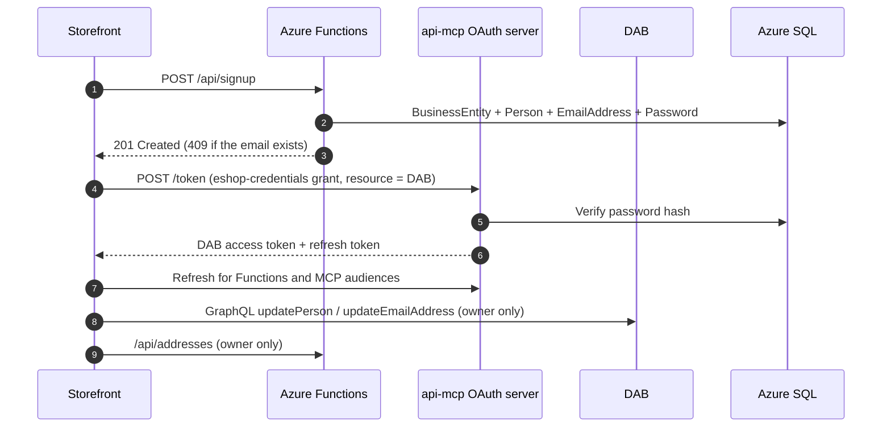

# Customer accounts and sign-in (storefront)

Storefront customers are AdventureWorks `Person` records. They sign up through Azure Functions, sign in through the self-hosted api-mcp OAuth server, and manage their own profile through DAB and Functions with audience-bound tokens.

## What it does

- **Sign up:** create an account with email, first name, last name and password.
- **Sign in / sign out:** exchange email and password for OAuth tokens.
- **Profile:** edit name, email address and phone numbers.
- **Addresses:** add, edit, delete and label (billing, shipping and so on) addresses.
- **Payment methods:** view, add (public test cards only; stored masked) and remove saved cards.
- **Order history:** see orders with their status (1–7) and resend receipts. See [Order lifecycle](../commerce/order-lifecycle.md) and [Receipts](../commerce/receipts.md).
- **Password:** change it from the account page or reset it by email; see [Passwords and reset](passwords-and-reset.md).

## Try it

- **UI:** open the storefront, choose **Sign in → Create account**, then open **Account**.
- **API:** account routes act on the signed-in customer only, so they need a consumer token. The canned `admin` and `manufacturing` identities are employees and cannot use the storefront grant. See [authenticated scripts](../../testing/AZURE_AUTHENTICATED_SCRIPTS.md) for creating a disposable consumer.

## How it works

### Sign-in

The storefront posts to `{api-mcp}/token` with:

| Field | Value |
|---|---|
| `grant_type` | `urn:adventureworks:params:oauth:grant-type:eshop-credentials` |
| `client_id` | `adventureworks-eshop` |
| `scope` | `mcp.access realtime.connect products.read customers.read customers.write orders.read orders.write offline_access` |
| `resource` | DAB API |

The first token targets DAB. The storefront uses the refresh token to obtain Functions and MCP tokens. Access tokens last 10 minutes and are refreshed 60 seconds before expiry; refresh tokens last 12 hours. Tokens are kept in `sessionStorage`.

The grant is for consumers only: individual customers (`PersonType` `IN`, which signup creates). Store, vendor and general contacts and sales persons (`SC`, `VC`, `GC`, `SP`) cannot sign in. Employees sign in to the admin and manufacturing apps instead; see [OAuth server](../mcp-oauth/README.md).

### Signup

`POST /api/signup` with `{ email, firstName, lastName, password }` creates the person in one transaction. Validation: valid email of at most 50 characters, names of 1–50 characters, and a password of at least 8 characters. An email that already belongs to any person returns HTTP 409, including when a concurrent signup wins the race.

### Profile, phones and addresses

| Data | API |
|---|---|
| Name | DAB GraphQL `updatePerson` |
| Email | DAB REST `EmailAddress` (`POST`, `PATCH`); HTTP 409 shows "That email address is already in use" |
| Phones | DAB REST `PersonPhone` |
| Addresses | Functions `GET` / `POST /api/addresses`, `GET` / `PUT` / `DELETE /api/addresses/{id}`, `/api/addresses/{id}/type`, `GET /api/person-addresses` |
| Saved cards | Functions `GET`/`POST /api/payment-methods`; remove with DAB REST `PersonCreditCard` |

`Person.Address` is not exposed through DAB because its `SpatialLocation` column uses the SQL `geography` type, so addresses go through Azure Functions.

## Data & storage

`Person.BusinessEntity`, `Person.Person`, `Person.EmailAddress`, `Person.PersonPhone`, `Person.Password`, `Person.Address`, `Person.BusinessEntityAddress`, `Sales.Customer`, `Sales.PersonCreditCard`. Token state is kept by api-mcp; see [OAuth server](../mcp-oauth/README.md).

## Events (Web PubSub)

Account pages have no dedicated push events. The storefront subscribes to the `orders` group so order history and the cart refresh when orders change; see [Web PubSub events](../../reference/webpubsub-events.md).

## Security

- DAB ownership policies compare the row's `BusinessEntityID` with the signed `business_entity_id` claim, so customers read and update only their own rows.
- Functions address and payment routes require `customers.read` / `customers.write` and bind to the signed-in customer.
- The credentials grant on `/token` is rate-limited to 20 requests per minute per IP address; refresh requests use a separate, higher limit.
- Signup and password reset are public by design.
- Email addresses are unique: the seed job adds the `UQ_EmailAddress_EmailAddress` constraint on `Person.EmailAddress(EmailAddress)`, so a customer cannot claim another person's address through DAB, signup (HTTP 409) or a profile edit (HTTP 409). As a second guard, api-mcp refuses sign-in when an email matches more than one person instead of picking one.

See [identity and auth](../../architecture/identity-and-auth.md), [Functions OAuth](../functions-oauth/README.md) and [end-to-end authentication](../authentication/END_TO_END_AUTHENTICATION.md).

## Configuration

| Setting | Purpose |
|---|---|
| `API_MCP_URL` | OAuth server base (strip `/mcp`) used by the storefront |
| `API_URL`, `API_FUNCTIONS_URL` | Token audiences and API endpoints |

The storefront reads these from the generated `app/public/config.js`.

## Limits

- The demo uses AdventureWorks sample people. Seeded customers do not share a known password; create a new account or use a reset to sign in as a customer.
- Sign-in is password-only; there is no social login or MFA.

## Related code & docs

- `app/src/context/AuthContext.tsx`, `app/src/services/eshopOAuth.ts`, `app/src/lib/authService.ts`, `app/src/pages/AuthPage.tsx`, `app/src/pages/AccountPage.tsx`
- `app/src/hooks/useProfile.ts`, `useAddresses.ts`, `useEmailAddresses.ts`, `usePaymentMethods.ts`
- `api-functions/Functions/PasswordFunctions.cs` (signup), `api-functions/Functions/AddressFunctions.cs`
- `api-mcp/AdventureWorks/Auth/EshopCredentialsGrant.cs`
- [Passwords and reset](passwords-and-reset.md) · [Storefront](../../apps/storefront.md) · [api-mcp](../../services/api-mcp.md)
