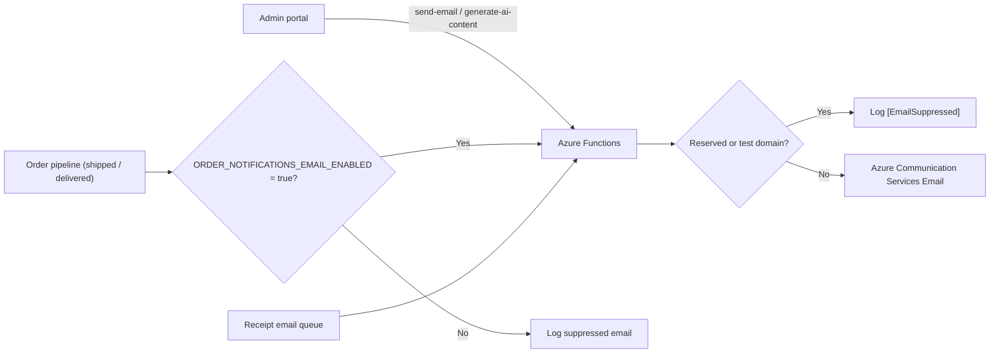

# Email notifications (Azure Communication Services)

Azure Functions sends all AdventureWorks email through Azure Communication Services (ACS) Email, using the managed identity. Email covers order receipts, shipped and delivered notices, password resets, and messages staff send from the admin portal.

## What it does

| Email | Trigger | Enabled by default |
|---|---|---|
| Order confirmation with PDF receipt | New order ([Receipts](../commerce/receipts.md)) | Yes |
| "Your order has pretend-shipped – demo" | Order reaches Shipped | **No** |
| "Your order has been delivered – demo" | Order reaches Delivered | **No** |
| Password reset link | [Password reset](../customers/passwords-and-reset.md) | Yes |
| Admin message to a customer or person | Admin **Customers** page | Yes (manual) |
| AI-written customer email | Admin bulk AI email dialog | Yes (manual) |

Shipped and delivered emails are off by default so the [shopping simulator](../simulators/shopping-simulator.md) doesn't flood inboxes. While off, Functions logs a `[EmailNotifications disabled] Shipped/Delivered email suppressed...` message instead of sending.

## Try it

- **UI:** in the admin app open **Customers**, select customers and choose **Send email** or the bulk **AI email** option.
- **API:** generate AI email content without sending anything:

  ```bash
  python3 scripts/utilities/azure-auth.py request \
    --identity admin --resource functions --path /api/email/generate-ai-content \
    --method POST --data '{"firstName":"Alex","templateType":"vip_appreciation","totalSpent":1250,"totalOrders":4}'
  ```

- **Test scripts:** [`tests/scripts/test-send-email.sh`](../../../tests/scripts/test-send-email.sh) and [`tests/scripts/test-email-with-attachment.sh`](../../../tests/scripts/test-email-with-attachment.sh) send real email; use an address you control.

## How it works



- `EmailService` sends from `DoNotReply@{EMAIL_SENDER_DOMAIN}` and returns once ACS accepts the message (`WaitUntil.Started`).
- `EmailRecipientPolicy` skips reserved and test domains (`.invalid`, `.test`, `.example`, `.localhost`, `example.com`, `example.net`, `example.org`) and logs `[EmailSuppressed]`.

### Routes

| Route | Body | Notes |
|---|---|---|
| `POST /api/customers/{customerId}/send-email` | `{ emailAddressId, subject, content, attachmentUrl? }` | `emailAddressId` must belong to the customer (otherwise 400). An optional attachment is downloaded from Azure Storage with the managed identity. |
| `POST /api/persons/{personId}/send-email` | `{ subject, content }` | Sends to the person's email address |
| `POST /api/email/generate-ai-content` | `{ firstName, templateType, productNames?, cartValue?, lastOrderId?, totalSpent?, totalOrders? }` | Returns AI-written subject and body; does not send |

`templateType` is one of `stale_cart`, `recent_order_thanks`, `re_engagement`, `vip_appreciation`, `product_recommendation` or `feedback_request`.

## Data & storage

Email does not store message content. Receipt attachments come from the `adventureworks-receipts` blob container; see [Receipts](../commerce/receipts.md).

## Events (Web PubSub)

None.

## Security

All admin email routes are internal and require `admin.write`. Functions authenticates to ACS and Storage with the managed identity; no ACS keys are used. See [Functions route scopes](../functions-oauth/ROUTE_SCOPE_MATRIX.md).

## Configuration

| Setting | Purpose |
|---|---|
| `COMMUNICATION_SERVICE_ENDPOINT` | ACS endpoint |
| `EMAIL_SENDER_DOMAIN` | Sender domain (`DoNotReply@…`) |
| `ORDER_NOTIFICATIONS_EMAIL_ENABLED` | `true` sends shipped and delivered emails; anything else suppresses them. Not set by the infrastructure templates. |
| `AI_AGENT_EMAIL_CONTENT_ID` | Foundry agent for AI-written emails |

The Functions readiness endpoint reports whether order emails are enabled; see [health diagnostics](../monitoring/HEALTH_DIAGNOSTICS.md).

## Limits

- The demo uses an Azure-managed sender domain, so messages may land in junk folders.
- Seeded AdventureWorks customers mostly have sample addresses that are not deliverable.
- Receipt and password-reset emails are not controlled by `ORDER_NOTIFICATIONS_EMAIL_ENABLED`.

## Related code & docs

- `api-functions/Services/EmailService.cs`, `EmailRecipientPolicy.cs`, `EmailContentAgentService.cs`
- `api-functions/Functions/SendEmailFunction.cs`, `SendPersonEmailFunction.cs`, `GenerateEmailContentFunction.cs`, `ProcessSalesOrderStatus.cs`, `OrderDeliveryTimerFunction.cs`
- `app-admin/src/components/BulkAiEmailDialog.tsx`
- [Receipts](../commerce/receipts.md) · [Order lifecycle](../commerce/order-lifecycle.md) · [Environment variables](../../reference/environment-variables.md)
