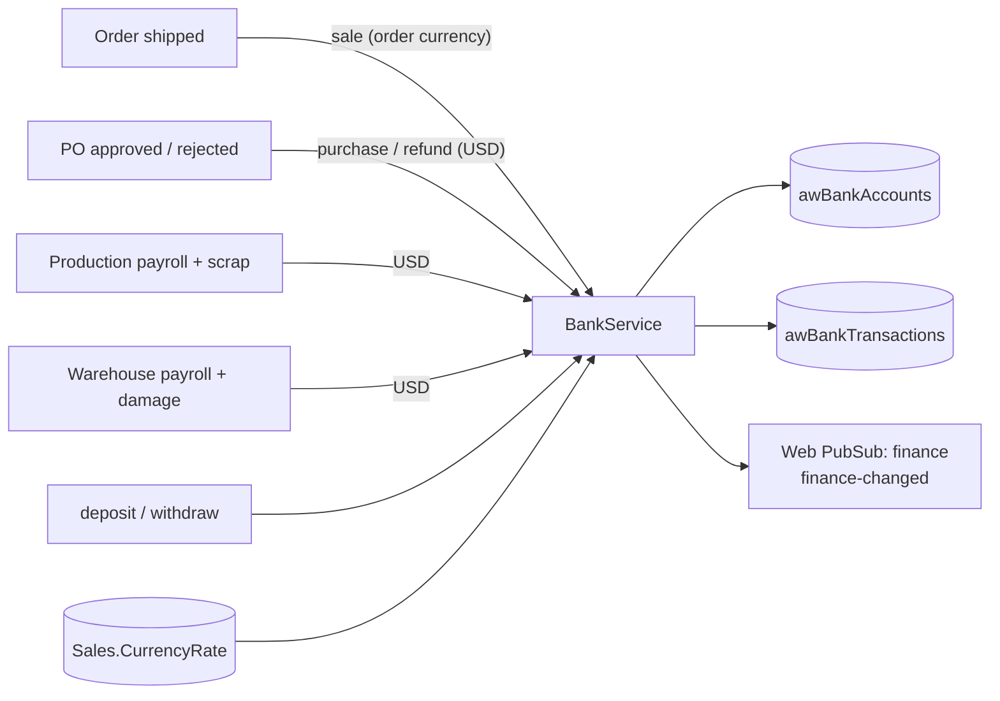

# Bank simulator

## What it does

The bank simulator keeps a running balance for AdventureWorks in each currency it sells in. The simulations post money in and out:

| Money | Direction | Currency | Posted by |
|---|---|---|---|
| Sales proceeds | In | The order's currency | Order pipeline, when an order ships |
| Vendor payments and refunds | Out / in | USD | [Supply chain](../supply-chain/supply-chain.md), on approval or rejection |
| Production payroll and scrap | Out | USD | [Production simulation](../manufacturing/production-simulation.md) |
| Warehouse payroll and damage | Out | USD | [Warehouse](../warehouse/warehouse-operations.md) |
| Manual deposits and withdrawals | In / out | Any supported | Bank API or MCP tools |

Balances may go negative. There are no fees or interest.

## Try it

**UI:** in the Manufacturing portal open **Plan → Finance** (`/plan/finance`) for balances, procurement and manufacturing costs.

**API:**

```bash
python3 scripts/utilities/azure-auth.py request --identity manufacturing \
  --resource functions --path /api/bank/status

python3 scripts/utilities/azure-auth.py request --identity manufacturing \
  --resource functions --path '/api/financials/procurement?maxCount=20'

python3 scripts/utilities/azure-auth.py request --identity admin \
  --resource functions --path /api/bank/accounts
```

## How it works



### Sales proceeds

When an order ships, the bank is credited with the order's **net proceeds** in the order currency:

- `SubTotal`, excluding tax.
- When the customer paid freight, freight is a pass-through and is excluded.
- When shipping was free (`Freight = 0`), an estimated shipping cost of $7.50 plus $1 per extra line is deducted.
- USD amounts are converted with `Sales.CurrencyRate`.

### USD total

`bank/status` converts every account to USD with the latest average rate. A currency with no rate is counted at face value.

### Initial balance

`SimulationMaintenance_Timer` seeds the bank on host start if it is empty (bank writes also seed it first): the USD account starts from a historical profit query. A [simulator reset](../simulators/simulator-controls.md) wipes the bank and re-seeds it.

### Concurrency

Balance updates use Table Storage ETags and retry on conflict. Amounts are stored as `double`.

### Exchange rates

`POST /api/exchange-rates/refresh` (`admin.write`) downloads current rates from the public Frankfurter API and merges them into `Sales.CurrencyRate`. The Admin portal **Currencies** page (`/currencies`) shows the rates and can trigger a refresh.

### Routes

| Route | Scope | Purpose |
|---|---|---|
| `GET bank/status` | `manufacturing.read` | Balances and USD total |
| `GET bank/transactions` | `manufacturing.read` | Recent transactions, all currencies |
| `GET bank/accounts`, `GET bank/accounts/{currencyCode}` | `sales.read` | Account balances |
| `GET bank/transactions/{currencyCode}` | `sales.read` | Transactions for one currency |
| `GET bank/currencies` | `sales.read` | Supported currencies |
| `POST bank/deposit`, `POST bank/withdraw` | `admin.write` | `{currencyCode, amount, description, referenceId?, transactionType?}`; amount must be positive |
| `GET financials/summary` | `manufacturing.read` | Procurement spend, work-order overhead, payroll and scrap totals |
| `GET financials/procurement?maxCount=` | `manufacturing.read` | PO debits and refunds (1–500, default 50) |
| `GET financials/manufacturing?type=` | `manufacturing.read` | `all`, `completions`, `payroll` or `scrap` |

### MCP tools

| Tool | Scope |
|---|---|
| `get_bank_status`, `get_bank_account`, `get_bank_transactions`, `get_supported_currencies`, `get_financial_summary` | `sales.read` |
| `bank_deposit`, `bank_withdraw` | `admin.write` |
| `get_procurement_transactions`, `get_manufacturing_financials` | `manufacturing.read` |

## Data & storage

| Store | Keys | Contents |
|---|---|---|
| Table `awBankAccounts` | PartitionKey `accounts`, RowKey currency code | Balance per currency |
| Table `awBankTransactions` | PartitionKey currency code, RowKey reverse ticks + GUID (newest first) | Type `initial`, `sale`, `purchase`, `payroll`, `deposit`, `withdrawal` or `other` |
| SQL `Sales.CurrencyRate` | — | Exchange rates |

The tables are provisioned by `infra/modules/storage.bicep`; `SimulationMaintenance_Timer` seeds the bank data.

## Events

Group `finance`. Transactions (coalesced), `state-changed` and `database-changed` are sent on the wire only as the generic signal `{ "event": "finance-changed" }`, with no amounts or identifiers. The Manufacturing portal invalidates its finance queries.

## Security

See the route and tool tables. The manufacturing-engineer role can read status, transactions and financials; account-level reads need `sales.read`; deposits and withdrawals need `admin.write`.

## Configuration

No settings beyond the shared storage account. The Frankfurter refresh needs outbound internet access from Functions.

## Limits

- No fees, interest or overdraft limits.
- `double` storage can show small rounding differences in long-running balances.

## Related code & docs

- `api-functions/Functions/BankControlFunction.cs`, `FinancialReportingFunction.cs`, `UpdateExchangeRatesFunction.cs`, `api-functions/Services/BankService.cs`
- `api-functions/Functions/ProcessSalesOrderStatus.cs` (sale postings)
- `api-mcp/AdventureWorks/Tools/BankMcpTools.cs`
- [Reporting](reporting.md) · [Simulator controls](../simulators/simulator-controls.md)
