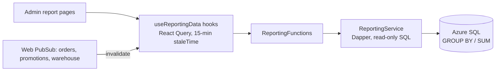

# Reporting

## What it does

The Admin portal's report pages chart the whole AdventureWorks dataset: revenue by category, territory and month, top products, order status, inventory, product profitability, discount impact, slow movers and customer statistics.

The aggregation runs in Azure Functions with read-only SQL rather than in DAB. DAB has no `GROUP BY` and pages list results, so totals across thousands of orders would need many requests. Each reporting route returns a small, pre-aggregated result.

## Try it

**UI:** in the Admin portal open **Reports** (`/reports`), **Product Profitability** (`/product-profitability`), **Loss Makers** (`/loss-makers`), **Slow Movers** (`/slow-movers`) or **Customer Stats** (`/customer-stats`). Use the channel selector to switch between all orders, online (eShop) and B2B store orders.

**API:**

```bash
python3 scripts/utilities/azure-auth.py request --identity admin \
  --resource functions --path /api/reporting/revenue-by-category

python3 scripts/utilities/azure-auth.py request --identity admin \
  --resource functions --path '/api/reporting/top-products?limit=5&channel=b2b'
```

## How it works



Most routes accept `channel=eshop` (online orders) or `channel=b2b` (store orders); without it they include all orders.

### Routes

All are `GET` and need `sales.read`.

| Route | Parameters | Returns |
|---|---|---|
| `reporting/revenue-by-category` | `channel` | Revenue per product category |
| `reporting/monthly-trend` | `channel` | Revenue and order count per month |
| `reporting/top-products` | `limit` (default 10), `channel` | Best sellers by revenue |
| `reporting/orders-by-status` | `channel` | Order count per status |
| `reporting/revenue-by-territory` | `channel` | Revenue and orders per sales territory |
| `reporting/inventory-by-category` | — | Stock quantity and product count per category |
| `reporting/dashboard-counts` | — | Headline counts for the dashboard |
| `reporting/product-profitability` | `limit`, `sortAsc`, `channel` | Revenue, cost and margin per product (ascending for loss makers) |
| `reporting/product-profitability-detail` | `channel` | Detailed revenue, cost and margin columns for all products |
| `reporting/profitability-by-category` | `channel` | Margin per category |
| `reporting/discount-impact` | `channel` | Revenue given away through discounts |
| `reporting/slow-movers` | `threshold` (default 10), `channel` | Products selling below the threshold |
| `reporting/sales-trends` | `productId`, `channel` | Sales over time for a product |
| `reporting/product-price-history` | `productId` | List-price and cost history |
| `customer-stats` | — | Customer totals |
| `customer-country-breakdown`, `customer-region-breakdown` | — | Customers by country or region |
| `customer-monthly-revenue` | — | Customer revenue per month |
| `customers/top-spenders` | — | Highest-spending customers |

### Financial reports

Simulation finances (procurement spend, manufacturing overhead, payroll and scrap) are served by `financials/summary`, `financials/procurement` and `financials/manufacturing` (`manufacturing.read`). They read the bank simulator's transactions rather than SQL; see [bank simulator](bank-simulator.md#routes).

### Adding a report

1. Add a parameterized Dapper query and record type to `ReportingService.cs`.
2. Add a `[Function("ReportXxx")]` method with route `reporting/xxx` to `ReportingFunctions.cs`, and register its scope in `api-functions/Auth/FunctionAuthorizationRegistry.cs`.
3. Add a typed hook to `app-admin/src/hooks/useReportingData.ts`.
4. Add a `ChartCard` to the page.
5. Deploy with `azd deploy api-functions --no-prompt` (published directly to Flex Consumption) and `azd deploy app-admin --no-prompt`.

## Data & storage

Read-only queries over `Sales.SalesOrderHeader`, `Sales.SalesOrderDetail`, `Sales.SalesTerritory`, `Sales.Customer`, `Production.Product*`, `Production.ProductInventory` and `Production.ProductCostHistory`. Nothing is cached server-side.

## Events

Reports do not publish events. The Admin portal invalidates report queries on `orders` and `promotions` events, and inventory-by-category on `warehouse` events. There is no polling; React Query also refetches on window focus after the 15-minute stale time.

## Security

`sales.read` (executive-admin, sales-admin, operations-admin and marketing-admin roles). Responses contain aggregates, not customer records, except the top-spenders list.

## Configuration

Uses the Functions `SQL_CONNECTION_STRING`. No report-specific settings.

## Limits

- The seeded orders are historical, so month-based charts are densest in the seeded years until simulators add recent orders.
- Large aggregates run on every cache miss; keep new queries indexed and bounded.

## Related code & docs

- `api-functions/Functions/ReportingFunctions.cs`, `api-functions/Services/ReportingService.cs`
- `api-functions/Functions/CustomerStatsFunction.cs`, `GetTopSpendersFunction.cs`
- `app-admin/src/hooks/useReportingData.ts`, `app-admin/src/pages/ReportsPage.tsx`
- [Bank simulator](bank-simulator.md) · [Admin portal](../../apps/admin-portal.md) · [Functions routes](../../reference/functions-routes.md)
