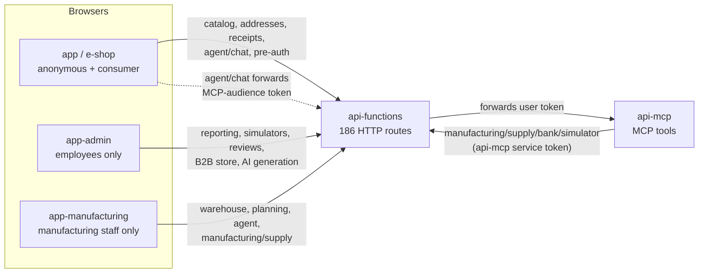
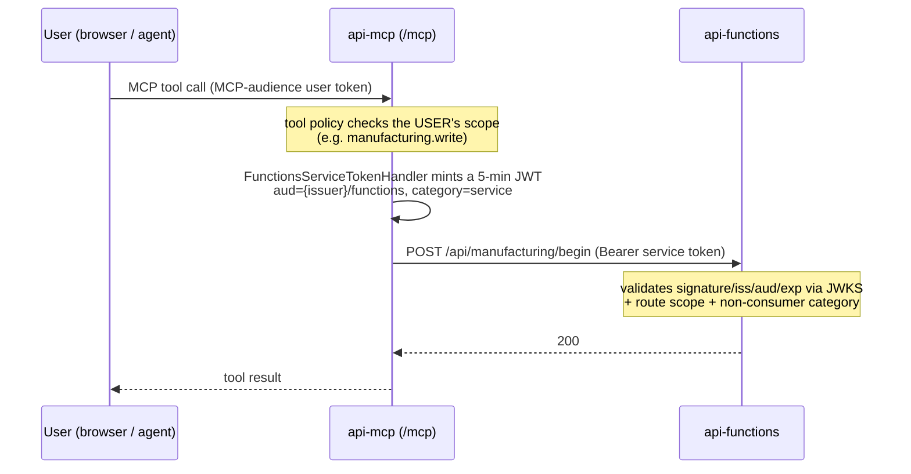

# Functions API OAuth Authorization

> Extends the self-contained AdventureWorks OAuth demo — already protecting the **MCP**
> server ([`docs/features/mcp-oauth`](../mcp-oauth/README.md)) and the **DAB** GraphQL/REST
> API (JWT config in [`api/dab-config.json`](../../../api/dab-config.json), see
> [`api/README.md`](../../../api/README.md)) — to the previously-anonymous
> **`api-functions`** HTTP surface.
>
> **Status: Enforced.** The `api-functions` resource server validates api-mcp-issued bearer
> tokens and applies per-route scope/category/ownership checks, with `FUNCTIONS_OAUTH_MODE=enforced`.
> All three first-party apps attach per-user Functions tokens minted silently from their sign-in
> refresh token, and api-mcp attaches a self-minted **service token** to the calls its MCP tools
> proxy. Only the explicit Tier P routes are reachable anonymously. See
> [Enforcement modes](#enforcement-modes) and [Remaining limitations](#remaining-limitations).

## Contents

- [What this covers](#what-this-covers)
- [Current state](#current-state)
- [Relationship to the MCP and DAB OAuth work](#relationship-to-the-mcp-and-dab-oauth-work)
- [Caller topology (who calls api-functions)](#caller-topology-who-calls-api-functions)
- [Authorization tiers](#authorization-tiers)
- [MCP-proxied routes — api-mcp service token](#mcp-proxied-routes--api-mcp-service-token)
- [Two design problems and their resolutions](#two-design-problems-and-their-resolutions)
- [Scopes and roles](#scopes-and-roles)
- [Ownership / record-level authorization](#ownership--record-level-authorization)
- [Resource identifier / audience design](#resource-identifier--audience-design)
- [Route-to-scope matrix](#route-to-scope-matrix)
- [Enforcement modes](#enforcement-modes)
- [Implementation roadmap](#implementation-roadmap)
- [Remaining limitations](#remaining-limitations)
- [Source map](#source-map)

## What this covers

`api-functions` is the .NET-isolated Azure Functions app (running on Flex Consumption) that
provides custom business logic for the e-shop, admin, and manufacturing frontends, plus AI
agent hosting and simulators. Every one of its **186 HTTP-triggered routes is declared
`AuthorizationLevel.Anonymous`** at the platform level; authorization is applied by the OAuth
middleware instead. This work decides — for each route — whether it should stay
anonymous or become an OAuth-protected resource, and with which scope and access mode, reusing
the exact same authorization server, scope catalog, and validation approach already shipped for
MCP and DAB.

Non-HTTP triggers (53 queue, 7 SQL, 3 timer) are internal and not externally reachable, so they
are out of scope for bearer-token protection.

## Current state

| Trigger kind | Count | In scope for OAuth? |
| ------------ | ----- | ------------------- |
| HTTP (`HttpTrigger`) | 186 | **Yes** — classified in the matrix |
| Queue (`QueueTrigger`) | 53 | No — internal |
| SQL (`SqlTrigger`) | 7 | No — internal |
| Timer (`TimerTrigger`) | 3 | No — internal |

All HTTP routes were anonymous before this work. `Program.cs` uses
`ConfigureFunctionsWebApplication()` (ASP.NET Core integration), so a JWT-validation
**middleware** (`IFunctionsWorkerMiddleware`,
[`FunctionsAuthorizationMiddleware`](../../../api-functions/Auth/FunctionsAuthorizationMiddleware.cs))
is now the enforcement point — the same signature/issuer/audience/lifetime/subject/scope checks
used by the MCP and DAB resource servers, validating against the api-mcp JWKS. Enforcement is
gated by [mode](#enforcement-modes). Every first-party client supplies a Functions token, so the
deployed mode is `enforced`.

## Relationship to the MCP and DAB OAuth work

The authorization server (OpenIddict, hosted in **api-mcp**) is already **multi-resource**
(RFC 8707): it mints short-lived, resource-bound JWTs for the MCP resource (`{issuer}/mcp`) and
the DAB resource (`{issuer}/dab`), signs them with a Key Vault-backed RSA key, and exposes JWKS.
Protecting Functions adds **one more resource identifier** (`{issuer}/functions`) to the same
server — `api-functions` becomes a pure **resource server** that validates tokens via the api-mcp
JWKS and needs **no Key Vault access of its own**. This keeps the least-privilege story clean and
reuses all existing building blocks.

## Caller topology (who calls api-functions)

Understanding every caller is what determines the tiers — especially which endpoints must stay
anonymous to avoid breaking existing behavior.

Two facts drive the design:

1. **`api-functions` → `api-mcp`.** The `agent/chat` endpoint already forwards the caller's
   **MCP-audience** token to the protected `/mcp` so agent tool calls run as the real user.
2. **`api-mcp` → `api-functions`.** Four proxy services (`ManufacturingService`,
   `SupplyChainService`, `BankService`, `SimulatorService`) call 40 Functions endpoints,
   backing the manufacturing/supply/bank/simulator MCP tools, with an **api-mcp service token**.

## Authorization tiers

Every route is assigned exactly one tier (full list in
[`ROUTE_SCOPE_MATRIX.md`](./ROUTE_SCOPE_MATRIX.md)):

| Tier | Name | Meaning | Count |
| ---- | ---- | ------- | ----- |
| **P** | Anonymous | No token. Public catalog, discovery, health, password-reset pre-auth, consumer signup, AI-assistant pass-through. | 18 |
| **C** | Consumer (ownership) | Valid token + business scope; consumers restricted to their **own** records (server-resolved owner id), internal roles unrestricted (password routes add stricter rules). | 12 |
| **I** | Internal-only | Valid token + business scope + **non-consumer category** (defense-in-depth). Includes the 40 MCP-proxied routes. | 156 |
| | | **Total** | **186** |

## MCP-proxied routes — api-mcp service token

The 40 endpoints the four proxy services call were originally left anonymous ("Tier M") because
api-mcp had no way to obtain a Functions-audience token. They are now ordinary **Internal-only**
routes. api-mcp *is* the authorization server, so it mints its own token in-process — no client
secret, no extra grant, no network round-trip:

[`FunctionsServiceTokenHandler`](../../../api-mcp/AdventureWorks/Auth/FunctionsServiceTokenHandler.cs)
is a `DelegatingHandler` on the four proxy `HttpClient`s. The token carries `sub=service:api-mcp`,
`category=service`, only the scopes the proxied routes need (`manufacturing.read/write`,
`inventory.read`, `sales.read`, `admin.read/write`) and an audit-only `obo_sub` with the end user's
subject. Because the MCP tool has already enforced the end user's scope, the service token never
widens what a user can do; browsers reach the same routes only with their **own** per-user token.

## Two design problems and their resolutions

1. **`agent/chat` audience conflict.** If `agent/chat` validated a *Functions* audience, it could
   not also forward an *MCP* audience token to `/mcp` (a token targets exactly one resource; the AS
   returns `invalid_target` for multiple). **Resolution:** keep the agent-host endpoints
   (`agent/chat`, `agent/status`) **anonymous pass-throughs** (Tier P). The anonymous e-shop
   assistant is preserved, and MCP tool authorization is still enforced downstream at `/mcp`.
2. **`api-mcp` → `api-functions` M2M.** Resolved by the in-process service token above.

## Scopes and roles

Reuses the shared business-domain catalog in
[`OAuthScopes.cs`](../../../api-mcp/AdventureWorks/Auth/OAuthScopes.cs). Distribution across the
protected (Tier C/I) routes:

| Scope | Routes | New? |
| ----- | -----: | ---- |
| `admin.write` | 42 | existing |
| `manufacturing.read` | 41 | existing |
| `sales.read` | 23 | existing |
| `manufacturing.write` | 23 | existing |
| `admin.read` | 19 | existing |
| `orders.write` | 6 | existing |
| **`customers.write`** | 5 | **new — the only catalog addition** |
| `orders.read` | 5 | existing |
| `customers.read` | 4 | existing |

`customers.write` is required because consumers self-manage their **own addresses** (address data
is served **only** by `api-functions` — it is excluded from DAB because of the `geography`
`SpatialLocation` column). A later phase adds it to `OAuthScopes.cs`, grants it to the `consumer`
role (ownership-gated for own records) and to the internal roles that mutate customer data, and
advertises it in AS metadata. Scope assignments align with the sibling MCP matrix wherever a
parallel capability exists (e.g. customer generation → `admin.write`, financial summaries →
`sales.read`, procurement/manufacturing financials → `manufacturing.read`).

Roles resolve to scopes exactly as today
([`ApplicationRoles.cs`](../../../api-mcp/AdventureWorks/Auth/ApplicationRoles.cs) →
`Auth.RoleScope` seed data). No permissions are hard-coded by user name.

## Ownership / record-level authorization

Tier C routes require the scope **and** record ownership. Ownership is resolved **server-side**
from the validated token's subject/owner claims (`customer_id` / `business_entity_id`), never from
a client-supplied identifier. This directly closes a live gap: the address endpoints today accept a
client-supplied `businessEntityId(s)` query parameter — in a later phase that value is
validated/overwritten against the caller's resolved owner id so a client value can never widen
access. Internal roles (with the same scope) are unrestricted.

## Resource identifier / audience design

- New canonical resource identifier **`{issuer}/functions`** (env-overridable, e.g.
  `FUNCTIONS_RESOURCE_IDENTIFIER`), added to the AS `AllowedResources()` allow-list next to the MCP
  and DAB identifiers — mirroring exactly how DAB was added.
- Frontends request the Functions resource via the RFC 8707 `resource` parameter and receive a
  token with `aud = {issuer}/functions`. Because each token targets a single resource, the MCP,
  DAB, and Functions tokens are **audience-isolated** and are stored under separate keys — a token
  minted for one resource is rejected by the others.
- Issuer, resource URI, endpoints, and redirect URIs are derived from deployed configuration (the
  api-mcp FQDN); no Azure hostnames are hard-coded.

## Route-to-scope matrix

The complete, authoritative classification of all 186 routes is in
**[`ROUTE_SCOPE_MATRIX.md`](./ROUTE_SCOPE_MATRIX.md)** — grouped by functional area, with method,
route, tier, required scope, access mode, and ownership key for every endpoint. It is the source of
truth the resource server enforces. Completeness is guaranteed by a reflection test
(`FunctionAuthorizationRegistryTests`) that fails closed if any HTTP-triggered `[Function]` is not
classified in the registry — exactly as `McpAuthorizationExtensions` does for MCP tools.

## Enforcement modes

The resource server reads `FUNCTIONS_OAUTH_MODE`
([`FunctionsOAuthOptions`](../../../api-functions/Auth/FunctionsOAuthOptions.cs)). Enforcement is
only possible when the issuer, audience, and OIDC metadata address are all resolved from
configuration; otherwise the server **fails open** to `disabled` so local and not-yet-wired
deployments keep working unchanged.

| Mode | Token absent | Token present | Blocks? | Purpose |
| ---- | ------------ | ------------- | ------- | ------- |
| `disabled` | allowed | ignored | never | Pure pass-through — pre-OAuth behavior. The implicit fallback when issuer/audience/metadata are unset. |
| `audit` | allowed | validated; allow/deny logged to App Insights | never | Shadow mode for diagnosing a new client before enforcing. |
| `enforced` *(deployed)* | protected routes → `401` | validated + scope/category/ownership enforced | yes | Full enforcement. |

Infrastructure wires the mode in [`infra/main.bicep`](../../../infra/main.bicep) as `enforced`.
Tier P routes are always allowed regardless of mode.

### How each client obtains its Functions token

| Caller | Token source |
| ------ | ------------ |
| e-shop (`app/`) | Consumer token from the e-shop credential exchange; attached by `functionsFetch`. |
| admin (`app-admin/`) | Refresh-token resource switch to `{issuer}/functions`; attached to every Functions-bound `fetch` by [`functionsAuthInterceptor.ts`](../../../app-admin/src/services/functionsAuthInterceptor.ts). |
| manufacturing (`app-manufacturing/`) | Same pattern ([`functionsAuthInterceptor.ts`](../../../app-manufacturing/src/services/functionsAuthInterceptor.ts)). |
| api-mcp proxy tools | In-process service token ([`FunctionsServiceTokenHandler`](../../../api-mcp/AdventureWorks/Auth/FunctionsServiceTokenHandler.cs)). |
| AI agent chat | `agent/chat` is Tier P and receives the user's **MCP**-audience token, which it forwards to `/mcp`. |

## Implementation roadmap

All phases are implemented.

- **Phase A — Classification:** this document + the 186-route matrix.
- **Phase B — Authorization server:** `functions` resource identifier + protected-resource
  metadata; `customers.write` scope and role grants; `FunctionsResourceTokenTests`.
- **Phase C — Resource server in `api-functions`:** JWT-validation middleware
  ([`FunctionsAuthorizationMiddleware`](../../../api-functions/Auth/FunctionsAuthorizationMiddleware.cs))
  + a visible per-route policy registry
  ([`FunctionAuthorizationRegistry`](../../../api-functions/Auth/FunctionAuthorizationRegistry.cs),
  mirroring the MCP tool registry) + Tier-C ownership checks
  ([`AddressFunctions`](../../../api-functions/Functions/AddressFunctions.cs),
  [`PasswordFunctions`](../../../api-functions/Functions/PasswordFunctions.cs)); structured App
  Insights authz telemetry.
- **Phase D — Frontends:** the e-shop, admin and manufacturing apps attach per-user Functions tokens
  silently after sign-in. Admin and manufacturing sign-in is performed solely by the api-mcp
  authorization server, which rejects users whose category does not match the portal.
- **Phase E — api-mcp service token:** the proxied endpoints graduated from anonymous to
  Internal-only.
- **Phase F — Infrastructure/AZD:** inject `FUNCTIONS_JWT_ISSUER` / `FUNCTIONS_JWT_AUDIENCE` /
  `FUNCTIONS_OAUTH_MODE=enforced` into the Function App settings from the deployed api-mcp FQDN.
- **Phase G — Docs & tests:** offline unit tests
  ([`api-functions.Tests`](../../../api-functions.Tests/)) covering registry completeness/no-stale
  entries, enforcement-mode resolution, and token-claim projection; portal category gating tests in
  [`api-mcp/AdventureWorks.Tests`](../../../api-mcp/AdventureWorks.Tests/PortalCategoryGatingTests.cs).

## Remaining limitations

- **Password-reset pre-auth flows and consumer signup stay anonymous by necessity** —
  `password/reset/*` and `signup` happen before the user has a token. `POST /api/password` and
  `POST /api/password/verify` now require a token: consumers act only on themselves, staff may only
  reset **customer** passwords, and verify is self-only (no password oracle).
- **`agent/chat` / `agent/status` stay anonymous** to preserve the anonymous assistant and MCP
  token forwarding; tool authorization is enforced at `/mcp`.
- **`openapi.json` / `swagger/ui` stay anonymous** and may describe internal routes — acceptable for
  a demo; the routes themselves are still protected.

## Source map

| Path | Role |
| ---- | ---- |
| [`ROUTE_SCOPE_MATRIX.md`](./ROUTE_SCOPE_MATRIX.md) | Complete route → tier/scope/mode/ownership matrix (all 186 routes) |
| [`api-mcp/AdventureWorks/Auth/OAuthScopes.cs`](../../../api-mcp/AdventureWorks/Auth/OAuthScopes.cs) | Shared business-domain scope catalog (reused) |
| [`api-mcp/AdventureWorks/Auth/ApplicationRoles.cs`](../../../api-mcp/AdventureWorks/Auth/ApplicationRoles.cs) | Role → scope mapping (reused) |
| [`api-mcp/AdventureWorks/Auth/AuthorizationServerOptions.cs`](../../../api-mcp/AdventureWorks/Auth/AuthorizationServerOptions.cs) | Resource identifiers / `AllowedResources()` (includes `functions`) |
| [`api-mcp/AdventureWorks/Services/{Manufacturing,SupplyChain,Bank,Simulator}Service.cs`](../../../api-mcp/AdventureWorks/Services/) | The four proxy services whose calls carry the api-mcp service token |
| [`api-functions/Auth/`](../../../api-functions/Auth/) | The resource server: policy registry, options, token validator, user model, and enforcement middleware |
| [`api-functions/Functions/AddressFunctions.cs`](../../../api-functions/Functions/AddressFunctions.cs) | Tier-C consumer record-ownership reference implementation |
| [`app/src/services/eshopOAuth.ts`](../../../app/src/services/eshopOAuth.ts) | E-shop credential exchange and silent DAB/Functions token refresh |
| [`infra/modules/flex-api-functions.bicep`](../../../infra/modules/flex-api-functions.bicep) · [`infra/main.bicep`](../../../infra/main.bicep) | Injects issuer/audience/mode into the Flex Consumption Function App settings |
| [`api-functions.Tests/`](../../../api-functions.Tests/) | Offline resource-server unit tests (registry coverage, mode resolution, claim parsing) |
| [`docs/features/mcp-oauth/README.md`](../mcp-oauth/README.md) · [`api/README.md`](../../../api/README.md) | Sibling OAuth designs this extends (MCP + DAB) |
