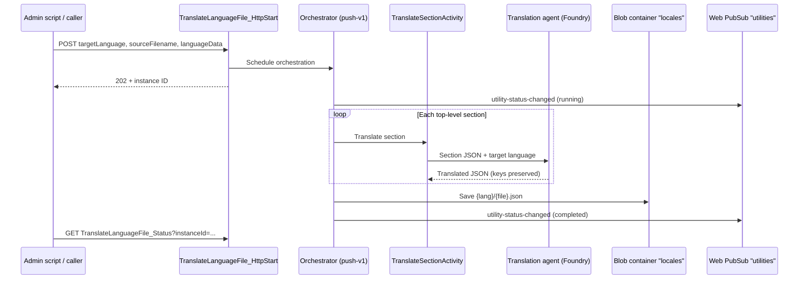

# Localization and translation (i18n)

## What it does

- The storefront UI is available in **23 locales**: `ar`, `de`, `en`, `en-au`, `en-ca`, `en-gb`, `en-ie`, `en-nz`, `es`, `fr`, `he`, `id`, `it`, `ja`, `ko`, `nl`, `pt`, `ru`, `th`, `tr`, `vi`, `zh`, `zh-cht`.
- Product names and descriptions are shown in the selected culture when a translation exists in the database; administrators can also translate category names and promotion text.
- Prices are converted to a currency associated with the selected language using the AdventureWorks `CurrencyRate` data; units of measure are localized through `UnitMeasureContext`.
- Administrators can generate new translations with Microsoft Foundry agents: whole UI language files (a Durable Functions orchestration), product descriptions, category names and promotions.
- Emoji in translated strings render consistently across platforms as Twemoji SVGs.

## Try it

1. Open the storefront (`azd env get-value APP_URL --no-prompt`) and choose a language from the header selector. The choice is saved in `localStorage` (`selectedLanguage`); on first visit the browser language is detected.
2. Browse a category: product names switch to the selected culture and prices use the matching currency.
3. Translate a UI language file to French with the admin identity (an AI call — run intentionally):

```bash
python3 scripts/utilities/azure-auth.py request \
  --identity admin --resource functions \
  --path /api/TranslateLanguageFile_HttpStart --method POST \
  --data "{\"targetLanguage\":\"fr\",\"sourceFilename\":\"footer\",\"languageData\":$(cat app/src/locales/en/footer.json)}"

# Check progress with the returned instance ID
python3 scripts/utilities/azure-auth.py request \
  --identity admin --resource functions \
  --path '/api/TranslateLanguageFile_Status?instanceId=<id>'
```

To translate every namespace into every supported language, use [batch-translate-language-file.sh](../../../scripts/utilities/batch-translate-language-file.sh).

## How it works

### Storefront rendering

[app/src/i18n.ts](../../../app/src/i18n.ts) bundles all locale JSON files at build time and initializes react-i18next with `en` as the default and fallback language. [LanguageContext.tsx](../../../app/src/context/LanguageContext.tsx) owns the selected language and keeps i18next, product names and currency in step. A supported `?lang=<code>` query parameter (used by the SEO `hreflang` alternates) overrides the saved choice on load. On every change it sets `<html lang>` and `<html dir>` — `rtl` for Arabic (`ar`) and Hebrew (`he`) — and key storefront components (header, search, product cards) use Tailwind logical classes (`start-*`, `end-*`, `ps-*`, `pe-*`) so they mirror correctly.

| Namespace | Content |
|-----------|---------|
| `common` | Header, navigation, shared labels |
| `product` | Product and category pages |
| `cart` | Cart and checkout |
| `account` | Sign-in, profile, orders |
| `footer` | Footer, newsletter |
| `chat` | AI chat assistant |
| `helpme` | Help Me Choose wizard |

Data-driven text comes from DAB GraphQL:

- `ProductNamesContext` queries `productNames` filtered by `CultureID` for the selected language.
- `CurrencyContext` maps each language to a currency code and converts prices with `currencyRates`.
- Product descriptions are read from `productModelProductDescriptionCultures` and their descriptions for the selected culture.

`Production.ProductCategory` and `Production.ProductSubcategory` hold one row per culture; their primary key is the ID plus `CultureID`, which defaults to `en`. Server-side SQL in Functions and api-mcp that joins either table (the order, Help Me Choose, warehouse, product, sitemap, reporting and promotion queries) filters `CultureID = 'en'` or deduplicates with `SELECT DISTINCT` / `MIN(Name)`, so each product or category appears once instead of once per language and totals are not multiplied. [`tests/scripts/test_localized_catalog_queries.py`](../../../tests/scripts/test_localized_catalog_queries.py) checks that new queries keep this rule.

### Language-file translation (Durable Functions)



1. The HTTP starter validates the target language against the 22 supported translation targets (`es`, `fr`, `de`, `pt`, `it`, `nl`, `ru`, `zh`, `zh-cht`, `ja`, `ko`, `ar`, `he`, `tr`, `vi`, `th`, `id`, `en-gb`, `en-ca`, `en-au`, `en-nz`, `en-ie`) and starts a `push-v1` orchestration.
2. The orchestrator splits the JSON into top-level sections and calls `TranslateSectionActivity` for each, so a failure retries only one section. Keys and structure are preserved; only values are translated.
3. Each activity calls the translation agent (`AI_AGENT_TRANSLATION_ID`) through `TranslationAgentService`.
4. The merged result is uploaded to the `locales` blob container as `{languageCode}/{sourceFilename}.json`, matching the `app/src/locales` layout. The batch script downloads these into the repository so they are bundled with the next storefront build.
5. Lifecycle changes are published through `UtilityLifecycleNotifications` so the admin Utilities status views update without polling.

### Catalog translations

| Route | Scope | Behaviour |
|-------|-------|-----------|
| `POST /api/TranslateProductDescriptions_HttpStart` | `admin.write` | Enqueues one `translation` job per product model on `ai-job-chat-queue`; the AI job worker writes culture-specific descriptions |
| `POST /api/TranslateCategoryName` | `admin.write` | Returns AI translations of a category name for every culture; the admin UI saves them |
| `POST /api/TranslatePromotion` | `admin.write` | Returns AI translations of a promotion's text for the admin UI to save |
| `POST /api/TranslateLanguageFile_HttpStart` | `admin.write` | Starts the language-file orchestration |
| `GET /api/TranslateLanguageFile_Status` | `admin.read` | Orchestration status and output |
| `POST /api/TranslateLanguageFile_Terminate?instanceId=…` | `admin.write` | Stops a running orchestration |

The admin `/cultures` page uses `LocalizationDialog` to review and edit translated values. Seed data already includes AI-generated translations (`*-ai.csv`) produced by the `scripts/generators/generate-*-translations.sh` scripts; see [Seed data generation](../../operations/seed-data-generation.md).

### Emoji in translations

Translation files can contain emoji either directly (recommended) or as Unicode escapes. Wrap translated strings that may contain emoji in `TwemojiText`, which replaces them with Twemoji SVGs:

```tsx
import { TwemojiText } from "@/components/TwemojiText";

<TwemojiText text={t("auth.demoHint")} size="1em" />
```

For a standalone emoji use the `Twemoji` component; [useEmojiTranslation.tsx](../../../app/src/hooks/useEmojiTranslation.tsx) provides a hook variant.

## Data & storage

| Store | Content |
|-------|---------|
| `app/src/locales/{lang}/{namespace}.json` | UI strings bundled into the storefront build |
| Blob container `locales` | Output of language-file translations, `{lang}/{file}.json` |
| `Production.ProductModelProductDescriptionCulture`, `Production.ProductDescription` | Localized product descriptions |
| `Production.ProductName` (DAB `productNames`), `Production.Culture` | Localized product names and the culture list |
| `Sales.CurrencyRate` (DAB `currencyRates`) | Exchange rates for price display |
| Queue `ai-job-chat-queue` | Product-description translation jobs |
| Durable Functions task hub | Orchestration state for language-file translation |

See [Storage resources](../../reference/storage-resources.md).

## Events (Web PubSub)

| Group | Event | Producer | Consumer |
|-------|-------|----------|----------|
| `utilities` | `utility-status-changed` | `UtilityLifecycleNotifications` (`translate-language-file`) | Admin utility status views, filtered by `instanceId` |

The storefront does not subscribe to translation events; new UI strings appear after the next storefront build.

## Security

- All translation routes require a Functions-audience token with the `admin.write` scope (status reads need `admin.read`) and an internal category; see [Functions OAuth](../functions-oauth/README.md).
- Language selection and localized catalog reads are anonymous storefront operations.
- Blob access uses the Functions managed identity; storage account keys are not used.

## Configuration

| Setting | Purpose |
|---------|---------|
| `AI_AGENT_TRANSLATION_ID` | Foundry translation agent used by all translation workflows |
| `AzureWebJobsStorage__*` | Identity-based storage for queues, blobs and Durable state |

See [Environment variables](../../reference/environment-variables.md).

## Limits

- Right-to-left mirroring covers document direction and the main shared components; some page-specific layouts may still use physical left/right classes.
- The non-English `helpme` files were machine-translated when the namespace was added; review them like other generated translations.
- UI language files are bundled at build time; translated files must be committed and the storefront redeployed before they appear.
- Translation quality depends on the model; review output before committing.

## Related code & docs

- [app/src/i18n.ts](../../../app/src/i18n.ts), [LanguageContext.tsx](../../../app/src/context/LanguageContext.tsx), [CurrencyContext.tsx](../../../app/src/context/CurrencyContext.tsx), [ProductNamesContext.tsx](../../../app/src/context/ProductNamesContext.tsx)
- [TwemojiText.tsx](../../../app/src/components/TwemojiText.tsx), [Twemoji.tsx](../../../app/src/components/Twemoji.tsx)
- [TranslateLanguageFile.cs](../../../api-functions/Functions/TranslateLanguageFile.cs), [TranslateProductDescriptions.cs](../../../api-functions/Functions/TranslateProductDescriptions.cs), [TranslateCategoryNames.cs](../../../api-functions/Functions/TranslateCategoryNames.cs), [TranslatePromotionDescriptions.cs](../../../api-functions/Functions/TranslatePromotionDescriptions.cs)
- [CulturesPage.tsx](../../../app-admin/src/pages/CulturesPage.tsx)
- [AI content generation](../ai/ai-content-generation.md) · [Foundry agents](../ai/foundry-agents.md) · [Functions routes](../../reference/functions-routes.md)
