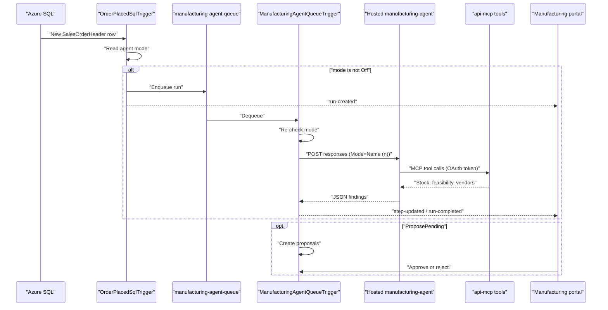

# Manufacturing agent

## What it does

When a sales order is placed, the manufacturing agent checks whether the ordered products can be supplied from stock, built from components or need purchasing. What it does next depends on the **agent mode**:

| Mode | Name | Behaviour |
|---|---|---|
| 0 | Off (default) | No runs are created |
| 1 | ReadOnly | Investigates and records findings |
| 2 | ProposePending | Investigates and creates proposals for a person to approve |
| 3 | FullyAutonomous | Investigates and starts manufacturing runs or places supply orders itself |

The agent is the hosted `manufacturing-agent` azd service (`host: azure.ai.agent`, Microsoft Agent Framework). It reaches AdventureWorks data only through the api-mcp MCP tools.

## Try it

**UI:** in the Manufacturing portal open **Manufacturing Agent** (`/manufacturing-agent`). Choose a mode and an auto-shutoff (1 h, 2 h, 4 h, 8 h, 1 day, 3 days or none). Mode 3 asks for confirmation. Place an order in the storefront or start the [shopping simulator](../simulators/shopping-simulator.md) and watch runs and steps appear.

**API:**

```bash
python3 scripts/utilities/azure-auth.py request --identity manufacturing \
  --resource functions --path /api/manufacturing/agent-config

python3 scripts/utilities/azure-auth.py request --identity manufacturing \
  --resource functions --path /api/manufacturing/agent-config \
  --method PUT --data '{"mode": 1, "autoShutoffHours": 1}'

python3 scripts/utilities/azure-auth.py request --identity manufacturing \
  --resource functions --path '/api/manufacturing/agent-runs?limit=30'
```

## How it works



1. `OrderPlacedSqlTrigger` runs on SQL change tracking for new orders. Besides receipt and order-status work, it creates a run record and queues a message when the mode is not Off. It has an always-ready instance, which keeps a SQL session open even when idle.
2. `ManufacturingAgentQueueTrigger` re-checks the mode (runs queued before the agent was switched off are discarded) and calls `MANUFACTURING_AGENT_ENDPOINT` with a token for `https://ai.azure.com`.
3. The agent must return JSON with `findingsSummary`, `toolsUsed`, `recommendedActions` and `actionsExecuted`. Invalid output and transient failures are retried with a 10 s × 2ⁿ back-off up to 8 times, then the message goes to the poison queue. The host processes up to 16 messages at once (`maxDequeueCount` 5).
4. In ProposePending mode, recommended actions become proposals.

### Hosted agent and tools

The hosted agent exchanges its managed-identity assertion for an api-mcp token (client `adventureworks-agents`).

- **ReadOnly and ProposePending:** 18 read tools, such as stock, feasibility, shortage forecast and vendor lookups.
- **FullyAutonomous:** adds `manufacturing.write` and the `begin_manufacturing_run` and `place_supply_order` tools.

api-mcp's `ManufacturingAutonomyGuard` only allows write tools when the mode is 3 and the auto-shutoff has not passed. Postdeploy sets the service trust list (`MCP_TRUSTED_SERVICE_PRINCIPAL_IDS`, `MCP_HOSTED_MANUFACTURING_PRINCIPAL_ID`, `MCP_FUNCTIONS_PRINCIPAL_ID`).

### Proposals

Proposals live in `awManufacturingProposals`. A proposal expires after 5 minutes; the read-only list shows the newest 10 unexpired items, and `SimulationMaintenance_Timer` (every minute) rejects expired or overflow items. **Approve all** executes up to 20 pending proposals.

### Auto-shutoff

`autoShutoffHours` sets `autoShutoffAt`. When the time has passed, the next config read switches the mode back to Off.

### Routes

All are under `/api/manufacturing/`. Reads need `manufacturing.read`; changes need `manufacturing.write`.

| Route | Purpose |
|---|---|
| `GET`, `PUT agent-config` | Mode and auto-shutoff |
| `GET agent-runs?limit=30` | Recent runs |
| `POST agent-runs/{id}/step` | Step updates written by the run pipeline |
| `GET agent-queue-status` | Queue and poison-queue depth |
| `DELETE agent-queue`, `DELETE agent-queue/poison` | Clear the queues |
| `GET`, `POST proposals` | List or create proposals |
| `POST proposals/{id}/approve`, `proposals/{id}/reject` | Act on one proposal |
| `POST proposals/approve-all`, `proposals/reject-all` | Act on all pending proposals |

### Portal

`/manufacturing-agent` shows the run feed, step timeline, queue depth with a drain estimate and a warning above 20 pending runs. `AgentControlBanner` disables manual work-order creation while the agent is active. **Settings** can clear the queue and the poison queue.

## Data & storage

| Store | Contents |
|---|---|
| `awManufacturingAgentRuns` | Runs and steps |
| `awManufacturingProposals` | Pending, approved and rejected proposals |
| `awManufacturingAgentConfig` | Mode and `autoShutoffAt` |
| `manufacturing-agent-queue` (+ poison) | Queued runs |

## Events

Group `manufacturing-agent`: `run-created`, `run-started`, `step-updated`, `run-completed`, `config-changed`, `queue-cleared`, `poison-queue-cleared`, `state-changed`. The portal invalidates its run, proposal and queue queries; there is no polling.

## Security

- Functions routes: `manufacturing.read` / `manufacturing.write` (manufacturing-engineer role).
- Hosted agent: service token from api-mcp; write tools gated by `ManufacturingAutonomyGuard`.
- Functions calls the agent with its managed identity.

## Configuration

| Setting | Where |
|---|---|
| `MANUFACTURING_AGENT_ENDPOINT` | Functions; set by postdeploy from `AGENT_MANUFACTURING_AGENT_RESPONSES_ENDPOINT` |
| `AZURE_AI_MODEL_DEPLOYMENT_NAME` | Hosted agent model deployment (default `chat`) |
| Hosted agent resources | 0.5 CPU, 1 GiB (`manufacturing-agent/`) |

## Limits

- Each order creates one run; a busy shopping simulator can build a long queue. Use the drain estimate and clear the queue if needed.
- Mode 3 actions use real simulation resources (bank balance, inventory, vendor stock).

## Related code & docs

- `api-functions/Functions/OrderPlacedSqlTrigger.cs`, `ManufacturingAgentQueueTrigger.cs`, `ManufacturingAgentRunFunctions.cs`, `ManufacturingAgentConfigFunctions.cs`, `ManufacturingProposalFunctions.cs`
- `manufacturing-agent/mcp-tools/src/mcp-tools/Program.cs`
- `api-mcp/AdventureWorks/Auth/ManufacturingAutonomyGuard.cs`
- `tests/scripts/test_manufacturing_agent_tools.py`, `tests/scripts/test_hosted_agent_mcp_trust.py`
- [Foundry agents](../ai/foundry-agents.md) · [Real-time eventing](../../architecture/realtime-eventing.md)
