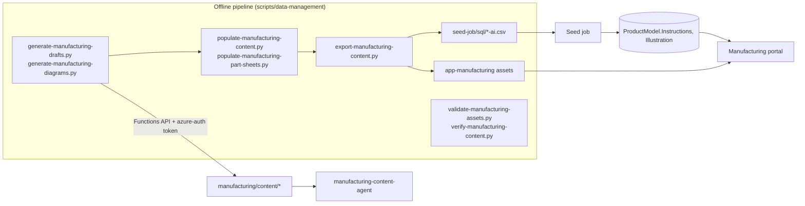

# Manufacturing content

## What it does

Each product model can show workstation-ready assembly instructions, and each manufactured part can show a part sheet and diagram. The content comes from three places:

1. **Seeded content.** `ProductModel.Instructions` XML and illustrations are loaded by the seed job. Extra AI-authored content is exported to `seed-job/sql/*-ai.csv` by the offline pipeline below.
2. **Bundled assets.** The Manufacturing portal ships JSON documents and SVG illustrations for the same models and parts.
3. **On-demand generation.** Four Functions routes ask the `manufacturing-content-agent` Foundry agent for a draft of instructions or a diagram. Drafts are returned to the caller and are not saved.

## Try it

**UI:** in the Manufacturing portal open **Define → Models** (`/define/models`), choose a model and open **Instructions** (`/define/models/:id/instructions`). Part sheets are at `/define/parts/:id/instructions`; operators see the same content at `/execute/work-order/:id/instructions`.

**API:**

```bash
# Documents for a part (read-only)
python3 scripts/utilities/azure-auth.py request --identity manufacturing \
  --resource functions --path /api/manufacturing/parts/994/documents

# Draft instructions for a product model (AI call; not saved)
python3 scripts/utilities/azure-auth.py request --identity manufacturing \
  --resource functions --path /api/manufacturing/content/instructions/generate \
  --method POST --data '{"productModelId": 19}'
```

## How it works



### Generation routes

All are `POST` and need `manufacturing.write`. Each call has a 200-second timeout.

| Route | Input | Output |
|---|---|---|
| `manufacturing/content/instructions/generate` | `{productModelId, supplementExistingInstructions?}` | Assembly instruction draft |
| `manufacturing/content/diagrams/generate` | product model | Diagram draft |
| `manufacturing/content/parts/instructions/generate` | part | Part sheet draft |
| `manufacturing/content/parts/diagrams/generate` | part | Part diagram draft |

Generated output is validated before it is returned. Ineligible products return `409`, invalid output `502` and timeouts `504`. The agent (`AI_AGENT_MANUFACTURING_CONTENT_ID`) has no tools and no memory; the Functions code supplies the product data.

### Read routes

| Route | Scope | Purpose |
|---|---|---|
| `GET manufacturing/parts/{productId}/documents` | `manufacturing.read` | Part documents shown on part instruction pages |
| `GET` or `POST manufacturing/illustrations/export` | `manufacturing.read` | Exports 1–500 `Production.Illustration` rows as SVG |

`npm run illustrations:export` in `app-manufacturing` runs `scripts/export-illustrations.mjs`. It calls the export route with `API_FUNCTIONS_URL` and a `FUNCTIONS_ACCESS_TOKEN` obtained from `azure-auth.py token`. With `--csv` it reads `seed-job/sql/Illustration*.csv` instead.

### In the portal

- `ProductModel.Instructions` XML is parsed in the browser; documents containing a `DOCTYPE` are rejected.
- `src/data/manufacturing` holds 56 `model-*.json` and 27 `part-*.json` documents. A bundled document is used only when its source matches the live instruction XML, so edited models fall back to the database content.
- `public/illustrations` holds 95 SVG illustrations.

### Offline pipeline

The scripts in `scripts/data-management/` maintain the seeded content:

| Script | Purpose |
|---|---|
| `generate-manufacturing-drafts.py`, `generate-manufacturing-diagrams.py` | Call the generation routes with `azure-auth.py` tokens |
| `populate-manufacturing-content.py`, `populate-manufacturing-part-sheets.py` | Assemble accepted drafts |
| `export-manufacturing-content.py` | Write `seed-job/sql/*-ai.csv` and the portal assets |
| `refresh-manufacturing-previews.py` | Rebuild preview assets |
| `validate-manufacturing-assets.py` | Check coverage against `seed-job/manufacturing-content-coverage.json` (61 models) |
| `verify-manufacturing-content.py` | Compare deployed content through DAB |

Tests are `tests/scripts/test_manufacturing_*.py`.

## Data & storage

- SQL `Production.ProductModel.Instructions` (XML), `Production.Illustration`, `Production.ProductModelIllustration`.
- `seed-job/sql/*-ai.csv` and `seed-job/manufacturing-content-coverage.json`.
- `app-manufacturing/src/data/manufacturing/` and `app-manufacturing/public/illustrations/`.

## Events

None. Generation is request/response.

## Security

Generation needs `manufacturing.write`; reads and export need `manufacturing.read`. The offline scripts use `azure-auth.py` with the manufacturing identity and never store tokens.

## Configuration

| Setting | Used by |
|---|---|
| `AI_AGENT_MANUFACTURING_CONTENT_ID` | Functions generation routes |
| `API_FUNCTIONS_URL`, `FUNCTIONS_ACCESS_TOKEN` | `illustrations:export` script |

## Limits

- Export returns at most 500 illustrations per call.
- Drafts are not persisted; use the offline pipeline and a fresh seed to publish new content.

## Related code & docs

- `api-functions/Functions/GenerateManufacturing*.cs`, `GetManufacturingPartDocuments.cs`, `ExportManufacturingIllustrations.cs`
- `api-functions/Services/ManufacturingContentAgentService.cs`, `ManufacturingDiagramService.cs`
- `app-manufacturing/src/pages/define/ModelInstructions.tsx`, `PartInstructions.tsx`
- [Foundry agents](../ai/foundry-agents.md) · [Seed data generation](../../operations/seed-data-generation.md)
