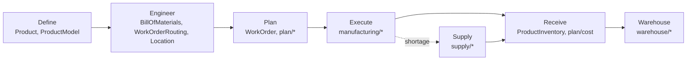

# Manufacturing overview

## What it does

The Manufacturing portal (`app-manufacturing`) models how AdventureWorks designs, plans and builds bicycles. It is organised as seven stages that follow a product from definition to storage:

| Stage | Route | What you do | Detailed doc |
|---|---|---|---|
| Define | `/define`, `/define/models` | Maintain products and product models; view assembly instructions | This page, [manufacturing content](manufacturing-content.md) |
| Engineer | `/engineer`, `/engineer/bom/:productId`, `/engineer/routing/:productId`, `/engineer/locations` | Edit bills of materials, routings and work centres | This page |
| Plan | `/plan`, `/plan/schedule`, `/plan/intelligence`, `/plan/demand`, `/plan/finance` | Create work orders, view the schedule, feasibility, demand and finance | [Planning and feasibility](planning-and-feasibility.md) |
| Execute | `/execute`, `/execute/shop-floor`, `/execute/tracker`, `/execute/workforce` | Run and watch production | [Production simulation](production-simulation.md) |
| Supply | `/supply` | Source components from vendors | [Supply chain](../supply-chain/supply-chain.md) |
| Receive | `/receive`, `/receive/costing` | Check inventory, reorder or build, review costs | [Planning and feasibility](planning-and-feasibility.md) |
| Warehouse | `/warehouse`, `/warehouse/floor`, `/warehouse/workforce`, `/warehouse/config` | Watch put-away, picking and receiving | [Warehouse operations](../warehouse/warehouse-operations.md) |

Secondary menus group the same pages by role:

- **Operations:** Shop Floor, Product Tracker, Workforce, Warehouse Floor, Warehouse Workers.
- **Intelligence:** Demand, Planning, Finance.
- **Reference:** Locations.
- **Admin:** AI Agent (`/manufacturing-agent`, see [manufacturing agent](manufacturing-agent.md)) and Settings (`/settings`).

## Try it

**UI:** open the Manufacturing portal (`APP_MANUFACTURING_URL`) and sign in as the manufacturing demo user (Peter, `manufacturing-engineer`). Start on **Define**, pick a bike, then follow its BOM in **Engineer** and its cost in **Receive → Costing**.

**API:** the Define and Engineer stages read DAB directly.

```bash
# Finished goods that are manufactured in-house
python3 scripts/utilities/azure-auth.py request --identity manufacturing \
  --resource dab --path '/api/Product?$filter=MakeFlag eq true and FinishedGoodsFlag eq true&$first=10'

# Active BOM lines for a product (EndDate null = active)
python3 scripts/utilities/azure-auth.py request --identity manufacturing \
  --resource dab --path '/api/BillOfMaterials?$filter=ProductAssemblyID eq 749 and EndDate eq null'

# Rolled-up cost for the same product
python3 scripts/utilities/azure-auth.py request --identity manufacturing \
  --resource functions --path /api/plan/cost/749
```

## How it works



### Define: products and models

- **Products.** The Define page lists finished goods that have an active BOM, together with their routing history. `MakeFlag = 1` marks a product that AdventureWorks builds; `MakeFlag = 0` marks a purchased component. Only products with both `MakeFlag` and `FinishedGoodsFlag` can start a production run.
- **Product and ProductModel editing** uses DAB REST create, update and delete on `Product` and `ProductModel`.
- **Cost roll-up** calls `GET /api/plan/cost/{productId}` (materials from the BOM plus average routing labour).
- **Instructions.** Model and part instruction pages (`/define/models/:id/instructions`, `/define/parts/:id/instructions`) render `ProductModel.Instructions` and generated documents. See [manufacturing content](manufacturing-content.md).

### Engineer: BOM, routing and locations

- **Bill of materials** (`/engineer/bom/:productId`) edits `Production.BillOfMaterials` through DAB. A line is active while `EndDate` is null; the simulation and planning APIs ignore ended lines.
- **Routing** (`/engineer/routing/:productId`) shows `Production.WorkOrderRouting` history: the sequence of operations, locations, planned cost and cost rate used to time each operation.
- **Locations** (`/engineer/locations`) list `Production.Location` work centres with cost rate and weekly availability. Availability sets the default number of parallel slots per station in the simulation.

### Which backend each stage uses

| Stage | DAB (REST/GraphQL) | Azure Functions |
|---|---|---|
| Define | `Product`, `ProductModel` (read/write) | `plan/cost/*`, `manufacturing/parts/{productId}/documents`, `manufacturing/content/*` |
| Engineer | `BillOfMaterials`, `WorkOrderRouting`, `Location` | — |
| Plan | `WorkOrder` (read/write), `SalesOrderHeader`/`Detail` (demand) | `plan/*`, `manufacturing/begin`, `financials/*`, `bank/*` |
| Execute | `WorkOrderRouting` (active operations) | `manufacturing/status`, `workforce`, `scrap-*`, `location-config` |
| Supply | `PurchaseOrderHeader`/`Detail` (reads) | `supply/*` |
| Receive | `ProductInventory` (read/write) | `plan/cost/{id}/current`, `supply/order`, `manufacturing/begin` |
| Warehouse | — | `warehouse/*` |

Every request uses the signed-in user's token: DAB calls send the `X-MS-API-ROLE` header for the user's role, and Functions calls use a Functions-audience token.

### Live updates

The portal subscribes to seven Web PubSub groups (`manufacturing-ops`, `manufacturing-agent`, `supply-chain`, `warehouse`, `finance`, `orders` and `shopping-simulator`) and batches events over a 2-second window before invalidating React Query caches. Pages do not poll. See [real-time eventing](../../architecture/realtime-eventing.md).

## Data & storage

- **SQL (`Production` schema):** `Product`, `ProductModel`, `BillOfMaterials`, `WorkOrder`, `WorkOrderRouting`, `Location`, `ProductInventory`, `ProductCostHistory`, `TransactionHistory`.
- **SQL (`Purchasing`, `Sales`, `HumanResources`):** vendors and purchase orders, sales demand, workforce.
- **Table Storage:** simulator state in `awManufacturing`, `awSupplyChain`, `awWarehouse`, `awBankAccounts`/`awBankTransactions` and the manufacturing agent tables. See [data stores](../../architecture/data-stores.md).

## Events

Stages listen to the groups above. The event lists are in each detailed doc and in the [event reference](../../reference/webpubsub-events.md).

## Security

- The manufacturing OAuth client is `adventureworks-manufacturing`. Users need an internal category; the `manufacturing-engineer` role has `manufacturing.read`, `manufacturing.write`, `inventory.read` and `products.read`.
- DAB entity permissions decide which roles can edit products, BOMs, routings and inventory. See the [route scope matrix](../functions-oauth/ROUTE_SCOPE_MATRIX.md) for Functions routes.

## Configuration

The portal reads `API_URL`, `API_FUNCTIONS_URL` and the OAuth settings from runtime configuration that its container startup script generates. Simulator speeds are covered in the detailed docs.

## Limits

- DAB list pages return up to 100 items by default; the portal follows cursors where it needs complete lists.
- BOM and routing edits affect new runs and planning results only; work orders already created keep their routing.

## Related code & docs

- `app-manufacturing/src/App.tsx` (routes), `app-manufacturing/src/pages/define/`, `app-manufacturing/src/pages/engineer/`, `app-manufacturing/src/services/api.ts`
- [Manufacturing portal](../../apps/manufacturing-portal.md) · [DAB naming conventions](../../architecture/dab-naming-conventions.md) · [Glossary](../../glossary.md)
