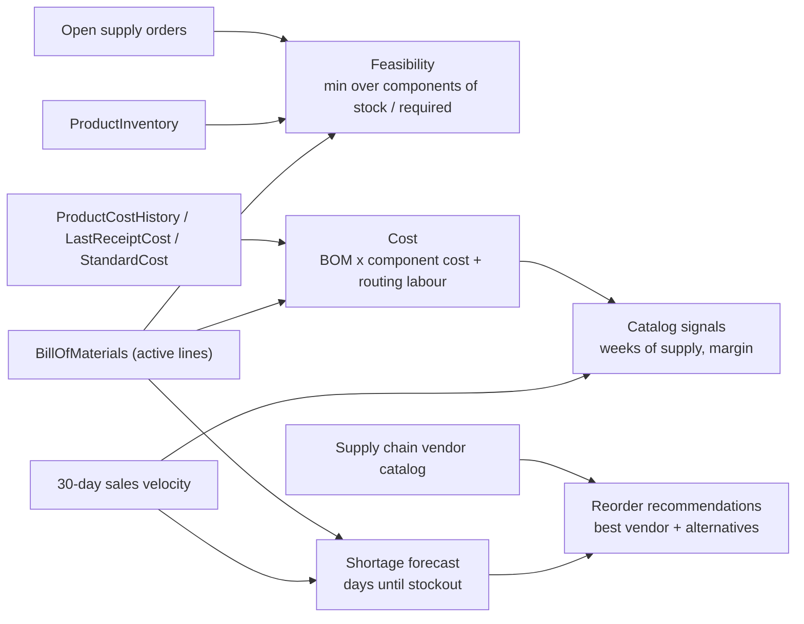

# Planning and feasibility

## What it does

The planning APIs turn live AdventureWorks data into planning answers:

- **Feasibility:** how many units of a bike can be built from current component stock, and which component is the bottleneck.
- **Cost:** a full BOM and routing cost breakdown, either from standard costs or from the latest purchase costs.
- **Catalog snapshot:** every manufactured finished good with cost, margin, stock and sales signals.
- **Overstock and thin margin:** candidates for a discount or a price increase.
- **Shortage forecast and reorder recommendations:** which purchased components run out first, and what to buy from which vendor.

All nine routes are `GET` requests that calculate plans without changing work orders or inventory. The first request after a reset can initialize supply-chain simulation state (vendor stock and seeded purchase orders). They power the Planning, Dashboard, Receive costing and Demand pages, and the manufacturing agent's read tools.

## Try it

**UI:** in the Manufacturing portal, open **Plan → Intelligence** (`/plan/intelligence`), **Plan → Demand** (`/plan/demand`) or **Receive → Costing** (`/receive/costing`).

**API:**

```bash
python3 scripts/utilities/azure-auth.py request --identity manufacturing \
  --resource functions --path '/api/plan/feasibility/749?qty=5'

python3 scripts/utilities/azure-auth.py request --identity manufacturing \
  --resource functions --path '/api/plan/shortage-forecast?days=90'

python3 scripts/utilities/azure-auth.py request --identity manufacturing \
  --resource functions --path '/api/plan/reorder-recommendations?days=60'
```

## How it works



### Routes

All routes are under `/api/plan/` and need `manufacturing.read`.

| Route | Default | Returns |
|---|---|---|
| `feasibility/{productId}?qty=&withProcurement=` | `qty=1`, `withProcurement=true` | `maxProducibleNow`, `maxProducibleWithProcurement`, `procurementCostToMeetRequest`, bottleneck component and per-component `canSupportUnits` |
| `feasibility?qty=` | `qty=1` | The same summary for every manufactured finished good, with `canMeetRequest` |
| `cost/{productId}` | — | BOM components × standard cost, plus average historical routing labour, margin and pricing signal |
| `cost/{productId}/current` | — | Current cost using `ProductCostHistory`, then `ProductVendor.LastReceiptCost`, then `Product.StandardCost`; shows the source per component |
| `catalog?inventorySignal=&pricingSignal=` | — | All manufactured finished goods with cost, margin, stock, 30-day sales and weeks of supply |
| `overstock?minWeeks=` | `12` | Products with more than `minWeeks` of supply (discount candidates) |
| `thin-margin?maxMarginPct=` | `0.20` | Products below the margin threshold, worst first (price-increase candidates) |
| `shortage-forecast?days=` | `90` | Purchased components ranked by days until stockout, with affected products |
| `reorder-recommendations?days=` | `60` | For each forecast stockout: a 30-day order quantity, the best vendor and all vendors by total cost |

The shortage forecast's function name is `PlanShortageForeceast` (spelled that way in code); its route is `plan/shortage-forecast`. `feasibility` (all products) and `reorder-recommendations` initialize the supply chain simulation on first use so vendor stock is available.

### Signals

| Signal | Values |
|---|---|
| `inventorySignal` | `out-of-stock` (no stock), `low-stock` (< 2 weeks), `healthy` (2–12 weeks), `overstock` (> 12 weeks) |
| `pricingSignal` | `healthy`, `thin-margin`, `loss-making`, `no-price` |
| `urgencyLevel` | `critical` (< 7 days), `warning` (7–30), `watch` (30–60), `ok` (≥ 60) |

`weeksOfSupply = -1` means there were no sales in the last 30 days.

A component's daily consumption is the sum over finished goods of `dailySalesRate × requiredPerUnit`. The suggested reorder quantity is `ceil(dailyConsumptionRate × 30)`. The best vendor is the cheapest one that can fill the whole quantity, or the cheapest overall if none can.

### Demand page

**Plan → Demand** (`/plan/demand`) is computed in the browser from DAB `SalesOrderHeader` and `SalesOrderDetail`:

- **Open demand** uses orders with `Status lt 5`.
- **Sales history** uses orders with `Status eq 5`, over 30-, 90- and 365-day windows that end at the most recent shipped order date (the seeded dataset is historical, so windows are anchored to the data rather than today).

### MCP tools

| Tool | Route |
|---|---|
| `get_production_feasibility` | `plan/feasibility/{productId}` |
| `get_all_products_feasibility` | `plan/feasibility` |
| `get_product_cost_analysis` (`useCurrent` selects `/current`) | `plan/cost/{productId}` |
| `get_manufacturing_catalog_snapshot` | `plan/catalog` |
| `get_overstock_items` | `plan/overstock` |
| `get_thin_margin_products` | `plan/thin-margin` |
| `get_component_shortage_forecast` | `plan/shortage-forecast` |
| `get_reorder_recommendations` | `plan/reorder-recommendations` |
| `propose_manufacturing_run` | Creates a pending proposal; see [manufacturing agent](manufacturing-agent.md) |

## Data & storage

Reads SQL `Production` (`Product`, `BillOfMaterials`, `ProductInventory`, `ProductCostHistory`, `WorkOrderRouting`), `Purchasing` (`ProductVendor`, open purchase orders) and `Sales` (`SalesOrderDetail`) tables, plus vendor stock in `awSupplyChain`.

## Events

The planning routes do not publish events. The pages refresh when `manufacturing-ops`, `supply-chain` or `warehouse` events invalidate their queries.

## Security

`manufacturing.read` (Functions audience, internal category). The MCP tools need the same scope; `propose_manufacturing_run` needs `manufacturing.write`.

## Configuration

`SIMULATION_TIME_SCALE_FACTOR` and `SUPPLY_CHAIN_SPEED_MULTIPLIER` affect the estimated delivery minutes in reorder recommendations.

## Limits

- Forecasts use a rolling 30-day sales rate. With only the historical seed data, the forecast can be empty until the shopping simulator or production runs consume stock.
- `feasibility` returns `404` for products that are not manufactured finished goods.

## Related code & docs

- `api-functions/Functions/ManufacturingPlanningFunction.cs`, `api-functions/Services/ManufacturingPlanningService.cs`
- `app-manufacturing/src/pages/plan/`, `app-manufacturing/src/pages/receive/`
- [Production simulation](production-simulation.md) · [Supply chain](../supply-chain/supply-chain.md) · [Functions routes](../../reference/functions-routes.md)
