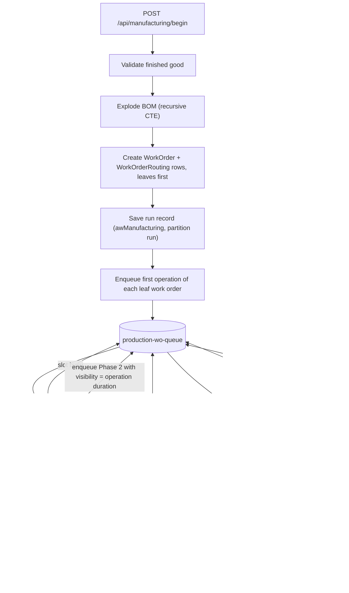

# Production simulation

## What it does

The production simulation builds AdventureWorks finished goods in simulated time. A run:

1. Validates that the product is a manufactured finished good (`MakeFlag = 1` and `FinishedGoodsFlag = 1`).
2. Explodes the bill of materials (BOM) recursively and creates a `Production.WorkOrder` with `Production.WorkOrderRouting` operations for every manufactured node.
3. Drives every routing operation through the `production-wo-queue` queue. Each message reschedules itself using queue visibility delays, so there are no timers or sleeps.
4. Enforces station capacity, consumes purchased components, assigns workers, rolls for scrap and posts labour, overhead and write-off costs to the [bank simulator](../finance/bank-simulator.md).

Finished goods are added to inventory and handed to the [warehouse](../warehouse/warehouse-operations.md) for put-away. Parent assemblies start automatically when all their child work orders finish.

## Try it

**UI:** sign in to the Manufacturing portal as the manufacturing demo user. Start a run from **Plan** (`/plan`) or a product's build dialog in **Receive** (`/receive`). Watch progress on **Execute** (`/execute`, `/execute/shop-floor`, `/execute/tracker`) and **Workforce** (`/execute/workforce`). Station capacity and scrap rates are on **Settings** (`/settings`).

**API:**

```bash
# Snapshot of queue depth, work orders, shortages, scrap and station load
python3 scripts/utilities/azure-auth.py request --identity manufacturing \
  --resource functions --path /api/manufacturing/status

# Start a run (this creates SQL work orders and queue messages)
python3 scripts/utilities/azure-auth.py request --identity manufacturing \
  --resource functions --path /api/manufacturing/begin --method POST \
  --data '{"productId": 749, "orderQty": 2}'

# Clear pending production messages
python3 scripts/utilities/azure-auth.py request --identity manufacturing \
  --resource functions --path /api/manufacturing/stop --method POST
```

Products with deep BOMs make good demos: road and mountain bikes such as 749 (Mountain-100 Black, 38) create 20–30 work orders.

## How it works



### Two-phase operations

`WorkOrderOperationProcessor` handles every message on `production-wo-queue`:

- **Phase 1 (start).** On the first operation of a work order it deducts purchased components from `Production.ProductInventory` using `UPDLOCK`. If stock is short it writes a shortage record and requeues the message after `MATERIALS_RETRY_DELAY_SECONDS`. It then claims a station slot, assigns an available worker, sets `ActualStartDate` and enqueues Phase 2 with a visibility delay equal to the scaled operation duration.
- **Phase 2 (complete).** It reschedules itself if it wakes early, sets `ActualEndDate`, `ActualResourceHrs` and `ActualCost`, releases the worker, posts payroll and rolls for scrap. It then enqueues the next operation, or completes the work order.

Completing a work order upserts finished-goods inventory, writes a `Production.TransactionHistory` row, posts the overhead charge, enqueues a warehouse **store** operation and unblocks parent assemblies whose children have all ended.

### BOM explosion and routing

The BOM query is a recursive CTE over active `Production.BillOfMaterials` rows (`EndDate IS NULL`, `MAXRECURSION 20`).

- Only `MakeFlag = 1` nodes get a work order. `MakeFlag = 0` nodes are purchased components that are consumed but not built.
- Shared sub-assemblies are deduplicated by summing quantities across paths.
- Work orders are created leaves-first. The run record stores the BOM parent map so the processor knows which parents to unblock.

Routing uses the most recent historical `WorkOrderRouting` for the product. Without history, leaf nodes get one operation at Subassembly (location 50); assemblies get Subassembly then Final Assembly (location 60).

### Simulated time

```text
opDurationHrs = PlannedCost / CostRate          (from WorkOrderRouting)
realSeconds   = opDurationHrs × 3600 / SIMULATION_TIME_SCALE_FACTOR
```

With the default factor of 60, one simulated hour takes one real minute. A factor of 600 makes it six seconds.

### Station capacity

Each production location has `N` slots, defaulting to `ceil(Location.Availability / 40)`. For example, Frame Forming (96 hours) has 2 slots and Subassembly (120 hours) has 3.

Slots are claimed with ETag-guarded optimistic concurrency in Table Storage. The processor picks the slot that frees up first. On a write conflict it retries up to three times, then requeues with a 5-second delay. If the earliest slot is in the future, the message is requeued with that delay, so the worker is free to process other work orders.

`PUT /api/manufacturing/location-config/{locationId}` changes the slot count, operating hours, shift start and speed factor. A `speedFactor` of 2.0 halves operation time; changes apply to the next message for that location.

### Scrap and supplier attribution

At the end of each operation the processor rolls against the station's `failureRatePct`, adjusted by the assigned worker's tenure. A random `ScrapReasonID` is chosen from the station's list.

| Outcome | Condition | Behaviour |
|---|---|---|
| Partial failure | `ScrappedQty + 1 < OrderQty` | `ScrappedQty` increases; good units continue |
| Total failure | `ScrappedQty + 1 >= OrderQty` | The work order ends with no inventory; parents stall on materials |

Reasons 1 (brake assembly not as ordered), 3 (gouge in metal), 7 (handling damage) and 10 (seat assembly not as ordered) are material-quality reasons. For these, the event is attributed to the most recent supplier (`Purchasing.ProductVendor.LastReceiptDate`) of a component the work order consumed. `GET /api/manufacturing/vendor-quality` aggregates the attributed events per vendor.

To stress a station, set a high rate. Material-quality reasons populate the vendor quality board:

```bash
python3 scripts/utilities/azure-auth.py request --identity manufacturing \
  --resource functions --path /api/manufacturing/scrap-config/50 --method PUT \
  --data '{"failureRatePct": 0.4, "scrapReasonIds": [1, 3, 7, 10], "note": "Incoming quality stress test"}'
```

Use `{"failureRatePct": 0.0, "scrapReasonIds": []}` to turn scrap off for a station.

### Workforce

On first use, `WorkforceService` loads the active employees of the Manufacturing department group (Production and Production Control) from the `HumanResources` tables, with name, shift and current pay rate. Workers are spread round-robin across the seven production locations:

| LocationID | Name |
|---|---|
| 10 | Frame Forming |
| 20 | Frame Welding |
| 30 | Debur and Polish |
| 40 | Paint |
| 45 | Specialized Paint |
| 50 | Subassembly |
| 60 | Final Assembly |

- A worker is `available` only during their shift (Day 07:00–15:00, Evening 15:00–23:00, Night 23:00–07:00). Otherwise they are `working`, `off-shift` or `unavailable` (no vacation hours left).
- Tenure lowers the scrap rate: `multiplier = max(0.5, 1.0 − tenureYears / 20)`.
- `GET /api/manufacturing/workforce` returns counts per location and shift; `.../workforce/detail` returns every worker.

### Bank postings

All manufacturing costs are posted in USD:

| Event | Amount | Reference | Type |
|---|---|---|---|
| Routing operation completed | `ActualResourceHrs × hourly rate` | `WO-{id}-OP-{seq}` | `payroll` |
| Work order completed | `SUM(WorkOrderRouting.ActualCost)` | `WO-{id}` | `purchase` |
| Scrap event | `ProductCostHistory.StandardCost × ScrappedQty` | `SCRAP-WO-{id}` | `other` |

`GET /api/financials/manufacturing?type=payroll|scrap|completions|all` reports them. See [bank simulator](../finance/bank-simulator.md).

### Inventory ledger

The simulation keeps an audit trail in `Production.TransactionHistory`:

| Type | Event | Quantity | Written by |
|---|---|---|---|
| `W` | Finished goods produced | positive | `WorkOrderSimulationService` |
| `W` | Component consumed | negative | `WorkOrderSimulationService` |
| `P` | Purchase order received | positive | `SupplyChainService` |
| `S` | Store (B2B) sales order | negative | `OrderGenerationService` |

The admin portal shows the ledger on **Inv. Transactions** and on each product page. A weekly timer archives rows older than one year; see [simulator controls](../simulators/simulator-controls.md#transaction-archive).

### Control routes

All routes are under `/api/manufacturing/`.

| Method | Route | Purpose | Scope |
|---|---|---|---|
| POST | `begin` | Start a run: `{productId, orderQty, dueDate?}` (due date defaults to 7 days); returns `202` with `runId`, `rootWorkOrderId`, work-order counts and inventory warnings | `manufacturing.write` |
| POST | `stop` | Clear pending `production-wo-queue` messages; in-flight operations finish | `manufacturing.write` |
| GET | `status` | Queue depth, pending/in-progress/completed-today counts, shortages, last 10 scrap events, station load | `manufacturing.read` |
| GET | `workforce` | Workforce summary (loaded on first call) | `manufacturing.read` |
| GET | `workforce/detail` | Per-worker status | `manufacturing.read` |
| GET | `scrap-config` | Scrap rate and reasons per station | `manufacturing.read` |
| PUT | `scrap-config/{locationId}` | `{failureRatePct 0–1, scrapReasonIds, note?}` | `manufacturing.write` |
| GET | `location-config` | Capacity, hours, speed and shift per station | `manufacturing.read` |
| PUT | `location-config/{locationId}` | `{capacityUnits, dailyOperatingHours, speedFactor, overtimeMultiplier, shiftStartHour, note?}` | `manufacturing.write` |
| GET | `scrap-events` | Full scrap history; optional `?vendorId=` | `manufacturing.read` |
| GET | `vendor-quality` | Scrap events aggregated by supplier | `manufacturing.read` |
| GET | `vendor-quality/{vendorId}` | One supplier; `404` when no attributed events exist | `manufacturing.read` |

Begin-run warnings are informational: the run is still scheduled and shortage retries continue until stock arrives (for example, from a [supply order](../supply-chain/supply-chain.md)).

Active operations are not a Functions route. The Manufacturing portal reads DAB `WorkOrderRouting` with `$filter=ActualStartDate ne null and ActualEndDate eq null` and joins product and location names.

## Data & storage

| Store | Contents |
|---|---|
| Queue `production-wo-queue` | One message per pending operation phase |
| Table `awManufacturing` | Partitions `locationconfig`, `locationslots` (ETag-guarded slot array), `scrapconfig`, `shortage` (`wo{woId}p{productId}`), `scrapevent` (reverse-chronological), `run` (run record and BOM parent map), plus workforce rows |
| SQL `Production.*` | `WorkOrder`, `WorkOrderRouting`, `ProductInventory`, `TransactionHistory`, `ProductCostHistory` |
| SQL `HumanResources.*` | Employees, departments, shifts and pay history (read-only) |

The queue and table are provisioned by `infra/modules/storage.bicep`. See [storage resources](../../reference/storage-resources.md).

## Events

Group `manufacturing-ops`:

| Event | Sent when |
|---|---|
| `shortage-updated` | A shortage is recorded or cleared (coalesced over 5 s) |
| `routing-updated` | An operation starts or completes (coalesced) |
| `scrap-event` | Scrap is recorded (coalesced) |
| `wo-completed` | A work order completes (coalesced) |
| `simulation-stopped` | `POST stop` cleared the queue |
| `config-changed` | Scrap or location config was updated |
| `state-changed` | A row in `awManufacturing` changed |
| `database-changed` | The SQL outbox recorded a direct DAB change to a production table |

Completing a work order also sends `warehouse:inventory-updated`. The Manufacturing portal invalidates its queries from these events; it does not poll. See [real-time eventing](../../architecture/realtime-eventing.md) and the [event reference](../../reference/webpubsub-events.md).

## Security

- Reads need `manufacturing.read`; writes need `manufacturing.write`. Both are Functions-audience scopes for internal users. The `manufacturing-engineer` role holds both; `executive-admin` and `inventory-admin` hold `manufacturing.read` only.
- MCP tools in `ManufacturingMcpTools` proxy these routes. `begin_manufacturing_run`, `stop_manufacturing`, `update_scrap_configuration` and `update_location_configuration` ask the client to confirm before running. See the [tool scope matrix](../mcp-oauth/TOOL_SCOPE_MATRIX.md).
- SQL is accessed with the Functions managed identity.

## Configuration

| Setting | Default | Effect |
|---|---|---|
| `SIMULATION_TIME_SCALE_FACTOR` | `60` | Simulated minutes per real second |
| `SIMULATION_SCRAP_RATE` | `0.05` | Fallback failure rate for stations without config |
| `MATERIALS_RETRY_DELAY_SECONDS` | `30` | Delay before retrying a work order that is short of materials |
| `SUPPLY_CHAIN_SPEED_MULTIPLIER` | `15` | Extra compression for supply deliveries; see [supply chain](../supply-chain/supply-chain.md) |

Queue processing uses the Functions host defaults in `api-functions/host.json` (batch size 16, `maxDequeueCount` 5, visibility timeout 30 minutes).

## Limits

- The Flex Consumption plan scales queue processing up to 5 instances. `POST stop` clears the queue but does not scale the app to zero: two always-ready instances (`OrderPlacedSqlTrigger` and `DatabaseChanges`) keep running and keep a SQL session open.
- `queueDepth` is approximate (Azure Storage reports an estimate).
- A total failure leaves parent assemblies waiting for materials until the component is rebuilt or bought.

## Related code & docs

- `api-functions/Functions/ManufacturingControlFunction.cs`, `WorkOrderOperationProcessorFunction.cs`
- `api-functions/Services/WorkOrderSimulationService.cs`, `WorkforceService.cs`
- `api-mcp/AdventureWorks/Tools/ManufacturingMcpTools.cs`
- [Manufacturing overview](manufacturing-overview.md) · [Planning and feasibility](planning-and-feasibility.md) · [Manufacturing agent](manufacturing-agent.md)
- [Functions routes](../../reference/functions-routes.md) · [Manufacturing portal](../../apps/manufacturing-portal.md)
