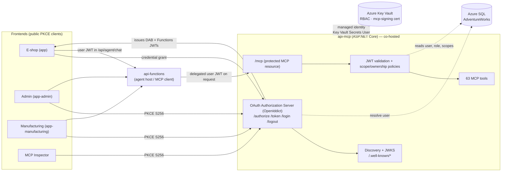
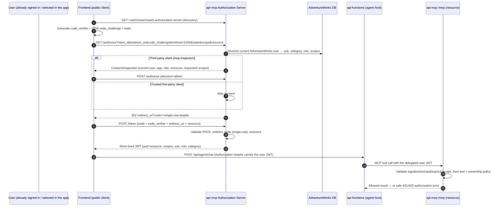
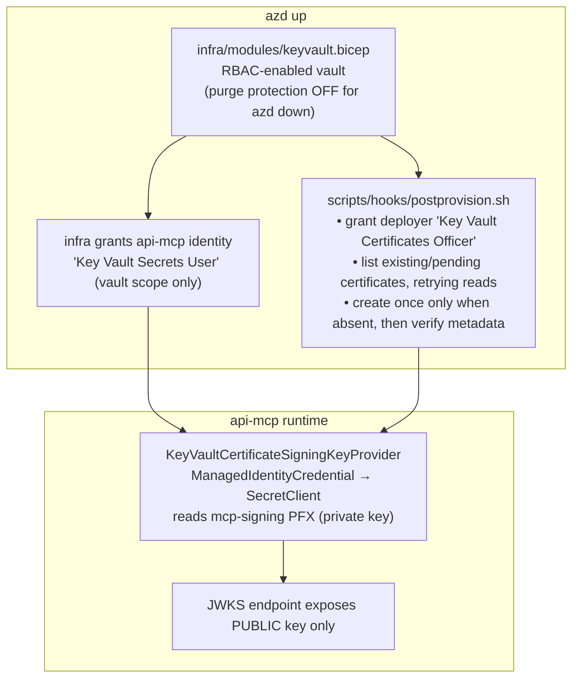

# MCP OAuth Authorization (Self-Contained Demo)

See [end-to-end authentication assurance](../authentication/END_TO_END_AUTHENTICATION.md)
for the complete user/workload trust model, executable validation and exception
boundaries, and [identity and authentication](../../architecture/identity-and-auth.md)
for a short architecture overview.

This feature turns the existing **`api-mcp`** service into an **OAuth 2.0-protected
MCP resource** *and* the **authorization server that protects it** — entirely
self-contained, provisioned automatically by `azd up`, and backed by the demo's
existing **AdventureWorks database users**.

> [!IMPORTANT]
> **This is a demonstration, not an enterprise identity system.** The seeded-user
> selection screens and the e-shop account-creation / password flows are the demo's
> *authentication* mechanism. The self-contained OAuth server **extends those existing
> AdventureWorks database-backed users** into OAuth subjects, scopes and policies. It is
> **not** Entra ID, it is **not** an external IdP, and it deliberately requires **no**
> manual app registrations, Keycloak, or post-deployment identity configuration. The
> `azd auth login → azd up → test → azd down` experience is fully preserved.

## Contents

- [What this demonstrates](#what-this-demonstrates)
- [Existing user model (preserved)](#existing-user-model-preserved)
- [Architecture](#architecture)
- [Subject design](#subject-design)
- [OAuth endpoints](#oauth-endpoints)
- [Clients](#clients)
- [Scopes and roles](#scopes-and-roles)
- [Tool-to-scope matrix](#tool-to-scope-matrix)
- [Ownership / record-level authorization](#ownership--record-level-authorization)
- [Authorization Code + PKCE sequence](#authorization-code--pkce-sequence)
- [JWT access-token validation](#jwt-access-token-validation)
- [Key Vault signing key (RBAC + managed identity)](#key-vault-signing-key-rbac--managed-identity)
- [Delegated token propagation and isolation](#delegated-token-propagation-and-isolation)
- [Silent admin sign-in and service tokens](#silent-admin-sign-in-and-service-tokens)
- [Demonstration steps (allowed and denied)](#demonstration-steps-allowed-and-denied)
- [Telemetry](#telemetry)
- [Testing](#testing)
- [Infrastructure and deployment](#infrastructure-and-deployment)
- [Security review](#security-review)
- [Accepted demo limitations](#accepted-demo-limitations)
- [Troubleshooting](#troubleshooting)

## What this demonstrates

- **OAuth discovery and authorization** served from `api-mcp` itself.
- **Authorization Code with PKCE `S256`** for browser / public clients (`plain` is
  rejected and is **not** advertised).
- **Resource/audience-bound JWT access tokens** (RFC 8707 `resource` indicator →
  `aud`).
- Full **signature, issuer, audience, lifetime, subject and scope** validation before
  any MCP processing.
- **Business-domain scopes** (not per-tool) with **tool-level and record-level
  (ownership)** authorization.
- **Delegated user context** propagated from the frontends through `api-functions` to
  `api-mcp`.
- **Allowed and denied MCP calls** determined by the *actual* AdventureWorks user, and
  a denied operation **succeeding after switching** to an appropriately authorized
  seeded user.
- **Signing material stored only in Azure Key Vault** (RBAC, not access policies), read
  by `api-mcp` via **managed identity** with **least privilege**.

## Existing user model (preserved)

The OAuth layer sits *on top of* each app's existing identity mechanism. Nothing about
login, user selection, account creation, anonymous browsing, or purchasing changes.

| App | Population | How the active user is established | OAuth behavior added |
| --- | ---------- | ---------------------------------- | -------------------- |
| **E-shop** (`app/`) | External consumers | Browse **anonymously**; sign in or create an account with the existing AdventureWorks email/password. | Sign-in silently exchanges those credentials for audience-bound DAB and Functions tokens; no OAuth login page or Entra ID is involved. Anonymous browsing stays anonymous. |
| **Admin** (`app-admin/`) | Internal employees | Selects an existing **seeded employee**. | Employee's **department → role → scopes** resolve to a user-bound token. Surfaces the **authorization-inspection** view (see [below](#authorization-inspection)). |
| **Manufacturing** (`app-manufacturing/`) | Manufacturing engineers | Selects an existing **seeded manufacturing user**. | Resolves to **manufacturing** scopes only — demonstrably **no** customer/admin/sales rights. |

There is **no** universal "persona selector" and **no** second user store. The
AdventureWorks database (`Person.Person`, `Sales.Customer`,
`HumanResources.EmployeeDepartmentHistory`) is the source of user and department data.
Role-to-scope policy is source-controlled in `ApplicationRoles`; no `Auth.*` SQL
authorization catalog or schema seed is required. Existing deployed `Auth.*` tables, if
any, are left untouched and are not read by the application.

## Architecture



**Everything OAuth lives in `api-mcp`** — the authorization server, AdventureWorks user
integration, AS metadata, MCP protected-resource metadata, JWKS, JWT validation,
scope/ownership policies, and the existing `/mcp` endpoint. `api-functions` is **not** an
auth service; it only *forwards* the user's token. No second auth service was introduced.

The authorization server is built on **OpenIddict** (stable, standards-compliant). OAuth
codes, PKCE, replay prevention, token issuance, metadata, client/redirect validation,
scopes, resource indicators, signing credentials and lifetimes are all handled by the
framework — **no OAuth is hand-written and no tokens are hand-fabricated.**

## Subject design

A stable, unique **`sub`** is required across all user types and must not rely solely on
email or leak sensitive database keys.

- **`sub` = the lowercased `Person.rowguid`** (a random `uniqueidentifier` that already
  exists on every `Person` row). It is stable, globally unique across consumers and
  employees, and is *not* a sensitive business key (unlike `BusinessEntityID`,
  `CustomerID`, or `NationalIDNumber`).
- The resolved identity also carries **user category**, **role**, and **granted scopes**,
  plus an optional non-sensitive **display name**.
- The consumer **`CustomerID`** used for ownership checks is resolved **server-side** from
  the token subject (`Sales.Customer.PersonID`) — it is **never** taken from a
  client-supplied argument.

Access tokens contain **only** `iss`, `sub`, `aud`, `iat`, `exp`, the granted `scope`s,
user category, application context, role(s) and an optional display name. They **never**
contain passwords, hashes, reset tokens, payment data, addresses or unnecessary PII.

The resolution chain uses AdventureWorks for identity and current department, then
source-controlled role/scope policy; it never maps permissions by user name:

```
AdventureWorks user ─▶ application role ─▶ OAuth scopes ─▶ MCP tool/ownership policies
    (Person / Customer / EmployeeDepartmentHistory) (ApplicationRoles) (ToolAuthorizationRegistry)
```

## OAuth endpoints

For command-line testing against an azd deployment, use the
[authenticated local scripting guide](../../testing/AZURE_AUTHENTICATED_SCRIPTS.md)
and its reusable helper for the seeded admin/manufacturing identities.

All paths are relative to the deployed `api-mcp` base URL (the **issuer**), which is
derived from configuration (`MCP_PUBLIC_BASE_URL`) — **no Azure hostnames are
hard-coded**.

| Endpoint | Purpose |
| -------- | ------- |
| `GET /.well-known/oauth-authorization-server` | Authorization-server metadata (issuer, endpoints, JWKS URI, response/grant types, scopes, `code_challenge_methods_supported: ["S256"]`). Also served at `/.well-known/openid-configuration`. |
| `GET /.well-known/jwks` | JSON Web Key Set — **public** signing key only. |
| `GET /.well-known/oauth-protected-resource` | MCP protected-resource metadata (RFC 9728): the resource identifier and its authorization server(s). |
| `GET` / `POST /authorize` | Authorization endpoint. Requires PKCE `S256`, valid `state`, an **exact** registered redirect URI, known scopes, and (optionally) a `resource`. |
| `POST /token` | Token endpoint. Exchanges a single-use authorization code + PKCE verifier for a short-lived JWT. |
| `GET` / `POST /login` | Integrates the **current AdventureWorks user** into the authorization request (does not replace app login/selection). |
| `GET /logout` | Clears the authorization session/context. |
| `POST /mcp` | The **protected MCP resource**. Requires a valid `Bearer` token with `mcp.access`. Unauthenticated access returns `401` with a `WWW-Authenticate` challenge pointing at the protected-resource metadata. |
| Health / readiness | Remain **open** for Container Apps probes. |

## Clients

All first-party clients are **public** (no secret). The admin, manufacturing and
Inspector clients use **Authorization Code + PKCE** with the `code` response type; the
e-shop uses the first-party e-shop credentials grant (see
[Token acquisition](#token-acquisition)). Trusted first-party clients
(`adventureworks-eshop`, `adventureworks-admin`, `adventureworks-manufacturing`,
`adventureworks-inspector`) skip the consent screen; third-party clients (e.g.
`mcp-inspector`) still require explicit consent. The service client
`adventureworks-agents` is used only for the managed-identity grant. Redirect URIs are
wired from the deployed app URLs at deploy time (`scripts/hooks/postdeploy.sh`) — never hard-coded.

| Client ID | App | Redirect URI (prod) | Loopback redirect |
| --------- | --- | ------------------- | ------------------ |
| `adventureworks-eshop` | E-shop | `<APP_URL>/oauth/callback` | `http://localhost:5173/oauth/callback` |
| `adventureworks-admin` | Admin | `<APP_ADMIN_URL>/oauth/callback` | `http://localhost:5174/oauth/callback` |
| `adventureworks-manufacturing` | Manufacturing | `<APP_MANUFACTURING_URL>/oauth/callback` | `http://localhost:5175/oauth/callback` |
| `adventureworks-inspector` | Hosted internal Inspector gateway | `<MCP_INSPECTOR_URL>/oauth/callback` | None |
| `mcp-inspector` | Separately run third-party Inspector | Configured exact Inspector callbacks | `http://localhost:6274/oauth/callback` |

The storefront has no `/oauth/callback` page: it signs in with the custom
`eshop-credentials` grant, so its registered redirect URIs are never used. The
loopback redirects are registered by the server but no app is run locally; all
apps are deployed and tested in Azure.

The hosted Inspector admits employee/manufacturing users only. Its OAuth gateway
holds separate MCP/DAB resource tokens server-side and exposes only the two exact
configured targets through an opaque cookie session. It does not launch the
upstream generic proxy or permit STDIO/arbitrary targets. Both client registrations
reuse deployed `OAUTH_INSPECTOR_REDIRECT_URIS`; only the third-party registration
adds its existing development callbacks. See
[hosted Inspector authentication](../authentication/END_TO_END_AUTHENTICATION.md#hosted-inspector-authentication)
for session expiry, logout, CSRF and browser evidence.

No client secrets are committed. If a confidential credential were ever unavoidable it
would be stored in Key Vault and read via managed identity — but the demo uses public
PKCE clients exclusively, so none exist.

## Scopes and roles

**OAuth scopes** (14), advertised in metadata and bound to the canonical MCP
resource so issued tokens carry the correct `aud`:

| Scope | Intent |
| ----- | ------ |
| `mcp.access` | Baseline — required for **any** authenticated MCP connectivity. |
| `realtime.connect` | Request user-bound Web PubSub group grants; the group scope/category policy remains authoritative. |
| `products.read` | Public catalog: search, details, recommendations, reviews, promotions. |
| `sales.read` | Internal sales summaries / analytics / financial reporting. |
| `customers.read` | Internal customer lookup / enumeration (consumer self-access is ownership, not this scope). |
| `customers.write` | Customer changes; consumer access is restricted to their own profile by ownership. |
| `inventory.read` | Internal inventory levels and availability. |
| `orders.read` | Order history / status (consumers restricted to **their own** via ownership). |
| `orders.write` | Permitted order changes under current business rules. |
| `manufacturing.read` | Manufacturing plans, work orders, feasibility, simulations, production/supply-chain data. |
| `manufacturing.write` | Manufacturing / supply-chain mutations (runs, supply orders, configuration). |
| `admin.read` | Internal administration (read): promotion candidates, admin dashboards. |
| `admin.write` | Internal administration (write): data generation, bank operations. |
| `mcp.admin` | Security-sensitive / broad MCP administration (e.g. simulator reset). |

**Roles, department mappings and scope grants** are source-controlled in
[`ApplicationRoles`](../../../api-mcp/AdventureWorks/Auth/ApplicationRoles.cs), and
assigned to employees by **current department** — **never by user name**. The SQL
authorization catalog is not part of runtime authorization and does not need to be
created or seeded. This does not drop or modify any such tables already present in an
Azure deployment.

| Role | Category | Granted scopes (besides `mcp.access` and `realtime.connect`) |
| ---- | -------- | ------------------------------------------------------------ |
| `consumer` | consumer | `products.read`, `orders.read`, `orders.write`, `customers.read`, `customers.write` (own records only, by ownership) |
| `sales-admin` | employee | `products.read`, `sales.read`, `customers.read`, `customers.write`, `orders.read`, `admin.read` |
| `marketing-admin` | employee | `products.read`, `sales.read`, `customers.read`, `customers.write`, `admin.read`, `admin.write` |
| `inventory-admin` | employee | `products.read`, `inventory.read`, `manufacturing.read`, `admin.read` |
| `operations-admin` | employee | `products.read`, `sales.read`, `customers.read`, `customers.write`, `orders.read`, `inventory.read`, `admin.read` |
| `executive-admin` | employee | `products.read`, `sales.read`, `customers.read`, `customers.write`, `inventory.read`, `manufacturing.read`, `orders.read`, `orders.write`, `admin.read`, `admin.write`, `mcp.admin` (everything except `manufacturing.write`) |
| `manufacturing-engineer` | manufacturing | `products.read`, `inventory.read`, `manufacturing.read`, `manufacturing.write` |

Every seeded role also receives `realtime.connect`. That baseline
scope alone grants no event group: each Web PubSub group requires its own mapped
business scope, and internal groups additionally require an internal category.

**Department → role** source-controlled mapping:

| Department | Role |
| ---------- | ---- |
| Sales (3) | `sales-admin` |
| Marketing (4) | `marketing-admin` |
| Purchasing (5), Shipping and Receiving (15) | `inventory-admin` |
| Production (7), Production Control (8) | `manufacturing-engineer` |
| Executive (16) | `executive-admin` |
| *any other employee department* | `operations-admin` (default) |

Note that `manufacturing-engineer` **excludes** `customers.read`, `sales.read`,
`orders.*` and `admin.*` — this is the **isolation** guarantee demonstrated by the
manufacturing app.

Anonymous e-shop users are **category `anonymous`** and are **never** issued an MCP access
token: they get public catalog browsing through the normal (unauthenticated) app paths
only.

## Tool-to-scope matrix

Every one of the **63** MCP tools is classified. The complete matrix — tool wire name,
required scope, access mode, and ownership argument — is in
**[TOOL_SCOPE_MATRIX.md](TOOL_SCOPE_MATRIX.md)**, generated from the single source of
truth [`ToolAuthorizationPolicy.cs`](../../../api-mcp/AdventureWorks/Auth/ToolAuthorizationPolicy.cs).
Startup validation **fails fast** if any discovered tool is unclassified, so coverage can
never regress.

## Ownership / record-level authorization

Scopes gate *domains*; **ownership** gates *records*. Tools that expose per-customer data
(`get_customer_orders`, `get_order_details`, `get_personalized_recommendations`) run in
`SelfOrInternal` mode:

- All three require `orders.read`: personalized recommendations query purchase
  history and reveal purchased categories, not only public product data.
  A catalogue-only `products.read` workload cannot invoke them, including as
  background tasks. Public catalogue tools remain available.
- **Consumers** may act only on **their own** records. The `customerId` argument is
  validated / overwritten against the caller's **server-resolved** `CustomerID` (from the
  token `sub`). A client that supplies *another* customer's ID cannot widen access — the
  value is replaced, and mismatches are denied and logged.
- **Internal roles** holding the scope are unrestricted (e.g. a sales admin may look up
  any customer's orders).

`InternalOnly` tools additionally require a **non-consumer category**, so a consumer token
that somehow carried an internal scope would still be denied (defense-in-depth).

Tasks in the existing Azure/in-memory stores bind subject, client, category,
originating tool and its required scope. Every read/control operation rechecks
that binding against the current tool policy; changed or unclassified policies
and old unbound records deny without migration or backfill. In Azure, MCP Tasks
are stored in the `awMcpTasks` table.

**Confirmation for destructive tools.** `begin_manufacturing_run`,
`stop_manufacturing`, `update_scrap_configuration`, `update_location_configuration`
and `reset_all_simulators` ask the client to confirm (MCP elicitation) before acting.
Programmatic and autonomous callers pass `confirmed=true` to skip the prompt; scope,
category and service-principal checks still apply.

## Authorization inspection

Two surfaces expose *why* a request was allowed or denied, without ever revealing raw
tokens:

- **Consent / inspection page** — served by the authorization server at
  `GET /authorize`. It shows the **current AdventureWorks user**, the **app** (client),
  the resolved **role**, the target **resource**, and the **requested scopes** before the
  user approves. It does **not** bypass the app's existing login/selection.
- **Server-side decision log** — `McpToolAuthorizationFilter` computes and logs the
  decision for every tool call (subject, category, app, tool, required scope, ownership
  result, correlation ID, allow/deny category) to Application Insights. Raw access tokens
  are **not** logged.

## Authorization Code + PKCE sequence



Rejected at `/authorize` or `/token`: missing PKCE, `plain` PKCE, invalid/missing `state`,
wildcard or non-matching redirect URIs, unknown scopes/resources, and expired or reused
authorization codes; at `/token`, an invalid PKCE verifier is rejected.

The e-shop does not use this redirect flow; it posts the customer's credentials with the
e-shop credentials grant (see [Token acquisition](#token-acquisition)).

| Item | Lifetime / limit |
| ---- | ---------------- |
| Access token | 10 minutes (configurable 1–60) |
| Authorization code | 5 minutes, single use |
| Refresh token | 12 hours absolute (not sliding) |
| Login cookie | 30 minutes |
| `/token` rate limit | 20 per minute per IP for the e-shop credentials grant; 300 per minute per IP for code, refresh and managed-identity grants |
| `/login` rate limit | 10 requests per minute per IP |

The OpenIddict store, the one-time code cache and the rate limiters are in memory, so
`api-mcp` runs as a single replica (0–1). Access and refresh tokens are self-contained,
so a scale-to-zero restart only interrupts a sign-in that is still in progress.

## JWT access-token validation

Before **any** MCP processing, `api-mcp` (OpenIddict validation + the MCP authorization
filter) validates the token's:

1. **Signature** — against the Key Vault-backed public key published via JWKS.
2. **Issuer** (`iss`) — the deployed `api-mcp` issuer.
3. **Audience / resource** (`aud`) — the canonical MCP resource identifier.
4. **Lifetime** (`iat`/`exp`) — tokens live ~**10 minutes**; codes ~5 minutes.
5. **Subject** (`sub`) — present and resolvable.
6. **Scopes** — `mcp.access` for connectivity, plus the tool's required scope; then the
   tool access mode (public / ownership / internal-only).

Access tokens are **JWS** (encryption disabled) so the resource server can validate them
via JWKS.

## Key Vault signing key (RBAC + managed identity)



- The vault uses **Azure RBAC** (`enableRbacAuthorization: true`), **not** legacy access
  policies.
- The signing **certificate is created at deploy time** (`postprovision` hook); the
  exportable PFX is retrieved from Key Vault into the api-mcp process and loaded
  into an ephemeral in-memory certificate. It is not committed, baked into an
  image, or placed in app settings or Bicep outputs; this is not a non-exportable
  Key Vault signing operation.
- `api-mcp` reads the PFX using its **managed identity** with the **narrowest** role —
  **`Key Vault Secrets User`**, scoped to the **vault** (not the subscription). Runtime
  identities are **never** Key Vault Administrators.
- The provider has **bounded retries with exponential backoff** to absorb RBAC role
  propagation delay, and all replicas/restarts use the same Key Vault-backed material.
- The template provisions a vault private endpoint, private DNS zone and VNet
  link for the Container Apps environment. The vault's public firewall defaults
  to deny; the provisioning hook temporarily permits the deployer's current IP
  for certificate setup and removes its own rule afterward.
- Certificate setup targets the selected azd subscription and retries only
  read-only inventory/readiness checks. It lists pending certificates too; an
  unavailable or malformed inventory stops setup rather than assuming absence.
  Creation is attempted once and an uncertain result fails without retrying, so
  an access or transport failure cannot silently rotate an existing signing key.
  Metadata readability does not prove that the runtime can retrieve the PFX.
- `azd down` removes the vault with the environment (purge protection is intentionally
  disabled).

## Delegated token propagation and isolation

`api-functions` hosts the AI agents and acts as the MCP client. It must forward the
**actual user's** token — never an unrestricted application token.

- Admin and manufacturing frontends obtain a **user-bound** JWT via PKCE; the e-shop obtains
  its tokens silently through the AdventureWorks credential grant. They send the MCP-audience
  token as a standard `Authorization: Bearer` header to **`POST /api/agent/chat`** (the
  Functions endpoint is `Anonymous` at the Functions layer; the header is used purely for
  downstream delegation).
- `AIAgentFunctions.Chat` extracts the token and passes it through
  `AIAgentService.ProcessMessageAsync` → `FoundryAgentClient.InvokeAsync(mcpAccessToken:…)`.
- `FoundryAgentClient` injects the token as an `Authorization` header on **each MCP tool**
  in a **per-request copy** of the tool configuration (`ApplyMcpAuthorization`). The
  **cached** agent definition is **never** mutated, so a token can never leak across
  users, conversations, cached MCP clients, or stateful MCP sessions.
- Authorization is re-evaluated on **every** tool invocation. Logout, user switching,
  account changes and app switching clear the prior authorization context (no shared
  globally-authenticated MCP client).
- When **no** delegated user token is supplied (for example, server-initiated AI
  features such as *Generate Customer with AI*), `FoundryAgentClient` falls back to a
  short-lived **service token** from `McpServiceTokenProvider` (see
  [Silent admin sign-in and service tokens](#silent-admin-sign-in-and-service-tokens)).
  Those calls are logged with subject `service:<principalId>` and category `service`.

## Silent admin sign-in and service tokens

### Protected browser routes

The admin and manufacturing portals keep only `/login` and `/oauth/callback`
public. Every other route, including unknown deep links, is nested under
`RequireAuth`. Protected pages and their live-update layout mount only after an
authenticated session exists; a pending OAuth callback alone is not a session.
Login carries the original local path, query and fragment through PKCE and returns
there after the callback. New internal pages must remain inside this boundary.
Rejected refresh credentials and logout remove the session and return protected
views to login. Internal tabs also recheck session presence on storage changes and
window focus; permission-denied responses do not sign users out.

The e-shop deliberately permits anonymous browsing, carts and password recovery.
Its account, checkout, order confirmation and order-tracking routes use the same
pre-mount boundary, redirecting to `/auth` and preserving the full return location.

Regression coverage (all three actual route trees and internal token renewal):

```bash
node --experimental-vm-modules --test tests/scripts/test-route-auth.mjs
```

### Token acquisition

The admin portal reads its data (customers, orders, dashboard KPIs) from DAB, which
requires an `api-mcp`-issued JWT. Authorization happens once, at sign-in, and is silent
afterwards; there is no separate authorization page.

The e-shop uses a dedicated first-party credential grant instead of the browser
Authorization Code redirect: its existing AdventureWorks login submits credentials to
`POST /token`, and `api-mcp` verifies them against the existing user directory before
issuing a DAB token and a refreshable Functions token. Requested scopes are intersected
with the consumer's server-resolved scopes, and owner claims are resolved server-side.
The password is not stored by the SPA; access and refresh tokens are tab-scoped in
`sessionStorage` and cleared on logout/account switch. The grant is rate-limited and
restricted to the e-shop client and consumer accounts.

- **Sign-in once.** After the admin login succeeds, `startSilentSignIn` (in
  `app-admin/src/services/dabAuth.ts`) performs a top-level form POST of the same
  credentials to `api-mcp` `/login`, which returns straight into `/authorize`
  (Authorization Code + PKCE) and back to `/oauth/callback`.
- **No consent prompt for first-party clients.** Clients in the trusted first-party list
  (`adventureworks-admin`, `adventureworks-eshop`, `adventureworks-manufacturing`,
  `adventureworks-inspector`) skip the consent screen; third-party clients such as
  `mcp-inspector` still see it.
- **Refresh tokens.** The admin requests `offline_access` and receives a rotating refresh
  token (12 h lifetime). `graphql-client.ts` refreshes the access token ahead of expiry
  and retries once on `401` / `AUTH_NOT_AUTHENTICATED`. If the refresh fails, the user is
  signed out with a "session expired" toast instead of seeing silently empty pages.
- **Managed-identity service grant.** Backend callers exchange a Microsoft Entra
  managed-identity token for an MCP token at `POST /token` with
  `grant_type=urn:adventureworks:params:oauth:grant-type:managed-identity`,
  `client_id=adventureworks-agents` and `assertion=<Entra token>`. `api-mcp` validates
  the assertion against `MCP_ENTRA_TENANT_ID` and only accepts principal IDs listed in
  `MCP_TRUSTED_SERVICE_PRINCIPAL_IDS`. Bicep (`infra/modules/aca-api-mcp.bicep`) sets
  `MCP_ENTRA_TENANT_ID` and seeds the trusted list with the Functions identity; the
  `postdeploy` hook then rewrites the list to add the hosted manufacturing agent's
  principal, which it also stores as `MCP_HOSTED_MANUFACTURING_PRINCIPAL_ID`.
- **Service-principal tool limits.** `ServicePrincipalPolicy` restricts each trusted
  workload further: the Functions identity may call 12 tools across 6 scopes, and the
  hosted manufacturing agent 20 tools. `ManufacturingAutonomyGuard` allows the agent's
  `begin_manufacturing_run` and `place_supply_order` only while the manufacturing agent
  configuration is in FullyAutonomous mode (3) with an unexpired `autoShutoffAt`.
- Authorization codes are strictly single-use.
- **Manufacturing app.** `app-manufacturing` uses the same silent flow with the
  `adventureworks-manufacturing` client (`app-manufacturing/src/services/dabAuth.ts`).
  Every DAB REST call goes through `src/lib/dabFetch.ts`, which sends the bearer token
  and `X-MS-API-ROLE`. When the session can't be renewed, the user is sent back to
  `/login`. In `api/dab-config.json`, the `manufacturing-engineer` role has CRUD on
  `Product`, `ProductModel`, `BillOfMaterials`, `WorkOrder`, `WorkOrderRouting`,
  `Location`, `ScrapReason` and `ProductInventory`. It has read access to the reference
  data the app displays, including `Department`, `Shift`, `Vendor`,
  `PurchaseOrderHeader`/`Detail`, `ProductCostHistory` and `SalesOrderHeader`/`Detail`
  (used for demand planning). Read access to the sales entities is limited to specific
  columns. On `SalesOrderHeader`: `SalesOrderID`, `SalesOrderNumber`, `OrderDate`,
  `DueDate`, `Status`, `OnlineOrderFlag`, `CustomerID` and `TotalDue`. On
  `SalesOrderDetail`: `SalesOrderID`, `SalesOrderDetailID`, `ProductID`, `OrderQty` and
  `LineTotal`. The role can't see addresses, account or PO numbers, tax, freight,
  comments or pricing details. These DAB grants are separate from the MCP **scopes**
  above, so the role still gets no customer, sales or admin MCP tools.

- **Per-user MCP token for agent chat.** The same refresh token can be exchanged for a
  token bound to a different allowed resource by sending an RFC 8707 `resource`
  parameter on the `refresh_token` grant (trusted first-party clients only).
  `getMcpAccessToken` uses this to mint an MCP-resource token silently, and
  `agentService.ts` forwards it to `/api/agent/chat`, so MCP tool calls run as the
  signed-in admin and role-based allow/deny applies. Chat rejects a missing or invalid
  delegated token; it does not fall back to a managed-identity service token.
  Admin routing additionally requires an internal caller with `sales.read`. Functions
  validates the actual cached admin agent definition against its 15 reviewed read-only
  tools and the selected MCP server, and rejects unchecked fallback definitions or
  unreviewed tools. If no admin agent ID is configured, chat instead uses the
  separately guarded customer agent.

## Demonstration steps (allowed and denied)

> Prerequisite: `azd auth login` then `azd up`. Retrieve URLs with `azd env get-values`.

### 1. Anonymous consumer (public only)
1. Open the **e-shop** without signing in.
2. Browse the catalog — served by public paths; no MCP access token is issued.
3. Any attempt to reach an authenticated MCP tool (e.g. order history) is **denied**
   (`anonymous` category, no `mcp.access`).

### 2. Authenticated consumer (own records)
1. Sign in as a seeded consumer (or create an account).
2. Ask the assistant for *your* orders → `get_customer_orders` **allowed** (ownership
   matches your server-resolved `CustomerID`).
3. Ask for an internal report (e.g. `get_business_stats`, `search_customers`) →
   **denied** (`sales.read` / `customers.read` not granted; `InternalOnly`).

### 3. Ownership denial
1. As the signed-in consumer, attempt `get_order_details` with **another** customer's
   `customerId`.
2. **Denied / scoped to self** — the argument is overwritten with your own `CustomerID`;
   the mismatch is logged. You cannot read another consumer's order.

### 4. Admin allow/deny **and switching** (the key demo)
1. Sign in to the **admin app** as a seeded **Sales** employee (`sales-admin`).
2. Review the **authorization decisions** in the server-side decision log (Application
   Insights): employee, category, role, app, subject, granted scopes, the requested tool,
   its required scopes, the ownership result, and the allow/deny decision (**raw tokens
   are not logged**).
3. Request `search_customers` → **allowed** (`customers.read`). Request `bank_deposit`
   (`admin.write`) → **denied** for `sales-admin`.
4. **Sign out and sign in** as a seeded **Executive** (`executive-admin`) or **Marketing**
   (`marketing-admin`) user and repeat `bank_deposit` → now **allowed**. This is the
   required "denied operation succeeding after switching to an appropriately authorized
   seeded user" demonstration. Switching **clears** the previous authorization context.

### 5. Manufacturing isolation
1. In the **manufacturing app**, select a seeded manufacturing engineer.
2. `get_manufacturing_status`, `begin_manufacturing_run` → **allowed**
   (`manufacturing.read` / `manufacturing.write`).
3. `search_customers`, `get_top_customers`, `bank_deposit` → **denied** —
   `manufacturing-engineer` carries no customer/sales/admin scopes, proving manufacturing
   permissions do **not** imply customer or admin access.

## Telemetry

Uses the existing Application Insights patterns. Safe, structured events are emitted for:
authorization start/approval, user resolution/switching, token issuance/validation
category, MCP authentication, tool allow/deny, ownership allow/deny, and context clearing.
Each decision logs subject, user category, app, tool, required scope, ownership result,
correlation ID, and the allow/deny category.

> **Never logged:** access tokens, authorization codes, PKCE verifiers, signing keys,
> secrets, passwords/hashes, reset tokens, or sensitive customer data.

## Testing

Fast, deterministic tests live in **`api-mcp/AdventureWorks.Tests/`** and run without
Azure:

```bash
cd api-mcp/AdventureWorks.Tests
dotnet test -c Release
```

They cover: the full **Authorization Code + `S256`** flow; **missing/`plain` PKCE**,
reused/expired code, invalid redirect/scope/resource/state — all denied; correct
issuer/audience/subject/scopes/lifetime; **metadata and JWKS**; role→scope and
category mapping; the PBKDF2 password hasher; **every tool present in the policy map**;
scope, ownership, internal-only and `orders.write` enforcement; and cross-category
escalation denial.

**Azure integration** aspects that require a live deployment (Key Vault certificate
loading, real issuer/JWKS over HTTPS, end-to-end delegated propagation through
`api-functions`) are validated **after `azd up`** using the demonstration steps above and
the MCP Inspector. Keep these separate from the fast suite.

## Infrastructure and deployment

`azd up` performs everything automatically:

1. Provisions an **RBAC-enabled Key Vault** and its private endpoint/DNS link
   (`infra/modules/keyvault.bicep`).
2. Grants `api-mcp`'s managed identity **`Key Vault Secrets User`** (vault-scoped).
3. Creates the **`mcp-signing`** RSA certificate only if absent (`postprovision`
   hook, with bounded read-only propagation checks and no blind create retry).
4. Configures the **issuer** and **canonical MCP resource URL** from the Container Apps
   environment default domain (no hard-coded hostnames).
5. Wires **exact OAuth redirect URIs** for every client from deployed app URLs
   (`postdeploy` hook).
6. Prepares the demo users' compatible OAuth password hashes as part of database
   seeding; no authorization-catalog schema is created or required.
7. Builds and deploys all services and outputs the app URLs.

`azd down` removes the vault and signing material with the environment. Existing managed
identity / `DefaultAzureCredential` patterns are reused; signing material is not
placed in azd environment files or outputs. Reusable test-consumer credentials may
be stored in the ignored local azd environment as described in the assurance guide.

## Security review

Reviewed before completion (see also [Accepted demo limitations](#accepted-demo-limitations)):

- **Open redirects:** only exact, registered redirect URIs accepted; wildcards rejected.
- **PKCE/state:** `S256` required and advertised; `plain` removed; `state` validated.
- **Code replay:** authorization codes are single-use and short-lived (~5 min).
- **Token lifetime:** access tokens default to ten minutes; trusted first-party
  clients may receive refresh tokens, which default to twelve hours.
- **Issuer/audience/resource:** validated on every call; tokens are resource-bound.
- **Scope escalation / ID tampering / ownership bypass:** internal-only + ownership checks
  derive identity from the validated token and server-side data, never from client input.
- **Cross-role/app/session leakage:** per-request token injection; no shared authenticated
  MCP client; context cleared on logout/switch.
- **Key Vault privileges:** runtime identity is `Key Vault Secrets User` only, vault-scoped.
- **Logs/outputs/images:** no tokens/codes/verifiers/keys/secrets in logs, source, images,
  or outputs.
- **CORS/cookies:** HTTPS in Azure; secure, `HttpOnly`, appropriate `SameSite` cookies.
  The e-shop keeps tokens in tab-scoped `sessionStorage`; the admin and manufacturing
  portals keep their session in `localStorage` so it survives new tabs.
- **Health probes:** remain open; discovery/JWKS/authorize/token/login remain accessible.

## Accepted demo limitations

- **Seeded-user selection and account creation are demonstration authentication**, not
  enterprise identity. They stand in for a real IdP so the demo is self-contained.
- The OpenIddict store is **in-memory and deterministic** (re-seeded every boot), which is
  ideal for a single-user demo but not for horizontal multi-instance token state.
- Key Vault **purge protection is intentionally disabled** so `azd down` can remove the
  vault. The user-owned disposable-environment recreation uses a new environment
  name and purges the old environment.
- The signing certificate is **self-signed** (adequate for JWT signing via JWKS; no PKI
  chain is needed).

## Troubleshooting

| Symptom | Cause / fix |
| ------- | ----------- |
| `api-mcp` fails to load its signing certificate | Read-only checks should distinguish missing certificate, identity/RBAC failure and firewall/private-DNS failure. Fix source/hooks and request user-owned environment recreation if provisioning is required; do not create or repair the certificate manually. |
| `403`/`ForbiddenByFirewall` reading the certificate | Verify the selected vault's private endpoint, DNS and Container Apps VNet binding. Azure-services bypass alone does not grant Container Apps access. Do not patch the deployed vault in place. |
| `403`/`AuthorizationFailed` reading the certificate | The provider retries bounded RBAC propagation. If it persists, inspect the selected runtime identity's vault-scoped `Key Vault Secrets User` assignment read-only and fix reproducible provisioning rather than changing the deployed assignment. |
| `401` on `/mcp` with a valid-looking token | Missing `mcp.access`, wrong `aud`/resource, or expired token. Re-authorize; check the `resource` parameter matches the canonical MCP resource. |
| `invalid_request` at `/authorize` | Missing/`plain` PKCE, bad `state`, or a redirect URI that is not exactly registered. Confirm the `postdeploy` hook wired the app's URL. |
| Vault name already exists after re-deploy | The prior vault may still be soft-deleted. Follow the user-owned disposable-environment recreation process instead of manually purging or repairing it. |
| Tool denied unexpectedly | Check the user's role→scope grant and the tool's row in [TOOL_SCOPE_MATRIX.md](TOOL_SCOPE_MATRIX.md); confirm category for `InternalOnly` tools. |

## Source map

| Concern | File |
| ------- | ---- |
| Scopes | [`Auth/OAuthScopes.cs`](../../../api-mcp/AdventureWorks/Auth/OAuthScopes.cs) |
| Role, department and scope policy | [`Auth/ApplicationRoles.cs`](../../../api-mcp/AdventureWorks/Auth/ApplicationRoles.cs) |
| Tool → scope registry | [`Auth/ToolAuthorizationPolicy.cs`](../../../api-mcp/AdventureWorks/Auth/ToolAuthorizationPolicy.cs) |
| Tool authorization filter | [`Auth/McpToolAuthorizationFilter.cs`](../../../api-mcp/AdventureWorks/Auth/McpToolAuthorizationFilter.cs) |
| Ownership / scope evaluator | [`Auth/ToolAuthorizationEvaluator.cs`](../../../api-mcp/AdventureWorks/Auth/ToolAuthorizationEvaluator.cs) |
| AS wiring, metadata, `/mcp` challenge | [`Auth/McpAuthorizationExtensions.cs`](../../../api-mcp/AdventureWorks/Auth/McpAuthorizationExtensions.cs) |
| Authorize/token/login/logout handlers | [`Auth/AuthorizationEndpoints.cs`](../../../api-mcp/AdventureWorks/Auth/AuthorizationEndpoints.cs) |
| AdventureWorks user resolution | [`Auth/SqlUserDirectory.cs`](../../../api-mcp/AdventureWorks/Auth/SqlUserDirectory.cs) |
| Key Vault signing provider | [`Auth/KeyVaultCertificateSigningKeyProvider.cs`](../../../api-mcp/AdventureWorks/Auth/KeyVaultCertificateSigningKeyProvider.cs) |
| Client / scope seeding | [`Auth/OpenIddictClientSeeder.cs`](../../../api-mcp/AdventureWorks/Auth/OpenIddictClientSeeder.cs) |
| Key Vault infra | [`infra/modules/keyvault.bicep`](../../../infra/modules/keyvault.bicep) |
| Cert creation / redirect wiring | [`scripts/hooks/postprovision.sh`](../../../scripts/hooks/postprovision.sh), [`scripts/hooks/postdeploy.sh`](../../../scripts/hooks/postdeploy.sh) |
| Delegated propagation | [`api-functions/Services/FoundryAgentClient.cs`](../../../api-functions/Services/FoundryAgentClient.cs) |
| Tests | [`api-mcp/AdventureWorks.Tests/`](../../../api-mcp/AdventureWorks.Tests/) |
