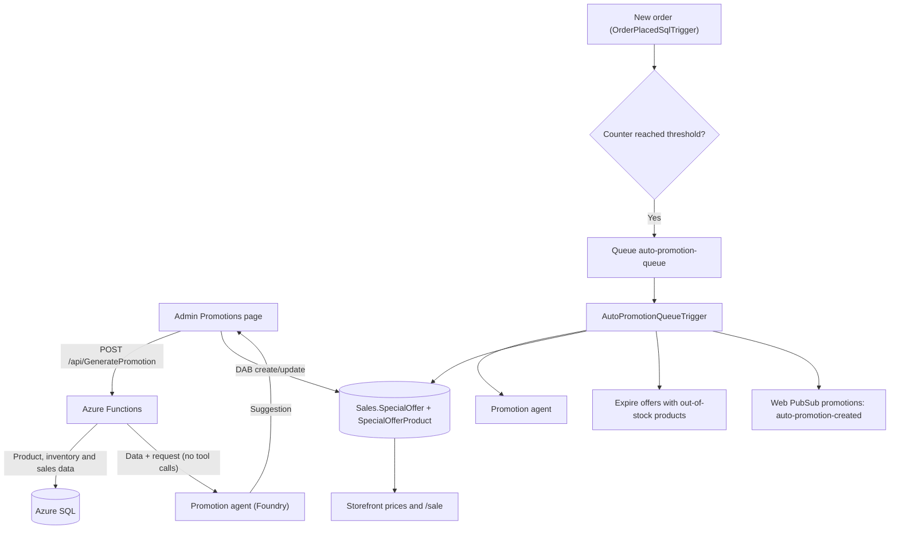

# Promotions, special offers and AI auto-promotions

Promotions are AdventureWorks special offers (`Sales.SpecialOffer`) linked to products (`Sales.SpecialOfferProduct`). Admins can create them by hand or with an AI promotion agent, and can let the system create promotions automatically as orders come in. The storefront applies active discounts to product prices and lists them on the **Sale** page.

## What it does

- **Promotions page** (`/promotions` in the admin app): create, edit, delete and assign products to special offers.
- **AI promotion wizard:** describe a promotion type and category; the agent proposes the discount, dates, description and products. Ask follow-up questions to refine it.
- **Translation:** translate a promotion description into the storefront languages.
- **Auto-promotions** (`/auto-promotions`): automatically create a promotion every N consumer or store orders.
- **Clearance promotions** from the admin **Reports** pages for overstocked items.
- **Storefront:** discounted prices on product cards and pages, plus the `/sale` page.

## Try it

- **UI:** in the admin app open **Promotions → Generate with AI**, or **Auto-promotions** to view the thresholds.
- **API** (read-only):

  ```bash
  python3 scripts/utilities/azure-auth.py request \
    --identity admin --resource functions --path /api/auto-promotion/config

  python3 scripts/utilities/azure-auth.py request \
    --identity admin --resource dab --path '/api/SpecialOffer?$first=5'
  ```

## How it works



### AI-generated promotions

`POST /api/GeneratePromotion` with `{ promotionType, offerCategory?, categoryId?, categoryName?, subcategoryId?, subcategoryName?, previousThreadId? }` loads live price, cost, inventory and recent-sales data for the target products (the same query as the MCP `get_products_for_promotion` tool) and sends it to the promotion agent, which returns a suggested promotion without calling tools. Pass the returned conversation ID back as `previousThreadId` to refine it ("make it 20%"). The admin then saves it with DAB. `POST /api/TranslatePromotion` translates the description.

### Auto-promotions

1. `OrderPlacedSqlTrigger` counts consumer (online) and store orders.
2. When a counter reaches its threshold, a job goes on `auto-promotion-queue`.
3. `AutoPromotionQueueTrigger` asks the promotion agent for a promotion across all products:
   - Consumer orders alternate between **Promotional Discount** and **Clearance** (offer category Customer).
   - Store orders create a **Volume Discount** (offer category Reseller).
4. It creates the special offer, assigns the suggested products, expires any offers whose products are out of stock and sends `auto-promotion-created`.

| Route | Purpose |
|---|---|
| `GET` / `PUT /api/auto-promotion/config` | `isEnabled`, `triggerOnConsumerOrders`, `triggerOnStoreOrders` and the two thresholds |
| `POST /api/auto-promotion/reset-counters` | Reset the order counters |

Auto-promotions are disabled by default; both thresholds default to 50 orders.

### MCP tools

| Tool | Scope | Use |
|---|---|---|
| `get_active_promotions` | `products.read` | Agents apply current discounts when planning orders |
| `get_products_for_promotion` | `admin.read` | Rank products for a promotion type (admin chat) |
| `get_overstock_items` | `manufacturing.read` (internal) | Find overstocked finished goods (clearance candidates) |

## Data & storage

| Data | Store |
|---|---|
| Offers and product links | `Sales.SpecialOffer`, `Sales.SpecialOfferProduct` (localized descriptions per culture) |
| Auto-promotion config and counters | Table `awAutoPromotionConfig` |
| Auto-promotion jobs | Queue `auto-promotion-queue` |

## Events (Web PubSub)

Group `promotions` (internal):

| Event | Meaning |
|---|---|
| `auto-promotion-created` | An automatic promotion was created |
| `database-changed` | `SpecialOffer` or `SpecialOfferProduct` changed |
| `state-changed` | Auto-promotion config or counters changed |

See [Web PubSub events](../../reference/webpubsub-events.md).

## Security

- Anonymous shoppers can read special offers through DAB; only internal roles can change them.
- `GeneratePromotion`, `TranslatePromotion`, `PUT auto-promotion/config` and `reset-counters` require `admin.write`; `GET auto-promotion/config` requires `admin.read`.

## Configuration

| Setting | Purpose |
|---|---|
| `AI_AGENT_PROMOTION_ID` | Promotion agent |
| `AI_AGENT_TRANSLATION_ID` | Promotion translation |

## Limits

- Each AI promotion is a model call; auto-promotions can add AI cost during long [shopping simulator](../simulators/shopping-simulator.md) runs.
- Storefront checkout discount codes (`SAVE10` and others) are separate demo codes; see [Cart and checkout](../commerce/cart-and-checkout.md).

## Related code & docs

- `api-functions/Functions/GeneratePromotionFunction.cs`, `TranslatePromotionDescriptions.cs`, `AutoPromotionControlFunction.cs`, `AutoPromotionQueueTrigger.cs`
- `api-functions/Services/PromotionAgentService.cs`, `AutoPromotionConfigService.cs`
- `app-admin/src/pages/PromotionsPage.tsx`, `AutoPromotionsPage.tsx`, `app-admin/src/components/GeneratePromotionWizardDialog.tsx`
- `app/src/pages/SalePage.tsx`
- [Foundry agents](../ai/foundry-agents.md) · [Localization](../i18n/localization.md)
