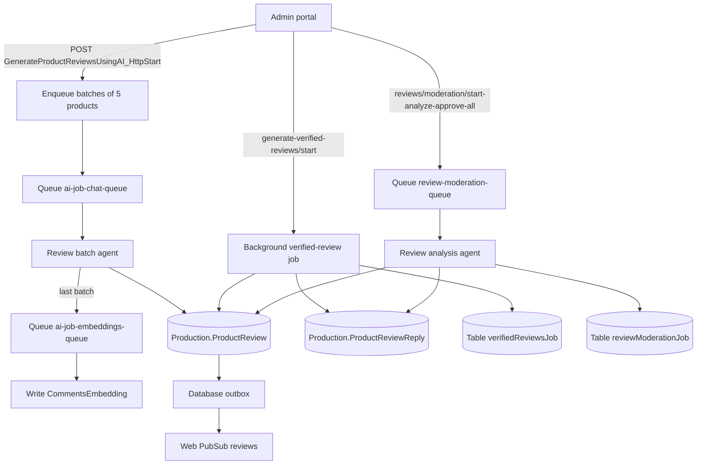

# Product reviews, AI review generation and moderation

Product pages show customer reviews with ratings, helpful votes and store replies. Shoppers can write reviews. Admins can fill the catalog with AI-generated reviews, moderate pending reviews with an AI agent and generate review embeddings so [semantic search](../search/semantic-search.md) can match review text.

## What it does

- **Storefront:** read reviews, write a review (signed in) and vote reviews helpful.
- **Random AI reviews:** generate playful reviews for many products in the background.
- **Verified-purchase reviews:** generate reviews only from customers whose orders for the product were delivered, with store replies to a share of them.
- **Per-product reviews with replies:** generate reviews and replies for one product.
- **AI moderation:** analyse every unmoderated review, write a store reply and mark it moderated.
- **Batch analysis:** analyse a set of reviews (sentiment and themes) on demand.
- **Review embeddings:** create `CommentsEmbedding` vectors for search.

## Try it

- **UI (customer):** open a product page and choose **Write a review**.
- **UI (admin):** open **Reviews** (`/reviews`) for moderation, or the verified-review wizard from the **Utilities** and product pages.
- **API (admin, read-only):**

  ```bash
  python3 scripts/utilities/azure-auth.py request \
    --identity admin --resource functions --path /api/generate-verified-reviews/summary

  python3 scripts/utilities/azure-auth.py request \
    --identity admin --resource functions --path /api/reviews/moderation/status
  ```

- **Script:** [`scripts/generators/generate-reviews-with-embeddings.sh`](../../../scripts/generators/generate-reviews-with-embeddings.sh) starts review generation and then embeddings. Both routes need an `admin.write` token.

## How it works



### Storefront

- Reviews are read with DAB GraphQL `productReviews`.
- A signed-in customer creates a review with DAB REST `POST /api/ProductReview`. The storefront sends the customer's `UserID`, and DAB's database policy rejects the request unless it matches the `business_entity_id` claim in the signed token.
- Helpful votes update `HelpfulVotes` with GraphQL `updateProductReview`; the browser remembers your votes in `localStorage`.

### Random AI reviews

`POST /api/GenerateProductReviewsUsingAI_HttpStart` (optional body `{ "productIds": [...] }`) enqueues one `review` job per 5 products on `ai-job-chat-queue` and returns immediately. The review batch agent writes 0–10 reviews per product with a random sentiment mix (mostly positive, mixed or mostly negative). When the last batch finishes, a `review-embeddings` job is queued automatically. Track the queues with `GET /api/ai-job-queue/status`.

### Verified-purchase reviews

| Route | Purpose |
|---|---|
| `GET /api/generate-verified-reviews/summary` | Products that qualify and the maximum eligible customers per product |
| `POST /api/generate-verified-reviews/start` | `{ productCount, reviewsPerProduct }` (`productCount: 0` = all) |
| `GET /api/generate-verified-reviews/status` | Progress (`processedCount`, `totalCount`) |
| `GET /api/products/{id}/eligible-reviewer-count` | Product-page gate |
| `GET /api/products/{id}/customers-with-delivered-orders` | Diagnostic list |
| `POST /api/products/{id}/generate-reviews-with-replies` | Reviews and replies for one product |

The job runs in the background and stores its state in the `verifiedReviewsJob` table. `ReviewJobWatchdog` runs every minute and ends jobs with no activity for 10 minutes.

### Moderation

`POST /api/reviews/moderation/start-analyze-approve-all` snapshots reviews that are not yet moderated and enqueues one message per review on `review-moderation-queue`. Each message runs the review analysis agent, inserts a `ProductReviewReply` and marks the review moderated. `GET /api/reviews/moderation/status` reports progress. `POST /api/reviews/analyze-batch` analyses a supplied list of reviews without changing them.

## Data & storage

| Data | Store |
|---|---|
| Reviews | `Production.ProductReview` (including `HelpfulVotes`, `IsModerated` and `CommentsEmbedding VECTOR(1536)`) |
| Store replies | `Production.ProductReviewReply` |
| Job state | Tables `verifiedReviewsJob`, `reviewModerationJob` |
| Queues | `ai-job-chat-queue`, `ai-job-embeddings-queue`, `review-moderation-queue` |

## Events (Web PubSub)

Group `reviews`:

| Event | Meaning |
|---|---|
| `generation-progress`, `generation-state-changed` | Verified-review job progress and state |
| `moderation-progress`, `moderation-state-changed` | Moderation progress and state |
| Terminal events (`changeType: "terminal"`) | A job finished, failed or expired |
| `database-changed` | `ProductReview` or `ProductReviewReply` changed |

See [Web PubSub events](../../reference/webpubsub-events.md).

## Security

- Anonymous users can read reviews; DAB hides the reviewer `EmailAddress` from anonymous reads.
- Customers can create reviews and change helpful votes through DAB role policies.
- Admin generation, moderation and embedding routes require `admin.write`; status and summary routes require `admin.read`. The `reviews` Web PubSub group is internal only.

See [DAB entities](../../reference/dab-entities.md) and [Functions route scopes](../functions-oauth/ROUTE_SCOPE_MATRIX.md).

## Configuration

| Setting | Agent |
|---|---|
| `AI_AGENT_REVIEW_BATCH_ID` | Random and per-product reviews, and store replies |
| `AI_AGENT_REVIEW_ID` | Verified-purchase reviews |
| `AI_AGENT_REVIEW_ANALYSIS_ID` | Moderation and batch analysis |

See [Foundry agents](../ai/foundry-agents.md).

## Limits

- Generated reviews are fictional demo content written in a deliberately playful tone.
- Verified reviews need delivered orders; run the [order pipeline](../commerce/order-lifecycle.md) or [shopping simulator](../simulators/shopping-simulator.md) first.
- New reviews are not searchable until review embeddings are generated.

## Related code & docs

- `app/src/hooks/useReviews.ts`
- `api-functions/Functions/GenerateProductReviewsUsingAI.cs`, `GenerateVerifiedReviewsFunction.cs`, `GenerateReviewsWithRepliesFunction.cs`, `ReviewModerationQueueFunction.cs`, `ReviewAnalysisFunction.cs`, `ReviewJobWatchdog.cs`, `AIJobProcessorFunction.cs`
- `api-functions/Services/ReviewService.cs`
- [Semantic search](../search/semantic-search.md) · [AI content generation](../ai/ai-content-generation.md)
