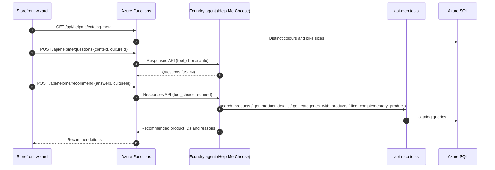

# Help Me Choose AI product wizard

Help Me Choose (`/help-me-choose`) is a guided shopping assistant on the storefront. An AI agent asks a few questions about how the shopper rides, then recommends specific products from the live AdventureWorks catalog with reasons.

## What it does

1. The shopper picks a starting point (for example, a bike or gear).
2. The agent generates tailored multiple-choice questions, using the live list of categories, colours and bike sizes.
3. The shopper answers, and the agent recommends products found with catalog search tools.
4. Results link to product pages; questions and results follow the selected language.

No sign-in is needed.

## Try it

- **UI:** open the storefront and choose **Help Me Choose**.
- **API:** the routes are public:

  ```bash
  FUNCS=$(azd env get-value API_FUNCTIONS_URL --no-prompt)
  curl -s "$FUNCS/api/helpme/catalog-meta"
  curl -s -X POST "$FUNCS/api/helpme/questions" -H 'Content-Type: application/json' \
    -d '{"context":"I want a bike for commuting","cultureId":"en"}'
  ```

  Each `questions` and `recommend` call runs the Foundry agent.

## How it works



- `HelpMeChooseService` caches a category and subcategory outline and passes `cultureId` and the shopper profile to the agent as structured inputs.
- Question generation may use tools; recommendations must use them, so every recommended product comes from the live catalog.
- Functions calls api-mcp with a workload token limited to `products.read`, and checks that the agent definition only uses the four public catalog tools listed above.

DAB also exposes a read-only `HelpMeChoose` view (`Production.vHelpMeChoose`, keys `CultureID` and `ProductID`) for catalog consumers.

## Data & storage

Read-only catalog data in `Production.*`. The wizard keeps answers only in the browser session; the public API does not store or resume agent conversations.

## Events (Web PubSub)

None.

## Security

- `/api/helpme/*` routes are public and anonymous.
- The agent's MCP access is restricted to public catalog tools with `products.read`; it cannot reach customer, order or internal tools. See [MCP tool scopes](../mcp-oauth/TOOL_SCOPE_MATRIX.md).

## Configuration

| Setting | Purpose |
|---|---|
| `AI_AGENT_HELP_ME_CHOOSE_ID` | Foundry agent definition |
| `MCP_SERVICE_URL` | api-mcp endpoint for catalog tools |
| `AI_FOUNDRY_PROJECT_ENDPOINT` | Foundry project |

## Limits

- Each questions or recommendation request is a model call, so responses take a few seconds and incur AI cost.
- The wizard's UI text (`helpme` locale namespace) is English-only; questions and recommendations are generated in the selected language.
- Recommendations are AI-generated and can vary between runs.

The storefront records `HelpMeChoose.ProfileCompleted` and `HelpMeChoose.ResultsViewed` telemetry events.

## Related code & docs

- `app/src/pages/HelpMeChoosePage.tsx`, `app/src/components/HelpMeChooseWizard.tsx`, `app/src/lib/helpMeService.ts`
- `api-functions/Functions/HelpMeChooseFunctions.cs`, `api-functions/Services/HelpMeChooseService.cs`, `FoundryAgentClient.cs`
- [Semantic search](semantic-search.md) · [Foundry agents](../ai/foundry-agents.md) · [AI chat](../ai/ai-chat.md)
