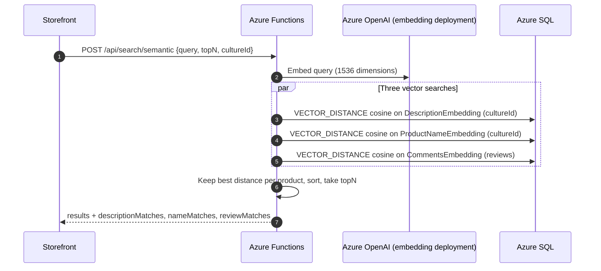

# AI semantic product search (vector embeddings)

The storefront search understands meaning, not just keywords: "something for muddy trails" finds mountain bikes and tyres. Azure Functions turns the query into an embedding and Azure SQL compares it with stored vectors for product names, descriptions and review comments.

## What it does

- **Search page** (`/search`): ranked results for a free-text query in the shopper's language.
- **Search suggestions:** up to 6 suggestions while typing.
- **Multilingual:** names and descriptions are matched in the selected culture.
- **AI agents:** the MCP `search_products` tool gives Foundry agents the same catalog search.
- **Embedding generation:** admin utilities create or refresh the vectors.

## Try it

- **UI:** type at least two characters in the storefront search box, then press Enter.
- **API:** semantic search is public:

  ```bash
  FUNCS=$(azd env get-value API_FUNCTIONS_URL --no-prompt)
  curl -s -X POST "$FUNCS/api/search/semantic" \
    -H 'Content-Type: application/json' \
    -d '{"query":"lightweight bike for long road rides","topN":5,"cultureId":"en"}'
  ```

- **Admin (read-only):**

  ```bash
  python3 scripts/utilities/azure-auth.py request \
    --identity admin --resource functions --path /api/ai-job-queue/status
  ```

- **Test script:** [`tests/scripts/test-search-suggestions.sh`](../../../tests/scripts/test-search-suggestions.sh).

## How it works



1. `POST /api/search/semantic` requires `query` and `cultureId`; `topN` defaults to 10.
2. The query embedding is compared in parallel with product descriptions, localized product names and review comments using `VECTOR_DISTANCE('cosine', …)` over `VECTOR(1536)` columns.
3. Results are merged by product, keeping the closest match, and sorted by distance.
4. The storefront `SearchPage` hides out-of-stock items and applies filters and sorting in the browser.

`GET /api/search/suggestions?q=` embeds the partial query and returns up to 6 suggestions from description and review matches. The storefront debounces input by 300 ms, waits for 2 characters and caches suggestions for 5 minutes.

The admin portal's **Search** page is a separate, client-side filter over DAB data.

### Generating embeddings

| Route | What it does |
|---|---|
| `POST /api/GenerateProductEmbeddings_HttpStart` | Queues a `product-embeddings` job on `ai-job-embeddings-queue` (descriptions); returns a `jobId` |
| `POST /api/GenerateProductReviewEmbeddings_HttpStart` | Queues a `review-embeddings` job; returns a `jobId` |
| `POST /api/GenerateProductNameEmbeddings` | Durable orchestration that embeds product names that have no vector yet; reports progress on `utilities` |
| `GET /api/ai-job-queue/status` | Queue depth for the AI job queues |

Seeded databases already include embeddings; see [seed data generation](../../operations/seed-data-generation.md).

## Data & storage

| Vector | Column |
|---|---|
| Descriptions | `Production.ProductDescription.DescriptionEmbedding` |
| Localized names | `Production.ProductName.ProductNameEmbedding` |
| Reviews | `Production.ProductReview.CommentsEmbedding` |

All are `VECTOR(1536)`. DAB also exposes the `ProductSearch` view (`Production.vProductSearch`, keys `ProductID` and `ProductDescriptionID`) for read access by every role.

## Events (Web PubSub)

Search itself has no events. The product-name embedding orchestration sends `utility-status-changed` on the internal `utilities` group; see [Web PubSub events](../../reference/webpubsub-events.md).

## Security

- `/api/search/semantic` and `/api/search/suggestions` are public and anonymous.
- Embedding generation routes require `admin.write`; `ai-job-queue/status` requires `admin.read`.
- MCP `search_products` requires `products.read`.

## Configuration

| Setting | Purpose |
|---|---|
| `AZURE_OPENAI_ENDPOINT` | Azure OpenAI / Foundry endpoint used for query embeddings |
| Deployment `embedding` | Embedding model deployment name (Bicep `embeddingDeploymentName`) |
| `embeddingDeploymentModelName` | Model chosen by the preup hook (prefers a "small" embedding model) |
| `SQL_CONNECTION_STRING` | Vector queries |

## Limits

- Every search and suggestion request calls the embedding model.
- Stored vectors and query vectors must come from the same embedding model. If you change the model, regenerate all embeddings.
- There is no keyword fallback; if the embedding call fails, search returns an error.
- New products or reviews are not found until their embeddings are generated.

### Troubleshooting

1. **HTTP 500 from `/api/search/semantic`:** check Application Insights for the Functions exception. The most common cause is the embedding deployment: confirm an Azure OpenAI deployment named `embedding` exists and has quota.
2. **Empty results:** confirm the embedding columns are populated (for example, run a DAB query against the `ProductSearch` view) and regenerate embeddings if needed.
3. **Wrong-language results:** pass the storefront culture (`en`, `fr`, `zh-cht`, …) as `cultureId`.

See [monitoring](../../operations/monitoring.md) for log queries.

## Related code & docs

- `api-functions/Functions/SemanticSearchFunction.cs`, `SearchSuggestionsFunction.cs`, `GenerateProductEmbeddings.cs`, `GenerateProductNameEmbeddings.cs`, `GenerateProductReviewEmbeddings.cs`, `AIJobProcessorFunction.cs`
- `api-functions/Services/AIService.cs`, `ProductService.cs`, `ReviewService.cs`
- `app/src/pages/SearchPage.tsx`, `app/src/hooks/useSemanticSearch.ts`, `useSearchSuggestions.ts`
- [Help Me Choose](help-me-choose.md) · [AI architecture](../../architecture/ai-architecture.md) · [MCP tools](../mcp-oauth/TOOL_SCOPE_MATRIX.md)
