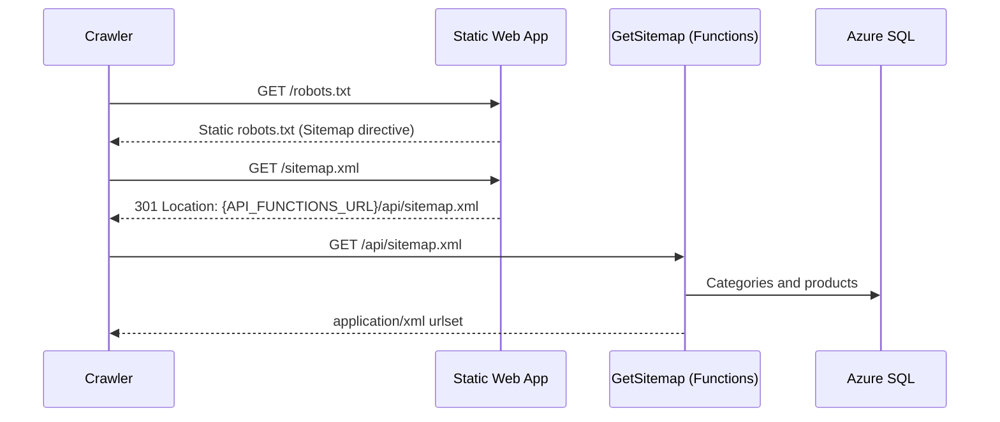

# SEO: meta tags, structured data, robots.txt and sitemap

## What it does

- Product and category pages set their own `<title>`, description, canonical URL, Open Graph and Twitter Card tags.
- Product pages embed **schema.org JSON-LD** (`Product` with an `Offer`, plus a `BreadcrumbList`), and category pages embed a `BreadcrumbList`, so search engines can show rich results.
- Catalog images load lazily and asynchronously with a pulse placeholder and fade-in, keeping pages responsive.
- `robots.txt` allows mainstream search engines and social previews, blocks common AI-training crawlers and excludes private or transient pages.
- `/sitemap.xml` is generated on demand from the live catalog by an anonymous Azure Function.

## Try it

```bash
APP=$(azd env get-value APP_URL --no-prompt)
FUNCS=$(azd env get-value API_FUNCTIONS_URL --no-prompt)

curl -s "$APP/robots.txt" | head -20
curl -sI "$APP/sitemap.xml" | grep -i '^location'      # 301 to the Functions sitemap
curl -s "$FUNCS/api/sitemap.xml" | head -30
```

Then open a product page and inspect the `<head>`: look for `og:title` and the `application/ld+json` script. Paste the URL into a rich-results or social-preview validator to see the rendered card.

For an end-to-end check of robots.txt, sitemap structure, content coverage and URL reachability, run [tests/scripts/test-robots-sitemap.sh](../../../tests/scripts/test-robots-sitemap.sh).

## How it works

### Page metadata

[SEO.tsx](../../../app/src/components/SEO.tsx) wraps `react-helmet-async` (the `HelmetProvider` is mounted in `main.tsx`). Pages render `<SEO title description image url type structuredData />`; omitted props fall back to site-wide defaults. [index.html](../../../app/index.html) provides baseline meta and Open Graph tags for pages that do not override them.

| Helper | Output |
|--------|--------|
| `generateProductStructuredData` | `Product` with name, description, image, SKU and an `Offer` (price, currency, `InStock`/`OutOfStock`) |
| `generateBreadcrumbStructuredData` | `BreadcrumbList` from the category path |

`ProductPage` and `CategoryPage` use the component. [OptimizedImage.tsx](../../../app/src/components/OptimizedImage.tsx) renders images with `loading="lazy"`, `decoding="async"` and descriptive `alt` text, and is used by product cards and the cart and checkout pages.

### Sitemap



1. The predeploy hook generates `app/staticwebapp.config.json` from [staticwebapp.config.template.json](../../../app/staticwebapp.config.template.json), substituting the deployed Functions URL into a `301` redirect for `/sitemap.xml`.
2. `GetSitemap` ([SitemapFunction.cs](../../../api-functions/Functions/SitemapFunction.cs)) builds a sitemap with static pages, every category and every product, using the request host as the base URL. Each entry includes `lastmod`, `changefreq` and `priority`.
3. In local development the Vite dev server proxies `/sitemap.xml` to the local Functions host on port 7071.

### Crawler policy

[app/public/robots.txt](../../../app/public/robots.txt) is deployed as a static file:

- **Allowed:** search engines (Googlebot, Bingbot, Slurp and others) and social-preview bots (Twitterbot, facebookexternalhit, LinkedInBot).
- **Blocked:** AI-training and scraping crawlers such as GPTBot, CCBot, Google-Extended, anthropic-ai, PerplexityBot and Bytespider.
- **Disallowed paths:** `/auth`, `/reset-password`, `/checkout`, `/order-confirmation`, `/account`, plus sort, filter and paging query variants to avoid duplicate content.

## Data & storage

The sitemap reads categories and products from Azure SQL through `ProductService` on each request. Meta tags and JSON-LD use data the page has already loaded from DAB. Nothing is persisted.

## Events (Web PubSub)

None. The sitemap is generated per request, so catalog changes appear on the next crawl.

## Security

- `GET /api/sitemap.xml` is a public, anonymous route that exposes only catalog data already visible on the storefront.
- robots.txt excludes account, checkout and password-reset pages from indexing; these pages also require sign-in or a reset token where applicable.

## Configuration

| Setting | Purpose |
|---------|---------|
| `API_FUNCTIONS_URL` | Substituted into the SWA sitemap redirect by `scripts/hooks/predeploy.sh` |
| `app/public/robots.txt` | Static crawler rules and `Sitemap:` directive; edit and redeploy the storefront to change them |
| `SEO.tsx` defaults | Site-wide title, description and share image |

## Limits

- The storefront is a client-rendered SPA: crawlers that do not execute JavaScript see only the baseline tags from `index.html`.
- robots.txt and the canonical URL in `index.html` are static and are not rewritten per environment.
- Only product and category pages set page-specific metadata; other routes use the defaults.
- JSON-LD prices are emitted in USD regardless of the shopper's selected display currency.

## Related code & docs

- [SEO.tsx](../../../app/src/components/SEO.tsx), [OptimizedImage.tsx](../../../app/src/components/OptimizedImage.tsx), [index.html](../../../app/index.html), [robots.txt](../../../app/public/robots.txt)
- [SitemapFunction.cs](../../../api-functions/Functions/SitemapFunction.cs), [staticwebapp.config.template.json](../../../app/staticwebapp.config.template.json), [vite.config.ts](../../../app/vite.config.ts)
- [test-robots-sitemap.sh](../../../tests/scripts/test-robots-sitemap.sh)
- [Catalog and browsing](../commerce/catalog-and-browsing.md) · [Storefront app](../../apps/storefront.md) · [Functions routes](../../reference/functions-routes.md)
