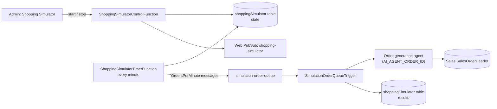

# Shopping simulator

## What it does

The shopping simulator keeps the store busy. While it runs, a timer queues orders every minute and an AI order-generation agent turns each one into a realistic sales order: it chooses or creates a customer, picks products and places the order through the normal order pipeline. Orders then flow through approval, warehouse picking, shipping and delivery, and can trigger the [manufacturing agent](../manufacturing/manufacturing-agent.md).

The simulator always stops after its configured duration.

## Try it

**UI:** in the Admin portal open **Utilities → Shopping Simulator** (`/shopping-simulator`). Set the rate, duration and customer mix, then select **Start**. Live statistics and the results feed update as orders are placed.

**API:**

```bash
python3 scripts/utilities/azure-auth.py request --identity admin \
  --resource functions --path /api/shopping-simulator/status

python3 scripts/utilities/azure-auth.py request --identity admin \
  --resource functions --path /api/shopping-simulator/start --method POST \
  --data '{"ordersPerMinute": 1, "durationHours": 1}'

python3 scripts/utilities/azure-auth.py request --identity admin \
  --resource functions --path /api/shopping-simulator/stop --method POST
```

Each order is an AI call. Start with a low rate and a short duration.

## How it works



1. The timer runs every minute. If the simulator is running and has not passed its end time, it queues `OrdersPerMinute` messages; otherwise it stops the simulator.
2. Each message has an **order mode**:

   | Mode | Customer |
   |---|---|
   | `b2b-store` | A reseller store, ordering replenishment based on its purchase history and stock |
   | `existing-repeat` | A top-spending existing customer |
   | `cart-recovery` | An existing customer with an abandoned cart |
   | `new-persona` | A new customer created from a random persona |
   | `no-order-customer` | A registered customer with no orders, drawn to sale items |

3. The queue trigger asks the order-generation agent for a structured order plan, validates it and places the order. Every attempt is saved as a result. Only the plan's product ids and quantities are used: duplicate products are merged, quantities are clamped to 1–10 and to Finished Goods stock, and products without a positive list price are skipped. Any AI-suggested price or offer is ignored.
   - **Consumer orders** go through the same server-side checkout as the storefront (`CheckoutService`): list price plus the best active `Customer` offer, tax from the ship-to address, freight from the cheapest ship method and the ship-to currency rate, written in one transaction. As with storefront checkout, stock is not decremented when the order is created.
   - **Store orders** use the same catalogue price query and line-pricing rules with the best active `Reseller` offer (see [B2B store orders](../commerce/order-lifecycle.md#b2b-store-orders-and-ai-orders)).
4. Queue processing scales out on Flex Consumption. At 60 orders per minute the queue fills faster than AI processing drains it.

### Configuration options

| Option | Default | Range |
|---|---|---|
| `OrdersPerMinute` | 1 | 1–60 |
| `DurationHours` | 24 | 1–72 |
| `IncludeConsumerOrders` | true | — |
| `IncludeStoreOrders` | true | at least one order type must be on |
| `StoreOrderPercentage` | 20 | 5–50 (share of slots when both types are on) |
| `ExistingCustomerPercentage` | 30 | share of consumer slots |
| `AbandonedCartPercentage` | 10 | share of existing-customer slots |
| `NoOrderCustomerPercentage` | 50 | share of new-customer slots |

### Results and failure codes

`GET shopping-simulator/results?limit=` (1–100, default 50) returns the latest results. A failed plan is saved with a failure code:

`empty_response`, `invalid_json`, `missing_customer_mode`, `invalid_customer_mode`, `unexpected_customer_mode`, `missing_customer_identity`, `both_customer_modes_present`, `seed_customer_mismatch`, `existing_customer_not_found`, `invalid_new_customer_payload`, `invalid_store_customer_payload`, `no_planned_items`, `no_valid_ai_planned_items`, `duplicate_customer_email` (a generated new customer's email already belongs to another person), `checkout_rejected` (server-side checkout refused the order, for example a customer without a person record), `model_capacity` (the Foundry model deployment was still throttling after retries; the admin `GenerateOrderWithAI` route returns 503 with `Retry-After`), `unhandled_error`, and `processing-exception` for errors in the queue trigger.

Unhandled queue exceptions are rethrown so the Functions runtime retries them and eventually moves them to the poison queue.

### Routes

| Route | Scope | Purpose |
|---|---|---|
| `GET shopping-simulator/status` | `admin.read` | State, counters and end time |
| `POST shopping-simulator/start` | `admin.write` | Start with a configuration |
| `POST shopping-simulator/stop` | `admin.write` | Stop now |
| `GET shopping-simulator/results?limit=` | `admin.read` | Recent results |
| `POST shopping-simulator/clear-queue` | `admin.write` | Remove queued messages |
| `POST simulation/orders/start` | `admin.write` | Queue a one-off batch: `{count (1–500), customerId?, personaHint?}` |

## Data & storage

| Store | Contents |
|---|---|
| Table `shoppingSimulator` | Row `state` (configuration, counters, end time) and partition `results` |
| Queue `simulation-order-queue` (+ poison) | Pending order requests |
| SQL `Sales.*`, `Person.*` | Orders and any new customers |

## Events

Group `shopping-simulator`: `simulator-started`, `simulator-stopped`, `queue-cleared` and `state-changed`. The Admin portal refreshes the simulator page and invalidates orders, customers, dashboard statistics and customer statistics. Placed orders also raise `orders` events through the order pipeline.

## Security

Admin routes need `admin.read` / `admin.write` (executive-admin role). Generated customers and orders are normal database records.

## Configuration

| Setting | Purpose |
|---|---|
| `AI_AGENT_ORDER_ID` | Order-generation agent; required for all order modes |
| `ORDER_NOTIFICATIONS_EMAIL_ENABLED` | Leave unset to log notification emails instead of sending them |

## Limits

- There is no random-order fallback: if the order agent is unavailable, attempts are recorded as failures.
- Web PubSub Free tier limits (20 concurrent connections, 20K messages per day) can be reached during long, high-rate runs.
- `POST /api/simulators/reset` stops the simulator and clears its queue and counters; see [simulator controls](simulator-controls.md).

## Related code & docs

- `api-functions/Functions/ShoppingSimulatorControlFunction.cs`, `ShoppingSimulatorTimerFunction.cs`, `SimulationOrderQueueTrigger.cs`
- `api-functions/Services/ShoppingSimulatorService.cs`, `OrderGenerationAgentService.cs`, `api-functions/Models/ShoppingSimulatorState.cs`
- `app-admin/src/pages/ShoppingSimulatorPage.tsx`
- [Order lifecycle](../commerce/order-lifecycle.md) · [Foundry agents](../ai/foundry-agents.md)
