# Supply chain

## What it does

The supply chain simulation lets you buy components from the 63 AdventureWorks vendors. You can browse vendors and their catalogs, get a quote, place a purchase order and watch it move through approval and delivery. Delivered stock is added to inventory, which can unblock a production shortage.

Purchase orders are real `Purchasing.PurchaseOrderHeader` rows; the order ID is the `PurchaseOrderID`.

## Try it

**UI:** in the Manufacturing portal open **Supply** (`/supply`). Open a vendor (`/supply/vendors/:vendorId`), a product's orders (`/supply/product/:productId`) or a purchase order (`/supply/orders/:orderId`). Adjust delivery speed in **Settings → Supply Chain Timing**.

**API:**

```bash
python3 scripts/utilities/azure-auth.py request --identity manufacturing \
  --resource functions --path /api/supply/vendors

python3 scripts/utilities/azure-auth.py request --identity manufacturing \
  --resource functions --path '/api/supply/quote?productId=1&qty=10'

python3 scripts/utilities/azure-auth.py request --identity manufacturing \
  --resource functions --path /api/supply/order --method POST \
  --data '{"vendorId": "1580", "productId": 1, "qty": 10}'
```

`vendorId` is the vendor's `BusinessEntityID` as a string. Use a vendor and quantity from the quote response, which respects the vendor's minimum and maximum order quantities.

## How it works

```mermaid
stateDiagram-v2
    [*] --> Pending: "POST supply/order"
    Pending --> Approved: "after 5 sim-minutes; bank debit"
    Pending --> Rejected: "cancelled"
    Approved --> Complete: "delivered (reliability roll passed)"
    Approved --> Rejected: "failed reliability roll; refund"
    Complete --> [*]
    Rejected --> [*]
```



| Status | Value | Meaning |
|---|---|---|
| Pending | 1 | Order placed, awaiting approval |
| Approved | 2 | Vendor accepted; `TotalDue` debited from the USD bank account |
| Rejected | 3 | Cancelled while pending, or delivery failed the vendor reliability roll (refunded as `PO-{id}-refund`) |
| Complete | 4 | Delivered |

State transitions run on `supply-chain-orders-queue` using visibility delays (`PurchaseOrderProcessorFunction`).

### Vendors and pricing

Vendor reliability and restock time come from `Vendor.CreditRating`:

| CreditRating | Reliability | Restock time (sim-hours) |
|---|---|---|
| 1 | 97% | 4 |
| 2 | 90% | 8 |
| 3 | 83% | 16 |
| 4 | 73% | 30 |
| 5 | 65% | 48 |

- **Price** = `StandardPrice × qty + ShipBase + weight × ShipRate × qty`, using one of ship methods 1–5.
- **Quantity limits** and **lead time** come from `Purchasing.ProductVendor` (`MinOrderQty`, `MaxOrderQty`, `AverageLeadTime`).
- **Vendor stock** is simulated in Table Storage and restocks automatically after each delivery, or on demand with `POST supply/restock/{vendorId}`.

### Timing

```text
deliverySeconds = leadTimeDays × 86400 / (SIMULATION_TIME_SCALE_FACTOR × speedMultiplier)
```

The speed multiplier is 1–50 (default 15) and is set with `PUT supply/config` or **Settings → Supply Chain Timing**.

### On delivery

1. Quantity is added to `Production.ProductInventory` at location 7 (finished goods storage).
2. `ProductVendor.LastReceiptCost` / `LastReceiptDate` are updated and a `ProductCostHistory` row is written.
3. A `ReceiveSupplier` operation is queued for the [warehouse](../warehouse/warehouse-operations.md).
4. A vendor restock is queued after the vendor's restock delay.

### First use

`SimulationMaintenance_Timer` on host start, the first `supply/*` write or `POST supply/initialize` prepares the simulation (reads never initialize it): it resolves seeded purchase orders still in status 2, seeds vendor stock and injects about 236 pending seed orders staggered one second apart.

Products sold only at retail join the vendor catalog through top-level BOM rows in `seed-job/sql/BillOfMaterials-ai.csv`.

### Routes

All are under `/api/supply/`. Reads need `manufacturing.read`; writes need `manufacturing.write`.

| Route | Purpose |
|---|---|
| `GET vendors`, `GET vendors/{vendorId}` | Vendors with reliability and stock |
| `GET catalog`, `GET catalog/{productId}` | Purchasable products and vendors |
| `GET quote?productId=&qty=&vendorId=` | Price and delivery estimate |
| `POST order` | Place a purchase order |
| `DELETE order/{orderId}` | Cancel a pending order |
| `POST reorder-all` | Reorder every short component |
| `POST restock/{vendorId}` | Restock a vendor now |
| `POST initialize` | Run first-use initialization |
| `GET`, `PUT config` | Speed multiplier |

### MCP tools

`get_supply_chain_vendors`, `get_vendor_details`, `get_supply_catalog`, `get_supply_quote`, `get_active_supply_orders`, `get_supply_order_history`, `get_supply_order_details` (`manufacturing.read`); `place_supply_order`, `cancel_supply_order`, `restock_vendor_inventory`, `propose_supply_order` (`manufacturing.write`).

## Data & storage

| Store | Contents |
|---|---|
| SQL `Purchasing.PurchaseOrderHeader` / `PurchaseOrderDetail` | Orders |
| SQL `Purchasing.Vendor`, `ProductVendor` | Vendors, prices, lead times |
| SQL `Production.ProductInventory`, `ProductCostHistory` | Received stock and costs |
| Table `awSupplyChain` (partition `stock`) | Vendor stock and config |
| Queue `supply-chain-orders-queue` | Delayed state transitions and restocks |
| Bank (`awBankTransactions`) | Purchase debits and refunds |

## Events

Group `supply-chain`: `po-created` (one event for `reorder-all`), `po-status-changed` (coalesced), `state-changed` and `database-changed`. The Manufacturing portal invalidates its supply queries.

## Security

`manufacturing.read` / `manufacturing.write` (manufacturing-engineer role). Hosted-agent calls to `place_supply_order` also need mode 3; see [manufacturing agent](../manufacturing/manufacturing-agent.md).

## Configuration

| Setting | Default |
|---|---|
| `SIMULATION_TIME_SCALE_FACTOR` | See [production simulation](../manufacturing/production-simulation.md) |
| Speed multiplier (`PUT supply/config`) | 15 (1–50) |

## Limits

- Purchases always post to the USD bank account; balances can go negative.
- An order can be at most 32,767 units (the per-SKU inventory limit).
- `POST /api/simulators/reset` returns resolved seed orders to Approved and re-seeds vendor stock; orders you placed are kept. See [simulator controls](../simulators/simulator-controls.md).

## Related code & docs

- `api-functions/Functions/SupplyChainControlFunction.cs`, `PurchaseOrderProcessorFunction.cs`, `api-functions/Services/SupplyChainService.cs`
- `api-mcp/AdventureWorks/Tools/SupplyChainMcpTools.cs`
- `app-manufacturing/src/pages/supply/`
- [Bank simulator](../finance/bank-simulator.md) · [Warehouse operations](../warehouse/warehouse-operations.md)
