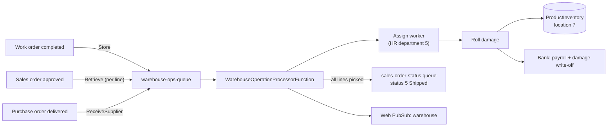

# Warehouse operations

## What it does

The warehouse sits between production, sales and purchasing. It has no start or stop control: it reacts to work arriving on `warehouse-ops-queue`.

| Operation | Triggered by | Effect |
|---|---|---|
| **Store** | A manufacturing work order completes | Finished goods are put away into inventory |
| **Retrieve** | A sales order is approved | Each line is picked; when every line is picked, the order is released to Shipped (status 5) |
| **ReceiveSupplier** | A purchase order is delivered | Supplier goods are inspected and put away |

Each operation is assigned a warehouse worker, takes a simulated amount of time, may damage some units and posts its costs to the bank.

## Try it

**UI:** in the Manufacturing portal open **Warehouse** (`/warehouse`), **Warehouse → Floor** (`/warehouse/floor`), **Workforce** (`/warehouse/workforce`) or **Config** (`/warehouse/config`). Start a [production run](../manufacturing/production-simulation.md) or the [shopping simulator](../simulators/shopping-simulator.md) to generate work.

**API:**

```bash
python3 scripts/utilities/azure-auth.py request --identity manufacturing \
  --resource functions --path /api/warehouse/status

python3 scripts/utilities/azure-auth.py request --identity manufacturing \
  --resource functions --path /api/warehouse/active

python3 scripts/utilities/azure-auth.py request --identity manufacturing \
  --resource functions --path /api/warehouse/damage-events
```

## How it works



1. `SimulationMaintenance_Timer` on host start, the first operation or `POST warehouse/initialize` seeds the worker pool from `HumanResources` department 5 and default handling, receiving and damage configuration.
2. Handling time is drawn from the product subcategory's minimum and maximum minutes. Items heavier than 5 kg take proportionally longer. Supplier receipts add inspection time.
3. Damage is rolled per operation. Damaged units are removed from the quantity, recorded as a damage event and written off at standard cost.
4. Inventory changes apply to location 7. Quantities are clamped to 32,767 per SKU.
5. Payroll is `duration hours × worker hourly rate`, posted to the USD bank account as `payroll`; damage write-offs are also posted.
6. For Retrieve operations, the warehouse tracks picks per order and queues status 5 on `sales-order-status` once all lines are picked. See [order lifecycle](../commerce/order-lifecycle.md).

### Default damage rates

| Operation | Rate | Reasons |
|---|---|---|
| Store | 2.0% | Dropped, forklift impact, crushed by stacking, water/moisture |
| Retrieve | 1.5% | Dropped, crushed, caught on racking, water/moisture |
| Receive | 4.0% | Crushed, caught on racking, packaging failure, water/moisture, temperature, label damaged |

Change them with `PUT warehouse/damage-config/{operationType}`.

### Routes

All are under `/api/warehouse/`. Reads need `manufacturing.read`; writes need `manufacturing.write`.

| Route | Purpose |
|---|---|
| `GET status` | Summary counts and today's metrics |
| `GET active` | Operations in progress |
| `GET workforce`, `GET workforce/detail` | Worker pool and assignments |
| `GET metrics` | Daily throughput |
| `GET damage-events` | Damage audit trail, newest first |
| `GET`, `PUT subcategory-config/{id}` | Store/retrieve minutes per subcategory |
| `GET`, `PUT supplier-receive-config/{id}` | Receive and inspection minutes |
| `GET`, `PUT damage-config/{operationType}` | Damage rate and reasons |
| `POST initialize` | Seed configuration and workforce |

## Data & storage

| Store | Contents |
|---|---|
| Table `awWarehouse` | Partitions `subcategoryconfig`, `supplierreceiveconfig`, `damageconfig`, `workforce`, `activeop`, `damageevent`, `metrics`, `ordertracking` |
| Queue `warehouse-ops-queue` (+ poison) | Pending operations |
| Queue `sales-order-status` | Shipped release for picked orders |
| SQL `Production.ProductInventory`, `Production.TransactionHistory` | Stock and inventory movements |
| Bank `awBankTransactions` | Payroll and damage write-offs |

## Events

Group `warehouse`: `config-changed`, `operation-completed` (coalesced), `inventory-updated` (sent when a work-order operation finishes), `state-changed` and `database-changed`.

- The Manufacturing portal invalidates its warehouse queries.
- The Admin portal refreshes transaction history, product transaction history, inventory by category and dashboard statistics.

## Security

Routes need `manufacturing.read` or `manufacturing.write`. Real-time subscribers receive the `warehouse` group only when their token has `realtime.connect`, `inventory.read` or `manufacturing.read`, and an internal user category.

## Configuration

`SIMULATION_TIME_SCALE_FACTOR` converts simulated minutes into real delays; see [production simulation](../manufacturing/production-simulation.md).

## Limits

- Per-SKU inventory cannot exceed 32,767 units.
- Bank posting failures are logged and do not block the warehouse operation.

## Related code & docs

- `api-functions/Functions/WarehouseFunction.cs`, `WarehouseOperationProcessorFunction.cs`, `api-functions/Services/WarehouseService.cs`
- `app-manufacturing/src/pages/warehouse/`
- [Supply chain](../supply-chain/supply-chain.md) · [Bank simulator](../finance/bank-simulator.md) · [Real-time eventing](../../architecture/realtime-eventing.md)
