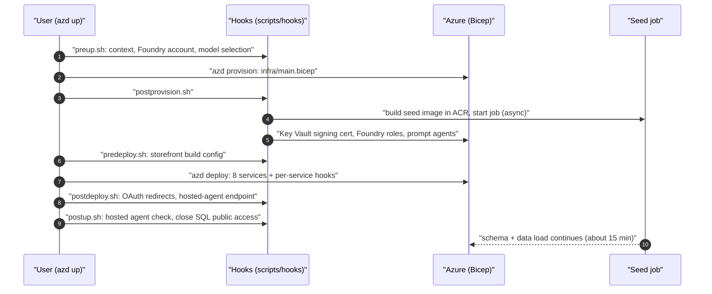

# Deployment lifecycle

The demo is deployed with the Azure Developer CLI (azd). One `azd up` provisions the Bicep infrastructure, runs Bash lifecycle hooks and deploys eight services. The database seed job then keeps running asynchronously. Every environment is a disposable demo, and there is no production environment.

## Who may run what

| Command | Who | Notes |
| --- | --- | --- |
| `azd deploy --no-prompt` (optionally `azd deploy <service> --no-prompt`) | Users and agents | Redeploys source changes to existing infrastructure, then runs the deploy hooks |
| `azd env get-value KEY --no-prompt` | Users and agents | Read only the values you need; do not dump the environment |
| `azd provision`, `azd up`, `azd down`, environment recreation | **User only** | Infrastructure changes and fresh databases take a long time and delete data |

Fix problems in source code, Bicep, seed scripts or hooks, then redeploy. Do not patch Azure resources, app settings or the database by hand, and do not start repair jobs. This is the [demo/POC policy](../../.github/copilot-instructions.md#azure-environment-policy-demopoc-only). If a change needs new infrastructure or a fresh database, ask the user to [recreate the environment](#recreating-the-environment).

Before the first deployment, the deploying identity needs Contributor plus a constrained role-assignment permission. See [Deployer permissions](../AZD_DEPLOYER_PERMISSIONS.md). For Windows, see [Deploying from Windows with WSL](wsl-deployment.md).

## Lifecycle overview



## Hook details

All hooks are Bash scripts declared in [`azure.yaml`](../../azure.yaml). See the [scripts reference](../reference/scripts.md) for each one.

### 1. `preup.sh`

[`scripts/hooks/preup.sh`](../../scripts/hooks/preup.sh) does the following:

- Persists the subscription, environment name and the signed-in user's object ID (`OBJECT_ID`).
- Removes conflicting Foundry role assignments left by earlier runs.
- Sets `SKIP_LOCAL_DEV_ROLE_ASSIGNMENTS=false`.

If the model selections are already stored in the azd environment, it exits at this point. Otherwise it continues:

- Sets the resource group to `rg-<env>` and validates `FOUNDRY_LOCATION`.
- Defaults `SQL_DATABASE_NAME` to `AdventureWorks`.
- Creates the resource group and the Foundry account, which Bicep later adopts.
- Selects models from regional availability and quota:
  - **Chat model:** influenced by `CHAT_MODEL_NAME_REGEX`, `CHAT_MODEL_COST_TIER` (`economy`, `balanced` or `premium`) and `CHAT_MODEL_MIN_CAPACITY`.
  - **Embedding model:** prefers a "small" model.
  - **Image model:** optional; only `gpt-image-2` is selected.

To skip discovery, set every model value yourself before running `azd up`.

### 2. Provision

`azd provision` deploys [`infra/main.bicep`](../../infra/main.bicep). [`infra/main.parameters.json`](../../infra/main.parameters.json) maps azd environment values to Bicep parameters. For the resources it creates, see [Azure resources](../reference/azure-resources.md) and [Networking](../architecture/networking.md).

### 3. `postprovision.sh`

[`scripts/hooks/postprovision.sh`](../../scripts/hooks/postprovision.sh) runs these steps in order:

1. Reconciles runtime role assignments with `scripts/utilities/reconcile-runtime-rbac.py --apply`.
2. Stores the `VITE_*` frontend URLs.
3. In the background, runs `git lfs pull`, builds `seed-job:latest` with `az acr build`, and updates the job with `SEED_SKIP_EXISTING=true`.
4. Checks Aspire Dashboard permissions. Problems produce a warning only.
5. Opens a temporary Key Vault IP rule and grants Certificates Officer, then creates the `mcp-signing` certificate if it is missing.
6. Runs a legacy-only SQL step. It applies only when the SQL server still has public access: it adds a client firewall rule, runs `assign-database-roles.sql` and enables Change Tracking. Private-only servers skip this step. On current deployments, runtime SQL grants are created by the seed job instead.
7. Starts the seed job asynchronously with `seed-job-execution.sh`.
8. Grants Foundry project roles, then waits for propagation.
9. Creates or updates the prompt agents with `create-foundry-agents.sh`, refreshes the environment and stores `FOUNDRY_AGENT_CONFIG_HASH`.

### 4. `predeploy.sh`

[`scripts/hooks/predeploy.sh`](../../scripts/hooks/predeploy.sh) prepares the storefront build. It writes these values to `app/.env.production`:

- `VITE_API_URL`
- `VITE_API_FUNCTIONS_URL`
- `VITE_API_MCP_URL`
- `VITE_APPINSIGHTS_CONNECTIONSTRING`

It then removes `app/dist` and renders `app/staticwebapp.config.json` from its template.

### 5. Service deployment

| Service | Host | How it deploys | Service hook |
| --- | --- | --- | --- |
| `api` (DAB) | Container Apps | Remote build in ACR | `api-postdeploy.sh` re-applies DAB settings |
| `api-functions` | Functions Flex Consumption | Direct publish, no container image | `api-functions-postdeploy.sh` sets agent IDs, `MCP_SERVICE_URL` and `MANUFACTURING_AGENT_ENDPOINT` |
| `api-mcp` | Container Apps | Remote build in ACR | — |
| `app` (storefront) | Static Web Apps | Local `npm install && bash scripts/build-with-env.sh`, then upload | `app-postdeploy.sh` |
| `app-admin`, `app-manufacturing` | Container Apps | Remote build in ACR | — |
| `mcp-inspector` | Container Apps | Remote build in ACR | — |
| `manufacturing-agent` | Foundry hosted agent (`azure.ai.agent`) | Requires the `azure.ai.agents` azd extension | — |

### 6. `postdeploy.sh`

[`scripts/hooks/postdeploy.sh`](../../scripts/hooks/postdeploy.sh) runs these steps:

1. Publishes `AGENT_MANUFACTURING_AGENT_RESPONSES_ENDPOINT` as `MANUFACTURING_AGENT_ENDPOINT`. A service-scoped `azd deploy` (or an environment rebuilt by `recover-azd-env.py`) doesn't republish the hosted agent output. In that case the hook reuses the `MANUFACTURING_AGENT_ENDPOINT` value from the earlier deployment, and the next step still checks the agent live in Foundry. It warns only when neither value exists.
2. Applies the hosted-agent MCP trust settings.
3. Configures the api-mcp OAuth redirect URIs (`OAUTH_*_REDIRECT_URIS`) for the deployed app URLs.
4. Recreates the prompt agents if their configuration hash changed.
5. Runs `api-functions-postdeploy.sh` again so the Functions agent settings match.

### 7. `postup.sh`

[`scripts/hooks/postup.sh`](../../scripts/hooks/postup.sh) does the following:

- Deploys `manufacturing-agent` if no endpoint has been recorded.
- Disables SQL public network access and removes the temporary client firewall rule.
- Prints the service URLs and the seed status.

## After `azd up` returns

The seed job keeps running for roughly 15 minutes. Until it finishes, pages may show empty or partial data. You can check progress in any of these ways:

- Open the storefront `/health` page. It reads the Functions `GET /api/seed/status` route. See [Health diagnostics](../features/monitoring/HEALTH_DIAGNOSTICS.md).
- Run the read-only command `az containerapp job execution list --name <seed-job-name> --resource-group <resource-group>`. Get the names with `azd env get-value SERVICE_SEED_JOB_NAME --no-prompt` and `azd env get-value AZURE_RESOURCE_GROUP --no-prompt`.
- Run `bash scripts/utilities/list-app-urls.sh` to print the app URLs again.

Then run the read-only deployment check `bash tests/scripts/test-health-diagnostics.sh`. For more test suites, see [Testing strategy](../testing/testing-strategy.md).

## Redeploying a change

```bash
azd deploy --no-prompt                 # all services, including hooks
azd deploy api-functions --no-prompt   # one service
```

`azd deploy` re-runs `predeploy.sh`, the service hooks and `postdeploy.sh`. It does not re-run `postprovision.sh` or the seed job. Changes that need any of these require a user-run recreation:

- schema or seed changes
- new storage queues or tables
- new role assignments
- SKU or networking changes

## Environments created by GitHub Actions

The [service-principal workflow](ci-cd.md#deploy-workflow) runs `azd up` on a GitHub runner, so the local machine has no azd environment for it. Rebuild one from the latest successful `main.bicep` deployment outputs:

```bash
python3 scripts/utilities/recover-azd-env.py --environment adventureworks042 --dry-run
python3 scripts/utilities/recover-azd-env.py --environment adventureworks042
```

`--subscription`, `--resource-group` and `--skip-app-settings` are optional. See the [workflow README](../../.github/workflows/README.md#recreate-the-local-azd-environment-after-a-github-deployment).

## Recreating the environment

Recreate the environment when a change needs:

- new infrastructure
- a fresh database or seed data
- fresh Durable Functions state

Recreation **permanently deletes the current demo environment and its data**. It is a **user-run command only**; agents must not run it.

```bash
OLD_ENV=$(azd env get-value AZURE_ENV_NAME) && OLD_SUB=$(azd env get-value AZURE_SUBSCRIPTION_ID) && NEW_ENV="adventureworks$((RANDOM % 900 + 100))" && azd down --force --purge --no-prompt && azd env remove "$OLD_ENV" --no-prompt --force && azd env new "$NEW_ENV" --no-prompt && azd env set AZURE_SUBSCRIPTION_ID "$OLD_SUB" && azd env set AZURE_LOCATION "eastus2" && azd env set FOUNDRY_LOCATION "swedencentral" && azd up --no-prompt
```

After the deployment completes and the asynchronous seed job succeeds, re-read the needed azd outputs and validate the new deployment.

## Related

- [CI/CD workflows](ci-cd.md)
- [Troubleshooting](troubleshooting.md)
- [Seed job](../services/seed-job.md)
- [Environment variables](../reference/environment-variables.md)
- [Monitoring](monitoring.md)
