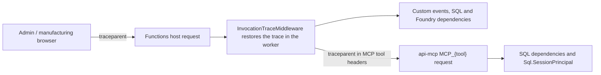
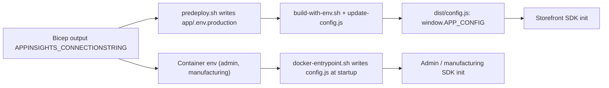

# Monitoring and telemetry

AdventureWorks configures one solution-wide workspace-based Application Insights resource (`av-appinsights-<token>`). Configuration is not proof of export or ingestion: service roles, timestamps, sampling and source failures determine observed coverage. The protected admin `/monitoring` dashboard complements readiness, not replaces it. Snapshot reads are pure; explicit capture controls mutate bounded control metadata. Fix problems in source/IaC and follow the [demo deployment policy](deployment.md), never repair Azure in place. See the [signal contract](../reference/telemetry-contract.md) and [validation walkthrough](../testing/OBSERVABILITY_VALIDATION.md).

## Resources

### Protected snapshots and capture controls

| Route | Scope | Contract |
| --- | --- | --- |
| `GET /api/monitoring/summary?range=1h` | `monitoring.read` | Ranges `1h` (default), `6h`, `24h`; fixed server-owned queries only |
| `GET /api/monitoring/traces/{traceId}` | `monitoring.read` | Lower-case 32-character W3C ID; last 24 hours, at most 100 projected spans |
| `GET /api/monitoring/capture` | `monitoring.read` | Pure read; at most 100 recent control grants |
| `POST /api/monitoring/capture` | `monitoring.write` | `{"scopeType":"session" or "job","scopeId":"stable-id"}`; fixed 15 minutes / 100 roots |
| `DELETE /api/monitoring/capture/{id}` | `monitoring.write` | Explicit Stop; does not delete already ingested telemetry |

Both scopes are initially **executive-admin only**, with scope/internal-category
middleware and handler checks. The browser gets no Azure management token. Functions
uses its selected managed identity for Log Analytics and native metrics with
workspace/resource-scoped read RBAC, not subscription permissions.

Responses include `asOf`, selected range, sampling/ingestion notes and per-source
`available`, `no-data`, `stale`, `forbidden`, `throttled` or `unavailable` status/reason.
Summary overall status is `available`, `no-data`, `partial` or `unavailable`.
Returned columns are fixed and bounded, never arbitrary KQL, resource IDs, SQL
text, exception messages or credential payloads. A failed source is not zero-filled.
Queries have a 10-second upstream budget, at most four concurrent source reads,
60-second process cache and coalesced identical reads. Native metric snapshots
report units/declared limits and observed points; absent platform counters remain
unavailable. Queue reads use approximate **per-queue** `GetProperties` metadata,
never peek/consume or the daily account-wide `QueueMessageCount`.

The admin UI invalidates through existing push groups, initial load, selection,
reconnect and focus; no network interval or manual refresh. Push events indicate
application changes, not completed Azure ingestion.

Rich capture is default-off, session/job-scoped, atomically admitted and UTF-8
bounded by [the signal contract](../reference/telemetry-contract.md#privacy-and-capture).
The `MonitoringCaptureService` helper requires a trusted admitted lease; trace
headers/queue references alone cannot enable content. Chat-session capture uses
the server-minted monitoring session ID after conversation/agent ownership
verification; trace rows expose it as `sessionId`. Manufacturing job capture uses
the persisted run's canonical GUID (`jobId` in trace rows), after matching its
order/customer and nonterminal state. It captures application input and hosted
findings/actions output, not hosted internal tools or hidden reasoning. Retries
share a stable admitted root and cumulative content budget. Other jobs without
persisted capture provenance remain metadata-only, not automatically linked.
Successful new root admissions publish only the generic
`utilities` / `monitoring-capture-changed` invalidation after persistence, so live
counts/exhaustion update without polling. Duplicate retry admissions and GETs do
not publish; best-effort delivery failure cannot undo admission.
Admitted content is also emitted as bounded `GenAI.Capture` custom events because
the HTTP parent's head-sampling decision precedes owned-session lookup. These
events preserve real trace/parent IDs but do not retroactively retain every span.
Unsampled logs are still subject to exporter failures/caps; missing third-party
or parent segments remain explicit. Trace queries project only this known event,
never arbitrary event bodies.
Fields are sanitized and marked truncated/omitted; officially returned reasoning
summaries are optional, hidden raw reasoning unsupported. Stop/expiry affects future
application content only. Foundry server-managed tracing/content is configured
independently and remains subject to its own policy/retention.

### Workbooks, portal Grafana and actionable alerts

[`infra/monitoring/workbook.json`](../../infra/monitoring/workbook.json) is a compact
shared workbook for request/browser latency, dependency edges, agent/tool spans,
background outcomes, worker termination, ingestion and cap evidence. IaC injects
workspace identity and links to standard native metrics. Operator portal links
require separate Entra permissions; seeded admin OAuth is not portal authorization.

The admin monitoring page is under **Utilities > Tools, Inspectors & Monitoring**.
It formats dates and times using the browser locale, rounds displayed numbers to at
most one decimal, and shows snapshot ages rounded to 30 seconds. Its freshness clock
is display-only; it does not poll. Hover or focus outcome/availability values for
privacy-safe explanations. Green denotes available data or successful outcomes,
orange denotes warnings/missing measurements, and red denotes failures. Comparable
percentage metrics turn orange at 80% of their configured limit and red at the limit;
cross-replica container rollups and latency without a configured threshold are not
assigned invented health thresholds.

**Monitoring self-diagnostics** queries exporter warning logs and workspace daily-cap
events over 24 hours, not a continuous heartbeat. Empty results mean no such signals
were observed; they do not verify exporter health. `ExporterDiagnostics` does not log
OpenTelemetry event 33 (`MetricInstrumentIgnored`) for the two by-design reasons:
another MeterProvider (for example Statsbeat) doesn't subscribe to the meter, or an
Azure Monitor view drops the instrument. Every other event 33 is logged with its
instrument, meter and reason. Error text, SQL text, headers and
private payloads are not exposed in tooltips. Azure query failures expose only HTTP
status and validated error codes. Trace selection scrolls to the trace detail panel.
The trace KQL must escape the reserved column name `kind` as `['kind']`; an unescaped
name produces HTTP 400 (`SyntaxError` / `SYN0002`) rather than an empty trace.

[`infra/monitoring/grafana.json`](../../infra/monitoring/grafana.json) is reusable
Azure Monitor dashboard content with a viewer-selected Azure Monitor datasource.
`ENABLE_MONITORING_GRAFANA=false` by default. Opt-in creates native
`Microsoft.Dashboard/dashboards@2025-09-01-preview` plus a
`dashboardDefinitions` child with `serializedData`, using the
[documented ARM schema](https://learn.microsoft.com/azure/templates/microsoft.dashboard/dashboards/dashboarddefinitions).
The target subscription/cloud must support the feature; an unsupported opt-in
fails explicitly, never silently produces a fake dashboard URL.

No new Managed Grafana Essential workspaces can be created; Essential retirement
is March 31, 2027. This design creates no paid Managed Grafana instance, new
Prometheus workspace or collector. Portal dashboards add no dedicated compute
charge; normal telemetry/query/alert costs remain.

`infra/modules/monitoring.bicep` defines six aggregated rules: unexpected
application/agent/background failure burst, rolling 24-hour ingestion warning at
800 MB, actual `_LogOperation` OverQuota evidence, observed ACA OOM/crash/backoff
Web PubSub connection quota pressure at 80%, and model throttling observed in
three separate five-minute windows rather than one recovered retry. The rolling warning is **not**
the workspace-specific daily reset window or an invoice estimate. Empty
`MONITORING_ACTION_GROUP_ID` means alerts visible in the portal without a personal
notification destination. Tune source volume/sampling before hitting the cap.

Native metrics are selected for SQL CPU/IO/storage/workers, blob/queue/table
latency, DAB CPU/MCP memory, Flex-specific CPU/on-demand execution, Foundry model
requests, Web PubSub connections and Key Vault availability. Existing ACA
console/system and ACR diagnostics are reused. Broad Storage reads, SQL query
text/deadlock payloads, OAuth audit bodies, Foundry request content and Web PubSub
per-message logs are not enabled: available diagnostic categories are not proof
they are safe or necessary. Email disabled/attempted/failed semantics remain
application telemetry; provider delivery is not inferred from acceptance.

Known tier limits are presented without fabricated remaining quota. SQL free-limit
mode is disabled by default; intentional scale-to-zero is not outage. Web PubSub
Free has 20 connections/20K daily messages, but outbound bytes cannot establish
remaining billed messages. Exact token quota, invoice cost, independently hosted
agent compute pressure and unsupported counters remain unavailable.

These new storage/RBAC/view definitions require the user's normal fresh demo
provisioning, not agent-run Azure changes. See [deployment](deployment.md) and
[environment settings](../reference/environment-variables.md).

| Resource | Configuration ([`infra/modules/applicationinsights.bicep`](../../infra/modules/applicationinsights.bicep)) |
| --- | --- |
| Log Analytics workspace | `PerGB2018`, 30-day retention, 1 GB/day emergency cap. Billable ingestion stops until the workspace-specific reset; overshoot can be billed. The cap is not an exact billing ceiling. |
| Application Insights | Workspace-based web component. Local (connection-string) authentication stays enabled because browser SDKs cannot use managed identity. |

The connection string is **not a secret**. It only allows telemetry to be sent, not read, so it is safe to place in browser configuration.

## Telemetry by service

| Service | Mechanism | `cloud_RoleName` |
| --- | --- | --- |
| `app` (storefront) | `@microsoft/applicationinsights-web` ([`appInsights.ts`](../../app/src/lib/appInsights.ts)) | `app-eshop` |
| `app-admin` | `@microsoft/applicationinsights-web` ([`appInsights.ts`](../../app-admin/src/lib/appInsights.ts)) | `app-admin` |
| `app-manufacturing` | `@microsoft/applicationinsights-web` ([`appInsights.ts`](../../app-manufacturing/src/lib/appInsights.ts)) | `app-manufacturing` |
| `api` (DAB) | Built-in DAB telemetry (`runtime.telemetry.application-insights` in [`dab-config.json`](../../api/dab-config.json)) | `DataApiBuilder` |
| `api-functions` | OpenTelemetry-mode Functions host + supported worker defaults and Application Insights 3.x worker provider | `av-func-<token>` / configured worker resource |
| `api-mcp` | Compatible Application Insights 3.x/OpenTelemetry provider, one exporter owner | `api-mcp` |
| `manufacturing-agent` | Hosted-agent OpenTelemetry (`OTEL_SERVICE_NAME` in [`azure.yaml`](../../azure.yaml)) | `manufacturing-agent` |
| `mcp-inspector` | [`telemetry.mjs`](../../mcp-inspector/telemetry.mjs): request telemetry with fixed route labels | `mcp-inspector` |
| `seed-job` | [`SeedTelemetry.psm1`](../../seed-job/SeedTelemetry.psm1): custom events only | `seed-job` |

Server-side services read `APPLICATIONINSIGHTS_CONNECTION_STRING`. Missing configuration does not prove health. Do not initialize a second Azure Monitor distro alongside Application Insights 3.x; each service has one export owner. The hosted agent retains its built-in exporter and DAB its vendor-supported pipeline.

## Sampling and trace correlation

**Sampling.** Trace sampling reduces volume but does not guarantee every failing root/parent is retained. Unsampled outcome metrics and sparse events also remain subject to exporter/ingestion failures and caps. Host/worker/provider settings are separate; inspect their current source and prove emitted payloads rather than assuming completeness. `count()` describes observed rows; `sum(itemCount)` estimates sampled request/event counts, not complete trace chains. Percentiles describe ingested observations.

**Correlation.** Application Insights links telemetry through the W3C trace ID, which appears as `operation_Id`.



- **Functions.** In the isolated worker, the current trace is not always the host invocation's trace. [`InvocationTraceMiddleware`](../../api-functions/Functions/InvocationTraceMiddleware.cs) runs for every invocation. When the trace differs, it starts an `Invocation` activity parented to the host's `traceparent`, so custom events, SQL dependencies and outbound calls share the caller's `operation_Id`. AI routes also start named activities and request operations (listed under [Azure Functions](#azure-functions)).
- **DAB.** Version 2.1.7 has been observed to link SQL dependencies to the request while emitting 32-character dependency IDs, rather than 16-character W3C span IDs. The strict trace verifier reports this separately from a successful parent link.
- **api-mcp.** Tool activities report protocol/business outcomes separately from HTTP entry requests. Functions passes validated W3C context where the protocol supports it.
- **Browsers.** All three first-party apps restrict W3C correlation to configured solution hosts and sanitize telemetry URLs/headers.
- **MCP Inspector.** The gateway reuses the trace ID from an incoming `traceparent` header and otherwise generates one.
- **Seed job.** All events from one run share a random operation ID.

## Custom events

### Storefront

| Event | When | Properties |
| --- | --- | --- |
| `User_Login`, `User_Signup` | Sign-in or account creation | userId (BusinessEntityID) |
| `User_Logout` | Sign-out | userId |
| `Product_View` | Product page viewed | productId, productName, category, subcategory, price |
| `Product_AddToCart` | Item added to cart | productId, productName, quantity, price, size, color |
| `Purchase_Complete` | Checkout completed | orderId, customerId, revenue, tax, shipping, itemCount, items |
| `Order_ReceiptResent` | Receipt re-sent | order identifiers |
| `Page_NotFound` | 404 route rendered | path |
| `HelpMeChoose*` | Help-me-choose wizard steps | step details |

Custom event properties carry no email addresses or names; users are identified only by their BusinessEntityID, which is also set as the authenticated user context. `app/scripts/telemetry-privacy.test.mjs` fails if a `trackEvent` call in any of the three frontends sends an email or name property. When no connection string is configured, for example during local development, every tracking call does nothing.

### Browser telemetry in all three frontends

All three apps emit initial/route page views, AJAX dependencies, bounded handled/global outcomes, realtime connection outcomes and available LCP/INP/CLS observations. Items use their app role. Availability and logical failures (including GraphQL errors on HTTP 200) are distinct from ordinary HTTP success.

To confirm that each deployed site's telemetry reaches Application Insights, run [`tests/scripts/test-frontend-telemetry.mjs`](../../tests/scripts/test-frontend-telemetry.mjs). It loads each site anonymously in headless Chromium (Playwright from `app/node_modules`) and blocks every request except the page, its assets and the telemetry POST. It then checks that Application Insights accepted the batch and that every item carries only that site's role. It signs nobody in and makes no API calls.

```bash
APP_URL=$(azd env get-value APP_URL --no-prompt) \
APP_ADMIN_URL=$(azd env get-value APP_ADMIN_URL --no-prompt) \
APP_MANUFACTURING_URL=$(azd env get-value APP_MANUFACTURING_URL --no-prompt) \
node tests/scripts/test-frontend-telemetry.mjs --output .auth-results/frontend-telemetry.json
```

### Azure Functions

| Area | Events and metrics |
| --- | --- |
| Agent chat | `Agent.ChatRequest`, `Agent.ChatSuccess`, `Agent.ConversationCompleted`, `Agent.GuardrailBlocked`, `Agent.InvalidRequest` |
| Foundry Responses | `Foundry.Responses.Completed`, plus the metrics `Foundry.Responses.InputTokens`, `Foundry.Responses.OutputTokens` and `AI.Embeddings.AverageDurationMs` |
| Help me choose | `HelpMeChoose.*` |
| Shopping simulator | `ShoppingSimulator.Started`, `.Stopped`, `.AutoStopped`, `.Tick`, `.QueueCleared`; `SimulationOrder.Enqueued`, `.Success`, `.Failed` |
| AI agents | `OrderGeneration.Success`, `PromotionAgent.Success`, `ProductContentAgent.Success`, `CartRecoveryAgent.Complete`, `TranslationAgent.ProductTranslated`, `EmbeddingsGenerated` |
| Business workflows | `SupplyChainOrder`, `BankTransaction`, `BankSeeded`, `OrderDelivery.BatchProcessed`, `AutoPromotion.Created`, `AutoPromotion.ExpiredOutOfStock` |

Internal AI calls use dependency/GenAI activities rather than adding another server-entry request. Operation names include:

- `AgentChat`
- `HelpMeChoose.GetQuestions`, `HelpMeChoose.GetRecommendations`
- `OrderGeneration.Generate`
- `PromotionAgent.Generate`
- `ProductContentAgent.Generate`
- `CartRecoveryAgent.Analyze`
- `CustomerGeneration.Generate`
- `EmailContentAgent.Generate`
- `ReviewAgent.GenerateReview`
- `ReviewAnalysisAgent.Analyze`
- `ReviewBatchAgent.Replies`
- `TranslationAgent.TranslateProduct`, `TranslationAgent.TranslateText`
- `GenerateEmbeddings`

When order notification email is disabled (the default), the intended email content is logged with the prefix `[EmailNotifications disabled]`.

**Foundry call failures.** When the Foundry Responses API returns an error, `FoundryAgentClient` logs an error trace with the HTTP status and these diagnostic fields. It never logs the response body, because error messages can echo prompts or tool output.

| Field | Meaning |
| --- | --- |
| `ErrorCode`, `ErrorType` | The `error.code` and `error.type` values, only when they look like identifiers (otherwise `other`, or `none` when absent) |
| `RemainingTokens`, `RemainingRequests` | The `x-ratelimit-remaining-tokens` and `x-ratelimit-remaining-requests` headers (`none` when absent) |
| `RequestBytes` | Request size, split into `InstructionBytes`, `InputBytes`, `ToolBytes` and `StructuredInputBytes` |

Help me choose, order generation and the manufacturing content and diagram agents retry throttled or unavailable responses (HTTP 429, 502, 503 or 504) up to twice. They wait for the `Retry-After` delay, or 3 and then 6 seconds, limited to 1–15 seconds. Each retry logs the warning `Foundry agent {AgentId} returned {Status}; retrying after {Seconds}s`.

### api-mcp and seed job

| Event | Source | Properties |
| --- | --- | --- |
| `MCP_ToolExecuted` | api-mcp | tool |
| `McpToolAuthorization` | api-mcp | tool, subject, category, app, requiredScope, outcome, allowed (`true`/`false`), correlationId |
| `Sql.SessionPrincipal` | api-mcp, api-functions, seed job | Which SQL principal served the connections (see below) |
| `Seed.Started`, `Seed.Stage`, `Seed.Failed`, `Seed.Completed` | seed job | Stage, Mode, categorical Outcome, DurationSeconds, ScriptVersion |

### SQL session principal (`Sql.SessionPrincipal`)

This event answers a simple question: *did the database see the managed identity we expected?* Each service asks SQL Server who it is (`SELECT SUSER_SNAME(), SUSER_SID()`) and compares the answer with its configured managed identity client ID (`AZURE_CLIENT_ID`). Only SHA-256 hashes and categorical results are exported, never the client ID, login name or connection string.

- **api-mcp and Functions** ([`SqlPrincipalTelemetry.cs`](../../api-mcp/AdventureWorks/Telemetry/SqlPrincipalTelemetry.cs), compiled into both). A background probe uses a separate connection built from the same connection string, so it uses the same credential as the pooled connections. The probe repeats every 10 minutes, or after 30 seconds if it fails. A listener on SqlClient connection-open events then emits the event once per trace and scope, using the latest probe result. The scope is `tool:<name>` for an MCP tool call and `function:<name>` for a Functions invocation (`none` outside those). Connections opened outside a trace are not reported.
- **Seed job** ([`SeedTelemetry.psm1`](../../seed-job/SeedTelemetry.psm1)). The seed job sends one event after it connects to SQL, with scope `seed:<mode>`. Its expected identity is the seed managed identity.

| Property | Values |
| --- | --- |
| `Service` | `api-mcp`, `api-functions` or `seed-job` |
| `Scope` | `tool:<name>`, `function:<name>`, `seed:<mode>` or `none` |
| `PrincipalMatch` | `match`, `mismatch`, `unverified` (the principal could not be read as a client ID), `unconfigured` (no valid `AZURE_CLIENT_ID`) or `pending` (no probe result yet) |
| `ServerPrincipalHash`, `ExpectedClientHash` | SHA-256 of the observed and expected client IDs (`unknown` or `unconfigured` when not available) |
| `PrincipalSource` | `login-name` (Entra login `clientId@tenantId`), `sid` (16-byte SID of a contained external user) or `none` |
| `ConnectionMatchesProbe` | `true` when the opened connection targets the same server, database, authentication mode and user as the probe |
| `VerifiedAgeSeconds` | Age of the probe result (`-1` before the first result; always `0` for the seed job) |

A non-`match` probe result is also logged as a warning (`SQL session principal comparison for {Service} is {Match}`).

### Seed job runs (`Seed.Completed`)

The seed job emits sparse `Seed.Started`/deduplicated `Seed.Stage` events after telemetry initialization, followed by `Seed.Completed` on success or `Seed.Failed` on failure. Fixed stage/mode/outcome labels and the script hash share one operation ID; exception text, SQL, row data and tokens are excluded. Export has a two-second deadline and a fixed failure diagnostic once per run. Startup failures before initialization still require console/system logs and job execution status; telemetry absence is not success. See [Seed job](../services/seed-job.md#monitoring).

### MCP Inspector requests

The Inspector gateway records fixed-route request spans and upstream HTTP dependencies. A validated incoming W3C parent links to a new gateway span and distinct forwarded upstream span. URLs are fixed/sanitized; queries, headers, cookies and bodies are excluded. HTTP status below 400 means transport success only, not logical MCP success. A 500-item buffer, one concurrent batch and two-second export deadline keep monitoring nonblocking. Fixed drop/rejection/network diagnostics are rate-limited to once per minute. See [MCP Inspector](../apps/mcp-inspector.md#telemetry).

### Queue, Durable and SQL causal boundaries

App-owned queues carry optional validated `Telemetry` context: W3C parent, job ID,
enqueue time, declared visibility delay and capture reference. Attempt metrics
(`background.attempt.outcomes`/`duration`) distinguish rejected, skipped, partial,
retrying and completed work; recovered retries have a separate counter. They are not
exactly-once logical job totals. Queue wait subtracts only known producer visibility
delay, not unknown runtime retry backoff. A failed invocation does not confirm poison
transfer; use on-demand approximate poison-queue metadata. Capture references alone
never authorize content collection. The supported rich job flow is a manufacturing
run: use the canonical persisted `awManufacturingAgentRuns.RunId` as the capture
scope. The consumer verifies the persisted order/customer and nonterminal state,
ignores queue capture references, and finds/claims a matching server-created grant.
Retries share that stable root and its cumulative budget. Other queues remain
metadata-only.

Manufacturing capture emits bounded, unsampled `GenAI.Capture` custom events for the
application request input and parsed hosted findings/actions output, after grant
revalidation and sanitization. It does not duplicate content onto sampled background
spans, expose internal hosted tools/hidden reasoning, or control provider-managed
tracing. The hosted response contract does not supply official reasoning summaries.

Durable instrumentation runs in activities and persisted status observers, not
orchestrator replay; `push-v1` is retained. SQL notifications expose age/batch
measurements and coalescing-call outcomes, not proof of browser receipt. DAB/SQL
Change Tracking does not preserve the initiating browser trace: order/run IDs provide
server-side causal joins instead. No private record IDs or values enter `orders` or
`finance` signals. See [Functions background telemetry](../../api-functions/README.md#background-telemetry).

## How browser apps get the connection string



- **Storefront.** `scripts/hooks/predeploy.sh` writes `VITE_APPINSIGHTS_CONNECTIONSTRING` to `app/.env.production`. Then [`app/scripts/build-with-env.sh`](../../app/scripts/build-with-env.sh) runs the build: `update-config` writes `public/config.js`, Vite builds, and `post-build-config` copies the file to `dist/config.js`. `index.html` loads `/config.js`, which sets `window.APP_CONFIG.APPINSIGHTS_CONNECTIONSTRING`.
- **Admin and manufacturing.** Each container's `docker-entrypoint.sh` writes `config.js` from its environment variables at startup, so no rebuild is needed when a value changes.

To check the setup, open the browser console and look for the Application Insights initialization message. Then use Live Metrics or query `customEvents` for the `cloud_RoleName` you expect.

## Health and readiness

Liveness does not prove that dependencies work. Use the sanitized readiness contracts instead:

- Functions `GET /api/health/readiness` checks SQL, storage queues/tables/containers, OAuth and the other dependencies.
- MCP `GET /ready` checks `sql`, `sql-identity` and `tasks`.
- The storefront `/health` page uses both of these. See [Health diagnostics](../features/monitoring/HEALTH_DIAGNOSTICS.md).

DAB's own `/health` endpoint probes entities anonymously. Most entities require a role, so it reports `Unhealthy` even when authenticated traffic works. Do not use it as a readiness signal.

No Azure Monitor alerts or availability tests are provisioned. Web PubSub runs on the Free tier, which allows 20 concurrent connections and 20,000 messages per day, and there is no alert on that quota either. Check usage in the Web PubSub metrics blade when live updates stop during heavy simulation.

## Diagnostic queries

Run these in the Application Insights **Logs** blade, or with the read-only `az monitor app-insights query --app <app-name> --analytics-query "<query>"`.

**Failed requests by service**

```kusto
requests
| where timestamp > ago(1h) and success == false
| summarize count() by cloud_RoleName, name, resultCode
| order by count_ desc
```

**Manufacturing `WorkOrder` HTTP 500.** This query links each failed DAB read to its SQL dependency through `operation_Id`:

```kusto
let failedReads = requests
| where timestamp > ago(1h)
| where cloud_RoleName == "DataApiBuilder"
| where url contains "/api/WorkOrder?" and resultCode == "500"
| project operation_Id;
dependencies
| where timestamp > ago(1h)
| where operation_Id in (failedReads)
| project timestamp, operation_Id, name, resultCode, success
```

SQL dependency result code `10928` means the database worker limit was reached. It does not indicate an invalid `$first` or `$orderby` parameter. The manufacturing real-time dispatcher groups bursts of events into fixed two-second windows and reuses reads that are already in flight, which limits concurrent reads. If `10928` persists, look at other backend workloads that run concurrently, such as simulators.

**Storefront conversion funnel**

```kusto
customEvents
| where cloud_RoleName == "app-eshop"
| where name in ("Product_View", "Product_AddToCart", "Purchase_Complete")
| summarize count() by name
```

**AI token usage**

```kusto
customMetrics
| where timestamp > ago(1d)
| where name in ("Foundry.Responses.InputTokens", "Foundry.Responses.OutputTokens")
| summarize sum(value) by name, bin(timestamp, 1h)
```

**MCP authorization denials**

```kusto
customEvents
| where name == "McpToolAuthorization" and tostring(customDimensions.allowed) == "false"
| summarize count() by tool = tostring(customDimensions.tool), scope = tostring(customDimensions.requiredScope)
```

**SQL principal evidence by service and scope.** Any row other than `match` with `ConnectionMatchesProbe == "true"` is worth investigating:

```kusto
customEvents
| where timestamp > ago(1d) and name == "Sql.SessionPrincipal"
| extend service = tostring(customDimensions.Service), scope = tostring(customDimensions.Scope),
         principalMatch = tostring(customDimensions.PrincipalMatch),
         sameTarget = tostring(customDimensions.ConnectionMatchesProbe)
| summarize events = count(), lastSeen = max(timestamp) by service, scope, principalMatch, sameTarget
| order by service asc, scope asc
```

**Everything in one Functions invocation.** Replace the operation ID with one from a failed request:

```kusto
union requests, dependencies, customEvents, exceptions, traces
| where timestamp > ago(1d) and operation_Id == "<operation-id>"
| project timestamp, itemType, cloud_RoleName, name, resultCode, message
| order by timestamp asc
```

**Seed runs**

```kusto
customEvents
| where timestamp > ago(7d) and cloud_RoleName == "seed-job"
| where name in ("Seed.Started", "Seed.Stage", "Seed.Failed", "Seed.Completed", "Sql.SessionPrincipal")
| project timestamp, name, operation_Id, mode = tostring(customDimensions.Mode),
          outcome = tostring(customDimensions.Outcome), seconds = toint(customDimensions.DurationSeconds),
          scope = tostring(customDimensions.Scope), principalMatch = tostring(customDimensions.PrincipalMatch)
| order by timestamp desc
```

**Foundry throttling.** Lists failed Responses calls with their error code and remaining quota:

```kusto
traces
| where timestamp > ago(1d) and message startswith "Foundry Responses API returned"
| project timestamp, operation_Id, status = tostring(customDimensions.Status),
          errorCode = tostring(customDimensions.ErrorCode),
          remainingTokens = tostring(customDimensions.RemainingTokens),
          requestBytes = toint(customDimensions.RequestBytes)
| order by timestamp desc
```

## Web PubSub blocked by Content Security Policy

When the browser reports that a `wss://...webpubsub.azure.com` connection violates the page's CSP, the page still loads but live updates are unavailable. This is a browser policy failure, not a Web PubSub authentication problem.

The storefront's [`staticwebapp.config.json`](../../app/staticwebapp.config.json) and its template both set `connect-src 'self' https: data: blob: wss://*.webpubsub.azure.com`. Keep the two files in sync, because `predeploy.sh` regenerates the config from the template. Fix the source, run `azd deploy app --no-prompt`, and reload. In the browser developer tools, confirm that the document's `Content-Security-Policy` header contains `connect-src` and that the WebSocket handshake returns HTTP 101. Never copy the negotiate URL's access token into logs or documentation.

## Related

- [Health diagnostics](../features/monitoring/HEALTH_DIAGNOSTICS.md)
- [Troubleshooting](troubleshooting.md)
- [Real-time eventing](../architecture/realtime-eventing.md)
- [Environment variables](../reference/environment-variables.md)
