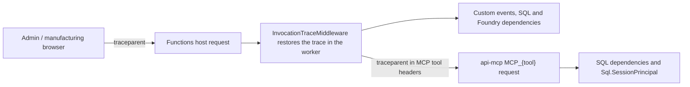
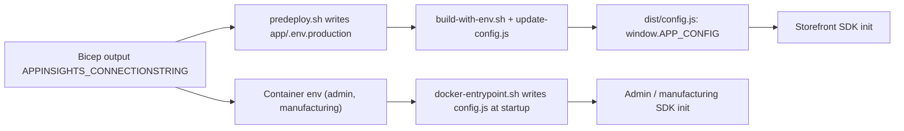

# Monitoring and telemetry

All AdventureWorks services send telemetry to one solution-wide Application Insights resource (`av-appinsights-<token>`), which is backed by a Log Analytics workspace. Each service reports its own `cloud_RoleName`, so it appears as a separate node in the Application Map. Monitoring is read-only. Use it to diagnose problems, then fix them in source and redeploy, as described in [Deployment lifecycle](deployment.md).

## Resources

| Resource | Configuration ([`infra/modules/applicationinsights.bicep`](../../infra/modules/applicationinsights.bicep)) |
| --- | --- |
| Log Analytics workspace | `PerGB2018`, 30-day retention, 1 GB/day ingestion cap. Once the cap is reached, telemetry stops until the next day. |
| Application Insights | Workspace-based web component. Local (connection-string) authentication stays enabled because browser SDKs cannot use managed identity. |

The connection string is **not a secret**. It only allows telemetry to be sent, not read, so it is safe to place in browser configuration.

## Telemetry by service

| Service | Mechanism | `cloud_RoleName` |
| --- | --- | --- |
| `app` (storefront) | `@microsoft/applicationinsights-web` ([`appInsights.ts`](../../app/src/lib/appInsights.ts)) | `app-eshop` |
| `app-admin` | `@microsoft/applicationinsights-web` ([`appInsights.ts`](../../app-admin/src/lib/appInsights.ts)) | `app-admin` |
| `app-manufacturing` | `@microsoft/applicationinsights-web` ([`appInsights.ts`](../../app-manufacturing/src/lib/appInsights.ts)) | `app-manufacturing` |
| `api` (DAB) | Built-in DAB telemetry (`runtime.telemetry.application-insights` in [`dab-config.json`](../../api/dab-config.json)) | `DataApiBuilder` |
| `api-functions` | Functions host plus `Microsoft.ApplicationInsights.WorkerService` and [`InvocationTraceMiddleware`](../../api-functions/Functions/InvocationTraceMiddleware.cs) | `av-func-<token>` |
| `api-mcp` | `Microsoft.ApplicationInsights.AspNetCore`, with a cloud-role-name telemetry initializer | `api-mcp` |
| `manufacturing-agent` | Hosted-agent OpenTelemetry (`OTEL_SERVICE_NAME` in [`azure.yaml`](../../azure.yaml)) | `manufacturing-agent` |
| `mcp-inspector` | [`telemetry.mjs`](../../mcp-inspector/telemetry.mjs): request telemetry with fixed route labels | `mcp-inspector` |
| `seed-job` | [`SeedTelemetry.psm1`](../../seed-job/SeedTelemetry.psm1): custom events only | `seed-job` |

Server-side services read `APPLICATIONINSIGHTS_CONNECTION_STRING`. When the value is missing or invalid, the Inspector gateway and the seed job simply send nothing. Do not add the OpenTelemetry Azure Monitor distro (`UseAzureMonitor`) to `api-mcp`. Combining it with the classic SDK suppresses request telemetry and duplicates dependencies.

## Sampling and trace correlation

**Sampling.** Adaptive sampling keeps telemetry volume down, but it never drops custom events or exceptions, so authorization decisions, identity evidence and business events are always complete.

| Component | Setting | Never sampled |
| --- | --- | --- |
| Functions host | [`host.json`](../../api-functions/host.json) `samplingSettings` | Requests, events, exceptions |
| Functions worker ([`Program.cs`](../../api-functions/Program.cs)) | SDK default sampling turned off, then adaptive sampling re-added at 20 items per second | Events, exceptions |
| api-mcp ([`Program.cs`](../../api-mcp/AdventureWorks/Program.cs)) | Same as the Functions worker | Events, exceptions |

Dependencies and traces (and api-mcp requests) can be sampled. When you count them, use `sum(itemCount)` rather than `count()`.

**Correlation.** Application Insights links telemetry through the W3C trace ID, which appears as `operation_Id`.



- **Functions.** In the isolated worker, the current trace is not always the host invocation's trace. [`InvocationTraceMiddleware`](../../api-functions/Functions/InvocationTraceMiddleware.cs) runs for every invocation. When the trace differs, it starts an `Invocation` activity parented to the host's `traceparent`, so custom events, SQL dependencies and outbound calls share the caller's `operation_Id`. AI routes also start named activities and request operations (listed under [Azure Functions](#azure-functions)).
- **api-mcp.** Each tool call runs inside an `MCP_{tool}` request operation. Functions passes a W3C `traceparent` to the MCP tools that Foundry agents call.
- **Browsers.** The admin and manufacturing apps send W3C correlation headers only to their own DAB, Functions and MCP hosts (`correlationHeaderDomains`). The storefront turns on CORS correlation for its API calls.
- **MCP Inspector.** The gateway reuses the trace ID from an incoming `traceparent` header and otherwise generates one.
- **Seed job.** All events from one run share a random operation ID.

## Custom events

### Storefront

| Event | When | Properties |
| --- | --- | --- |
| `User_Login`, `User_Signup` | Sign-in or account creation | userId (BusinessEntityID) |
| `User_Logout` | Sign-out | userId |
| `Product_View` | Product page viewed | productId, productName, category, subcategory, price |
| `Product_AddToCart` | Item added to cart | productId, productName, quantity, price, size, color |
| `Purchase_Complete` | Checkout completed | orderId, customerId, revenue, tax, shipping, itemCount, items |
| `Order_ReceiptResent` | Receipt re-sent | order identifiers |
| `Page_NotFound` | 404 route rendered | path |
| `HelpMeChoose*` | Help-me-choose wizard steps | step details |

Custom event properties carry no email addresses or names; users are identified only by their BusinessEntityID, which is also set as the authenticated user context. `app/scripts/telemetry-privacy.test.mjs` fails if a `trackEvent` call in any of the three frontends sends an email or name property. When no connection string is configured, for example during local development, every tracking call does nothing.

### Browser telemetry in all three frontends

The storefront, admin and manufacturing apps share the same baseline. Each sends a page view for the initial load (automatic route tracking only covers later in-app navigations), plus route changes, page visit time, AJAX dependencies and unhandled exceptions and promise rejections. Every item is tagged with the app's own `cloud_RoleName`. The admin and manufacturing apps send no custom events.

To confirm that each deployed site's telemetry reaches Application Insights, run [`tests/scripts/test-frontend-telemetry.mjs`](../../tests/scripts/test-frontend-telemetry.mjs). It loads each site anonymously in headless Chromium (Playwright from `app/node_modules`) and blocks every request except the page, its assets and the telemetry POST. It then checks that Application Insights accepted the batch and that every item carries only that site's role. It signs nobody in and makes no API calls.

```bash
APP_URL=$(azd env get-value APP_URL --no-prompt) \
APP_ADMIN_URL=$(azd env get-value APP_ADMIN_URL --no-prompt) \
APP_MANUFACTURING_URL=$(azd env get-value APP_MANUFACTURING_URL --no-prompt) \
node tests/scripts/test-frontend-telemetry.mjs --output .auth-results/frontend-telemetry.json
```

### Azure Functions

| Area | Events and metrics |
| --- | --- |
| Agent chat | `Agent.ChatRequest`, `Agent.ChatSuccess`, `Agent.ConversationCompleted`, `Agent.GuardrailBlocked`, `Agent.InvalidRequest` |
| Foundry Responses | `Foundry.Responses.Completed`, plus the metrics `Foundry.Responses.InputTokens`, `Foundry.Responses.OutputTokens` and `AI.Embeddings.AverageDurationMs` |
| Help me choose | `HelpMeChoose.*` |
| Shopping simulator | `ShoppingSimulator.Started`, `.Stopped`, `.AutoStopped`, `.Tick`, `.QueueCleared`; `SimulationOrder.Enqueued`, `.Success`, `.Failed` |
| AI agents | `OrderGeneration.Success`, `PromotionAgent.Success`, `ProductContentAgent.Success`, `CartRecoveryAgent.Complete`, `TranslationAgent.ProductTranslated`, `EmbeddingsGenerated` |
| Business workflows | `SupplyChainOrder`, `BankTransaction`, `BankSeeded`, `OrderDelivery.BatchProcessed`, `AutoPromotion.Created`, `AutoPromotion.ExpiredOutOfStock` |

AI calls are wrapped in request operations, so one operation ID links each call with its Foundry dependencies. The operations are:

- `AgentChat`
- `HelpMeChoose.GetQuestions`, `HelpMeChoose.GetRecommendations`
- `OrderGeneration.Generate`
- `PromotionAgent.Generate`
- `ProductContentAgent.Generate`
- `CartRecoveryAgent.Analyze`
- `CustomerGeneration.Generate`
- `EmailContentAgent.Generate`
- `ReviewAgent.GenerateReview`
- `ReviewAnalysisAgent.Analyze`
- `ReviewBatchAgent.Replies`
- `TranslationAgent.TranslateProduct`, `TranslationAgent.TranslateText`
- `GenerateEmbeddings`

When order notification email is disabled (the default), the intended email content is logged with the prefix `[EmailNotifications disabled]`.

**Foundry call failures.** When the Foundry Responses API returns an error, `FoundryAgentClient` logs an error trace with the HTTP status and these diagnostic fields. It never logs the response body, because error messages can echo prompts or tool output.

| Field | Meaning |
| --- | --- |
| `ErrorCode`, `ErrorType` | The `error.code` and `error.type` values, only when they look like identifiers (otherwise `other`, or `none` when absent) |
| `RemainingTokens`, `RemainingRequests` | The `x-ratelimit-remaining-tokens` and `x-ratelimit-remaining-requests` headers (`none` when absent) |
| `RequestBytes` | Request size, split into `InstructionBytes`, `InputBytes`, `ToolBytes` and `StructuredInputBytes` |

Help me choose, order generation and the manufacturing content and diagram agents retry throttled or unavailable responses (HTTP 429, 502, 503 or 504) up to twice. They wait for the `Retry-After` delay, or 3 and then 6 seconds, limited to 1–15 seconds. Each retry logs the warning `Foundry agent {AgentId} returned {Status}; retrying after {Seconds}s`.

### api-mcp and seed job

| Event | Source | Properties |
| --- | --- | --- |
| `MCP_ToolExecuted` | api-mcp | tool |
| `McpToolAuthorization` | api-mcp | tool, subject, category, app, requiredScope, outcome, allowed (`true`/`false`), correlationId |
| `Sql.SessionPrincipal` | api-mcp, api-functions, seed job | Which SQL principal served the connections (see below) |
| `Seed.Completed` | seed job | Mode, Outcome (`succeeded`/`failed`), DurationSeconds, ScriptVersion |

### SQL session principal (`Sql.SessionPrincipal`)

This event answers a simple question: *did the database see the managed identity we expected?* Each service asks SQL Server who it is (`SELECT SUSER_SNAME(), SUSER_SID()`) and compares the answer with its configured managed identity client ID (`AZURE_CLIENT_ID`). Only SHA-256 hashes and categorical results are exported, never the client ID, login name or connection string.

- **api-mcp and Functions** ([`SqlPrincipalTelemetry.cs`](../../api-mcp/AdventureWorks/Telemetry/SqlPrincipalTelemetry.cs), compiled into both). A background probe uses a separate connection built from the same connection string, so it uses the same credential as the pooled connections. The probe repeats every 10 minutes, or after 30 seconds if it fails. A listener on SqlClient connection-open events then emits the event once per trace and scope, using the latest probe result. The scope is `tool:<name>` for an MCP tool call and `function:<name>` for a Functions invocation (`none` outside those). Connections opened outside a trace are not reported.
- **Seed job** ([`SeedTelemetry.psm1`](../../seed-job/SeedTelemetry.psm1)). The seed job sends one event after it connects to SQL, with scope `seed:<mode>`. Its expected identity is the seed managed identity.

| Property | Values |
| --- | --- |
| `Service` | `api-mcp`, `api-functions` or `seed-job` |
| `Scope` | `tool:<name>`, `function:<name>`, `seed:<mode>` or `none` |
| `PrincipalMatch` | `match`, `mismatch`, `unverified` (the principal could not be read as a client ID), `unconfigured` (no valid `AZURE_CLIENT_ID`) or `pending` (no probe result yet) |
| `ServerPrincipalHash`, `ExpectedClientHash` | SHA-256 of the observed and expected client IDs (`unknown` or `unconfigured` when not available) |
| `PrincipalSource` | `login-name` (Entra login `clientId@tenantId`), `sid` (16-byte SID of a contained external user) or `none` |
| `ConnectionMatchesProbe` | `true` when the opened connection targets the same server, database, authentication mode and user as the probe |
| `VerifiedAgeSeconds` | Age of the probe result (`-1` before the first result; always `0` for the seed job) |

A non-`match` probe result is also logged as a warning (`SQL session principal comparison for {Service} is {Match}`).

### Seed job runs (`Seed.Completed`)

The seed job sends `Seed.Completed` from its final block when a run that reached the SQL connection step finishes, successfully or not. `Mode` is `full`, `guest-carts`, `realtime-notifications`, `manufacturing-overlays` or `manufacturing-overlays-verify`. `ScriptVersion` is the first 8 characters of the script's SHA-256 hash. Telemetry failures are ignored, so they never change the seed result. The seed job sends no SQL text, row data or tokens. See [Seed job](../services/seed-job.md#monitoring).

### MCP Inspector requests

The Inspector gateway sends one request item per HTTP request. The item holds the method, a fixed route label, the status code, the duration and success (status below 500). Known routes such as `/auth/login`, `/oauth/callback` and `/proxy/mcp` keep their path. Other `/proxy/` paths are reported as `/proxy/*` and everything else as `/assets/*`. Query strings (which carry OAuth codes and state), headers, cookies and bodies are never sent. Items are buffered (up to 500, oldest dropped first) and sent every 5 seconds, and again when the container stops. See [MCP Inspector](../apps/mcp-inspector.md#telemetry).

## How browser apps get the connection string



- **Storefront.** `scripts/hooks/predeploy.sh` writes `VITE_APPINSIGHTS_CONNECTIONSTRING` to `app/.env.production`. Then [`app/scripts/build-with-env.sh`](../../app/scripts/build-with-env.sh) runs the build: `update-config` writes `public/config.js`, Vite builds, and `post-build-config` copies the file to `dist/config.js`. `index.html` loads `/config.js`, which sets `window.APP_CONFIG.APPINSIGHTS_CONNECTIONSTRING`.
- **Admin and manufacturing.** Each container's `docker-entrypoint.sh` writes `config.js` from its environment variables at startup, so no rebuild is needed when a value changes.

To check the setup, open the browser console and look for the Application Insights initialization message. Then use Live Metrics or query `customEvents` for the `cloud_RoleName` you expect.

## Health and readiness

Liveness does not prove that dependencies work. Use the sanitized readiness contracts instead:

- Functions `GET /api/health/readiness` checks SQL, storage queues/tables/containers, OAuth and the other dependencies.
- MCP `GET /ready` checks `sql`, `sql-identity` and `tasks`.
- The storefront `/health` page uses both of these. See [Health diagnostics](../features/monitoring/HEALTH_DIAGNOSTICS.md).

DAB's own `/health` endpoint probes entities anonymously. Most entities require a role, so it reports `Unhealthy` even when authenticated traffic works. Do not use it as a readiness signal.

No Azure Monitor alerts or availability tests are provisioned. Web PubSub runs on the Free tier, which allows 20 concurrent connections and 20,000 messages per day, and there is no alert on that quota either. Check usage in the Web PubSub metrics blade when live updates stop during heavy simulation.

## Diagnostic queries

Run these in the Application Insights **Logs** blade, or with the read-only `az monitor app-insights query --app <app-name> --analytics-query "<query>"`.

**Failed requests by service**

```kusto
requests
| where timestamp > ago(1h) and success == false
| summarize count() by cloud_RoleName, name, resultCode
| order by count_ desc
```

**Manufacturing `WorkOrder` HTTP 500.** This query links each failed DAB read to its SQL dependency through `operation_Id`:

```kusto
let failedReads = requests
| where timestamp > ago(1h)
| where cloud_RoleName == "DataApiBuilder"
| where url contains "/api/WorkOrder?" and resultCode == "500"
| project operation_Id;
dependencies
| where timestamp > ago(1h)
| where operation_Id in (failedReads)
| project timestamp, operation_Id, name, resultCode, success
```

SQL dependency result code `10928` means the database worker limit was reached. It does not indicate an invalid `$first` or `$orderby` parameter. The manufacturing real-time dispatcher groups bursts of events into fixed two-second windows and reuses reads that are already in flight, which limits concurrent reads. If `10928` persists, look at other backend workloads that run concurrently, such as simulators.

**Storefront conversion funnel**

```kusto
customEvents
| where cloud_RoleName == "app-eshop"
| where name in ("Product_View", "Product_AddToCart", "Purchase_Complete")
| summarize count() by name
```

**AI token usage**

```kusto
customMetrics
| where timestamp > ago(1d)
| where name in ("Foundry.Responses.InputTokens", "Foundry.Responses.OutputTokens")
| summarize sum(value) by name, bin(timestamp, 1h)
```

**MCP authorization denials**

```kusto
customEvents
| where name == "McpToolAuthorization" and tostring(customDimensions.allowed) == "false"
| summarize count() by tool = tostring(customDimensions.tool), scope = tostring(customDimensions.requiredScope)
```

**SQL principal evidence by service and scope.** Any row other than `match` with `ConnectionMatchesProbe == "true"` is worth investigating:

```kusto
customEvents
| where timestamp > ago(1d) and name == "Sql.SessionPrincipal"
| extend service = tostring(customDimensions.Service), scope = tostring(customDimensions.Scope),
         principalMatch = tostring(customDimensions.PrincipalMatch),
         sameTarget = tostring(customDimensions.ConnectionMatchesProbe)
| summarize events = count(), lastSeen = max(timestamp) by service, scope, principalMatch, sameTarget
| order by service asc, scope asc
```

**Everything in one Functions invocation.** Replace the operation ID with one from a failed request:

```kusto
union requests, dependencies, customEvents, exceptions, traces
| where timestamp > ago(1d) and operation_Id == "<operation-id>"
| project timestamp, itemType, cloud_RoleName, name, resultCode, message
| order by timestamp asc
```

**Seed runs**

```kusto
customEvents
| where timestamp > ago(7d) and cloud_RoleName == "seed-job"
| where name in ("Seed.Completed", "Sql.SessionPrincipal")
| project timestamp, name, operation_Id, mode = tostring(customDimensions.Mode),
          outcome = tostring(customDimensions.Outcome), seconds = toint(customDimensions.DurationSeconds),
          scope = tostring(customDimensions.Scope), principalMatch = tostring(customDimensions.PrincipalMatch)
| order by timestamp desc
```

**Foundry throttling.** Lists failed Responses calls with their error code and remaining quota:

```kusto
traces
| where timestamp > ago(1d) and message startswith "Foundry Responses API returned"
| project timestamp, operation_Id, status = tostring(customDimensions.Status),
          errorCode = tostring(customDimensions.ErrorCode),
          remainingTokens = tostring(customDimensions.RemainingTokens),
          requestBytes = toint(customDimensions.RequestBytes)
| order by timestamp desc
```

## Web PubSub blocked by Content Security Policy

When the browser reports that a `wss://...webpubsub.azure.com` connection violates the page's CSP, the page still loads but live updates are unavailable. This is a browser policy failure, not a Web PubSub authentication problem.

The storefront's [`staticwebapp.config.json`](../../app/staticwebapp.config.json) and its template both set `connect-src 'self' https: data: blob: wss://*.webpubsub.azure.com`. Keep the two files in sync, because `predeploy.sh` regenerates the config from the template. Fix the source, run `azd deploy app --no-prompt`, and reload. In the browser developer tools, confirm that the document's `Content-Security-Policy` header contains `connect-src` and that the WebSocket handshake returns HTTP 101. Never copy the negotiate URL's access token into logs or documentation.

## Related

- [Health diagnostics](../features/monitoring/HEALTH_DIAGNOSTICS.md)
- [Troubleshooting](troubleshooting.md)
- [Real-time eventing](../architecture/realtime-eventing.md)
- [Environment variables](../reference/environment-variables.md)
