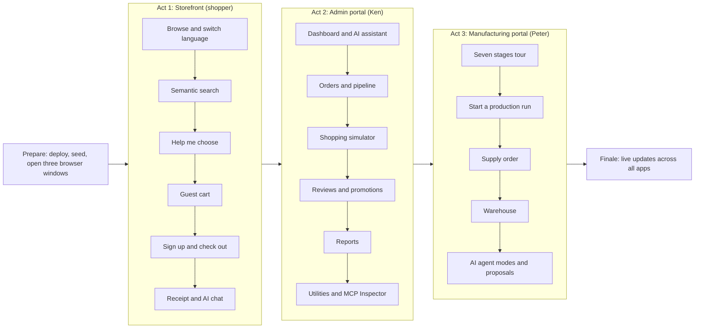

# AdventureWorks demo walkthrough (15–30 minutes)

This script walks a presenter through the deployed AdventureWorks demo in three acts — the shopper's
storefront, the back office and the factory — finishing with live updates flowing between them. Each
act takes 5–10 minutes; skip steps to fit your time slot.

## Before you start

1. Deploy with the [Quickstart](../../QUICKSTART.md) and wait until the storefront `/health` page
   reports the seed job as completed.
2. Print the URLs with `bash scripts/utilities/list-app-urls.sh`.
3. Open three browser windows side by side: storefront, admin portal and manufacturing portal. Load
   the admin and manufacturing portals once beforehand — Container Apps scale to zero and the first
   request takes a few seconds.
4. Sign in to the admin portal as **Ken** (`ken0@adventure-works.com`, executive-admin) and to the
   manufacturing portal as **Peter** (`peter0@adventure-works.com`, manufacturing-engineer) using the
   click-to-fill demo identity on each login page.

## Act 1 — Storefront: the shopper (5–10 minutes)

| Step | Do this | Point out |
| --- | --- | --- |
| 1 | Open the home page, pick a category, open a product. | A 1990s sample database rendered as a modern React store; AI-generated product photos loaded by the seed job; data served by Data API builder GraphQL. |
| 2 | Switch the language (for example to Japanese or German) and the currency. | 23 locales with AI-translated product names and live currency conversion. |
| 3 | Search for something descriptive, such as "something light for long road rides". | Semantic vector search over embeddings stored in Azure SQL, not keyword matching. |
| 4 | Open **Help me choose** and answer the questions. | A Foundry agent calls MCP catalog tools to recommend real products. |
| 5 | Add two or three products to the cart without signing in; optionally add some to **Compare**. | Server-side guest cart keyed by a guest session token. |
| 6 | Choose **Sign up**, create an account and return to the cart. | The guest cart merges into the new account; sign-in uses the api-mcp OAuth server. |
| 7 | Check out and view the order confirmation, then **Account** → orders. | The order is written through Functions; a SQL change trigger starts the simulated order pipeline and generates a PDF receipt. |
| 8 | Open the AI chat and ask "Where is my latest order?" or for accessories for the bike you bought. | The chat agent calls MCP tools on the customer's behalf with a token limited to their own data, behind a Responsible AI policy. |

## Act 2 — Admin portal: the back office as Ken (5–10 minutes)

| Step | Do this | Point out |
| --- | --- | --- |
| 1 | Show the dashboard; ask the AI assistant "What are our top-selling products this month?" | Admin chat agent with read-only business MCP tools. |
| 2 | Open **Orders** and find the order placed in Act 1. | It advances on its own from Pending to Approved, Shipped and Delivered on simulated timings. |
| 3 | Open **Order pipeline** (via Orders/Utilities) and shorten the timings or promote pending orders. | Pipeline settings live in Table Storage and changes push to every open window. |
| 4 | Open **Shopping simulator**, set a low rate (for example 2 orders/minute) and a 1-hour duration, then start it. | An AI order agent places realistic consumer and B2B orders; the simulator always stops automatically. |
| 5 | Open **Reviews** and run AI analysis/approval on pending reviews. | Review analysis agent writes moderation replies. |
| 6 | Open **Promotions** and generate a promotion with the AI wizard; refine it with a follow-up prompt. | Multi-turn Foundry agent conversation. |
| 7 | Open **Reports** and **Product profitability**. | Pre-aggregated SQL reporting through Functions, filtered by channel. |
| 8 | Open **Utilities** and follow the MCP Inspector link. | Sign in through OAuth and list the 63 api-mcp tools, each with its own scope. |

## Act 3 — Manufacturing portal: the factory as Peter (5–10 minutes)

| Step | Do this | Point out |
| --- | --- | --- |
| 1 | Walk the header tabs: Define, Engineer, Plan, Execute, Supply, Receive, Warehouse. | A full make-to-order flow on the AdventureWorks production schema. |
| 2 | **Define** → open a bike model's instructions. | AI-generated assembly instructions and SVG illustrations. |
| 3 | **Engineer** → open a BOM and its routing. | Bills of materials and work-center routings from the original data. |
| 4 | **Plan → Demand** or **Planning intelligence**: schedule a run for a product with open demand. | Feasibility checks explode the BOM and create sub-assembly work orders. |
| 5 | **Execute → Shop floor**. | Operations progress live through work centers, with scrap and material shortages. |
| 6 | **Supply** → open a vendor, get a quote and place a purchase order. | Simulated vendor lead times; receipt adds inventory and debits the simulated bank (**Plan → Finance**). |
| 7 | **Warehouse → Floor**. | Simulated store, retrieve and supplier-receive operations; retrieving stock ships approved orders. |
| 8 | **AI Agent**: set mode **Propose + Approve**, place an order in the storefront, then approve or reject the proposal. Optionally try **Fully Autonomous** with a short auto-shutoff. | The hosted Manufacturing agent reacts to new orders via MCP tools; autonomous actions are allowed only in mode 3 and before auto-shutoff; proposals expire after five minutes. |

## Finale — live updates

Keep all three windows visible while the shopping simulator runs or while you place another
storefront order:

- New orders update the admin dashboard without refreshing.
- Work orders, shop-floor operations, purchase orders and warehouse activity update in the
  manufacturing portal.

Every update is pushed by Azure Web PubSub after a server-side change; no page polls. See
[Real-time eventing](../architecture/realtime-eventing.md).

## Cost and clean-up notes

- **AI calls cost money.** Search, Help me choose, chat, content generation, the shopping simulator
  and the Manufacturing agent all call Foundry models. Use low simulator rates.
- **The shopping simulator auto-stops** after its configured duration (1–72 hours, default 24). Stop
  it explicitly when the demo ends, and set the Manufacturing agent back to **Off**.
- **Web PubSub Free tier** allows 20 concurrent connections and 20,000 messages per day; long
  high-rate simulations can exhaust it, after which apps show "live updates unavailable".
- **Idle cost continues** until you run `azd down --no-prompt`.
