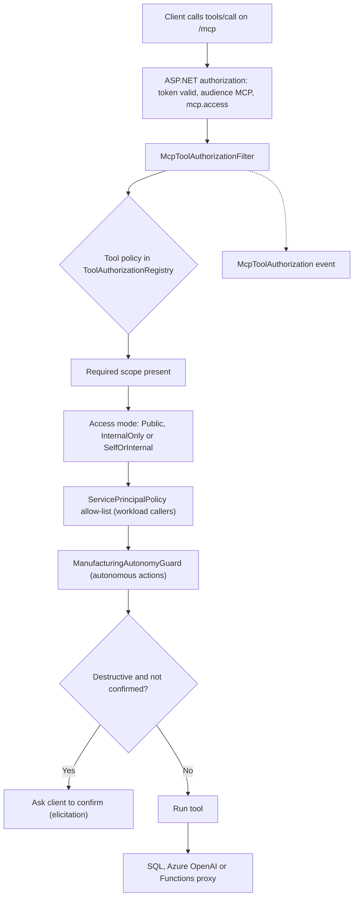

# api-mcp: OAuth authorization server and MCP server

The `api-mcp` service is one ASP.NET Core (.NET 10) process in [`api-mcp/AdventureWorks/`](../../api-mcp/AdventureWorks/) with two jobs:

- **OAuth authorization server.** It signs in AdventureWorks database users and trusted Azure workloads, and issues JWTs that are bound to one resource: MCP, DAB or Functions.
- **MCP server.** It serves 63 tools at `/mcp`, each checked against a per-tool authorization policy.

This page covers how the service runs. The security design (clients, grants, scopes, roles and ownership rules) is in the [OAuth server design](../features/mcp-oauth/README.md).

## Endpoints

| Path | Purpose |
|---|---|
| `/.well-known/openid-configuration`, JWKS | Authorization-server metadata and signing keys |
| `/.well-known/oauth-protected-resource` | Protected-resource metadata for `/mcp` |
| `/authorize`, `/token` | Authorization code with PKCE (S256), refresh token, and the custom e-shop credentials and managed-identity grants |
| `/login`, `/logout` | Sign-in page and sign-out |
| `/mcp` | MCP Streamable HTTP endpoint (requires a token with `mcp.access`) |
| `/health`, `/alive` | Liveness |
| `/ready` | Readiness |

The `API_MCP_URL` and `MCP_SERVICE_URL` azd outputs end in `/mcp`. Strip it to get the issuer base URL.

## Tokens

- Tokens are RS256 JWTs signed with the `mcp-signing` certificate, which api-mcp reads from Key Vault (`MCP_SIGNING_KEY_VAULT_URI`, `MCP_SIGNING_CERTIFICATE_NAME`) with its managed identity.
- Each token's audience is one resource: `<issuer>/mcp`, `<issuer>/dab` or `<issuer>/functions`. DAB and Functions validate the issuer and their own audience.
- Tokens are self-contained. The OpenIddict client and scope store is an in-memory EF Core database that is rebuilt on every start, so there is no token database.
- First-party clients are `adventureworks-eshop`, `adventureworks-admin`, `adventureworks-manufacturing` and `adventureworks-inspector`. Azure workloads (the Functions app and the hosted Manufacturing agent) use `adventureworks-agents` with the managed-identity grant.

## MCP tools

The server is registered with `AddMcpServer().WithHttpTransport().WithToolsFromAssembly().WithTasks(...)` and mapped with `MapMcp("/mcp").RequireAuthorization("mcp")`. The transport is Streamable HTTP, not SSE.

There are **63 tools** in six classes in [`Tools/`](../../api-mcp/AdventureWorks/Tools/):

| Class | Tools | Backend |
|---|---|---|
| `AdventureWorksMcpTools` | 20 | SQL directly (orders, products, reviews; vector search uses the `embedding` deployment) |
| `ManufacturingMcpTools` | 20 | Functions proxy |
| `SupplyChainMcpTools` | 11 | Functions proxy (one tool reads `Purchasing` tables in SQL) |
| `BankMcpTools` | 9 | Functions proxy |
| `CustomerGeneratorMcpTools` | 2 | In-process random customer profiles (Bogus); no data access |
| `SimulatorMcpTools` | 1 | Functions proxy |

Every tool, with its scope, access mode and allowed service principals, is in the [tool scope matrix](../features/mcp-oauth/TOOL_SCOPE_MATRIX.md).

### Tool-call pipeline

- **Policy coverage.** Each tool must have an entry in `ToolAuthorizationRegistry` ([`ToolAuthorizationPolicy.cs`](../../api-mcp/AdventureWorks/Auth/ToolAuthorizationPolicy.cs)). At startup, `ValidateToolAuthorizationCoverage` stops the app if any discovered tool lacks one, and `ToolAuthorizationRegistryTests` checks the count. **To add a tool**, add the method, add its registry entry, and update the tool scope matrix.
- **Ownership.** For `SelfOrInternal` tools, a consumer's customer ID is taken from the token and replaces any ID in the arguments; a mismatch is denied.
- **Confirmation.** `begin_manufacturing_run`, `stop_manufacturing`, `update_scrap_configuration`, `update_location_configuration` and `reset_all_simulators` ask the client to confirm through MCP elicitation unless called with `confirmed=true`.
- **Proposals.** `propose_*` tools create proposals that a person approves in the manufacturing portal.
- **Tasks.** Long-running calls can run as MCP Tasks. `AzureTableMcpTaskStore` keeps them in the `awMcpTasks` table, bound to the caller's subject, client, tool and scope.
- **Tool list.** `tools/list` returns every tool; authorization is applied when a tool is called.

## Functions proxy

Manufacturing, supply-chain, bank and simulator tools call `api-functions` routes under `api/manufacturing/*`, `api/plan/*`, `api/supply/*`, `api/bank/*`, `api/financials/*` and `api/simulators/reset`.

- `FunctionsServiceTokenHandler` adds a 5-minute service JWT with the Functions audience, `sub` `service:api-mcp`, the scopes those routes need, and `obo_sub` set to the calling user for audit.
- Requests go only to the `API_FUNCTIONS_URL` origin. Redirects are not followed and there are no retries.
- Timeouts are 90 seconds per call, 200 seconds for simulator reset and 10 seconds for the autonomy guard check.

## Health and readiness

- `/health` and `/alive` are liveness checks.
- `GET /ready` checks SQL (required), the SQL identity and the task store, each with a 12-second timeout. It caches the result for 60 seconds and returns 200 or 503 without identifiers.

See [health diagnostics](../features/monitoring/HEALTH_DIAGNOSTICS.md).

## Telemetry

Application Insights uses cloud role name `api-mcp`. Adaptive sampling is limited to 20 items per second and never samples custom events or exceptions, so every authorization decision is recorded. Useful names:

| Telemetry | Meaning |
|---|---|
| `MCP_{tool}` request | One tool call |
| `MCP_ToolExecuted` event | Tool finished |
| `McpToolAuthorization` event | Authorization decision and reason |
| `Sql.SessionPrincipal` event | Whether the SQL principal matches the runtime identity (`AZURE_CLIENT_ID`), reported as hashes and a match result per tool (scope `tool:<name>`) |

Tokens, codes and PKCE verifiers are never logged. See [monitoring](../operations/monitoring.md#sql-session-principal-sqlsessionprincipal) for the event properties and queries. OTLP export runs only when `OTEL_EXPORTER_OTLP_ENDPOINT` is set.

## Hosting

| Setting | Value |
|---|---|
| Resource | Container app `av-mcp-*` ([`aca-api-mcp.bicep`](../../infra/modules/aca-api-mcp.bicep)) |
| Image | [`api-mcp/Dockerfile`](../../api-mcp/Dockerfile), remote build in ACR |
| Port | 8080, external HTTPS ingress |
| Size and scale | 1 CPU, 2 Gi, 0–1 replicas |
| Identity | Runtime managed identity for SQL, Key Vault, Storage and Azure OpenAI |

- `postdeploy.sh` sets the OAuth redirect URIs and trusted service principals on the container after each deployment.
- [`api-mcp/AppHost/`](../../api-mcp/AppHost/) is a .NET Aspire host for running api-mcp and Functions together locally. The container does not use it.

Settings are listed in [environment variables](../reference/environment-variables.md#oauth-and-mcp-server-api-mcp).

## Deploying, calling and testing

- Deploy with `azd deploy api-mcp --no-prompt`.
- Get tokens for any resource with [`azure-auth.py`](../../scripts/utilities/azure-auth.py), for example `python3 scripts/utilities/azure-auth.py token --identity manufacturing --resource mcp`. Do not print tokens.
- Use the [MCP Inspector](../apps/mcp-inspector.md) to browse and call tools interactively.
- Tests are in [`api-mcp/AdventureWorks.Tests/`](../../api-mcp/AdventureWorks.Tests/): `dotnet test api-mcp/AdventureWorks.Tests`.
